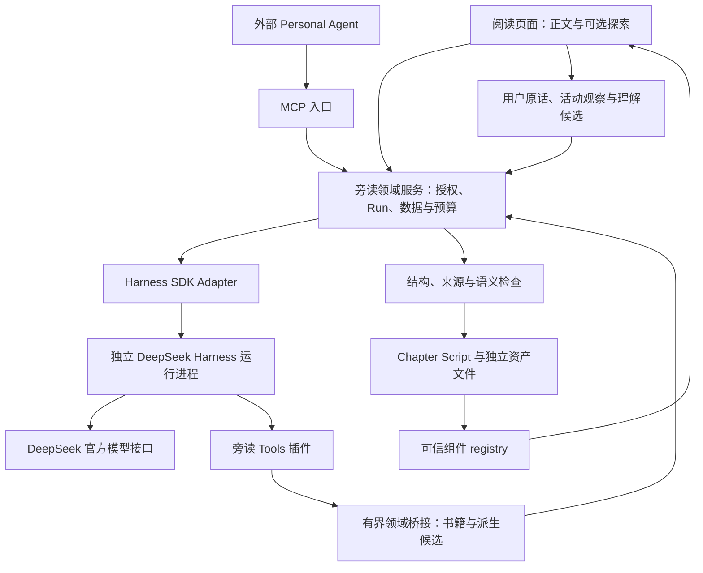

# 旁读 · DeepSeek Harness 系统设计

2026-10-12。用户指定使用官方 DeepSeek Harness 作为 Agent 内核，并提供本机 API 凭证；随后明确授权四条阅读故事的实现。当前已有官方 SDK + 回声插件与真实网页链路，透视/站队采用预载候选资产，技术验证与学习效果分开报告。最新实现范围见 [四条阅读体验](four-reading-experiences-implementation.md)。下文保留完整体系设计，其中全书语义地图、跨书读者模型和外部 MCP 仍属后续部分。

## 产品目标与实现基线

旁读帮助一个真心想深入一本书的人，在完整正文中持续阅读，获得合适的解释或探索，并留下自己的理解。翻译是工具之一。阅读体验、归属感、投入时间和用户的数据控制，继续决定功能取舍。

已有本机 Node + HTML/JS 服务，入口为 [本机阅读](http://127.0.0.1:8330/)。七章、101 节、579 段均有直译和意译草稿；来源与译文尚未逐段完成本人审阅。已有评论、问题、进度与导出，私人记录采用原子 JSON 写入。Book Map、Reader Model、Harness、可信探索组件与 MCP 尚未接入。

用户已经确定模型供应商与 Harness；下文的默认模型、预算、组件和阶段安排是工程设计提案。不会因此批量重译现有全书、发布仓库或开启每天的通知。

## 采用哪条接入路线

采用独立 Harness 进程，通过官方 TypeScript SDK 接入当前 Node 服务。旁读拥有用户界面、领域数据和访问判断；Harness 拥有模型循环与工具运行。版本化 Chapter Script 将二者连接。

直接把 Harness Web UI 嵌入旁读会省去部分接入工作，但它的通用会话与工具界面不适合当前纯正文体验。直接调用 DeepSeek API 自建循环容易起步，却不能满足使用官方 Harness 内核的要求。将 SDK 作为内部 Adapter，能保留当前阅读页面，也能使用真实 Harness。

桥接访问和模型生成不占用读取正文的路径。循环失败或供应商不可用时，正文与已有译文仍可读。

## 官方内核与版本

源码基线为 `deepseek-ai/deepseek-harness@d743267388641bc76f17c45ce8b4c231aed1d32c`。官方项目处于 developer preview；SDK、CLI、插件及 profile 用同一源码构建，依赖锁文件记录实际版本，不追随浮动 latest。

官方提供命名 profile、SDK JSON-RPC、工具 registry 与会话事件。选择 `sdk-minimal` 作为显式配置的起点，叠加旁读自己的启动 patch。原模板面向代码 Agent，默认含持久 shell；阅读 profile 必须禁用这些工具，不能直接拿原模板作为产品运行配置。

默认 `provider = deepseek-official`，`model = deepseek-flash`；2026-10-12 的账户模型发现返回 Flash 与 `deepseek-v4-pro`。官方 SDK 示例中的旧 Flash 名称不能取代实际模型发现结果。初始化显式传模型，不依赖示例默认值。

Harness 官方 API-key Adapter 使用 DeepSeek 的 Anthropic Messages 兼容接口，凭证引用为 `DEEPSEEK_API_KEY`。普通 Chat Completions 往返只验证该 API 路径；Messages 路径、SDK 握手和真实工具执行分别验收。模型的推理内容不作为教学说明或理解证据显示给读者。

来源：[官方仓库](https://github.com/deepseek-ai/deepseek-harness)、[SDK Client](https://github.com/deepseek-ai/deepseek-harness/blob/d743267388641bc76f17c45ce8b4c231aed1d32c/packages/sdk/client/README.md)、[API-key Adapter](https://github.com/deepseek-ai/deepseek-harness/blob/d743267388641bc76f17c45ce8b4c231aed1d32c/packages/llm/llm-deepseek-api-key/README.md)、[Messages 兼容接口](https://api-docs.deepseek.com/guides/anthropic_api/)。

## 阅读 profile 与插件职责

`sdk-minimal` 的 patch 禁用 `persistent-bash`、`persistent-pwsh` 和 `tool-working-directory`。工具呈现使用 native 模式，保留 kernel 必要依赖，不挂 PTC 的代码执行能力。sandbox-policy 改为 read-only，工作目录只指向该 Run 的临时目录；会话日志在独立私人 Harness home。

旁读首批插件分成三个模块。`reader-context` 提供书籍范围与当前阅读目标；`reader-tools` 通过有界领域桥接注册阅读和候选生成工具；`reader-policy` 检查工具身份、有效授权、Run 状态和预算，并结算可靠的产物。它们是本项目计划实现的插件名，不是已安装的官方包。

工具通过 `ctx.tools.register` 注册输入与输出契约。`ctx.tools.guard` 承担不能被后续插件放宽的拒绝规则；工具可见性过滤只改善模型上下文，不能代替访问检查。`tools/execute` 记录超时与开销，`tools/result` 接收最终结果。插件由应用安装，模型没有安装新插件的工具。

外部进程只能通过短期桥接凭证访问授权段落和候选资产。凭证由进程环境传入，不进入模型 prompt，绑定 Run 和 bookId，过期或撤回后拒绝。所有写入先产生候选，最终提交由旁读服务完成。桥接仅监听 loopback，并核对凭证与来源范围。

来源：[最小 profile](https://github.com/deepseek-ai/deepseek-harness/blob/d743267388641bc76f17c45ce8b4c231aed1d32c/packages/bundle/sdk-minimal/README.md)、[工具机制](https://github.com/deepseek-ai/deepseek-harness/blob/d743267388641bc76f17c45ce8b4c231aed1d32c/docs/subsystems/tools.md)、[Sandbox Policy](https://github.com/deepseek-ai/deepseek-harness/blob/d743267388641bc76f17c45ce8b4c231aed1d32c/packages/sandbox/sandbox-policy/README.md)。

## 原料、地图与翻译

原始文件、校对后的文本与译文分别版本化。原文 Passage ID 永久保留；重新提取引起拆分合并时记录映射，不根据数组位置移动评论。已有书籍包作为第一本输入，通用 PDF/EPUB 导入继续独立实施。

Book Map 按段落到章节再到全书建立。每项主张与关系都有 sourceRefs、类型、归属和核验状态。作者明说、编辑推断、外部比较分开；跨章关系能跳到具体原句。地图未覆盖或含歧义时仍能直接阅读，不能伪造完整论证。

离线处理采用有界任务队列。已完成的译文不重复生成；请求改译时新增版本。翻译输入含邻段、语境中的术语及必要的地图项，输出直译、意译和未决项。检查否定、条件、程度与指代；哲学解释及生活例子留在编辑注解，双译不互相冒充。模型自检不能升级本人审阅状态。

缓存键包含来源摘要、工具与 prompt 版本、语言及生成参数。含私人问题的缓存限定于该用户与授权上下文；权限收窄后不能返回旧的私人产物。公开体验包不得包含用户问题、API 凭证或默认附带整本书。

## Reader Model 与教学策略

显式目标和偏好优先。行为观察与理解候选分开，回答记录是否独立完成或使用了提示。停留、跳过和阅读时间用于安排节奏，不能自动推断困难或掌握。候选带证据、时间与适用概念，可纠正、到期和删除，不推断人格。

一个主要 Chapter Agent 先判断本段需要什么帮助。默认安静阅读；需要解释时先从原文取材；值得探索时提出一个明确目标。先让读者解释或预测，愿意继续再给提示、交换情境和核对。已有独立证据后减少支架，不持续增加按钮和活动。

用户可以直接看解释、跳过探索或保持不同立场。活动反馈检查理由及原文限定，不能以接受作者观点计分。章末整理引用自己的原始记录；未经接受的 AI 总结仍是候选。

## 能力目录与结果归属

| 能力 | 输入范围 | 产物 | 写入与条件 |
| --- | --- | --- | --- |
| read_context / read_passage | 指定书与有界段落 | 来源、版本、译文状态 | 只读，每次检查 grant |
| search_book / read_map | 已授权的检索与地图范围 | 有来源的命中 | 不暴露未知书名或任意文件 |
| translate | 用户发起的范围、目标语言与术语 | 独立双译候选 | 新版本，按批次审阅 |
| xray_argument | 原句、邻段与相关主张 | 依据、前提及疑点 | 编辑候选，不补造作者论证 |
| spawn_card | 一个理解目标与 sourceRefs | 提问、提示和反馈 | 可信组件参数，允许自由答案 |
| spawn_demo | 可解释的变化与假设 | 情境或模拟参数 | 标示类比/模拟及适用范围 |
| check_understanding | 获授权的回答与依据 | 有理由的反馈候选 | 不写成用户已掌握 |
| reflect_chapter | 选定原始个人记录 | 可接受的整理候选 | 明确接受后进入认可笔记 |
| restyle | 用户请求与可读性偏好 | design tokens | 不返回 CSS/HTML/外链脚本 |
| submit_script | 候选 Script 与来源依赖 | 资产引用与核验回执 | 幂等提交，不直接改变 UI |

首个体验只开放 read_context、read_passage、spawn_card 与 submit_script；既有翻译直接读取。其余能力保留接口职责，按验收开放。读取个人记录另有 scope，公开分享和删除不作为模型默认能力。

## 单次 Run 与费用

Host 的 prepare 输入为 bookId、chapterId、passageId、contentVersion、intent、用户时间预算及幂等键。grant、ownerId、费用上限由已认证的服务上下文决定，模型不能自行填入授权。

状态为 queued → starting → running → verifying → ready；失败分支为 failed、expired 或 interrupted，取消经过 cancelling → cancelled。ready 只表示产物满足当前验证条件，不代表本人审阅或用户学会。正文阅读不等待 Run。

初始单次体验限制为最多 4 个模型 step、8 次工具调用、每个请求最多 2,048 输出 token、60 秒总墙钟时间；修复包含在这些次数中。上下文正文默认当前段及前后各一段，扩展检索带总大小限制。大段任务在运行前改为离线批次，不能静默提高上限。默认费用预留上限为人民币 0.10 元/Run，可由实例调低；它是本产品的预算提案，不是 DeepSeek 报价。

请求前用最新官方单价和最坏输入/输出量预留费用；无法取得可信费率时，只读功能可用，生成返回 budget_not_ready。usage 结算实际用量，核算规则和费率版本保留；不能靠 maxTokens 单独保证花费。失败或断流缺少 usage 时显示待结算区间，不报告零费用，不自动改用 Pro。

计数覆盖实际模型请求，最多 4 次；规划、修复、核验与重试都占用同一限额。完整请求（含系统文本、工具定义与历史）默认最多 24 KiB UTF-8 文本，以保守 token 上界预留；活动图片第一版不上传。默认关闭 llm-retry 插件，Host 执行有次数记录的重试。禁止旁读生成工具内部再开启不受监管的模型循环。

## 取消、恢复与关联

每个 Run 有独立 runtime 与 session，不将两个用户动作排入同一共享会话。官方高层 run 返回收件到 idle 的区间结果，不能单凭最后一条文本判断它属于哪次请求。产物经 submit_script 绑定 hostRunId、来源版本与固定 sessionId；Host 根据收件回执和事件校验关联。

SDK 目前没有单次 prompt cancel 或 session-close 方法。取消先在 Host 标记 Run、撤回桥接 grant、拒绝后续提交，再调用 close 并确认进程退出；不等 SDK 出结果才恢复正文。若退出未确认，Run 保持 cancelling，不启动同 ID 的新实例。用户再尝试建立新的 attempt 与 grant。

硬进程中断后只恢复已经持久化并核验的资产，不假定 SDK 能从中断点恰好继续。queued 任务可重试；running 任务改 interrupted，再次请求从快照与明确的新 attempt 开始。一次写入或模型扣费是否已经发生不确定时，先对账，不能盲重放。

任务与模型历史隔离于用户书房记录。Harness 日志用于排障，但日志不是 Chapter Script 的完整备份；官方工具中间 value 不保证持久化。submit_script 将规范 JSON、依赖摘要和校验记录另存于旁读内容资产目录。

来源：[SDK Client 限制](https://github.com/deepseek-ai/deepseek-harness/blob/d743267388641bc76f17c45ce8b4c231aed1d32c/packages/sdk/client/README.md)、[SDK Protocol](https://github.com/deepseek-ai/deepseek-harness/blob/d743267388641bc76f17c45ce8b4c231aed1d32c/packages/sdk/protocol/README.md)。

## Script、组件与阅读页面

Script 只描述可信组件的数据及状态转换。第一组件 compare_purposes 对应《有限与无限的游戏》§1，读者解释两个目的并尝试交换目的；活动是编辑构造，反馈回到真实段落。没有任意代码执行、游戏排行榜或信念分数。

schemaVersion、原文摘要、组件版本、action 白名单和 returnAnchor 共同决定可执行性。JSON Schema 检查结构；应用检查引用范围、来源摘要、状态转换与权限；语义检查确认反馈没有扩大作者命题。第一活动人工核对，不能把机器校验写成 humanReviewed。

已有正文浮层增加一个“帮我理解”入口；显示本次会送出的范围。开始后仅显示简短进度与取消。完整候选核验后原子替换旁栏，不能把半截流式 JSON 渲染成页面。解释可以逐步显示已验证文本，旧的阅读位置始终保留。

默认一章最多一个推荐，跨刷新去重；用户主动请求可以继续。专注模式不主动弹出活动。桌面用可关闭旁栏，手机在同段之后展开；完成或跳过恢复同一段。主题只通过允许的 token 改动，遵守字体、对比度和减少动态效果的设置。

开放代码生成 demo 作为后续独立能力，需要单独运行隔离和资源限制。早期使用固定组件和情境数据已经能验证可玩理解，不能因为 Harness 支持代码模式就默认开放 shell。

## 存储、迁移与 MCP

Book / Passage / Translation、BookMap / ChapterScript、UserComment / Question / ReaderObservation / ReaderHypothesis、Run / Artifact / AgentGrant 分别归属。前两组是内容与派生资产；个人记录私有；Run 与授权属于运行管理。评论保持用户原话，AI 回答注明供应商、模型、依据与状态。

首个体验可用原子 JSON 元数据和独立文件保存，不为新 UI 强制迁移 React 或 SQLite。需要多任务事务与复杂查询后，把 Host 的 Run、grant 与索引迁到 SQLite，文件资产保持开放格式；领域接口与稳定锚点不变。

个人备份包含认可笔记、原始回答与未解决问题，理解候选独立分组。体验包包含地图、Script、组件依赖和允许分享的引用；私人历史及密钥不在分享包内。按 schema 版本在干净实例恢复，恢复完成前核对记录数量和所有锚点。

网页和 MCP 共用 prepare/act/cancel 与有界资源查询。外部 Personal Agent 获得书籍只读权不自动获得私人回答；既有授权可撤回。MCP 是接口，通知由宿主按用户设定调度。暂停、阅读中或无有用续接内容时不发送，本次不建立实际日程。

## 验证与开源生态

技术检查覆盖 profile 启动、工具名单、跨书访问、源版本失效、撤回授权、取消迟到提交、重复提交、供应商错误、预算耗尽、未知组件、原文回跳与数据恢复。启动后 dump-config 和注册工具都必须符合冻结契约；单靠 prompt 要求拒绝越权不算通过。

内容检查覆盖已存在却不支持主张的引用、遗漏否定或限定、把编辑例子当作者观点、将模型总结当用户原话。学习试读比较安静阅读与固定活动，再比较固定活动与 Agent 选择；看独立复述、新例子及自愿参加的七天后复述。阅读时长和分享次数只作辅助。

开源共享的是阅读器、工具契约、可信组件与经过来源审查的体验包。贡献者可以添加一种玩法，也能提交同段的不同解读；包注明作者、许可、语言、版本依赖和验证范围。安装由用户或实例维护者发起，兼容性与来源检查通过后才进入 registry。初期不建立插件市场、自动安装或复杂收入分成。

完整试读之前不宣称学习效果成立，不将代码开放等同于书籍公开。保持当前私有仓库和私人内容的边界。

## 本轮验证记录

本机 `.env` 已保存用户提供的凭证，权限为 0600 且被 Git 忽略。模型发现与账户可用性检查已通过；真实 Chat Completions 测试完成一次授权段落工具请求、工具结果回传和解释，共两次生成请求。

私有回执位于 `local/service/deepseek-provider-check.json`。Harness 使用的 Anthropic Messages 接口同样已完成短段落生成，回执为 `local/service/deepseek-messages-check.json`。这些测试没有启动官方 Harness，也没有接通网页实时追问。设计、供应商接口检查和正式产品实现分开报告。

执行次序与各阶段验收见 [交付次序](deepseek-harness-delivery-plan.md)。
