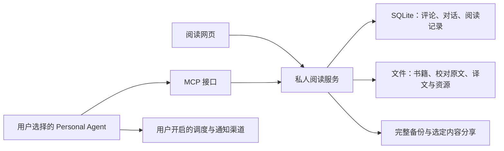

# 私人阅读书房的架构

当前品牌为 Leafhour，正式网站 https://leafhour.com，唯一公开仓库为 `getyak/leafhour`。下方设计与交接保留各自日期及授权范围；当前发布与验收见 [品牌上线记录](../docs/verification/2026-10-16-leafhour-launch.md)。

更新日期：2026-10-12。当前已有 Node + HTML/JS 的本机阅读服务、全书双译草稿与原子 JSON 私人记录。用户已指定官方 DeepSeek Harness 作为 Agent 内核；完整系统规格见 [DeepSeek Harness 系统设计](deepseek-harness-system-design.md)，执行拆分见 [交接](deepseek-harness-delivery-plan.md)。

下文保留原有书房领域结构。React/TypeScript 与 SQLite 是后续候选，不是当前实现，也不是 Harness 首个体验的必要前提。新系统规格中的运行职责、接口与失败处理优先于旧阶段假设。

## 推荐结构

保留 React + TypeScript + Vite 的阅读前端，增加一个本地 Node/TypeScript 服务、SQLite 和文件目录。浏览器和 MCP 共用领域服务，个人评论、阅读位置与时间都只有一份可信记录。本机运行是默认路径；同一套服务可以部署到用户自己的服务器。

静态 JSON 仍适合设计小样。用户上传文件、维护评论并接入 MCP 后，需要本地服务。不要另建一套只供 Agent 使用的书库或记忆，以免记录分叉。

## 模块边界

Library 接收 PDF、EPUB、TXT/Markdown 与 Leafhour 阅读包，保存原件和来源版本，编排提取/OCR、去页眉、章节与段落对齐。扫描提取完成不等于校对通过。导入状态区分接收、提取中、待校对、可读与失败。

Content 管理书、章、原作者小节、稳定段落 ID、资源与语言。Translation 生成并版本化直译、意译和注解，支持术语表、批次检查与断点恢复。切换既有译文只改变显示，不调用模型；用户明确发起新的翻译任务才进入生成队列。

Reader 管理正文与偏好、稳定位置和专注计时。Notes 管理用户评论；Conversations 管理问题和 AI 回答，并保存引用段落与当前内容版本。Sharing 将用户选中的内容编成预览与分享包。MCP 是这些服务的授权入口，不拥有另一份数据。

## 数据职责

书籍源文件与解析资源放在文件目录，以内容哈希识别版本。SQLite 保存书目、章节索引、段落锚点、翻译元数据、个人评论、对话、阅读时段、访问授权和任务状态。原文与译文可继续采用按章的版本化 JSON 文件；索引必须能从内容文件重建。

Book、Chapter、Passage、Translation、EditorialNote、UserComment、QuestionThread、ReadingSession、AgentGrant 是独立对象。作者原文、编辑解释、用户判断与 AI 候选都保留归属，不能用无作者信息的数组混装。

段落编号一经分配不因排序改变。原文、译文与个人记录分别有版本；重新 OCR 或改译文不能使用户评论消失。拆分合并段落提供锚点迁移，无法确定的新锚点进入待确认状态。

展示状态使用 `viewMode = source | translation | parallel` 和独立的 `translationVariant = literal | interpretive`。`sourceLanguage`、`targetLanguage` 由内容与用户偏好决定。阅读目标为 `deep | language`，影响默认显示与帮助方式，不改变原文。

## 私有运行与 AI

服务默认只监听本机，仍检查请求来源和应用授权，避免其他网页直接操作本机书库。自托管实例需要登录、实例级授权与网络传输保护。密钥保存在实例本地配置或宿主秘密存储中，不能放在网页代码、Git、备份或公开分享包里。

提取与索引优先本地执行。用户选择云模型后，界面说明将发送的当前段落、邻近上下文和已授权个人记录；配置的同意范围持续生效，不逐次重复询问。启用本地模型时提供离线能力。使用云模型不能宣称文本完全留在本机。

追问取当前段落、前后文、本章结构、相关术语与必要的书内引用。用户选择后可增加自己的评论；默认不回读所有私人资料。回答指向实际 Passage ID，未取得的章节或资源不能被编造为引用。

## 阅读时间

位置保存 `bookId + sourceVersion + passageId + offsetWithinPassage`。切换排版或语言前捕获锚点，渲染后恢复；字体加载、跨章节跳转与重新打开也适用。

分开记录可见阅读估计时长和用户主动开始的专注时段。前者仅统计前台书页可见区间，闲置判定明确为估计；后者允许思考时停留在同一段，用户可暂停。页面隐藏或关闭后不继续默默计时。

时段带来源、开始结束时间和口径，自动记录、手动补记与 Agent 提交分别标明。多设备合并去重重叠区间；Agent 不得将其自己读资源的时长当成用户阅读时长。阅读统计不构成掌握证明。

## 导出与分享

完整备份为开放格式 ZIP：manifest、来源文件（用户选择纳入）、版本化内容、评论与对话、阅读时段及锚点映射。另提供 Markdown/JSON 导出个人记录。默认备份与仅导出记录的范围要清楚。

分享默认只包含用户选定的评论与少量引用定位，不带私人问题、历史对话、阅读时间或完整书籍。预览后才生成外部分享；公开书籍与译文需要另外核清许可。软件开源许可证不替代书籍内容授权。

迁移验证在干净实例导入，核对内容、评论、引用与时段。不能把下载成功当成迁移成功。

## MCP 与主动陪读

本地 MCP 优先采用 stdio，自托管远程入口采用 Streamable HTTP 并按协议配置授权。访问按实例、书籍与数据类型授权；资源 ID 与文件路径分离，不接受任意路径。默认只读，创建评论等写入能力另开。

资源、工具和调度分工见 `mcp-contract.md`。MCP 可通知资源变化，但每天何时向用户发消息，需要宿主 Agent 的调度与通知渠道。先支持用户开启、暂停和调整频率，阅读中保持安静。

一手依据：[Resources](https://modelcontextprotocol.io/specification/2025-11-25/server/resources)、[Tools](https://modelcontextprotocol.io/specification/2025-11-25/server/tools)、[Transports](https://modelcontextprotocol.io/specification/2025-11-25/basic/transports)、[Authorization](https://modelcontextprotocol.io/specification/2025-11-25/basic/authorization)。PI 应在实现当日检查 SDK 与协议兼容版本。

## 验收

必要检查包括：导入同一文件不复制私人记录；重新校对不丢评论；语言/排版切换位置稳定；导出后可在干净实例恢复；缺译文与失败任务有状态；MCP 拒绝越权读取，AI 写入有归属；后台页面不计阅读；暂停后无推送。

在 390、768、1440px 检查正文、评论、追问和移动端对照。不以视觉截图、token 消耗或阅读时长证明深读效果。
