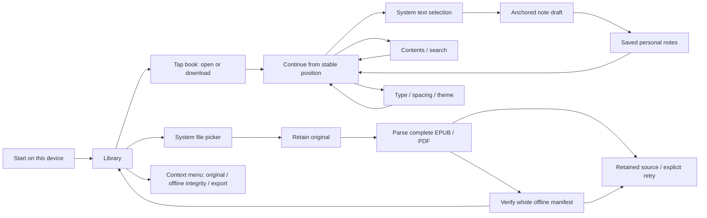

# Leafhour native iOS

This is the native iOS reader, with optional Leafhour account login and cloud synchronization. Device-local import and reading still work without a login or network connection. System listening runs locally; cloud translation and reading conversations require an explicit action. After sign-in, opening a book without a cached guide also starts a non-blocking AI reading guide from bounded opening samples; a device-local original stays on the device. See [current iPhone behavior and data boundaries](../../docs/ios-reading-experience.md) and the [November 5 verification record](../../docs/verification/2026-11-05-reading-experience/README.md). The checked-in debug identifier is for unsigned local development only; distribution must reuse the separately verified existing Leafhour App Store Connect app.

## Build and test

Requires Xcode 16+ (iOS 17 minimum), Swift 5.9+, and the existing shared iOS guard on this Mac. ZIPFoundation 0.9.20 and Swift cmark 0.6.0 are vendored with upstream blob checksums. No sample books or personal data ship in the app. `node tools/verify-ios-vendor.mjs` checks both dependencies without network access.

```sh
# Use an output path issued by dev-storage-guard new-artifact GET-276-native.
dev-storage-guard audit
dev-storage-guard resources
dev-ios-session run -- swift test --package-path apps/ios/LeafhourCore --scratch-path "$LEAFHOUR_IOS_ARTIFACT/swift-build" --jobs 2
dev-ios-session run -- xcodebuild -project apps/ios/Leafhour.xcodeproj -scheme Leafhour -configuration Debug -sdk iphonesimulator -destination 'generic/platform=iOS Simulator' -derivedDataPath "$LEAFHOUR_IOS_ARTIFACT/DerivedData" CODE_SIGNING_ALLOWED=NO build
```

The Xcode project is generated from `project.yml` with XcodeGen and committed for build reproducibility. `Config/Signing.local.xcconfig` is ignored. Only after the existing Apple app and permissions are verified, set its `LEAFHOUR_BUNDLE_ID` and `DEVELOPMENT_TEAM` there. Release configuration intentionally has no default registered application identifier.

The optional `LeafhourUITests` scheme tests system selection, EPUB chapter XII/cold resume, note drafts after relaunch, and a 73-page PDF. Seed `Alice-complete.epub` (12 complete public-domain narrative chapters) and `Alice-complete.pdf` (73-page complete local catalog-text derivative) in the task-owned test app’s Documents using the system picker/guarded setup. Do not erase or reinstall a user’s app for these tests. Retain the `.xcresult` through source delivery. Actual run scope and evidence are in [GET-276 verification](../../docs/verification/2026-10-27-get-276-native/README.md). No signing configuration is evidence of App Store Connect access, distribution or acceptance.

## Local data and import contract

Files selected through the system picker are copied under the current device or account's Application Support library before parsing. Original bytes identify duplicates and content versions. An identical-source import explicitly offers Keep original, Replace book or Add as new book. Keep reuses the original identity; Replace republishes verified content under that identity and preserves personal state. Add as new uses a durable operation identity and starts independent, empty personal records; retrying that operation reuses its copy identity. Replacement uses the existing staged repair journal and retains a recovery path after interruption. Matching titles alone do not establish a duplicate. Complete EPUB spines and their local assets are parsed in order; every local PDF page remains available in the original PDF, including pages with no extractable text. Markdown retains its original source and renders CommonMark/GFM as native attributed text. Parsing never invents text, translations or OCR results. Source files never enter this Git repository.

Archive entries are bounded by count, per-entry size and total expanded size. Absolute paths, parent traversal, symbolic links, duplicate archive names, unsupported encryption and missing spine content are rejected. CRC and offline file hashes are checked. A staged import becomes a book only after the complete original, content index and resources have been written and verified. Failed/interrupted jobs retain their copied original and offer an explicit retry; reconnecting never starts a paid task.

Imported books are already on this device. “Available offline” means the complete local manifest has passed verification; it never means a network request merely started. Cloud downloads retain all text chapters, source IDs and available translations as a verified reading copy. Original EPUB/PDF files stay separate; a text copy is not a downloaded original. Device-local identity and authenticated account UUID scopes are isolated. Account tests use fixtures; production login/read checks and real-device acceptance are recorded separately.

Cloud reading copies first use an owner-bound gzip archive, downloaded in 1 MiB parts and checked against its SHA, declared size and final source snapshot before atomic publication. Limits are 96 MiB decoded, 32 MiB compressed, 5,000 chapters and 300,000 passages. An older server that returns 404/405 for the archive plan uses the existing bounded chapter fallback. The default “Recent activity” order uses the later of actual shelf addition and actual reading time, so a newly added book can precede an older reading session. A cloud copy's device download time is not its addition time. An explicitly saved sort remains in effect. Addition order remains selectable and uses actual cloud addition dates or the account's saved manual order; pins remain first and cached dates survive offline use. Unchanged snapshots do not republish the shelf; a failed refresh retains loaded books, and same-account profile changes retain the library. [Cloud arrival verification](../../docs/verification/2026-10-31-ios-cloud-book-arrival.md) separates actual-book transport checks from simulator UI and physical-device acceptance.

The shelf uses the public catalog's artwork and authenticated original-file covers, cached by owner and content version for reloads and offline use. Existing local EPUBs recover their declared cover without rewriting the saved index; PDFs use their actual first page. Missing artwork keeps a readable title fallback and never blocks opening the book.

Email/password and email-code login reuse the website's authenticated APIs. Session credentials stay in Keychain and an isolated URLSession. Saved notes and positions write locally before synchronization; retries keep stable note IDs, and newer cloud positions require an explicit choice. Local drafts remain on the device. Signing out hides the account's cache and returns to the separate device library. Uploading a local original is explicit; only unique exact source matches migrate its notes and position, with unmatched records retained in the source book.

The quiet reader has no persistent time, AI or listening footer. Center tap reveals tools and progress; native long press reveals selection actions. Foreground-estimate timing starts silently on entering the visible reader by default, with a profile-scoped opt-out; focus timing still starts explicitly. Manual pause and finish are preserved across tools. Listening, Chat, tools and backgrounding do not accumulate reading time. Book-specific history reads local intervals and authenticated cloud month summaries separately, without adding overlapping totals. Time checkpoints and shelf actions use account-scoped durable queues and matched receipts; background/hidden-reader intervals do not count, and device overlap is unioned by the service. The complete account shelf snapshot supplies reading state, recent continuation, pins, manual order and explicit archive state. Downloaded originals/copies and drafts remain on their device. Cold launch presents the cached shelf before authentication and background synchronization; Continue reading opens only after an explicit tap. Repeated foreground refreshes within 30 seconds reuse a successful account synchronization unless local activity, pending actions or retry errors require work; pull to refresh always rechecks. Reader-first opening verifies the local source, index and visible resources before presentation, then checks the full package and synchronizes records. Unchanged decoded indexes are reused with device/inode/size/mtime/ctime checks. Deferred failure freezes the reader and preserves a source-bound recovery snapshot, exportable immediately or later from book details. Source observations are distinct from upload acknowledgements, so delayed offline progress cannot become the most recent reading merely by arriving late. See [reading-time semantics](../../docs/reading-time.md).

Google and Apple sign-in use the system authentication browser and the existing hosted providers. The account screen lists actual linked identities and allows a signed-in account to link another provider while keeping its ID, native session and offline library. Supabase owns automatic linking for the same verified email; Apple relay and different provider addresses require explicit authenticated linking. An occupied identity is a conflict, never permission to merge reading data. The native callback contains only a short-lived one-time code and state; a verifier-bound HTTPS exchange obtains the opaque session. See [social sign-in operations and acceptance limits](../../docs/ios-social-sign-in.md).

Stable chapter/passage identifiers and source versions bind reading position, notes and drafts. State writes are atomic and serialized. Keep/Replace duplicate imports leave existing personal state intact; Add as new creates separate records. Native text selection keeps copy available; author text, a selected quote and personal notes are labeled independently. Source and translation selections have separate draft identities; translated quotes retain their literal/interpretive variant and source paragraph anchor. No literal/interpretive translation is fabricated when none is available.

## Reading controls and sharing

- New profiles and missing navigation settings default to horizontal pages; valid saved scroll settings are preserved. Native page curl follows a committed tap or swipe; it does not continuously track the finger.
- Bundled Noto Serif SC and WenKai Lite, PingFang and a rounded Latin pairing apply to reflowable text; Latin faces can be chosen independently; original PDF typography stays intact. All reading preferences are shared across books within the same `LibraryScope`, including typography, paper, navigation, reading layer, translation variant, listening speed and automatic-turn interval. Positions, notes and drafts remain book-specific; device and account scopes stay isolated.
- Quick consecutive contacts each turn a page without a double-tap selection wait; native long press retains selection and Copy. Navigation settings → More interactions holds the profile-scoped 0–500 ms response delay (default immediate) and optional always-visible progress (default off). VoiceOver keeps its system activation gestures, and PDF pinch zoom remains native.
- Contents retain the actual chapter order and mark the current chapter/page. Original-text search covers local chapter bodies as well as titles or PDF page numbers, grouping verified excerpts under their real entries. Explicit AI search uses only the current book's frozen device snapshot through read-only tools, with a separate conversation namespace; it does not read other books, private notes or the web. Only source references validated against the snapshot become jump targets. Locate clears the search and scrolls to the current entry without changing the reading position. No inferred hierarchy is added.
- Bookmarks are independent device-local records, separate from notes. Pull down and release at the reader's bookmark threshold, or use the explicit button/VoiceOver action. The current-location marker and book list support naming, color changes and removal. Original positions retain source anchors; translated positions additionally retain the translation fingerprint, variant, target language and UTF-16 offset. Changed or unavailable text must be checked before jumping. Bookmarks are included in native reading-record exports; no cloud bookmark synchronization or Web-backup channel is claimed.
- Listening uses temporary local PCM for each passage and a draggable 0.5×–5× playback-speed slider. Opening the panel or adjusting speed does not start playback; word markers follow the actual player clock.
- Automatic page turning starts explicitly, with a 5–120-second interval in 5-second steps, defaulting to 30 seconds. Touch, selection, tools, listening, VoiceOver and backgrounding pause it. Continue starts a fresh interval; returning to the app never resumes it automatically. It stops at the book's end and does not restore a running state after relaunch.
- Reading styles combine classic, spacious and compact typography presets with nine named papers including warm, white, sage, mist, sand, apricot, dusk, night and system. Settings preview changes before returning to the page; typography presets preserve content, navigation and listening choices.
- First-line indentation offers None or Two characters. TXT source padding is removed only from the displayed paragraph; selection still maps to the unchanged source. Book-specific translation uses automatic source detection and a one-line target-language intent. New books default to English; Chinese, English, Japanese, Korean, French, German and Spanish names and supported aliases are accepted locally. Ambiguous, unsupported or same-language input needs correction before generation. Saved targets remain unchanged; legacy books without the defaults-version marker retain the old Chinese-source → English / other-source → Chinese fallback, including when their state file is absent or a package is repaired. Language selection alone never starts generation. Existing Chinese translation formats remain compatible; other targets, offline caches and uncertain requests are retained separately by language.
- Sharing separates images, full text, eligible links and files through the system share sheet. Paper, ink and night card styles share the same measured pagination and complete quotation. Selected text keeps its source/translation attribution and paginates into 4:5, 1:1 or 9:16 cards without truncation. Authorized public/gift links include a native QR code for image forwarding. Card rendering is capped at 12 pages; longer selections remain available as full text. Installed apps determine the available destinations.

Gift publication requires an explicit action. The Web gift page's “Import in the iOS app” button opens a `leafhour://gift/<token>` preview; accepting and downloading require confirmation. Validated `leafhour://read?book=<id>` links also preview before opening. Private or unknown-visibility books do not receive fabricated public reading links.

See [GET-352 implementation and verification](../../docs/verification/2026-11-01-get-352-ios-reading.md) for recorded local evidence and delivery references. Universal Links require separate associated-domain/AASA and device verification. Real-device social destinations, VoiceOver and audible quality at extreme playback rates remain separate acceptance gates.

## Native flows and states



The reader initially exposes its native tools, then lets them sleep after idle time or scrolling. Edge controls and a small bottom handle restore the toolbar. Ordinary text taps keep their reading behavior. Contents, search, notes, typography, system listening, translations and reading conversations use native panels. The companion is summoned explicitly from the top controls, “AI 引用” after system selection, or the additional reading tools. It opens the native Chat margin, with optional expansion, and closes directly to quiet reading while clearing native selection. The global Chat tab can select any owned cloud book without downloading or moving its reading position. Source context remains visible and stays fixed while a question or uncertain request exists; changing to the current paragraph is explicit. Questions and unresolved conversation requests persist in account- and book-scoped local storage; retries retain the original request identity, and a failed history refresh keeps loaded messages. Sending an ordinary conversation is its submission, without a second confirmation. Billing quotes are still validated and uncertain retries preserve the exact request and billing identity. Translation retains separate explicit enablement, bounded scope and per-paragraph quote validation. Additional website tools open in a clearly labeled, short-lived web panel with an isolated account session. Historical [GET-274 verification](../../docs/verification/2026-10-29-get-274/README.md) describes the earlier unconnected companion; GET-312 adds the authenticated service integration.

Tap a shelf card to open or download its book. A small checkmark before the title shows offline availability, with full status available to VoiceOver. Standard text sizes use three equal cover columns with scalable 13-point titles; accessibility sizes use full-width rows. Visible Select and per-book action menus offer single or multiple removal, account/device-scoped persistent pins, a share preview and details. Removal moves books into Removed, where restoring reuses the same identity, original/package, position, notes, drafts and reading time. Local visibility stays in the current profile; account removal/recovery uses the existing durable cloud shelf queue. Removing a shelf entry is separate from discarding a download. The share preview separates cards, text, eligible links and files; sharing a file retains a local original or exports a cloud copy as source-only TXT, without notes, drafts or reading history. Range, count, sort and layout share a compact shelf heading; search opens on demand and has an explicit clear/cancel action. Download progress and cancellation appear only beside the downloading book, so another downloaded book remains readable. Imports without a shelf item keep their global activity indicator.

The root tabs separate Library, Chat and My Reading. My Reading presents the account, reading style, personal records and summaries, then synchronization and offline/data information. Provider management remains inside the account screen. Reading settings place a live preview, paper themes and typography first; reading content/translation and navigation details each have a separate destination with a direct return to reading. Original, translation and parallel templates preview actual cached text; literal and interpretive choices persist independently. Parallel order, original-text scale/emphasis and spacing apply to the preview and page immediately while retaining the source anchor or verified translated viewport. Missing or stale translation retains the source text with a status label. Saved translations load locally and refresh from the current and next chapter when connected; viewing saved text and changing typography make no model calls.

Changing a template does not start generation. The translation panel shows the current visible page and at most two following paragraphs, capped at 12 paragraphs within the chapter. The user explicitly enables following translation after choosing translation or parallel view; preparing new translations currently requires an authenticated cloud-linked book. Each paragraph's actual quote is checked before submission. Complete literal/interpretive pairs are skipped without extending the window, and partial or source-mismatched pairs stop for review. Actual user navigation cancels the old window immediately; a new user-navigation marker and valid visible page are both required for the next window. Layout or translation arrival cannot advance it. The scope never wraps backward or scans the whole book.

Preparation runs sequentially in the foreground and each saved paragraph becomes readable immediately. “Return to reading” preserves an explicitly enabled following state; the X action stops the current transport and later work. Backgrounding, returning to original view, leaving the reader or changing the account closes the switch. A chapter jump cancels the old window and waits for a real navigation marker and the new visible page. Cancellation propagates through URLSession and the service to the provider; late results cannot update an invalidated run. Cancellation after a durable save does not promise rollback or free usage. Exact request bodies, IDs, quotes and billing keys remain recoverable until a trusted terminal receipt resolves them; recovery checks the old paragraph only and requires explicit re-enabling before new work. Reopening the app does not start a new model request. The system status bar, including its time, is hidden throughout the reading surface; library and chat retain normal system behavior. Quiet controls and transient awake tools preserve the page's layout budget.

The [2026-10-30 design](../../docs/superpowers/specs/2026-10-30-ios-quiet-shelf-design.md) and [implementation plan](../../docs/superpowers/plans/2026-10-30-ios-quiet-shelf.md) describe GET-344. Its [2026-10-31 local acceptance record](../../docs/verification/2026-10-31-get-344-ios-quiet-shelf/README.md) records 160 Core, 132 application-unit, 4 primary UI and 217 affected host checks, plus focused recovery, filtering, background-download and preview checks. Those recorded runs do not establish real paid-model, current TestFlight or physical-device acceptance.

See [GET-357 reading style, settings, Chat and sharing verification](../../docs/verification/2026-11-01-get-357-ios-style-chat.md) for the current changes, simulator screens and delivery evidence.

## Local-book conversations

A book imported into the current device/account library can use AI without uploading its original or creating a cloud-library entry. Sign-in connects the existing model service independently of book synchronization. The official DSH runtime requests read-only context, outline, chapter pages and search from the iOS device; each result is bound to the current account, frozen book version and request. Private notes, arbitrary paths and other books are unavailable in this scope. Requested excerpts reach the model service; “local book” does not mean offline model inference. Image-only pages require extracted text first.

Send publishes an immutable outgoing message before session/billing round trips, then streams provisional answer text. A completed receipt remains distinct from partial output. Unknown outcomes retain the exact request and billing key for recovery; original messages and local drafts are preserved separately. Shared tool receipts support reconnecting to a live run across hosted processes. An expired/killed runtime becomes interrupted rather than silently creating another paid generation.

The conversation uses a compact assistant text style with Dynamic Type, one sent quote and one response status. Each completed answer offers three distinct follow-up questions without another model request; tapping one sends it through ordinary chat while preserving unrelated draft text, voice and selected excerpts. Guide follow-ups store a server-validated AI `guideContext` separately from the user's question `text`, including in history and recovery. Returning keeps the underlying native reader and selection; Markdown and immutable book-index caches avoid repeated parsing during layout and local state saving. Durable reading records still flush before returning to the shelf.

## Conversational context and voice

Ordinary chat uses the configured model's known context/output capacities, with summaries of older context when needed to fit the model window. Original messages remain in owner-scoped active storage and immutable history receipts; the active storage page size is not a conversation retention or model-context limit. Ordinary chat has no product turn-count, daily-conversation, tool-call or 2,000-character message cap. Provider capacity, authenticated source permissions, request transport sizes, cancellation and hosting deadlines still apply. Specialized translation and automatic-companion policies remain separate. See [conversation scope](../../docs/reading-chat-scope.md).

Native chat renders Markdown headings, lists, quotations, code and tables as selectable text. The composer puts a smaller microphone on the left and Send on the right, grows with the draft and keeps only microphone and Send beside the input; scrolling dismisses the keyboard, with a named accessibility dismissal action. Live speech recognition fills the composer; tapping the microphone again cancels and restores the previous draft. Sending during recording retains a playable original recording plus its transcript, uploads through owner-scoped voice storage and submits once. Cancelled audio is not uploaded. Permission denial, interruptions, backgrounding and account changes preserve or cancel drafts according to the recorded state; hardware capture and audible playback require device verification.

The [2026-11-02 library/chat verification record](../../docs/verification/2026-11-02-ios-library-chat.md) separates local source changes, native/host checks, simulator acceptance and unverified release/device work.

## Separate pending acceptance

TestFlight archive/upload, Apple processing, distribution, authorized tester invitation/acceptance, physical installation, an actual TestFlight update with retained data, full VoiceOver and real-device timing remain separate pending acceptance. Apple browser/authentication and physical-device availability must not block source work. Cloud authentication, upload/sync, conflict handling and translation/companion service integration require their own recorded integration evidence. Keep GET-276 In Progress until its complete issue acceptance is satisfied.

Reference APIs: [Apple fileImporter and security-scoped access](https://developer.apple.com/documentation/swiftui/view/fileimporter(ispresented:allowedcontenttypes:oncompletion:)), [Apple PDFKit](https://developer.apple.com/documentation/pdfkit), [ZIPFoundation 0.9.20](https://github.com/weichsel/ZIPFoundation/releases/tag/0.9.20).

## TestFlight release automation

The archive/upload/Apple-confirmation chain, signing audit and maintenance workflow are documented in [native TestFlight operations](../../docs/ios-testflight-release.md). `release.json` owns the native marketing version. Runtime release switches are repository settings; on 2026-10-29 the user explicitly enabled automatic upload, and [run 40834531572](https://github.com/getyak/leafhour/actions/runs/40834531572) recorded Apple VALID for source `c03ecd7`, version 0.1.0/build 1.0.10. That historical receipt does not verify later source, tester distribution or installation. Credentials and the registered application identity remain outside source.


The [GET-346 acceptance record](../../docs/verification/2026-10-31-get-346-ios-reading-library.md) records compact horizontal pages, paragraph/chapter translation, three-column shelves, native long-press actions and one configured online generation. TestFlight and physical-device acceptance remain separately recorded gates.

## Listening and first paragraph selection

Listening starts at the visible sentence, using the actual original or selected translation layer. The current sentence is painted behind the existing native text using speech word markers and the actual playback clock; the word being spoken controls scrolling/page following. One passage is queued at a time, continuing through this book. Pause, interruption and explicit stop retain a verified local listening position. Background/locked playback now continues after the November 3 authorization, while preserving checkpoints. Reopening offers the previous position, or an explicit start from the current page. Voice changes restart the current sentence; rate changes adjust local PCM playback without regenerating speech. Manual browsing and selection suspend following. The player offers a quiet location icon to return to the actual spoken sentence without seeking or changing playback state; transport provides pause/resume.

A first long press on selectable text creates a stable paragraph/layer selection and keeps UIKit's native edit menu. A matching glass selection dock provides copy, notes, translation, sharing and a labeled AI 引用 tap action. Tapping it opens the existing Chat directly; its optional draggable excerpt opens the existing Chat with the exact current quote and attribution when dropped on AI; opening Chat does not submit a question. Narrow widths fold secondary actions into a menu. Existing selection handles, held selection and links keep system behavior. Copy and note actions read the actual current selection. PDFKit keeps its original pages, separate speech paint, and extracted text boundaries; image-only tails never restart the book. No model, cloud speech or reading-point request is made by this feature.

[GET-347 native verification](../../docs/verification/2026-10-31-get-347-listening-selection.md) separates callback, layout, native UI, CI and release evidence. Simulator speech callbacks do not establish audible physical-device quality or installation.

[Quiet reading controls and validation](../../docs/verification/2026-11-02-quiet-reading/README.md) records the native grid, local language font pairs and matching web paper controls.

## Immersive listening and reading glass

The Listen action opens a full-screen native destination. Portrait stacks book identity, sentences and transport; landscape places transport beside the transcript. Actual speech word callbacks drive sentence following and current-word emphasis in display coordinates. Speed and voice controls are available in a separate settings sheet; opening the player, returning to it and changing speed do not autoplay. Manual transcript scrolling suspends following. Explicit playback or sentence seeking resumes following. After browsing or selection, a quiet location icon restores the actual playback viewport without restarting audio. Reduce Motion disables following animations.

Reader controls tint native iOS 26 Liquid Glass with the selected paper when built with SDK 26. Compiler guards retain material for older SDK builds; earlier systems also use material; Reduce Transparency or Increased Contrast uses a solid matching paper. White, colored and dark papers share this mechanism. Temporary selection chrome is excluded from the persistent scroll-inset budget. See [implementation and acceptance](../../docs/verification/2026-11-02-immersive-reader/README.md).

## Quiet reader interactions (November 3)

The GET-375 follow-up restores book conversations to a half-height margin note with optional expansion. Message selection menus offer reply, like/unlike and whole-message copy alongside native selection. Replies preserve an authenticated conversation reference; likes stay in the profile/book's local conversation draft. The composer rests as “继续问…” while reading an answer. Source excerpts appear only when attached. Reading progress floats at the lower right as a source-based estimate instead of a chapter screen count. Reading-time persistence reuses the invalidatable index cache, and queued full state snapshots coalesce without discarding an in-flight write. See [verification and release boundaries](../../docs/verification/2026-11-03-get375-reading-margins.md).

Quiet reading reserves only 4/8-point internal top/bottom margins inside system safe areas. Waking controls overlays the same page instead of repaginating. The optional always-visible progress line reserves its scaled height; an explicitly started automatic-page countdown remains an opt-in exception. Listening transport stays hidden with quiet tools. Statistics and explicit time controls remain available in reading tools.

Chat holds the pending excerpt directly above the composer, with book/chapter and original/translation attribution, expand and remove actions. Removing an excerpt hides its preview while retaining the captured paragraph as authorized context. New explicit excerpts replace unsent draft quotes while preserving the question. Preparation, generation and uncertain retries keep the submitted quote immutable; a newer excerpt waits separately and survives draft restoration. Saved messages render their own server-saved quote. Translated excerpts retain the existing, explicitly labeled request behavior of citing their corresponding original paragraph.

See [design](../../docs/superpowers/specs/2026-11-03-quiet-reader-interactions-design.md), [plan](../../docs/superpowers/plans/2026-11-03-quiet-reader-interactions.md) and [verification](../../docs/verification/2026-11-03-quiet-reader-interactions/README.md). Source merge, TestFlight processing/distribution and physical-device acceptance remain separate records.

## Selectable bilingual listening (November 3)

Listening now presents a continuous, selectable chapter using the reading paper, local font pairing, size and spacing. Tap an original/spoken-layer sentence to seek with its real source coordinates; hold to select across sentences. Existing translation appears below the matching paragraph, with separate original/literal/interpretive attribution and an optional comparison switch. Without a matching translation, both the comparison region and its switch disappear, leaving the source area available. The saved comparison preference is preserved. No sentence correspondence or translation is invented. Manual browsing and selection pin the displayed chapter/layer until explicitly returning to playback.

Playback controls hide after five idle seconds and can be revealed from their 44-point control. Pause, selection, manual browsing, VoiceOver, settings and an active speed hold retain controls. Hold the speed control for a gradual temporary boost up to 5×; release, cancellation, pause, background or dismissal restores the chosen speed. Appearance is shared with reading; temporary speed changes are not saved. Reading also exposes previous/next chapter, with consistent side tap regions at the top/bottom corners. See [implementation and verification](../../docs/verification/2026-11-03-listening-study/README.md).


## Approved player and current-page controls (November 3)

The approved player restores book identity, selectable sentence stage, a separate fixed paragraph comparison region, centered transport and the shared reading/listening functional bar. Controls never overlay the text. The player has no persistent return banner; a location icon appears after manual browsing. Reading has previous/next chapter controls, page-turn gestures and a current-page translation destination using configured original/translation/parallel presentation, language pair and literal/interpretive choice. Real native geometry freezes the exact intersecting source paragraphs; partially shown paragraphs are completed in full, as the user chose. Changing layout invalidates an unconfirmed page scope. Existing translation cost confirmation and immutable uncertain-request recovery remain.

Explicitly started local audio now continues while locked/backgrounded; reading time and translation generation still pause. MediaPlayer publishes real book/chapter metadata, actual output rate and an aspect-fit real cover or typographic fallback. Native remote controls target only the current audio/book/account/source owner. Audio replacement, microphone start, interruptions and route loss retain their safeguards. No guessed audio duration is published. The [verification record](../../docs/verification/2026-11-03-player-controls-lockscreen/README.md) distinguishes simulator/code evidence from pending physical lock-screen and audio acceptance.

## Reader-first entry and direct actions (November 3 follow-up)

Local source presentation no longer waits for cloud records. Deferred verification gates auxiliary resources and translation publication; failure keeps a frozen recovery that can be exported after restart or repair. Active reading ownership protects newer edits, and remote positions remain an explicit choice across queued synchronization.

Both controllers expose previous/next chapter. Listening chooses the neighbor of its displayed chapter, skips chapters without playable text and preserves idle/paused/playing intent. The source expands when no real comparison exists; existing comparison remains optional. Location only restores the viewport and native selection clears only when explicitly requested. A visible AI 引用 action opens the attributed selection in Chat, with optional drag retained.

See [measurements, tests and delivery boundaries](../../docs/verification/2026-11-03-lazy-reader/README.md). Reported local critical-path timings are not physical-device first-frame measurements; Apple processing, tester installation and device acceptance remain distinct.


## Navigation, personal identity and conversation sharing (November 4)

The shelf, squirrel and reading journal share native continuous horizontal paging and bounded vertical scrolling. The native root measures the actual tab-bar height and owns keyboard geometry, so the composer and selection actions stay fully above navigation or keyboard. Pushed destinations retain their back gesture. Bundled DiceBear CC0 avatars work offline; a system-picked photo is downsampled, stripped of metadata and stored per account on this device, with that scope visible in the picker.

The seven-day overview publishes validated account/timezone disk data before network requests, reuses a fresh snapshot for 30 seconds and fetches cross-month data concurrently. Notes load independently. Explicit refresh, reading changes, date/timezone and account changes invalidate freshness. Unknown measurements remain unknown; offline cached values stay available.

Conversations use attributed user/assistant bubbles with native selectable text. Long press adds reactions, reply, copy, multiple selection and system sharing. Marking a reaction never starts a model; the next explicit send resolves its saved owner/book/version message targets before passing them to AI. Sharing previews exact selected messages, optionally adds visible neighboring excerpts, and exports a single measured long image in three styles with a QR instead of a printed URL. The generic chat QR opens Leafhour's homepage and never publishes private chat. Accessible complete text remains available. Oversized images fail explicitly with complete-text export retained.

See [design, independent assessments and actual image evidence](../../docs/verification/2026-11-04-ios-experience/README.md). Local simulator evidence, merge, web deployment, TestFlight distribution and physical-device acceptance are separate.
