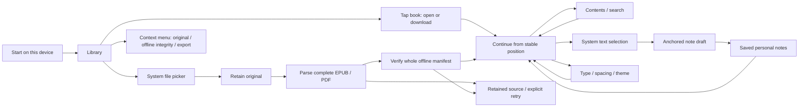

# Leafhour native iOS

This is the native iOS reader, with optional Leafhour account login and cloud synchronization. Device-local import and reading still work without a login or network connection. System listening runs locally; cloud translation and reading conversations require an explicit action. The checked-in debug identifier is for unsigned local development only; distribution must reuse the separately verified existing Leafhour App Store Connect app.

## Build and test

Requires Xcode 16+ (iOS 17 minimum), Swift 5.9+, and the existing shared iOS guard on this Mac. ZIPFoundation 0.9.20 and Swift cmark 0.6.0 are vendored with upstream blob checksums. No sample books or personal data ship in the app. `node tools/verify-ios-vendor.mjs` checks both dependencies without network access.

```sh
# Use an output path issued by dev-storage-guard new-artifact GET-276-native.
dev-storage-guard audit
dev-storage-guard resources
dev-ios-session run -- swift test --package-path apps/ios/LeafhourCore --scratch-path "$LEAFHOUR_IOS_ARTIFACT/swift-build" --jobs 2
dev-ios-session run -- xcodebuild -project apps/ios/Leafhour.xcodeproj -scheme Leafhour -configuration Debug -sdk iphonesimulator -destination 'generic/platform=iOS Simulator' -derivedDataPath "$LEAFHOUR_IOS_ARTIFACT/DerivedData" CODE_SIGNING_ALLOWED=NO build
```

The Xcode project is generated from `project.yml` with XcodeGen and committed for build reproducibility. `Config/Signing.local.xcconfig` is ignored. Only after the existing Apple app and permissions are verified, set its `LEAFHOUR_BUNDLE_ID` and `DEVELOPMENT_TEAM` there. Release configuration intentionally has no default registered application identifier.

The optional `LeafhourUITests` scheme tests system selection, EPUB chapter XII/cold resume, note drafts after relaunch, and a 73-page PDF. Seed `Alice-complete.epub` (12 complete public-domain narrative chapters) and `Alice-complete.pdf` (73-page complete local catalog-text derivative) in the task-owned test app’s Documents using the system picker/guarded setup. Do not erase or reinstall a user’s app for these tests. Retain the `.xcresult` through source delivery. Actual run scope and evidence are in [GET-276 verification](../../docs/verification/2026-10-27-get-276-native/README.md). No signing configuration is evidence of App Store Connect access, distribution or acceptance.

## Local data and import contract

Files selected through the system picker are copied under the current device or account's Application Support library before parsing. Original bytes identify duplicates and content versions. Complete EPUB spines and their local assets are parsed in order; every local PDF page remains available in the original PDF, including pages with no extractable text. Markdown retains its original source and renders CommonMark/GFM as native attributed text. Parsing never invents text, translations or OCR results. Source files never enter this Git repository.

Archive entries are bounded by count, per-entry size and total expanded size. Absolute paths, parent traversal, symbolic links, duplicate archive names, unsupported encryption and missing spine content are rejected. CRC and offline file hashes are checked. A staged import becomes a book only after the complete original, content index and resources have been written and verified. Failed/interrupted jobs retain their copied original and offer an explicit retry; reconnecting never starts a paid task.

Imported books are already on this device. “Available offline” means the complete local manifest has passed verification; it never means a network request merely started. Cloud downloads retain all text chapters, source IDs and available translations as a verified reading copy. Original EPUB/PDF files stay separate; a text copy is not a downloaded original. Device-local identity and authenticated account UUID scopes are isolated. Account tests use fixtures; production login/read checks and real-device acceptance are recorded separately.

The shelf uses the public catalog's artwork and authenticated original-file covers, cached by owner and content version for reloads and offline use. Existing local EPUBs recover their declared cover without rewriting the saved index; PDFs use their actual first page. Missing artwork keeps a readable title fallback and never blocks opening the book.

Email/password and email-code login reuse the website's authenticated APIs. Session credentials stay in Keychain and an isolated URLSession. Saved notes and positions write locally before synchronization; retries keep stable note IDs, and newer cloud positions require an explicit choice. Local drafts remain on the device. Signing out hides the account's cache and returns to the separate device library. Uploading a local original is explicit; only unique exact source matches migrate its notes and position, with unmatched records retained in the source book.

Google and Apple sign-in use the system authentication browser and the existing hosted providers. The account screen lists actual linked identities and allows a signed-in account to link another provider while keeping its ID, native session and offline library. Supabase owns automatic linking for the same verified email; Apple relay and different provider addresses require explicit authenticated linking. An occupied identity is a conflict, never permission to merge reading data. The native callback contains only a short-lived one-time code and state; a verifier-bound HTTPS exchange obtains the opaque session. See [social sign-in operations and acceptance limits](../../docs/ios-social-sign-in.md).

Stable chapter/passage identifiers and source versions bind reading position, notes and drafts. State writes are atomic and serialized. Duplicate imports leave existing personal state intact. Native text selection keeps copy available; author text, a selected quote and personal notes are labeled independently. Source and translation selections have separate draft identities; translated quotes retain their literal/interpretive variant and source paragraph anchor. No literal/interpretive translation is fabricated when none is available.

## Native flows and states



The reader initially exposes its native tools, then lets them sleep after idle time or scrolling. Edge controls and a small bottom handle restore the toolbar. Ordinary text taps keep their reading behavior. Contents, search, notes, typography, system listening, translations and reading conversations use native panels. The companion is summoned explicitly from the top controls, “解释这句” after system selection, or the additional reading tools. Its half sheet preserves the book above it and closes directly to quiet reading while clearing native selection. Cloud generation requires explicit confirmation and preserves request identity across uncertain retries. Additional website tools open in a clearly labeled, short-lived web panel with an isolated account session. Historical [GET-274 verification](../../docs/verification/2026-10-29-get-274/README.md) describes the earlier unconnected companion; GET-312 adds the authenticated service integration.

Tap a shelf card to open or download its book. A small corner mark shows offline availability, with full status available to VoiceOver. Range, count, sort and layout share a compact shelf heading; search opens on demand and has an explicit clear/cancel action. Download progress and cancellation appear only beside the downloading book, so another downloaded book remains readable. Imports without a shelf item keep their global activity indicator.

Account settings put personal records and summaries first, with provider management behind a disclosure. Reading settings preview the selected reading layer and group typography, paper themes and navigation separately. Source, translation and stacked parallel views keep the same source passage anchor; literal and interpretive choices persist independently. Missing or stale translation retains the source text. Saved translations load locally and refresh from the current and next chapter when connected; viewing saved text and changing typography make no model calls.

Preparing missing translations starts only after an explicit confirmation of scope and maximum reading-point cost. That confirmation freezes the current and next chapter, source version and at most 100 missing passages. The app validates each passage's quote and saves its exact request and idempotency key before submission, so uncertain retries and a new login recover the same request. Existing complete translation pairs are skipped; a partial pair stops preparation for review. Only a trusted terminal billing receipt clears an unresolved request; completed translations are saved before updating the offline cache.

Preparation runs sequentially in the foreground while translation or parallel view is selected. Stopping, backgrounding, returning to source view or leaving the confirmed chapter scope prevents later submissions. A passage already submitted may still finish and consume its quoted reading point; its result remains recoverable. The scope never expands automatically to the whole book.

The [2026-10-30 design](../../docs/superpowers/specs/2026-10-30-ios-quiet-shelf-design.md) and [implementation plan](../../docs/superpowers/plans/2026-10-30-ios-quiet-shelf.md) describe GET-344. Its [2026-10-31 local acceptance record](../../docs/verification/2026-10-31-get-344-ios-quiet-shelf/README.md) records 160 Core, 132 application-unit, 4 primary UI and 217 affected host checks, plus focused recovery, filtering, background-download and preview checks. Those recorded runs do not establish real paid-model, current TestFlight or physical-device acceptance.

## Separate pending acceptance

TestFlight archive/upload, Apple processing, distribution, authorized tester invitation/acceptance, physical installation, an actual TestFlight update with retained data, full VoiceOver and real-device timing remain separate pending acceptance. Apple browser/authentication and physical-device availability must not block source work. Cloud authentication, upload/sync, conflict handling and translation/companion service integration require their own recorded integration evidence. Keep GET-276 In Progress until its complete issue acceptance is satisfied.

Reference APIs: [Apple fileImporter and security-scoped access](https://developer.apple.com/documentation/swiftui/view/fileimporter(ispresented:allowedcontenttypes:oncompletion:)), [Apple PDFKit](https://developer.apple.com/documentation/pdfkit), [ZIPFoundation 0.9.20](https://github.com/weichsel/ZIPFoundation/releases/tag/0.9.20).

## TestFlight release automation

The archive/upload/Apple-confirmation chain, signing audit and maintenance workflow are documented in [native TestFlight operations](../../docs/ios-testflight-release.md). `release.json` owns the native marketing version. Runtime release switches are repository settings; on 2026-10-29 the user explicitly enabled automatic upload, and [run 40834531572](https://github.com/getyak/leafhour/actions/runs/40834531572) recorded Apple VALID for source `c03ecd7`, version 0.1.0/build 1.0.10. That historical receipt does not verify later source, tester distribution or installation. Credentials and the registered application identity remain outside source.

