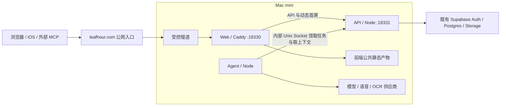

# Leafhour：前端、后端、Agent 三模块与 Mac mini 部署设计

日期：2026-11-05。状态：设计提案，供下一轮重构和部署实施。唯一公开仓库继续使用 [getyak/leafhour](https://github.com/getyak/leafhour)，许可证维持 AGPL-3.0。

仓库内划分 `web`、`api`、`agent` 三个业务模块，分别构建和运行。三者部署在 Mac mini；既有 Supabase 继续保存身份、数据库与私人文件。前端负责阅读体验，后端掌握授权与数据，Agent 执行生成和耗时任务。

本次完成设计、只读环境检查与文档同步；没有重构应用目录、安装生产服务、迁移用户数据或切换正式域名。下文中的目录、端口、任务协议和资源阈值均为目标设计。现有生产链保持运行，直到替代入口完成验收。

## 1. 已核对的起点

源码基准为公开主线 `8e3a39a6f70663b201943e86bc37539b187629c4`。当前网页与 HTTP API 由同一个 Node 入口提供，主要业务集中在 `server/portal.mjs`；本地适配器和 Supabase 托管适配器共用领域服务。AI 对话、导入和音频已有各自的状态、取消或恢复机制，拆分时要逐项接入统一执行协议，保留已验证的行为。

Mac mini 的只读检查结果：Apple M4、10 个物理核心、16GB 内存、macOS 26.4；数据卷约 460GiB，当前可用约 34GiB，使用率约 93%。机器还运行其他应用及构建任务。本次观察到休眠关闭、断电恢复开启、Tailscale 在运行；这些不能替代断电后的真实启动和远程恢复验收。目标端口 18330–18332 在检查时没有监听者。

没有核验 DNS 管理权限、Cloudflare Tunnel 配置、Supabase 备份方案、UPS、FileVault 冷启动解锁和真实业务负载。已有其他应用随包运行的 Node 不作为 Leafhour 的生产运行时。

## 2. 三个模块的职责

| 模块 | 负责 | 边界 |
| --- | --- | --- |
| `apps/web` | 官网、书房、阅读器、设置、登录与聊天界面；静态资源、首屏模板和浏览器离线缓存 | 不持有模型或数据库管理密钥；不自行决定书籍、笔记与计费权限 |
| `apps/api` | Web/iOS/MCP 接口、会话、授权、书房、原件与记录、任务受理、结果校验和持久化 | 不在用户 HTTP 请求中执行模型循环、整批 OCR 或长音频生成 |
| `apps/agent` | 持久任务消费、官方 DeepSeek Harness、供应商适配、提取与生成、取消和执行回执 | 不接受浏览器直接调用；不持有 Supabase 管理密钥；不任意选择账号或读取整库 |

Web 使用 Caddy 提供公共静态资源与同源转发，API 与 Agent 各自使用独立 Node 进程，合计三个常驻业务进程。公网隧道、备份和监控属于基础设施，数量单列。iOS 保留为已有客户端；外部 MCP 保留为后端的受控适配器。

### 首屏页面仍保留现有语言与登录行为

现有 `api/ui-entry.js` 会核对会话与账号语言，再渲染首屏，不能直接替换成统一的静态 `index.html`。目标中，模板及纯渲染函数归前端产物，放入 `packages/web-shell`；API 的薄入口负责身份与语言决策，读取只读模板并调用纯渲染函数。Caddy 将 `/`、`/library`、`/read` 和兼容的首屏入口转给 API，其余获准公共资源由 Web 提供。

这保留了三个模块的源代码归属，也避免为了拆目录新增一套登录或首屏语言逻辑。API 不导入 `apps/web` 源码；它只依赖经过构建的模板与共享纯函数。

## 3. 仓库布局与依赖规则

```text
leafhour/
  apps/
    web/                  # 现有 app/ 的浏览器代码、资源与模板
    api/                  # HTTP 组合入口、公开路由、内部执行网关
    agent/                # 调度、任务执行、Harness、供应商适配
    ios/                  # 现有客户端与测试继续保留
  packages/
    contracts/            # 运行时 schema、DTO、API/任务协议
    domain/               # 书房、记录、授权、任务与交付规则
    persistence/          # Supabase 与本地测试存储适配，仅后端使用
    web-shell/            # 纯首屏渲染与模板清单，无密钥和数据访问
    test-support/         # 合成样本、契约与故障注入工具
  infra/
    macos/                # launchd、入口配置、发布和恢复说明
    migrations/           # 增量数据库迁移；保留现有迁移兼容入口
  catalog/                # 共享公版目录与来源许可
  docs/
  scripts/
  package.json            # npm workspaces、聚合构建与检查
  package-lock.json
```

保留当前 JavaScript ESM、Node 版本下限与锁文件；不把框架更换、全仓 TypeScript 改写或模型升级绑进这次拆分。新增跨进程输入输出用闭合的运行时 schema 校验。普通 HTTP 接口继续兼容现有 `/api/...` 路径，新增任务接口在内部明确协议版本。

依赖方向由检查脚本约束：Web 只使用浏览器安全的 contracts/web-shell 导出；API 使用 domain、persistence、contracts；Agent 使用 contracts 与自己的执行适配器，通过内部网关取获准内容。禁止应用间相互导入，禁止 Web 引入 Node 或密钥模块，禁止 Agent 直接导入数据库存储实现。

当前文件按职责迁移：

| 现有位置 | 目标归属与拆法 |
| --- | --- |
| `app/`、浏览器构建工具 | Web；保留共享模块的唯一运行时实例和现有体积门禁 |
| `server/portal.mjs`、账号/书房/记录/授权/计费 | API 组合入口与领域包 |
| `api/ui-entry.js`、首屏语言与 HTML 渲染 | API 的身份决策适配器 + 前端模板与 web-shell 纯渲染 |
| `server/reader-chat.mjs` | 任务受理、归属与结果提交留 API；模型执行移 Agent |
| `server/ingestion*`、`server/audio-service.mjs` | 持久状态与授权留 API；提取、供应商调用与分段执行移 Agent |
| `harness/`、各类 generator/provider | Agent；保留官方 Harness、原有工具权限和供应商选择 |
| `deploy/hosted-auth.mjs`、`deploy/hosted-store.mjs` | 后端适配层；旧托管入口在切流前继续兼容 |
| `server/mcp*`、已有命令别名 | API 适配器；继续共用书与数据类型授权 |

迁移以调用接口为单位，不按文件名整批搬运。`npm start` 在过渡期保留原本的本地运行兼容；生产改用三个已构建产物，由进程管理器启动。

## 4. Mac mini 上的部署形态



默认采用 macOS 原生 `LaunchDaemons`，以不同低权限账号启动 Web、API、Agent，使用明确的二进制和工作目录。这样不依赖操作者登录桌面、交互式 shell 或某个应用附带的 Node。`launchd` 托管系统服务与用户登录后才运行的 LaunchAgent 有区别，安装阶段要核对真实 plist 与启动域。[Apple 文档](https://developer.apple.com/library/archive/documentation/MacOSX/Conceptual/BPSystemStartup/Chapters/CreatingLaunchdJobs.html)

第一阶段不在这台共享机器上部署整套 Supabase、Redis 或 Docker Desktop 数据库栈。持久身份、数据和任务队列继续使用现有 Supabase，避免同时迁移用户数据和执行环境。原生进程与不同账号提供权限隔离，不能宣称等同虚拟机隔离；文件解析子进程不继承模型密钥、数据库权限或通用 shell 工具。

公网入口默认选择 Cloudflare Tunnel，由 Mac mini 主动建立出站连接，再到只监听回环地址的 Web 入口。正式实施前核对域名归属、隧道凭据和套餐限制；本设计没有创建隧道或改 DNS。Tailscale 继续用于维护，不将 Agent 管理接口公开。[Tunnel 工作方式](https://developers.cloudflare.com/tunnel/concepts/)

| 组件 | 目标监听与权限 |
| --- | --- |
| Web | `127.0.0.1:18330`；只读公共产物，无数据库与模型密钥 |
| API | `127.0.0.1:18331`；另提供仅 API/Agent 账号可访问的内部 Unix Socket |
| Agent | 不接收公网业务请求；`127.0.0.1:18332` 仅返回脱敏健康状态 |
| 隧道 | 仅转发至 Web；不直接到数据库、API 内部网关或 Agent |

Caddy 先匹配 API 和动态首屏路径，再处理静态资源，保留路径、方法、流式输出与断线语义。阻止公开访问内部任务路径、运行目录和密钥目录，不开启文件目录浏览。公共根目录只包含导出清单内的浏览器产物，不能把整个仓库作为站点根目录；站点内符号链接也不能指向私人目录。[路由顺序](https://caddyserver.com/docs/caddyfile/directives/route) · [静态文件边界](https://caddyserver.com/docs/caddyfile/directives/file_server)

## 5. 数据、凭据与账号归属

API 是身份和数据写入的唯一业务入口，接收浏览器、iOS 和外部 MCP 的既有凭据。`X-Reader-Owner` 只用于核对捕获身份，不能由客户端指定新的实际身份。公网 Origin、Cookie、引用版本与权限撤回规则继续保留。

Agent 的启动凭据只允许领取后端已受理的任务；每次获租后再取得短期任务能力，绑定 `jobId`、`ownerId`、书籍、原文版本、动作、范围和本次租约。模型不能传入任意用户 ID，也不能把供应商回答当作授权。续租、读下一页上下文和交付结果均由 API 复核能力与取消状态。

数据库管理密钥仅留 API；模型、语音和 OCR 的供应商凭据留 Agent。Web 不持有这些凭据。Agent 不获得 Supabase 管理密钥、整库文件系统挂载或私人笔记读取权限。内部 Unix Socket 具有专用组和访问权限，仍校验执行器身份和任务能力，不靠路径隐蔽性授权。

秘密存储于仓库和发布产物之外的受保护位置，按服务账号分开读取。登录钥匙串不能被假定为冷启动前已解锁。安装时验证服务的实际取密方式；环境变量、错误、子进程参数和日志均不得输出原值。不从历史 Notion 内容复制任何凭据到设计或源码。

保留真实 Supabase 用户 ID、原件、段落稳定 ID、独立直译与意译、注解归属、草稿和阅读记录。iOS 本地书籍原件继续留在设备，按现有显式请求提交片段。持久联调资源仍归 `test@cubxxw.com` 的真实账号，执行前查询其 Auth ID；纯测试使用隔离样本。

普通对话按配置模型容量压缩上下文并保留原始历史，不恢复旧的六轮、24KiB、产品轮数和日频限制。专门翻译、自动陪读、阅读前导及赞助容量仍按各自现有契约处理；拆分服务不授权全书重译、读取私人笔记、主动推送或开启计费。

## 6. 持久任务协议

队列落在既有 Postgres，通过 API 的受控事务领取，不用进程内数组作为任务真相。新增专用任务表和事件表；现有 JSON/CAS 数据逐类兼容读取。多消费者可用 `FOR UPDATE SKIP LOCKED` 避免争抢，它只用于队列领取，不用来跳过普通业务查询的完整性检查。[PostgreSQL 依据](https://www.postgresql.org/docs/current/sql-select.html)

任务至少保存：`id`、真实所有者、任务类型、协议版本、幂等键、输入摘要、内容版本、引用与授权快照、状态、优先级、下一次执行时间、租约令牌与递增 fencing 序号、尝试记录、供应商派发与结果回执。队列只放引用和获准的有界输入，原件与生成资产仍放私人对象存储。

```text
queued → leased → running → validating → succeeded
                     ├→ failed
                     ├→ cancel_requested → cancelled
                     └→ needs_reconciliation
```

受理接口先校验账号、书籍、来源与既有费用规则，以 `(ownerId, type, idempotencyKey)` 去重；同键异输入返回冲突。API 保存任务后即可返回 `202 + jobId`，后续以认证事件流读取状态，断线可按事件序号续接，也保留轮询。前端断线不等于取消任务。

Agent 经内部网关领取一个任务，按租约读授权上下文并执行。提交时 API 再查当前租约/fencing 序号、账号授权、原文版本、精确引用和取消状态，验证成功后才发布结果。旧执行器即使迟到，也不能覆盖新尝试；流式草稿不冒充已保存的最终交付。

### 派发前也要取得许可

每个外部调用步骤都要先向 API 申请一次持久派发许可。事务核对当前租约、fencing 序号、授权、取消状态和费用预留，再创建绑定 `jobId/stepId/attemptId`、供应商、输入摘要及稳定供应商幂等键的 `dispatch_intent`。同一逻辑步骤只能有一个未核清的意图；没有许可的执行器不得调用供应商。

API 将派发意图的脱敏元数据写入数据库之外的加密异地追加日志，取得持久确认后才返回许可。日志不得含供应商密钥或书籍原文。日志不可用时暂停派发，不能把“准备写日志”当作已记录。恢复对账至少能查到所有已发放许可，包括数据库备份之后新增、后来丢失的任务。

许可发放即表示“可能已调用供应商”。执行器在调用前再次检查许可有效性；一旦租约到期、进程中断或请求结果不明，后继执行器不能因为没有 HTTP 响应而重新派发。先前执行器也不能凭旧许可领取新步骤。供应商支持幂等与查询时使用原键核对；不支持时保留 `needs_reconciliation`，由明确的恢复操作决定后续动作。

只有没有派发意图的步骤，或供应商侧已确认没有执行的步骤，才允许自动重领。fencing 可以拒绝迟到提交，不能撤销已经发生的外部调用。本协议选择在不确定时暂停；不能同时承诺不中断执行与外部费用严格只发生一次。用户点数消费与供应商实际成本分别记录，继续沿用未交付不消费购买点的现有规则。

### 最终交付采用一个可去重的提交回执

大资产先使用账号/任务/尝试隔离的不可变键暂存到私人对象存储，由 API 核对大小、摘要和完整性；此时不向用户公布领域引用。随后 API 在同一 Postgres 事务中复核当前授权与原文版本、租约及取消状态，并提交领域数据的 CAS 更新、资产引用、任务终态、购买点或赞助预留回执，以及最终状态事件。用唯一 `commitReceiptId` 和唯一任务交付约束去重。

对象存储与数据库不宣称是同一个原子事务。数据库提交前失败只留下不可见暂存对象；提交响应丢失时，执行器查询原提交回执，不再次调用模型或再次结算。领域记录发生并发 CAS 冲突时，只重算本地合并与提交步骤，复用已经核验的候选资产。最终事件与提交同事务保存，事件流只是可恢复的投递层。

暂存对象清理需要宽限期、活跃尝试/租约核对和当前引用复核，不能在一次 CAS 失败后立即删除。过渡适配器如果尚不能完成上述事务边界，这类任务继续留在旧执行器，不能先把新 Agent 接入生产再补一致性。

取消先落库并撤销继续读/提交能力，再通知 Agent；关闭 Harness 后确认子进程退出。未确认的结果保留原请求和回执。模型会话和子进程不跨账号复用，关闭聊天窗口保留草稿，不自动取消底层任务。

初始调度建议：全局同时执行 1 项生成或重型解析；普通显式提问优先，自动赞助任务次之，批量导入分步让出执行机会。这个并发值用于共享 16GB 主机起步，需压测后调整，不能写成已验收容量。

## 7. API 与 Agent 的操作面

以下路径为目标协议，不代表当前已实现：

| 调用方 | 入口 | 保证 |
| --- | --- | --- |
| Web/iOS | 既有业务入口，逐步内部转为任务受理 | 老客户端兼容；只读与查看缓存不触发生成 |
| Web/iOS | `GET /api/jobs/:id`、`GET /api/jobs/:id/events` | 仅任务所属账号可读，事件按序可恢复 |
| Web/iOS | `POST /api/jobs/:id/cancel` | 幂等取消，不将未知结果伪报成功 |
| Agent | 内部 `claim`、`heartbeat`、`read-context`、`commit` | 执行器身份 + 本次租约 + 任务能力三者一致 |
| 运维 | 私网健康、版本、暂停受理和排空 | 不返回书名、原文、用户问题或凭据 |

API 不接受模型直接声明来源已核验；Agent 提交实际读取登记，服务端核验引用。网页、iOS 与外部 MCP 继续使用同一领域授权。MCP 的用户授权和 Agent 的内部执行凭据相互独立。

API 与 Agent 可以独立重启。Agent 不在线时，正文和已有记录仍可读取；新任务显示排队状态。API 不把失败自动回退到另一条直接调用模型的路径，防止重复任务和费用。

## 8. 运行目录与进程托管

```text
/Library/Application Support/Leafhour/
  runtime/                     # 经校验的独立 Node 与原生运行依赖
  releases/<release-id>/
    web/public/                # 唯一可公开的静态根
    web/templates/             # API 只读的首屏模板
    api/
    agent/
    manifest.json
  current/{web,api,agent}       # 原子切换的发布指针
  config/                      # 非秘密配置
  secrets/                     # 按服务身份隔离，不在 Web 根目录中
  data/{api-cache,agent-work}/  # 权限受限的可恢复缓存与任务工作目录
  logs/                        # 脱敏且轮转
```

`launchd` 使用固定程序路径、专用低权限账号、工作目录、退避和标准输出位置。API/Agent 收到停止信号后停止受理或领取，保留任务状态并在宽限期内结束；超过宽限期按“派发前”与“结果未知”分别恢复。进程托管不承担任务去重和重试的业务判断。

Node、官方 DSH SDK 和原生绑定按 macOS arm64 独立构建、锁定并做无密钥启动检查，不复制现有 Linux x64 的 `.reader-runtime`。安装步骤和 ABI/依赖版本纳入发布清单；本机通过不能替代该目标机启动验证。

建议起始保护值：API 的 JS 堆上限 1GiB；Agent 的 JS 堆上限 2GiB；Agent 连同子进程的总 RSS 达 3GiB 时停止领取重任务并告警。这些不是 OS 硬隔离保证，原生内存和子进程需额外监测。磁盘不足 15GiB 暂停新重任务，不足 8GiB 停止新上传受理，保留只读和恢复入口。阈值均为提案，需要实测。

不自动清理其他应用、构建缓存或旧数据。Leafhour 任务临时文件只在本次租约结束且没有引用后按规则清理；旧迁移目录继续作为恢复依据保留。正式安装前需为发布版本、临时提取和备份建立空间预算。

## 9. 发布、缓存与回滚

一个公共主仓库、一个锁文件，生成三个不可变构建产物。清单包含源码提交、构建 ID、各模块摘要、任务协议和迁移版本。HTML、API、Agent 健康端点与浏览器 Service Worker 都能显示对应版本；不以运行中的脏工作区或浮动依赖部署。

前端使用带内容版本的资源清单，HTML 走在线更新检查，旧静态资源保留兼容宽限期。共享浏览器模块在同一版本只有一个 URL/实例，不能通过任意查询参数生成另一个运行时。缓存升级不删除未同步草稿或清空用户阅读记录，已有页面也不被无提示强制刷新。

生产只接收通过同一提交检查的主线产物。没有生产凭据的隔离环境处理不可信 PR；这台兼作生产的 Mac mini 不运行任意 PR 安装脚本。主线目标平台构建可在专用构建账号下限并发执行，但它与已有共享 CI 仍需隔离权限和调度。

发布时先上传完整产物并校验，执行向前兼容的数据库增量迁移。目标端口表表示首个活动槽；候选 API 使用另一回环端口，例如 `18341`，以及版本专属的内部 Unix Socket，不能与旧 API 抢同一监听地址。候选 API 配对读取该版本的前端模板，先通过无生成的健康和合成请求检查。

切流前暂停领取并排空旧 Agent；候选 Agent 只做启动检查，不领取生产任务。单个 Caddy Web 进程校验并重载一份配置，将动态入口转到新 API，同时选择匹配的前端产物；带版本的旧静态资源仍可读取。验证流量后，只启用指向新内部 Socket 的 Agent，再排空旧 API。需要升级 Caddy 二进制时另设维护窗口，不声称配置重载能代替二进制切换。

三个组件指针不是一组天然原子操作。发布控制器持久记录 `prepared/switching/draining/active/rollback`、各组件版本及实际代理上游，重启后按真实健康端点和 Caddy 活动配置续接；文件指针只作发布引用。Caddy 管理接口使用受权限保护的本机 Socket，不暴露到公网。保留前一完整版本和兼容矩阵，Web/API/Agent 至少在过渡窗口兼容当前与前一协议；旧 iOS 客户端继续走兼容入口。

Agent 升级先暂停领取并排空，不能切换二进制后让旧进程继续提交新租约。回滚通常只回应用版本，不倒退已经提交的用户数据或破坏性回滚数据库。发现协议不兼容时先停新任务，保留原件、任务和不确定回执，再恢复上个兼容版本。

沿用“每小时最多一次集中发布”的目标，为 Mac mini 建立唯一发布入口与互斥记录。当前 Vercel 自动发布链在新链验收前保持不变；正式切换时一次性替换，不能两条链同时对同一生产任务执行模型或写结果。

## 10. 备份、故障与可观测性

数据库、原件、音频与其他生成对象分开备份并一起恢复。Supabase 的数据库备份不包含 Storage 里的文件，只恢复数据库会遗漏对象内容；实施前核对现有套餐、保留期和实际备份策略。[Supabase 说明](https://supabase.com/docs/guides/platform/backups)

备份必须加密并保存在这台 Mac mini 之外，配置独立恢复凭据；真实密钥不进入书房导出、Git 或 Notion。可重建的本地缓存不作为数据真相。建议先把“数据误删时恢复点不超过 24 小时、在替代机器恢复不超过 4 小时”作为待演练目标，不作为已提供的承诺。

恢复时先暂停生成，产生全新的恢复代次并失效旧租约/任务能力；执行代次不能只从旧快照中的计数器加一。旧主机或执行器必须确认停止，不能确认时先撤销其派发凭据，防止它继续调用供应商。

派发对账使用前述独立加密日志与供应商回执，重建数据库备份之后的任务幂等占位、派发意图和未知结果。若日志或回执不完整，相关非终态任务全部隔离，包含快照里看似还在 `queued` 的任务；新生成也不能因恢复后“查不到旧幂等键”就自动重放。此时先恢复只读服务，再完成派发与计点对账。单纯恢复同一数据库中的回执不算独立证据。

用专门测试账号或隔离样本在干净实例恢复原件、段落、独立译文、笔记、引用、进度和任务回执，核对后才允许新生成。

健康分开报告 Web 可达、API 可读写、Agent 心跳和队列最老等待时间。监测任务成功率、供应商失败、取消耗时、未知结果数、RSS、磁盘和发布来源。日志仅记录随机操作 ID、状态、耗时和版本，沿用现有隐私同意与脱敏规则，不把原文、问题或 Cookie 送到监控平台。

单台 Mac mini 没有主机冗余，电源、网络或磁盘故障会影响三模块。保留磁盘加密，验证冷启动解锁和远程接管；不以关闭 FileVault 获得“无人值守”的表面成功。UPS、网络恢复和替代主机恢复演练通过前，不承诺高可用。

## 11. 实施顺序与退出条件

| 批次 | 实施范围 | 本批完成的证据 |
| --- | --- | --- |
| A：边界与构建 | contracts、入口组合、依赖检查、三个构建清单；保留旧路径适配 | 现有契约与账号隔离通过，发布包不含运行数据/秘密，原阅读和登录行为不变 |
| B：任务协议 | 统一受理、状态、租约、事件与执行网关，先用合成执行器 | 去重、租约争抢、取消、重启、撤权与迟到提交拒绝；HTTP 断线后可查回任务 |
| C：Agent 拆出 | 按任务类型迁移实际 Harness、提取、OCR、语音与生成 | 每类任务分别核验；先排空旧执行器，再原子切换路由；未知供应商结果不重发 |
| D：Mac mini 试运行 | 安装专用账号/运行时/进程托管，只接隔离环境 | 目标机无密钥启动检查、进程重启、压力与磁盘告警、日志脱敏、整机恢复演练 |
| E：生产切换 | 验证同源登录/MCP/iOS，备份，替换唯一发布链与入口 | 当前提交来源一致、老客户端兼容、真实授权验收、回滚和数据恢复通过 |

先保留 Supabase 数据位置，只切换执行地点。迁移期间每种任务只有一个生产执行归属；新旧执行路径不双写、不同时派发。影子验证只使用隔离样本和无供应商调用的执行器。

任何一项边界、恢复或发布检查未通过，都保留现有正式站。设计文档入库、PR 合并、目标机安装、正式流量切换和真实用户验收分别记录，不能相互代替。

## 12. 设计取舍与后续触发条件

本方案保持用户指定的三个模块，不把功能目录进一步拆成多个微服务。共享数据库简化数据归属与恢复，独立 Agent 让长任务不再依赖网页函数寿命；对应代价是需要维护任务协议、租约和模块版本兼容。

原生进程方案节省共享机器的资源，但不能提供虚拟机级隔离，也不能解决单机停电。若文件处理需要更强隔离、长任务挤压阅读服务，或实测内存/等待时间持续超过预算，先把 Agent 移到隔离执行环境或第二台机器；Web/API 契约不随之改变。不要把单台机器的运行时长当作生产稳定性的证明。

后续实施前还需落实：公网域名与隧道管理权限、独立取密与冷启动方式、Supabase 实际备份/恢复权限、目标平台原生依赖启动结果，以及试运行压测得到的容量。以上是待验证部署条件，不是本次已执行或已验收的事实。
