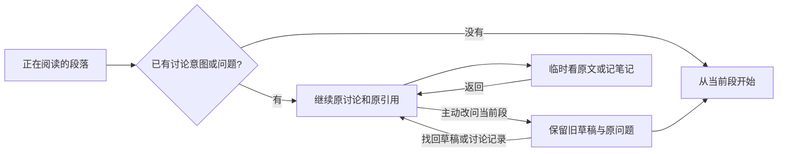

# 第三轮：从哪里开始问

隔离探针已复现：读到第二段、没有已有问题或草稿时，点“读到这里”却进入第一段。若确有第一段旧草稿，继续第一段是正确的，入口应说明这是已有讨论。

新入口区分未开始与已建立的讨论。没有有效讨论时从当前逻辑阅读段落开始；显式点陪读、解释选句、恢复讨论记录，以及已输入的问题/草稿，都建立讨论。仅选择文字不建立或改绑讨论。原问题、草稿和未完成提问保持原引用。

看原文和记笔记使用临时引用，不改写讨论快照。从阅读发起的笔记保存后回到阅读；从讨论发起的笔记保存后回到原讨论。笔记文字不回填讲解或问题。

已有讨论时入口为“继续讨论”。面板说明原句与当前阅读的关系；需要切换时由读者点“改问正在读的段落”。旧草稿沿用现有保存/找回机制，实际旧问题保存为原引用的讨论记录；不把固定问题示例当成用户原话，也不把未完成问题标成已回答。显式选句可建立独立上下文，不能被下一次打开悄悄改回整段。

正文层身份在深读时也要可见。导航保留书名、目录和排版的结构，增加一行简短的原文/示例直译/示例意译标识；讨论卡继续显示它自己实际绑定的层，不因正文切换而改引用。

范围仍为固定公版样章，不调用模型、不读取私人笔记、不写真实书房。验证使用隔离合成状态，覆盖新入口、旧草稿/问题/未完成提问、主动切换、旧草稿找回、选择未提交、显式选句、正文层变化和窄屏夜读。原生 iPhone、Safari、系统键盘、VoiceOver 与真实生成仍未验收。

轮内回归发现：在来自讨论的笔记面板再次选择别段时，临时页面曾丢失返回讨论的快照。新增连换笔记段落的失败复现，再保留原返回快照；自己的两段笔记与原讨论草稿各归其位。

发送新问题之前，另一个未完成提问按原引用留在“我的记录 → 讨论”，标成“未完成提问”；点击恢复后等待明确重试。在线发送、离线再次提交及互相恢复都不覆盖别段的待处理问题。已完成记录仍保留最近六条，未完成提问单独保留，不随已完成记录一起裁剪。
