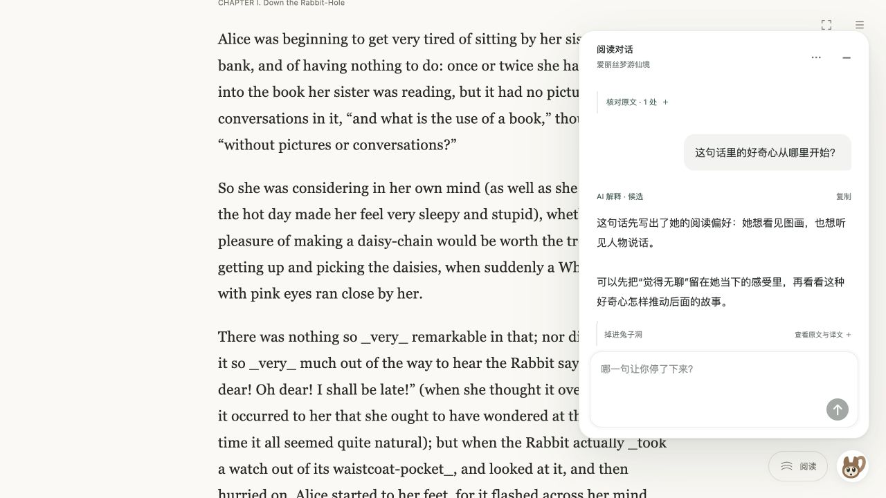
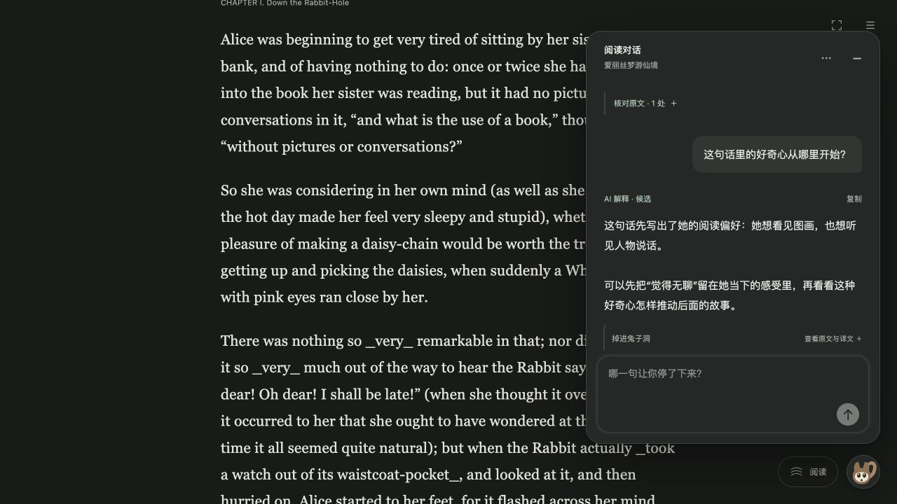

# 阅读对话验收记录

2026-10-15。实现、宿主接入与独立代码审阅已完成。记录覆盖本次浮窗重设计，不能作为真实付费模型、云端账号或实体手机输入法的验收证明。

## 实际页面

使用正式应用代码与本机临时服务，书籍来自项目公版目录。测试身份及阅读记录位于临时目录；没有读取真实用户书籍，也没有向云端书房写入资源。回答由明确注入的测试生成器返回，用于验证提交、显示与引用流，应用源码没有演示回答。

浏览器曾因连接和访问策略加载失败无法使用，恢复后在 Codex 内置浏览器完成以下操作：

- 从书房打开非模态对话，展开时仍能点击书架进入正文；阅读页加载同一对话历史及当前书名。
- 展开真实来源引用，点击「回到引用段落」：对话收起，仍停留在同一阅读 URL，正文定位到对应段落。
- 输入中文问题，收起后重新打开，原草稿完整恢复；提交后实际服务保存问题并返回带真实段落引用的测试回答。
- 桌面面板为 420 × 590px，阅读页实际背景为白色、细边框；正文为平台无衬线字体，15px / 28.5px 行高。
- 390 × 844px 窗口面板宽 374px，无页面横向溢出；阅读工具与松鼠入口各自可见。
- 390 × 300px 窗口聚焦输入框后，外层滚动位置为 0，收起按钮顶部约 19.7px，发送按钮底部约 269px。松鼠入口在紧凑展开时隐藏，避免遮挡发送；收起后恢复。
- 模拟系统暗色与减少动画：面板为 rgb(36, 40, 38)，文字为 rgb(232, 236, 232)，展开动画为 none。模拟设置随后清除。

实际浏览器检查发现并修复了全局 dialog 样式覆盖白底、阅读工具重叠、短窗口输入聚焦造成外层滚动，以及紧凑模式入口遮挡发送的问题。窄窗口检查属于浏览器尺寸测试，未声称实体手机键盘或系统输入法已实测。

## 自动检查与审阅

完整测试串行执行：495 项，494 通过，1 项按环境跳过，0 失败。首次使用外部 node_modules 符号链接导致运行时追踪的三项检查失败；改为工作区独立依赖目录后完整重跑通过，没有修改运行时实现或放宽检查。

打包并实际初始化隔离阅读运行时：927 个文件、约 9.0 MB，无模型请求。站点构建、公开构建内容检查、270 项软件文件发布白名单及来源验证均通过。

实现 Agent 与独立只读审阅 Agent 分工。独立审阅发现的正文键盘拦截和短窗口裁切问题已修复复核；消息增量更新保留未变回答节点及展开引用。独立聚焦测试 21 项通过，最终代码增量未发现阻塞问题。

## 证据边界

未调用付费模型；未验证真实云端登录及线上生成。原生中文输入法、实体手机键盘、200% 浏览器缩放、剪贴板和下载仍未在真实设备完成专项验收。相应状态与输入法保护由现有测试及新增回归覆盖，不把这些测试替身写成设备实测。

远程检查、合并和已有发布流程的结果以 PR 及工作流状态为准，提交本记录时尚未声称线上版本验收完成。

## 同步上游后的复核

PR 创建期间，主分支合入阅读设置与后台音频更新（#32，d17c227）。本分支同步主分支，唯一内容冲突为相邻的模块导入，保留两边导入及功能。同步后完整测试重跑：499 项，498 通过，1 项按环境跳过，0 失败。独立审阅再次核对聊天与设置接入，相关测试 13 项通过，无新增阻塞问题。

随后主分支合入书房个性化与赠书（#34，0fc06d6），本分支再次同步，无内容冲突。对最终集成重跑完整测试：563 项，562 通过，1 项按环境跳过，0 失败。独立审阅复核聊天接入的账号清理、书目回调、隐藏入口、样式及路由，另跑聊天界面与 HTTP 测试 11 项通过。聊天的实现与视觉保持不变。
