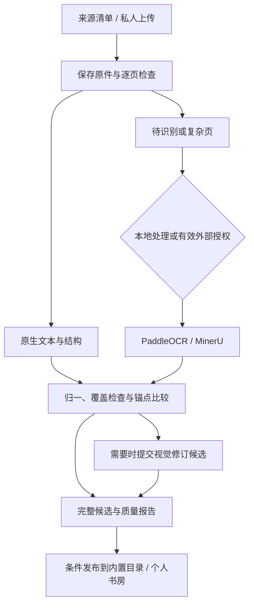

# Leafhour 书籍导入、原文版本与锚点迁移设计

日期：2026-10-17。状态：设计候选，供用户审阅；本次只交付设计和格式样例，不接通收费接口、不导入真实书籍、不改变生产数据。

## 1. 决策与范围

采用“自有内容格式 + 来源优先 + 按页分流 + 可恢复后台任务”。内置书和个人上传共用处理模块，但分别控制来源、访问权限和发布方式。会员 Agent 经 MCP 管理内置书批次、查看疑难页和提交修订候选；普通网页上传不要求用户自备 Agent 或模型会员。

用户已确认内置书属于公版或已获产品内提供授权。成功标准是原文完整、能回到来源、重新解析不丢用户记录，以及单位合格书籍的整理成本下降。免费额度和公开榜单用于选择试验对象，不能代替真实书籍验收。

本设计覆盖导入和提取校对。全书翻译、主动陪读、站外通知、通用知识库、向量数据库和自动搜集全网书籍不在本次范围。现有按段翻译与阅读 Agent 的授权范围保持原约定。

### 三种做法的比较

| 做法 | 得到什么 | 代价 | 本次选择 |
| --- | --- | --- | --- |
| 所有页直接交给通用视觉模型 | 原型快，提示词灵活 | 输出重生成、定位和结构仍需另做，会员限额与输出长度影响批次 | 仅作对照与疑难页修订 |
| 采用一家供应商的 JSON 作为书籍格式 | 初期接入少 | 换供应商会影响段落、笔记、备份与渲染 | 不采用 |
| Leafhour 内容格式，供应商结果经适配后成为候选版本 | 两条入口复用；供应商可替换；迁移可审计 | 先建立格式、锚点与任务契约 | 推荐 |

优先验证 PaddleOCR 官方服务，将 MinerU 官方精准解析服务作为同轮对照及备用候选；DeepSeek Flash 作为第三组和局部复核候选。生产默认由相同样书、实际在线模型版本和总成本共同决定。Mistral OCR 4.1 保留为可选第四组，不因旧版本分数直接排除，也不占第一轮必须完成的工作。

## 2. 当前实现及需要解开的耦合

以下为本次读取源码所得，不代表生产上传已验收：

- `server/document-import.mjs` 只接受 PDF/TXT/MD；PDF.js 提取文字，不执行扫描识别。上限为 20 MiB、500 页、约 200 万字符；扫描件会被拒绝。
- 当前段落 ID 为源文件哈希前缀加段落序号；`makeBook` 每 30 段建立一个“阅读片段”，不是原书章节。
- `server/library-service.mjs` 中 `contentVersion` 同时被用作正文版本和原文件哈希，原件下载也要求二者相等。加入重新解析后必须拆开校验，不能直接改一个字段就上线。
- 书籍与个人记录分开保存；高亮包含原文/译文层、UTF-16 偏移及准确引文。`app/highlights.mjs` 只在当前文本完全匹配时绘制；删除标记与重复提交别名必须保留。
- `app/library-backup.mjs` 当前接受 `kind: marginalia-library, schemaVersion: 1`，并要求书籍与记录版本相等；不能把新格式冒充成旧格式。
- 托管版目前用 Supabase 私人对象存储保存原件，用 `reader_documents` 保存 JSON；单书 JSON 约 3.5 MB 限制不适合加入全书坐标和供应商原始结果。
- 网页完成上传后直接解析，尚无可恢复的解析队列；Vercel 请求最长 120 秒。MCP 当前是阅读/记录/声音工具，没有书籍导入工具。

落地时新增一个深模块 `BookIngestion`，对网页、管理端与 MCP 提供同一组 Interface：准备、提交、查询/检查、提交修订、应用候选、取消。原生提取、Paddle、MinerU、任务存储、格式归一和锚点迁移是内部 Adapter。调用方不用了解供应商字段或轮询协议。

## 3. 内容契约：三层结构，四种身份

候选格式见 [book.schema.json](book-ingestion/book.schema.json)，人工构造的最小样例见 [book.example.json](book-ingestion/book.example.json)。它们是设计附件，当前运行时尚未加载该 Schema。

书 → 章 → 内容块是阅读结构；页面是证据位置，不是章节。一个段落可跨多页；一个章节也可包含正文、标题、脚注、表格、公式和图片块。嵌套小节以标题块及 `level` 表达，避免把层级塞回固定长度分组。

| 标识 | 含义及规则 |
| --- | --- |
| `bookId` | 书房中这本书的稳定身份，既有值原样保留；新值由领域服务分配，不能由模型指定归属 |
| `editionId` | 底本版本；出版社、译者、年代、章节范围或实质异文不同，不能仅凭同书名合并 |
| `sources[].sha256` | 实际源文件字节的校验和，只用于原件完整性和同账号去重 |
| `revisionId` | 一次不可变的完整候选快照；包括几何定位、来源及处理记录，重新提取可产生新值 |
| `contentVersion` | 当前可读内容及结构的版本；新书按下述确定性摘要生成。解析器版本或坐标单独变化不改变它 |
| 内容块 `id` | 逻辑段落身份；初建时分配不含顺序的随机 ID。一对一匹配时复用；不能从页码、数组下标或文本哈希重新生成 |

已有书引入格式时，保留原 `bookId`、章节 ID、段落 ID、`contentVersion`，标记 `contentVersionScheme: legacy-source-sha256`，不重排记录。发生首次实质正文/结构变更时才切到 `canonical-sha256-v1`。不能用新算法覆盖旧版本号的含义。

新摘要使用固定字段、固定顺序的数组投影进行 UTF-8 JSON 序列化，再取 SHA-256：`["leafhour-content-v1", editionId, title, authors, language, chapters.map(c => [c.id,c.title,c.kind,c.blocks.map(b => [b.id,b.type,b.level??null,b.text,b.attribution,b.footnoteRefs,b.payload??null])]), assetsSortedById.map(a => [a.id,a.sha256,a.mediaType])]`。不做 Unicode、标点、大小写或空白改写；不包含坐标、时间、供应商、个人记录。投影内所有对象键递归按 Unicode 码点排序，章节与块数组保序，阅读素材先按 ID 码点序排序；各语言实现使用相同无空格 JSON 编码，文字保留实际 Unicode，控制字符按 JSON 转义，并以共享摘要向量验证。当前摘要投影的数值只允许安全整数；定位坐标不参加摘要。`textDigest` 则对块的实际 `text` UTF-8 字节取 SHA-256。阅读素材 ID 与字节均不可原地覆盖；证据页截图放在处理结果包，不放入阅读素材数组。

### 每块必须保留的证据

`sourceAnchors[]` 记录源文件 ID、原始 PDF 页码、印刷页标记、坐标和来源定位。PDF 页码从 1 开始；未知印刷页为 `null`，不能全书使用固定差值猜测。EPUB/HTML 没有固定页码时，页码和坐标为 `null`，使用文件内路径、元素 ID 或外部修订定位；不能生成虚假的 PDF 页码。

坐标为旋转和 CropBox 处理后可见原页的左上角坐标系，归一到 `[0,1]`，矩形顺序为 `[x0,y0,x1,y1]`。适配器必须保存供应商原始坐标系、转换参数和原始页映射；不能在切片后把第 1 页冒充原书第 1 页。跨页段落保存多个定位，不把整页包围框当作精确段落框。缺坐标允许 `null` 并附质量问题，不能伪造。

块 `text` 是保留出处的阅读底本；提取原始结果另存。清理断行、合并跨页、移走重复页眉等变换记录输入、输出和规则版本。简繁转换、古籍现代标点、补字、改写均不能作为无痕清理。修订候选、人工采纳结果、原作者注释和编辑补充分别归属。

脚注也是块。`footnoteRefs` 指向脚注块并保留原标号与正文偏移；脚注块放在所属章内，阅读顺序与脚注显示位置分开处理。块 `attribution` 区分 `source`、`author`、`translator`，不能把译者注标成作者原注；来源无法确定时保持 source。边注和译者注不能混成正文；表格保留结构与原图，公式保留 LaTeX/原图，插图保留素材和说明。供应商的丢弃区结果也要保留并检查，不能只接最终 Markdown。Leafhour 新增的编辑补充另存覆盖层，不在此数组冒充底本。

`review` 区分 `extracted_unreviewed`、`source_checked`、`visually_checked`。来源网站声称已校对时记录在来源元数据；模型自报“高置信度”或两个模型一致，不会自动升级为 Leafhour 人工视觉校对。

译文、编辑注解和私人记录不混入 canonical 原文块。直译/意译继续独立保存；译文覆盖层绑定块 ID、原文字节摘要、语言、译法和译文自身版本。原文改变后保留旧译文，并标为待复核，不自动沿用 reviewed 状态。

### JSON Schema 之外的语义验证

Schema 校验形状；发布门禁还必须检查全书 ID 唯一、来源/处理记录引用存在、脚注目标类型正确、素材存在且哈希匹配、页覆盖一致、坐标面积为正、UTF-16 范围不截断代理对、摘要可重算。缺失原件的备份可以作为文字恢复包，但不得声称已经验证原件完整性。样例不含真实 PDF；其中 PDF 哈希和几何值只是人工构造，不构成解析证据。

## 4. 重新解析与记录迁移

核心原则：旧快照永远可读取；新结果先成为候选。块匹配和用户记录重新定位是两件事，必须分别评估。

| 变化 | 块 ID | 对个人记录的处理 |
| --- | --- | --- |
| 同底本、文本和分段不变，只有坐标/处理器变化 | 全部保留 | 原版本继续有效；只更新来源快照 |
| 一对一、文本完全相同，但章节位置改变 | 唯一匹配后保留 | 更新绑定的章节，准确引文复验 |
| 一对一、确认是同段但改正少量识别错误 | 保留并更新摘要 | 段落笔记保留且提示底本变化；高亮须重新找到准确引文，否则待定位 |
| 一段拆成多段、多段合一 | 产生新块 ID，保存多对多 lineage | 仅能无歧义恢复的准确选区自动绑定；整段笔记或范围跨越含义不清时待定位 |
| 相同句子在多处出现 | 不能仅凭全文搜索匹配 | 使用相邻文字、来源和顺序消歧；仍多解则待定位 |
| 段落删除、无法识别，或底本实质不同 | 不猜位置 | 保留旧引文和旧书位置，提供原版本查看 |

匹配先按明确版本/来源定位和完整文本，再结合邻段、受限顺序匹配和可解释的规范化候选。坐标与模型相似度仅提供证据；不能只因“相似度超过某分”自动关联。不同底本默认另建 edition，不让同书名触发迁移。

个人选区使用 `bookId + contentVersion + blockId + layer + exact + prefix + suffix + start/end`。借鉴 W3C TextQuoteSelector 思路，但偏移单位明确采用现有浏览器 UTF-16，与 W3C 字符位置选择器不宣称完全等价。保留原记录、原偏移及原引文，在独立 `anchorBindings` 保存新版本目标、匹配方法和审阅状态。

自动绑定必须满足准确选中文字全部保留、来源和邻文足以唯一消歧、目标顺序合法。高亮渲染前仍做当前层准确文本匹配。译文选区只在相同语言/译法/译文版本内匹配，绝不投影到原文。拆段后超过当前客户端 8 个片段或跨章的选区，保留记录并待定位，不能截断。

评论、问题、阅读位置、对话引用、声音来源与搜索索引均需要版本处理：评论原话不改；位置可映射至已确认对应段落，但无法恢复精确段内位置时显示提示；旧对话/声音仍指向旧快照；搜索索引按新内容版本重建，未完成前使用正文检索。删除高亮的 tombstone、requestIds 和取消标记必须跨版本保留，不能因迁移重现。

### 发布一致性与备份

发布候选前写完不可变内容、映射、质量报告和全部素材；复核摘要后，使用数据库条件更新切换 `activeRevisionId`。租约 fencing token 与预计的旧版本必须同时成立。新客户端按读取时捕获的版本访问块和记录视图，不能一次请求混用两个快照。

个人记录保存时仍携带其原始目标版本，绑定视图单独版本化。旧客户端对已升级正文的写入明确返回 409，保留本地草稿并给出刷新/导出入口。应用新版本与撤销操作不能覆盖同期新增的个人记录。管理端只迁移共享内容，不读取私人笔记；个人绑定由账号领域服务按需计算。

`marginalia-library` 名称保留。现有 v1 备份永久可导入；引入多版本记录与待定位状态时采用新的 `schemaVersion: 2`，包含原记录、绑定、旧目标快照和素材清单。v1 导出仅限能无损表达的书籍；不能把待定位记录静默过滤后宣称完整备份。新备份须在干净实例恢复，并实际核对原文、译文、记录、删除状态和未解决锚点。

原件下载改为对 `sources[].sha256` 校验字节，不再与 `contentVersion` 比较；旧书继续适用旧校验方式，不能放松原件校验。旧阅读数据与旧目录保留，不在本项目自动删除。

## 5. 内置书：来源清单先行

先建立人工批准的来源清单，每条记录作品、具体底本、语言、译者/校订者、格式、获取位置、网站修订/文件哈希、来源校对状态、许可与署名要求、完整/节选范围。只有版本可匹配、质量与许可确认的条目进入目录。ISBN 缺失不妨碍收录，但同书名不意味着同一版。

来源优先顺序是已授权的出版社 EPUB/HTML/XML，其次是对应版本的 Standard Ebooks、Project Gutenberg、Wikisource 等现成文本，最后才解析 PDF。不能用网上另一版文字替换用户上传的 PDF 并声称逐页对应。

英文公版优先评估 Standard Ebooks 与 Gutenberg 的 EPUB/HTML。批量获取遵循各站公布的下载/镜像方式，不遍历站点搜索页面。Wikisource 同时记录页级校对状态；优先 Validated，但不能把整个站点标成“全部已校对”。中文古籍从可核对底本的 Wikisource 和已获许可的电子文本开始；ctext 作为候选来源和核对链接，取得数据使用授权后再批量导入。本次 ctext 正文/条款抓取受 403 限制，未证实可自由批量再分发。

内置书批次工作顺序：清单 → 原始文件留档 → 原生解析/必要识别 → 结构与覆盖检查 → 疑难页复核 → 抽检及授权范围确认 → 发布版本。处理工具完成批量 IO，Agent 分页查看质量问题，不把整批书塞进一次模型上下文。修订只提交候选；发布权来自预先授权的批次范围与目录编辑身份，不能从书内文字取得。

## 6. 用户上传：隐私选择与页面分流

“本地/自托管处理”“保存到我的书房”“允许外部识别”是不同的数据动作。托管版即使只做原生提取，原文件也已上传 Leafhour；不能用“本机处理”误导用户。

默认流程先保存私人原件，完成文件校验和每页检查。确认上传后的原件归该账号的导入任务，解析耗时不受临时上传链接寿命影响；失败仍可恢复或导出，未完成内容不会冒充已入库成品。第一批保持当前 20 MiB、500 页和约 200 万字符的产品上限，不因供应商接收更大文件便自动扩大范围。正常文字直接提取；扫描、乱码、复杂阅读顺序进入待处理范围。封面、空白页与纯插图不能因为字少就误判为识别失败。正常数字 PDF 的多栏问题可用版面恢复解决，不一定需要重新识字。

需要外部处理且没有对应有效授权时，显示一个有实质信息的选择：例如“有 28 页需要文字识别。将这些页面发送给 PaddleOCR 官方服务；这不会上传你的笔记。”展示实际接收方、发送范围、可能费用和已核实的保存/删除说明。用户可允许本书、保持原文件阅读或选择已配置的本地处理。产品不要求每页确认，也不把授权隐藏在供应商技术设置中。

保存 `consentReceipt`，绑定账号、源文件哈希、用途（识别/视觉修订）、接收方、页面/区域范围、政策版本、费用上限、有效期和撤回状态。“允许 PaddleOCR 识别”不自动允许把页面再发给 DeepSeek；接收方或用途变化需已有覆盖授权，否则返回待授权。切换备用供应商也不能越过此检查。

每次外部请求前及结果发布前检查授权；撤回后禁止新的请求与新结果发布，已发出的请求可能仍被处理/计费，不能承诺即时远端删除。远端删除按能力执行并保留状态；能力未知则明确说明，不宣称零保留。

源文件默认走私有上传路径。只向供应商发送批准的连续页组或局部图片，页面范围参数不能被当作“只发送这些页”的保证：若 API 要求上传整本文件，必须先在 Leafhour 提取所需页并保留原页映射，或取得整本传输授权。只使用短期授权资源，禁止永久公开书籍 URL；不得附带笔记、聊天、账号邮箱或其他书籍。

同账号同源文件哈希、策略和配置版本可复用已完成结果；不向其他账号暴露私人文件是否存在，不做私人文件的跨账号命中提示。内置公开底本可以复用管理员批准的结果，个人译文与记录仍独立。

## 7. 解析、修订与持久任务

### 模块与存储

`SourceResolver` 只处理已批准来源及版本证据。`BookIngestion` 持有任务状态和策略；内部包含原生、Paddle、MinerU Adapter、格式归一、质量门禁与迁移。网页和 MCP 调用领域 Interface，禁止另建直接写数据库的导入通道。现有 `tools/import-supabase-book.mjs` 面向旧单书表，不能作为多账号导入入口。

大原件、供应商结果包、逐章内容和素材放私人对象存储；小 manifest、索引、任务状态和原子发布指针放数据库。私有包在真实账号命名空间，公开包仅由目录编辑操作发布。几何和原始结果不塞进现有 3.5 MB 单书 JSON。逻辑上可导出一个完整书籍包，物理上按章分片；原有 API 通过版本化投影读取。

第一批使用当前 PDF.js 作原生基线，独立评估 LiteParse 能否改善多栏顺序与逐页诊断；不在接识别供应商时同时替换所有解析路径。EPUB 读取 manifest/spine/nav，HTML 读取已有语义结构并净化内容，保留原始文件及资源关系，不执行脚本或任意外链抓取。

### 任务机制

托管版使用 Supabase PostgreSQL 增加导入任务/页组状态及租约记录，独立 Node worker 执行长任务；推荐托管运行形态为 Cloud Run Jobs（按批唤起、单 worker 起步、无 GPU）。API 仍留在现有 Vercel，提交返回 202 和任务 ID；不在浏览器/MCP 请求内等待全书。自托管运行同一 Node worker，使用本机持久日志和单写锁 Adapter。此设计不创建这些云资源。

任务状态为 `received → inspecting → awaiting_consent | queued → parsing → checking → review_required | ready → applied`，另有 `failed`、`cancelled`。等待授权不是失败；有正文缺页不准标成 ready。允许用户先查看已完成部分，但必须显示覆盖范围，部分结果不能替换已经完整的旧书。

每个工作单元记录账号、任务/页组、原页映射、源哈希、请求指纹、处理器配置、请求/实际模型版本、远端 ID、输出哈希、计费用量、重试次数、授权回执、租约代数和取消代数。数据库条件更新领取租约；旧 worker 失效后不能提交。按账号/批次限制并发和预算；预留、实际结算和退款写入账本，不能靠 Agent 自报成本。

处理连续页组，默认最多 20 页、保持跨页段落上下文；供应商上限更小时继续缩小。为拼接需要额外发送邻页时，也要纳入传输授权、预算和请求身份。先检查原页覆盖，再按原页顺序拼接。空白页也有明确覆盖记录，不能以输出块数充当完整页数。

同账号同请求指纹的重复提交加入已有任务。知道远端任务 ID 时轮询/取回，不能重新付费提交；请求超时且是否受理不明时进入 reconciliation，等待可核对结果或用户明确重试，不盲目发送。取消后递增代数，迟到回调可以记账、留存诊断，但不能发布正文、恢复已删除记录或自动重新提交。

供应商回调按文档校验签名并绑定原任务，结果拉取不接受任意 URL；ZIP 展开限制路径、大小、文件数及类型。远端输出、HTML 和 PDF 内容均作为资料，不能成为 Agent 指令。原始成功结果保留，归一规则调整可离线重做，减少重复调用。

### 供应商契约与路由

Adapter 输入为已经授权的字节/临时资源、原页范围及映射、明确配置和预算；输出统一为带来源块、页覆盖、原始包引用、版本证据、质量问题和实际用量。坐标、脚注、置信分数或版本字段缺失时返回明确 unknown，不补造。生产策略只选一条默认识别路线和一条经授权的备用路线，不做每页多模型投票。

Paddle 官方为优先验证候选，特别关注中文古籍、生僻字和脚注。MinerU 使用官方精准解析接口作对照；不使用仅返回 Markdown 的 Agent 轻量接口作为最终书籍底本。DeepSeek 用于选定难页/裁切区域，修订输出必须引用本次实际看到的区域，并逐项展示差异，不允许凭背景知识补写缺失原文。看不清保留不确定状态。模型输出过长或范围不完整时按失败重试，不截断后接受。

## 8. MCP 最后接入，复用已有任务

设计新增 `reader_prepare_import`、`reader_submit_import`、`reader_get_import`、`reader_propose_import_patch`、`reader_apply_import`、`reader_cancel_import`。查询工具分页返回进度/质量问题，也可按指定原页取得图像证据；不默认返回全书。批次是若干幂等任务的集合，后台批量 IO 不依赖 Agent 连续逐页调用。

现有阅读 grant 绑定已经存在的书，不能复用来创建书籍。新增预创建的导入批次授权，绑定账号、批次、允许来源/资源、私有或共享目标、供应商/模型用途、页数/金额上限和有效期。普通账号只能写自己的书房；共享目录写入需要目录编辑身份。`reader_submit_import` 只能引用已授权资源 ID，不能让远端 Agent 传任意本机路径或切换 owner。所有写入有幂等键，apply 带候选摘要及预计旧版本。

用户可预先批准“这批来源内、质量门禁通过的书自动加入指定书房”，工具按照范围执行，不重复逐页确认。疑难项停留候选；公开发布必须有对应发布权限与批次授权，不能把解析权限等同公开权限。

会员模型由宿主 Agent 管理；MCP 不提供会员额度，也不把某个管理员个人会员自动变成网页用户共享后端。内置书可由用户登录的 Codex 等宿主驱动批次；普通上传使用网站已配置的处理路线。接入官方 Paddle MCP 可以辅助试验，但写入 Leafhour 仍经过自己的任务与领域验证。

## 9. 200 页对照与明确门禁

使用 10 本许可已确认、能够核对底本的代表性书籍，每本选 20 页，共 200 页；保留连续页组，至少包含 20 个跨页接缝，不能全部随机单页。人工基准先建立，再冻结任务配置和提示词。按书籍划分 100 页调参与 100 页保留评估，保留页不参与改提示词和路由阈值。相同输入、同一文本范围、同一版面标注与同一计时方式用于三组。

| 类型 | 页数 |
| --- | ---: |
| 英文数字 PDF / HTML / EPUB 对应版面 | 40 |
| 中文现代印刷书扫描 | 40 |
| 中文古籍、竖排与异体/生僻字 | 40 |
| 双栏、脚注密集和跨页段落 | 40 |
| 混合页、插图、表格、公式与低清扫描 | 40 |

200 页用于解析质量对照；EPUB/HTML 导入和往返另用对应原生文件验证。数字 PDF 的正常页应走原生路径，并记录“是否被错误送往识别”。原生格式不能为凑页数而截图重识别。

首轮比较 PaddleOCR 官方实际在线模型、MinerU 官方精准解析、DeepSeek Flash 直接视觉提取。能固定版本时固定；只能选择别名时保存别名、请求时间、原始响应和服务返回版本，实际权重未知必须明确标记，不能拿开源权重版本冒充云端实测模型。

| 指标 | 定义与建议验收目标（目标不是已达成绩） |
| --- | --- |
| 原文错误 | 插入/删除/替换编辑距离除以基准字符数；分别报告保留标点的严格值及仅统一换行/空白的辅助值。中文按 Unicode 码点，保留异体字；按类别和书籍报告，不能只报平均分 |
| 普通印刷正文 | 保留评估集字符错误率 ≤0.2%；不把此目标套给低清古籍，古籍必须报告原始结果及人工修订后残余错误 |
| 完整性 | 页状态 100% 有交代，基准正文块零静默遗漏；原生/识别接缝处无漏段、重段和重复脚注 |
| 顺序与脚注 | 接缝及抽检关键块顺序正确率 100%；脚注内容检出率、引用绑定正确率分别报告，发布版本不得有未说明的漏注 |
| ID 保留率 | 在人工确认的一对一逻辑块集合中，保留旧 ID 的数量/该集合总数；坐标或解析器单独变化要求 100%。另报告拆合段覆盖，防止通过缩小分母美化成绩 |
| 记录重定位 | 自动迁移准确率（目标绑定被人工确认正确/自动迁移数）、总可恢复率、待定位率分别报告；构造对抗样本自动错绑必须为 0，不能靠强行绑定提高保留率 |
| 人工校对时长 | 每本从候选到合格所用主动编辑分钟数；工具自动排除等待/后台时间，报告页数、类别、编辑次数与重做时间，不能只测难页而外推整本 |
| 成本与等待 | 实际付费调用、重试、邻页、推理/输出、存储、worker 和人工成本；同时报告无试用额度情况下的成本、P50/P95 可读与完成耗时、失败恢复耗时 |

另建立完全人工构造的锚点回归集：重复句、插入前言导致页码移动、修正 OCR、拆段/合段、章节改名、emoji/代理对、简繁异文、译文变化、已删除高亮、过期版本提交、取消后迟到回调。要求原记录及原目标快照 100% 留存、错层迁移 0、已删除记录复活 0。该组不需要收费模型。

选型先过完整性、错误率、记录保护、授权、可恢复和上线可用性门禁；再比较“每本合格书的总成本”。人工成本按编辑小时乘可调整时薪，免费活动额度与常规成本分列。样本不足、未取得生产使用条件或没有实际云端调用时，不宣布某家是生产赢家。

## 10. 实施顺序与停止条件

| 阶段 | 交付 | 通过后才能进入下一阶段 |
| --- | --- | --- |
| 1 格式与兼容 | Schema、语义验证、旧书无损读取投影、版本拆分与合成迁移夹具 | 既有 ID/版本/双译/删除标记保留；原件下载校验未被放松；新格式导出恢复验证 |
| 2 来源与原生导入 | 经批准来源清单、EPUB/HTML/PDF 原生路径、覆盖与脚注检查 | 版次及许可可核对；原生文件无模型费用；不改写作者正文 |
| 3 官方对照与后台任务 | 私人授权、任务/租约、两家官方 Adapter 和 DeepSeek 对照、200 页质量报告 | 实际接收方/模型证据/费用清楚；断点、重试和撤回有效；按总成本选默认 |
| 4 网页与版本发布 | 部分可读状态、疑难页修订、富块渲染、版本切换、个人绑定视图 | 真实账号完整上传/重开/重解析/恢复；匿名及隔离身份不能读取；备份新实例复原 |
| 5 MCP 批次 | 复用领域 Interface 的批次授权和六个工具 | 真实宿主提交、断开恢复、查看证据、提交候选、取消与应用均有回执，不能越权 |

阶段 1 不强制将所有旧书重写成新格式；先用读取 Adapter 和隔离夹具验证。不能无损投影到当前段落渲染器的表格/图片等内容，在阶段 4 渲染支持完成前只保留候选并提供原件，不把格式校验通过当成阅读已支持。

每阶段独立交付与验收。本设计不授权批量搬动现有书库、实际收费处理、全书翻译或自动发布新书。未来需要持久保存的验收书归默认测试账号，先从 Auth 取得真实 ID；单元夹具仅用临时数据。

## 11. 本轮事实核验及选型依据

核验日期为 2026-10-17。以下均为官方源码/文档或网站公开说明，未登录核对账号额度、服务开通、商业使用条款或数据保留配置，也未调用模型。报价和额度均不作为产品常量。

1. [PaddleOCR 官方当前文档](https://www.paddleocr.ai/main/)：已发布 VL-1.6；首页公开说明免费 API 上限提高至每天 20,000 页。此前 1.5 / 3,000 页的说法不能直接沿用。该上限不证明当前账号、模型、并发、生产使用资格或可用性承诺。
2. [PaddleOCR 官方 API](https://www.paddleocr.ai/main/version3.x/inference_deployment/serving/paddleocr_official_api/overview.html)：有 Node.js TypeScript SDK，支持提交文件、异步任务轮询和结果解析；调用 SDK 不表示模型在本机运行。[官方 MCP](https://www.paddleocr.ai/main/version3.x/integrations/mcp_server.html) 可用于验证，不替代 Leafhour 的权限和导入事务。
3. [OmniDocBench 官方仓库](https://github.com/opendatalab/OmniDocBench)：本次读取的 v1.6_full 表含 PaddleOCR-VL-1.6 96.34、MinerU2.5-Pro 95.75、PaddleOCR-VL-1.5 94.93、Mistral OCR 85.66；Mistral 的评测版本字段为 2503。这些是同表综合指标，不是整书字符正确率；不能用旧榜单约 79 分评价 [OCR 4.1](https://docs.mistral.ai/models/ocr-4-1)。主仓库不同段落存在 v1.6/v1.7 更新描述，实际复测必须固定代码/数据版本。
4. [MinerU 官方接口文档](https://mineru.net/apiManage/docs)：精准接口支持异步、批量、页范围及 Markdown/JSON 包；公开页面写单文件 200 MB/200 页和每天 1,000 页最高优先级，超额降低优先级。它不是付费生产吞吐或永久免费承诺。`pipeline` / `vlm` 是选择项，不等于固定权重版本；Agent 轻量接口仅返回 Markdown。[MinerU 输出契约](https://opendatalab.github.io/MinerU/reference/output_files/) 可作格式适配参考。
5. [DeepSeek 模型及计费](https://api-docs.deepseek.com/quick_start/pricing/) 与 [视觉接口](https://api-docs.deepseek.com/guides/vision/)：Flash 支持图像；按 token 计费且大图会缩放，难辨的小字应按批准范围裁切。不能从长上下文推断整书 OCR 准确率。
6. [Standard Ebooks](https://standardebooks.org/)、[Gutenberg 批量访问方式](https://www.gutenberg.org/policy/robot_access.html)、[Wikisource 校对状态](https://en.wikisource.org/wiki/Help:Page_status)：现成文本应优先，但分别保留底本、版本、完整范围和来源校对状态。[CTP API](https://ctext.org/tools/api/ens) 的公开搜索摘要说明存在使用限制；本次直接正文抓取 403，未完成许可核验，故不将其列为可直接批量复制的默认源。
7. [LiteParse 按页检查](https://developers.llamaindex.ai/liteparse/guides/complexity/) 与 [Parse Gateway](https://github.com/run-llama/parse-gateway)：证明页面分流有现成实现可参考；示例不是持久队列、个人记录迁移或当前部署的验收证据。
8. [W3C Web Annotation](https://www.w3.org/TR/annotation-model/#text-quote-selector)：引用原文及前后文可作重定位证据；本设计保留 Leafhour UTF-16 兼容口径，另加版本与来源约束。

## 12. 设计自检与交付证据

设计自检检查了标识/摘要口径、跨页定位、迁移多对多、译文层、旧备份、原件下载、私人授权、页组传输、取消代数、租约、费用和实际版本不明等冲突。本轮离线验证结果：

- Draft 2020-12 Schema 自身合法；包含跨页段落、脚注与 emoji 的人工样例通过形状检查。
- 临时验算脚本核对引用、页覆盖、坐标、UTF-16 范围与摘要，并拒绝 10 个形状错误和 9 个语义错误样例。这是设计附件验算，不是运行时验证器已经实现。
- Python 与 Node 对样例计算出相同正文摘要 `7dfcd44ea5d413ce5e1a9868fe37d1deac3259c24bf5a9ec5347dd29afd03833`。
- `node --test tests/library-export.test.mjs tests/highlights.test.mjs tests/reading-pending-backup.test.mjs`：15 项通过，0 失败；证明既有相关逻辑的当前测试状态，不证明新迁移算法已实现。
- 设计内本地附件链接有效，未留下未决占位符。

真实识别质量、供应商账号额度、200 页对照、线上上传与跨版本恢复尚未验证，不能以本次文档交付替代。
