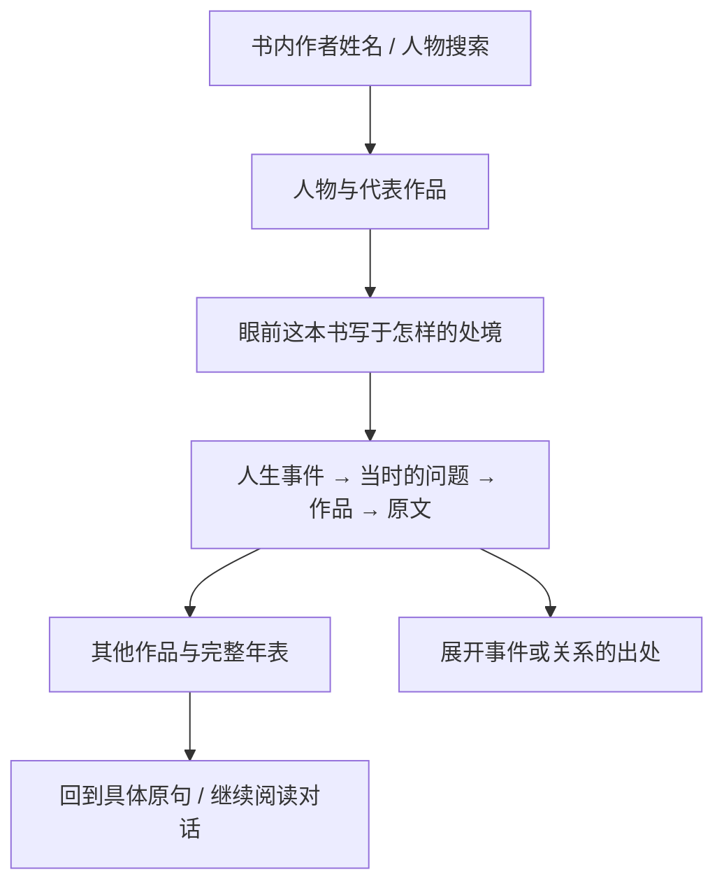

# Leafhour 人物页：在一个人的一生里读一本书

日期：2026-10-27。用户已选择“文学馆式叙事”。用户已确认完整设计，并要求打磨每个页面、按钮、交互和动效。本轮已进入实现，发布与验收另记。实现与评测结果将另记，当前没有分数。

人物页沿着生平、作品与原文展开。读者能理解眼前这本书写于怎样的处境，找到值得停下来的原句，再带着问题回到书里。页面和阅读 Agent 使用同一份人物资料及证据。

## 1. 已确定的方向与取舍

用户要求：高质量人物主页与分享；兼容多语言；生平与作品两种时间线融合；有出处的重大事件、作品与原文；通过 skill 形成稳定的撰写逻辑；Agent 能搜索、创建、更新、提取和删除人物，并结合生平与书回答问题；建立多维评测，目标严格超过 98/100。

比较了三个方向：

| 方向 | 好处 | 代价与决定 |
| --- | --- | --- |
| 文学馆式叙事 | 事件与作品交替出现，适合连贯阅读和情感停顿 | 需要编辑主次；用户已选择，作为主结构 |
| 人物档案式浏览 | 基本资料、履历、作品容易定位 | 容易把关系切碎；借用其紧凑信息区和跳转目录 |
| 每次打开都实时生成长传记 | 冷门人物也可立即尝试 | 等待、费用与事实漂移破坏阅读；页面读取保存版本，生成由明确操作启动 |

下文的具体尺寸与工具名称，以及容量与首批案例，都是本次设计建议，由实现者在满足契约的前提下调整。它们不是用户已经逐项批准的事实。

## 2. 现有实现与接入点

已检查本地公开仓库 `getyak/leafhour`。当前为 Node 服务与原生 HTML/CSS/模块脚本，不迁移前端框架。书籍信息位于 `app/index.html` 的 `#book-info`，由 `app/reader-book-actions.mjs` 增强。目前作者是书目文字，没有独立人物领域服务或完整人物主页。

`server/reading-agent-tools.mjs` 已提供书目与分页正文，也支持检索、网络搜索和本轮精确引文登记。`server/reader-chat.mjs` 捕获用户、当前书及本轮范围。`harness/chat-generator.mjs`、`harness/chat-plugin.mjs` 执行官方 DSH 工具流程。扩展这些边界，不另建聊天系统。

`skills/leafhour-reading/SKILL.md` 是已有外部阅读 skill。新增人物 skill 放在同一目录体系。远程 MCP 的按书授权、本机 stdio 与站内阅读范围分别处理。存储复用领域服务和 `read/mutate` 适配器，使本机与托管使用相同校验，不把托管写入存到临时目录。

当前工作区含其他任务的未提交改动。实现使用隔离的公开仓库工作分支，只提交本任务文件。不能覆盖现有聊天、语言目录或测试修改。

## 3. 参考研究怎样影响设计

| 一手参考 | 已观察到的组织方式 | 本次转译 |
| --- | --- | --- |
| [LinkedIn Featured](https://www.linkedin.com/help/linkedin/answer/a552452/featured-section-on-your-profile-faqs) | 精选作品作为经历的证据 | 首屏少量代表作品；作品有内容与入口 |
| [司马辽太郎纪念馆：作品年表](https://www.shibazaidan.or.jp/world/) | 年份与作品、奖项并置，另列身后出版 | 生平与作品共享时间轴；身后影响独立标识 |
| [日本国立国会图书馆：夏目漱石](https://www.ndl.go.jp/portrait/datas/307/) | 肖像、姓名异称、生卒、说明与馆藏原稿连接 | 身份区简洁，资料可以继续追溯到原件 |
| [Smith College：A Room of One’s Own](https://www.smith.edu/libraries/libs/rarebook/exhibitions/conway/room.htm) | 作品连接 1928 年演讲与 1929 年出版 | 将创作和出版分成不同事件，并给关系附来源 |
| [Mary Shelley：1831 年序言](https://www.gutenberg.org/files/42324/42324-h/42324-h.htm) | 作者回顾 1816 年的写作起源 | 记录事件发生时间与回忆发表时间，不混成同期记述 |

已用真实浏览器查看国会图书馆人物页和司马辽太郎作品年表。前者以较大的肖像和旁边的资料区建立人物辨识度，原件入口可继续追溯。后者把年份与书封对齐，但完整年表的密度较高。Leafhour 保留肖像、资料与作品的关系，先选重点事件供连续阅读，再让完整年表按需展开。两张参考截图保留在本机研究输出中，不能替代新页面的画面验证。

三岛由纪夫文学馆在本次访问时显示维护，漱石山房主页抓取超时，不将这两个主页作为已完成视觉验收的依据。不复制馆徽或整页版式，也不复制照片和正文。

## 4. 页面是一条可以读完的线

### 进入与返回

作者姓名进入 `/people/:personId`。从书籍进入可带 `?work=:workId`，仅携带公开作品标识。私有书 ID、私人书名、段落、笔记及阅读位置不进入公开地址。原页面把回程位置保存在本机当前账号的临时导航状态里，返回时恢复同书同段。直接打开公开链接不依赖该状态。

点击书名仍打开现有书籍信息。从其中选择作者或“这本书的来处”进入人物。多作者、译者与编者分别显示，传统归属也单独标明，不能把书目整串拆成一个虚构人物，也不把译者生平算到原作者身上。

### 阅读顺序

1. **认识这个人。** 姓名、原文名、生卒或“生于”、一张真实且许可可用的肖像、约 60–120 字人物引入。首屏只放一个继续阅读入口与安静的分享按钮。
2. **这本书的来处。** 从作品进入才突出。说明写作之前的处境、作品提出的问题、写作/连载/首版的过程，以及随后有据可查的变化。先解释眼前这本书，再展开一生。
3. **一生与作品。** 顺时呈现 4–8 个重点时期，默认约 10–16 个事件，完整年表可展开。每个时期有具体场景或问题、重大事件、同阶段作品，选择性穿插一段原文。事件不必年年齐全。
4. **继续读他的作品。** 完整作品索引独立于精选；每项有作品类型、原名、首版时间和可读状态。软件、产品、演讲等可用同一作品模型。没有书房正文时给书目或来源，不伪造“开始阅读”。
5. **带着一句话回去。** 最后保留一处有定位的原文和一两个可继续思考的问题，不替读者总结人生教训。点击“和这句话聊聊”回到原有阅读对话，先填入问题，由读者发送。
6. **资料与版本。** 正文就近有轻量出处入口，完整来源与版本放末尾及展开详情。重要争议、不确定年份和推断在相关内容附近可见，不能藏到页底。

### 视觉与排版

沿用 Leafhour 清纸、墨色与墨绿。桌面内容约 1080–1160 px，正文 600–660 px，左侧约 150 px 为时期与跳转。肖像约占首屏三分之一，与姓名和短引入对齐。没有许可可用图片时改为文字构图，不生成假历史照片。年代是定位，避免大数字抢走人物。

中文叙事使用现有本地宋体，英文使用现有衬线字体，界面与资料标签用现有无衬线字体。长姓名、日文与拉丁文字分别检查断行。正文约 19–21 px、行高 1.85–1.95。留白区分时期，细线关联同阶段事件，作品用书脊或小幅封面提供变化。只有重要原文获得更大字阶，不把每段做成卡片。

手机变为单列，肖像保持主体完整，年份贴近对应事件。目录可折叠。不使用横向拖动年表。320/390/768/1440 px、大字与夜读分别检查。可读内容不依赖滚动动画出现。减少动态时仍完整。普通文字可选择复制，链接与选字不会触发跳转。

### 分享

首屏与重点原句旁使用相同的细线图标与“分享”文字，触控目标至少 44 px，焦点清楚。打开轻量面板后预览人物卡或“人物 + 一句原文”卡，可复制链接或保存图片，也可在浏览器支持时调用系统分享。用户取消系统分享不显示失败。

竖图默认 1080×1440，另提供方图。长原句按真实排版分页，不能截掉结尾或静默缩成摘要。图上保留人物、年份、作品、原句、必要的原文/译文标识和返回公开页的路线。图片作者与许可保存在资料详情和下载伴随记录，遵守实际许可所需的署名位置。没有许可时省去照片，保留文字构图。

预览使用服务端的公开内容投影。用户私有译文、书籍正文和个人记录不进入公开页面、图片链接、社交元数据或搜索索引。私人内容可在用户主动本机导出时使用，但不能因此建立公开地址。分享旧版本前重新核对引用及公开状态，失败则保留预览与重试。

## 5. 内容与证据模型

**Person** 有稳定 ID、原文名、按语言保存的姓名/别名/简介、身份标识、肖像、出生与逝世日期、修订号及资料状态。人物身份与语言无关，不能切语言就创建另一个人物。日期保存精度与范围，支持仅年份、约年、争议、未知与在世。不能用空死亡日期推断仍在世。

**LifeEvent** 保存事件类型、起止日期、地点、叙述、相关人物/作品以及 `claimIds`。出生到最后已知事件完整可追踪，资料稀少的时期允许空缺。身后再版和影响不放入本人生命阶段。

**Work** 区分作品与具体版本。保存书籍/产品/演讲等类型、原名与各语言标题、作者角色、写作/连载/首版/再版等独立日期、外部典据标识、本地可读映射及精选说明。某译本出版年不能覆盖作品首版年。

**EvidenceSource / Claim** 保存来源标题、机构或作者、规范 URL、出版与抓取时间、已核对的有界片段、许可、内容指纹和定位。每条生卒、事件及创作缘由指向具体 claim。搜索摘要只算线索，不算已读证据。内部记录来源类型和核对方式。页面只显示有用的出处和争议。

**WorkContext** 把事件、作品、原句连接起来。关系分为 `author_testimony`（作者自述）、`documented_relation`（来源明确记载）、`editorial_interpretation`（编辑解读）、`contemporary_context`（同时期背景）。有时间先后不自动产生因果。编辑解读显示“可作这样的理解”，缺乏证据时不回答确定的“为什么”。

**Excerpt** 必须是实际来源里的连续文字，保存作品版本、原文语言、段落/章节/页码或外部稳定定位、原始文本与指纹。引用核对精确字符。编辑省略另存显示变换，不能改源文。译文是独立字段，保留译者/来源/审阅状态。模型写的概括放在导读字段，不能塞进引号。“代表片段”不冒充有统计依据的“最热门摘录”。

结构化资料只接受数据字段，不接受脚本、HTML 模板或技能覆盖指令。作者原文、编辑文案、私人笔记和生成候选在存储上分开。

## 6. 撰写 skill 与生成流程

新增 `skills/leafhour-author-portrait/SKILL.md`，围绕“识别人 → 查证经历 → 区分作品版本 → 建立有据关系 → 选择原句 → 编排叙事 → 核对并保存”组织。附结构说明与少量案例。技能不强制每个人都有创伤、转折或名言，也不规定每个时期必须出现一本书。

skill 的正文与输出结构是可审查的仓库来源。运行时通过明确的服务端加载器读取并校验所需版本，把相应撰写约束送入有界生成任务。输出经过 schema、身份、证据引用、原文与权限校验后才可保存。浏览器使用确定性排版组件。不能声称放了一个 Markdown 文件就会被网页自动执行，也不能让模型直接生成可执行页面。

已有人物：打开页面读取保存版本，按当前人物、语言及关联作品选择展示。缺少人物：显示已知书目信息与“整理人物资料”。用户点击后启动搜索和有界候选生成。可接受“打开即加载 skill”，但加载与读取本身不发起计费任务。用户明确要求创建、补充或重写时才生成。不因一次访问全量翻译人物或整书。

每次任务只处理一人、至多一个主作品上下文。默认最多 8 个已读来源、20 个事件候选、8 个作品、3 个精确引文。单步上下文和工具响应复用既有字节限制。超限分页，显式继续可做下一批。复用既有 DSH 预算、供应商计量与取消机制，不能另设绕开费用门禁的网络模型调用。没有配置生成服务时，现有资料仍可读，不能用模板假装已生成。

资料保存与模型生成分成两个动作。`people_create/update` 只保存已经提供且通过校验的数据，不能暗中调用模型。生成使用单独的 prepare/generate 任务：prepare 返回范围、来源、费用上限与可用性，generate 校验当前账号对该次准备结果的授权和幂等标识。现有费用门禁尚未包含人物任务，实现时新增独立 `person-portrait` 动作，不伪造书/段落锚点。生成权限与 `people:write` 分开。旧令牌不包含生成权限。关闭计费或供应商未配置时返回明确可用性，不以免费占位结果冒充真实调用。

现有 DSH 工具桥对普通工具请求限制为 8 KiB、响应为 24 KiB。人物写入逐项或按小批次提供字段与 claim 引用，较大的生成结果由服务端任务保存。不能把一整份带八个来源的传记塞进一次工具参数。分页绑定人物 revision 与内容快照，修改后旧游标失效。

中文文案先遵守 `docs/writing.md`，再按用户授权执行 `lieflat-less-ai-tone` 的检测、白名单最小改写与复测。原文、外语、日期、事实限定和结构化标识保持原样。界面使用 `en/zh-Hans/zh-Hant/ja` 四套目录。人物内容分别存语言版本。缺译时展示注明语言的原文，可主动整理目标语言。不能把英文冒充四语言完成。

## 7. Agent 能做什么

工具复用人物领域服务，传入身份由服务捕获，模型不能自报账号或扩大授权。每个工具有严格参数、大小限制、分页/快照和可核对返回值。

| 工具建议名 | 作用与关键返回 |
| --- | --- |
| `people_search` | 搜索已有资料或显式搜索外部人物候选；返回身份线索、别名、来源与匹配依据，歧义时给多个候选 |
| `people_get` | 按需分页取人物、事件、作品和相关 claim；返回修订及缺失状态 |
| `people_get_work_context` | 取某作品写作前后事件、关系类型、证据和可用原句；当前书工具不扩展到其他私有书 |
| `people_extract` | 从用户选定且当前可读的正文或已查阅资料提取候选；默认不保存，不访问未授权书籍/笔记 |
| `people_create` | 保存本账号人物资料；返回保存结果和版本，不隐含生成任务 |
| `people_update` | 按 `expectedRevision` 更新本账号资料；幂等键去重，冲突返回最新版本供重新比较 |
| `people_delete` | 删除本账号创建的资料或覆盖层；删除前明确对象及影响，不能删除共享公共典据、书籍和阅读记录 |
| `people_export` | 导出当前有权读取的结构化资料和 Markdown；大结果分页或文件下载，保留来源和语言状态 |
| `people_prepare_generation` / `people_generate` | 准备并执行单人整理任务；生成有独立的费用授权、取消与结果核对 |

站内普通阅读对话只获得读工具及无副作用提取。用户明确发起人物管理请求后，本轮开放相应写能力。删除采用可恢复的 tombstone，恢复是明确操作。物理清除不隐含在一次普通工具调用里。管理动作不改变阅读进度、不保存为用户笔记。

外部 MCP 增加独立人物范围，例如 `people:read/people:write`。旧令牌不扩权。没有人物范围时仍可使用原有按书阅读工具。公开人物可独立访问，但私有人物读写需正确账号与范围。为当前授权书获取公共作者资料，可以在书范围内提供窄只读上下文，不因此开放全书房搜索或网络生成。OAuth 页面说明真实范围，工具可用性与服务端复查一致。

人物连接作为独立的授权类型，与现有按书连接并列。默认只选一个人物，最多显式选择 20 个。`people_search/get/update/delete/export` 都过滤到当前连接选定的对象，不授予整个私人目录。可另选 `people:create` 创建本账号对象，新对象由服务加入该连接的 `createdPersonIds`，仍受 20 个上限和撤权检查。`people:generate` 单独选取，并且不代替每次准备结果的费用授权。已有书籍 OAuth 与默认只读行为保持兼容。

Agent 回答“这段话为什么这样写”时：先取得实际原文，再取对应作品上下文，引用相关事件和来源，分开说清已知缘由与解读。资料不足就说明缺口。生成的生活启发是讨论内容，不写回史实。

## 8. 搜索、权限与保存

公开编辑过的人物种子随源码保存。每个账号的新增、修改和生成候选存运行数据，默认私有。普通用户不能改写或删除所有人的公共作者档案。公共人物的个人覆盖层只影响本账号，分享默认使用公共版本。个人候选发布须经过明确的公开预览流程，不隐式提升为共享真相。

个人分享发布的是当前账号名下的不可变公开副本，地址为独立的 `/p/:shareId`，不写入全站人物目录或公共种子。预览只含核对过的公开事实、允许公开的原句与具备许可的图片，不含私有书关联或私人译文。读者主动发布后才能生成链接，更新资料不改动旧副本。可撤回，撤回返回失效页。删除私人资料时同一事务撤回其公开副本，删除个人覆盖层不影响公共种子。发布与撤回从现有网页分享入口执行，普通 Agent 写权限不隐含发布。

检索先匹配规范身份/别名与已有作品，再查询 Wikidata / Open Library 等权威标识目录。参考 [Wikidata 数据访问](https://www.wikidata.org/wiki/Wikidata:Data_access)。目录用于身份和线索，不替代创作动机的原始资料。外部适配器固定已允许的服务和路径，限时、限量并处理 429。不接受工具中的任意网址作为后端请求目标。搜索失败不保存捏造结果，也不删掉旧资料。

一手来源的读取通过独立、有界的 source reader 完成：它只接受当前任务已登记的来源标识，服务端核对 HTTPS、公共网络地址、跳转目标及允许域名，并限制字节、时限和重定向次数。不能读取本机、私网或元数据地址。成功读取才记录已查阅片段，网页里的指令按资料处理。外部目录和抓取失败时保留已有证据，可继续编辑，不以搜索摘要补为核实全文。

编辑以 revision 比较后保存，同账号同人物并发写入只有一方成功。生成在保存前重查身份、版本、取消与授权。退出、关闭任务或撤权后不允许迟到结果发布。服务端审计只记录必要动作元数据，不把正文、密码、令牌或私有书名写到日志。导出不依赖订阅。

## 9. 首批案例与反例

**伍尔夫 /《一间自己的房间》**：利用已存在的 `gutenberg-au-room-of-ones-own`。展示生平、1928 年演讲、1929 年出版与可精确定位原文。相关经历是否支持具体动机逐条核对，不能把一本书的出版史推广为所有作品的动机。

**玛丽·雪莱 /《弗兰肯斯坦》**：利用 `gutenberg-frankenstein`。1816 年构思、1818 年初版、1831 年序言/修订分别记录。1831 年自述链接到公开外部版本，不能假装当前书房正文包含该序言。当前目录为 PG84 正文，书房映射和外部证据各自保留版本。1822 年之后的经历不能当作 1818 年首版的起因。

**James P. Carse /《有限与无限的游戏》**：公开生平先以可查机构或出版信息为据。家属讣告保留来源性质，不能独立支撑全部生平。用户私有书原句仅在授权阅读对话中使用。公开分享只用可公开且已核对的文字。找不到明确写作缘由时展示缺口，不编造人生转折。

补充反例：同名人物、笔名与本名、共同作者与译者、在世且缺少日期、古代不确定年代、缺肖像、缺目标语言、无正文作品、失效来源、伪造名言、恶意嵌入工具指令，以及“删除人物不删除书”。

## 10. Benchmark 与超过 98 分的含义

用户提到的“建 BigMac”暂按建立可复验的 benchmark 理解。如果指特定产品，可替换评测载体。评分规则在运行前冻结并公开，证据和原始分项保留，不能为了过线再调权重。当前不打分。

| 维度 | 权重 | 评价内容与证据 |
| --- | ---: | --- |
| 事实与出处 | 20 | 关键事实是否有支持它的已读证据；身份/日期/引文准确率，盲评依据独立资料 |
| 叙事与启发 | 15 | 独立审阅叙事顺序、重点、原句与经历的联系及回到书的路径；真实读者启发另列研究 |
| 视觉与阅读 | 15 | 层级、节奏、肖像、字阶与分享构图；真实四尺寸画面和注明评审性质的独立审阅 |
| 人物与作品关系 | 10 | 因果/同时期/解读区分，版本与身后事件，不把后来事件倒置为起因 |
| 工具与调用 | 10 | 真实工具链、参数、幂等、冲突、取消与结果核对；确定性回归和实际宿主调用 |
| 搜索与生成 | 10 | 未见人物检索、消歧、候选质量、证据缺口；记录实际网络与模型调用、失败和费用 |
| 多语言与可访问性 | 10 | 四语言界面与内容回退，大字、键盘、读屏语义、减少动态；明确真实设备覆盖 |
| 分享与数据边界 | 5 | 公私投影、链接与图片内容一致，取消/失败恢复，导出后重读 |
| 性能与恢复 | 5 | 缓存页面与冷生成分别测量；限流、离线、超时、撤权与存储冲突 |

每项先按冻结 rubric 得 0–100，再计算 `sum(weight * dimensionScore / 100)`，最终严格 `>98.0` 才通过。分项低于 95 不能仅靠平均分补齐。缺少对应实际检查、独立审阅、真实宿主或真实模型任务的项记“未测”，总分显示“未完成”，不计零也不换算满分。工程通过率与审美评分各自报告，不能把单元测试数量当审美证据。总分附评审性质与覆盖范围，不将模型辅助的 98 分称为真实读者研究结论。

首轮固定评测计划：24 个人物/作品任务（6 条种子人物、6 条未见人物、6 条身份/证据反例、6 条管理/恢复），每条至少 3 次独立运行，共 72 条任务。按任务计成功，另报工具级错误。不能只用已写好的两个页面证明泛化。24 条任务在执行前具体落盘，留出未用于调试的案例。真实生成仅执行预算已明确且计量有效的有界任务。

视觉和叙事评分由独立审阅者按冻结 rubric 完成，并记录是人工评审还是模型辅助审阅。多人评分分别保留原分，不把意见平均后称为客观审美。目标读者的复述与启发反馈另列为用户研究，未开展就标未测。不要求用户先安排三名评审才能完成实现和发布。自动检查、独立审阅与真实读者结论分别报告。

真实生成评测先生成可审查的执行清单，固定 72 次任务及最多 6 次纠错重跑，列明本次已有授权与供应商最大费用。仅在现有授权和可强制执行的总额上限内运行，不购买余额或扩大订阅。暂时缺少完整用量计量的环节必须单列。当前 `reading-agent-search.mjs` 的供应商搜索只记录 `costStatus: unknown`，不能称为已完整计费核实。优先用公开目录和有界来源读取完成检索。需要收费搜索时先补齐其费用边界。未能完成的真实调用项目不靠模拟测试补为通过。

**任何一项触发都阻止验收**：跨账号读取/写入、私有内容进入公开分享、无出处的原句、虚构写作动机、删除关联书/笔记、已有正文或译文被篡改、旧令牌自动扩权、未授权计费或取消后迟到写入。其余分数不能抵消这些问题。

## 11. 实施与交付次序

完整设计确认后编写逐步实现计划，按下面次序交付同一个功能，不把独立设计稿当正式完成：

1. 人物/作品/证据结构、公共种子、账号覆盖层与领域服务；验证权限、版本与恢复。
2. 证据支持的两个完整案例、人物 skill 与有界生成适配；验证精确引文和语言回退。
3. 正式人物页、书内入口、回程和分享；取得真实桌面/手机画面并修正。
4. 站内 Agent 与外部 MCP 接入；实际调用搜索、上下文、提取、创建、修改、导出和删除。
5. 固定评测集、真实调用与独立视觉/叙事审阅；修正已发现的问题，保留失败案例和未测项。
6. 必要测试、完整构建和审阅；按仓库既有授权提交、推送、PR、CI 后正常合并；不建 Preview。跟踪同提交 Production，分别记录已合并、已发布与线上验收。

不重译整书、不迁移全部旧运行数据、不新建通知渠道。需要保留的真实验收资源归入 `test@cubxxw.com` 当前真实 Auth 用户，隔离单元测试不写入真实账号。

工程交付以必要检查、权限底线和同提交生产验收为依据。完整评测可以保留未测项，工程发布不代表已达到总分目标。只有分项证据齐全且冻结规则下总分严格超过 98，才宣称该评测目标完成。读者是否受启发仍以真实反馈为准。

## 12. 本轮状态

已完成仓库接入调查、一手内容研究、方向比较与完整设计初稿。用户已经选择文学馆式叙事。完整设计已确认，正在实现正式人物功能、可加载的撰写 skill、Agent 工具和评测。最终合并、发布、验收与分数以验证记录为准。

2026-10-28 工程进度：人物页、分享、可加载撰写规则、站内工具与独立人物连接已经实现。已合入当前主分支更新，本机全量检查为 3811 通过、0 失败、1 项平台跳过，正式构建和七项真实浏览器检查通过。独立审阅已批准，记录见 `docs/verification/author-portraits/`。远程 CI、合并和同提交 Production 验收继续执行，九维评分仍未完成。
