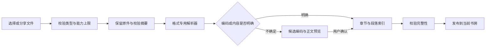

# 网页与 iOS 统一书籍导入方案

日期：2026-11-02。本文区分已验证的缺陷修复与后续统一方案；容量、任务协议与新依赖尚未按本文全部实施。真实书籍仅在本机验收，不进入源码、测试夹具或公开报告。

## 真实样本与当前差异

用户提供的中文 TXT 为 23,964,345 字节（22.85 MiB），无 BOM。按 Windows GBK/CP936 兼容规则解出 12,918,647 个字符，转成 UTF-8 后为 35,009,912 字节。文件有 30 个兼容字节 `0x80`。严格的部分 GB18030 实现拒绝这些字节；WHATWG TextDecoder、iconv-lite 与 Foundation 的对应兼容解码可以读取它们。仅让用户另存为 UTF-8，仍不能绕过网页现有的 20 MiB 上限。

修复后的原生完整导入产生 230,392 段，与独立解码结果的正文哈希一致，保留原件逐字节一致。网页现有构造器在本机离线解析同一内容，生成约 74.71 MB 的书籍 JSON，低于现有 96 MiB 内容上限；但其每 30 段分组会产生 7,680 个自动阅读片段。原生目前将 TXT 组织成一章。两端能够解码，不表示章节和锚点已经统一。

| 环节 | 网页现状 | iOS 现状 | 需要统一的规则 |
| --- | --- | --- | --- |
| 入口 | 上传弹窗、侧栏、聊天附件、拖放，经上传控制器进入服务 | 文件选择、共享或打开文件，经本机书房导入 | 所有入口提交同一种导入请求，不在入口另写校验 |
| 传输 | 根据能力走分块、签名直传或 Base64 | 本机直接读取；云端书走下载协议 | 区分本机导入、传原件和下载已解析书籍，保留相同任务语义 |
| 原件容量 | PDF 256 MiB，EPUB/TXT/MD 20 MiB，多处重复判断 | 默认本机统一为 150,000,000 字节 | 一份版本化能力契约，界面、服务端、客户端共用 |
| 文本编码 | 修复前仅 UTF-8 | 修复前先 UTF-8 再无条件 UTF-16 | BOM、检测、解码、预览、确认分别有明确结果 |
| 正文结构 | 每 30 段自动分组，随后提供章节读取 | TXT 统一一章，按空行分段 | 一份解析规范、版本和合成样本，各端验证相同输出 |
| 后续操作 | 来源核对曾另写 UTF-8 解码 | 从保留的原件重试 | 来源核对、重试与恢复使用同一次已确认的解码决策 |
| 错误 | 容量、格式、任务失败分散处理 | 通用“书房提示”，失败任务另有重试入口 | 错误包含原因、原件状态和可执行的恢复动作 |

## 推荐的流程

统一的是任务、能力、内容和验收契约。网页与 iOS 可保留适合各自环境的实现：联网导入得到同一份权威章节投影；本机离线导入遵守同一规范。离线模式不应为了上传而把原件先发到服务器，也不能宣称不同解析器天然生成相同段落 ID。

建议建立 `ImportPolicy`、`ImportJob`、`DecodeDecision` 和 `ContentManifest` 四份版本化契约。它们分别记录允许的格式和容量；任务阶段与重试；编码、检测器版本、是否经用户确认及解码警告；原件摘要、解析版本、章节和段落摘要。原件始终保持原字节，UTF-8 正文是派生内容。已有书籍不自动重解析，不改动旧锚点或个人记录；重解析产生新内容版本并验证锚点迁移。

第一版建议将 TXT/Markdown 原件上限提高到 64 MiB，EPUB 暂保留 20 MiB，PDF 保留 256 MiB；同时独立限制解码后正文、解压资源、段落数和单本内容容量。上述数值是待实施建议，需结合手机峰值内存与托管环境压测调整。容量调整需要同时覆盖文件选择、签名上传、分块初始化和任务建立；内容存储、导出与恢复也要通过同一能力契约校验。

编码处理先认 BOM，再严格验证 UTF-8。旧编码从原始字节取头、中、尾的有界样本，产生带排序的候选；整文件解码负责发现坏字节和中途混入的另一种编码。低置信或候选接近时显示真实正文预览，允许切换编码。不用 AI 改写、删除坏字节或悄悄替换乱码。确认后，重试与来源核对沿用保存的决策。

## 开源方案比较

以下为 2026-11-02 查询到的候选项目 GitHub 星标数，不代表整个领域的质量排名。

| 项目 | 星标约数 | 能解决的部分 | 本项目取舍 |
| --- | ---: | --- | --- |
| [Unstructured](https://github.com/Unstructured-IO/unstructured) | 15,662 | 多类文档转结构化数据 | 面向文档处理管线；若直接接入，需承担独立 Python 环境和内容映射，不宜仅为 TXT 更换现有阅读结构 |
| [Apache Tika](https://github.com/apache/tika) | 4,120 | 内容类型识别、元数据和多格式提取 | 适合将来扩展 Office 文档的独立服务；需要额外 Java 运行环境 |
| [ICU](https://github.com/unicode-org/icu) | 3,637 | 跨语言编码检测与转换 | 可作为原生一致性方案候选；需要明确打包和版本，不依赖未承诺的系统内部接口 |
| [iconv-lite](https://github.com/pillarjs/iconv-lite) | 3,184 | 多编码转换与流式解码 | 推荐用于 Node 解码；不会替我们判断用户想选哪种编码 |
| [jschardet](https://github.com/aadsm/jschardet) | 743 | 编码候选检测 | 可作对照；本次尾部样本出现错误的低置信候选 |
| [chardet](https://github.com/runk/node-chardet) | 310 | 返回排序后的编码候选和置信值 | 推荐先用于有界检测，再配合真实预览和全文件验证 |

本机使用 chardet 2.2.0、jschardet 4.1.0、iconv-lite 0.7.3 测试。对同一原件的头、中、尾各取 64 KiB，chardet 三次都将 GB18030 排首位；jschardet 在尾部返回低置信 KOI8-U。iconv-lite 按 GBK 或 GB18030 解完整文件均未产生替换字符。此结果只证明该样本的表现，不能推出所有语种和短文本的识别准确率。

推荐采用 chardet + iconv-lite 处理网页服务的文本检测与解码，先用合成字节夹具约束 iOS Foundation 的输出。若多语种验收显示两端持续分歧，再评估共同封装 ICU。PDF 延续已有 PDF.js/PDFKit 适配器；EPUB 延续有边界的归档与章节解析。Readium 可用于后续 EPUB 能力评估，它不会直接解决 TXT 编码和上传任务一致性。[Readium 支持范围](https://github.com/readium/swift-toolkit)。

[ICU 官方说明](https://unicode-org.github.io/icu/userguide/conversion/detection)明确将编码检测视为统计和启发式判断。框架可以提供候选，产品仍需处理不确定性、权限、取消、恢复和数据归属。

## 必须覆盖的情况

| 情况 | 预期结果与恢复方式 |
| --- | --- |
| UTF-8、带 BOM 的 UTF-16、常见无 BOM 文本、GBK/CP936/GB18030、Big5、日文和西文旧编码 | 有明确规则或可靠候选时解析；不明确时预览选择。不同编码不能仅因“能转成字符串”就被接受 |
| 空文件、仅空白、截断多字节、混合编码、含非法字节 | 区分原因，保留原件；无法可靠还原时标出位置并等待处理 |
| 后缀改错、二进制冒充 TXT、加密或损坏 EPUB、需密码 PDF | 校验真实内容，明确格式或密码问题，提供重新选文件入口 |
| 文字 PDF、扫描 PDF、混合 PDF、EPUB 有效或缺失目录 | 普通提取和 OCR 分开；外部识别遵守现有授权，目录采用格式声明或可说明的退化规则 |
| 超限大书、超长单段、很多短段、解压量膨胀、设备空间不足 | 在相应阶段有界中止；不丢尾文，不将不完整内容标成可读完成 |
| 网络中断、退出后台、应用被终止、重复提交、换号 | 任务可恢复且幂等；当前账号隔离；旧账号的晚到响应不能发布到新书房 |
| 导入成功后的来源核对、下载、重试、备份恢复 | 使用原件与保存的解析决策；正文摘要、段落 ID、版本及个人记录归属一致 |

实施分三批。先合入已复现的登录与编码缺陷修复；再统一能力、容量、任务错误与检测预览，并让真实大型样本通过网页全链路；最后统一章节投影、离线一致性和迁移验收。每批分别记录本地测试、PR、发布与真机结果，不能把模拟器构建当作用户手机已更新。
