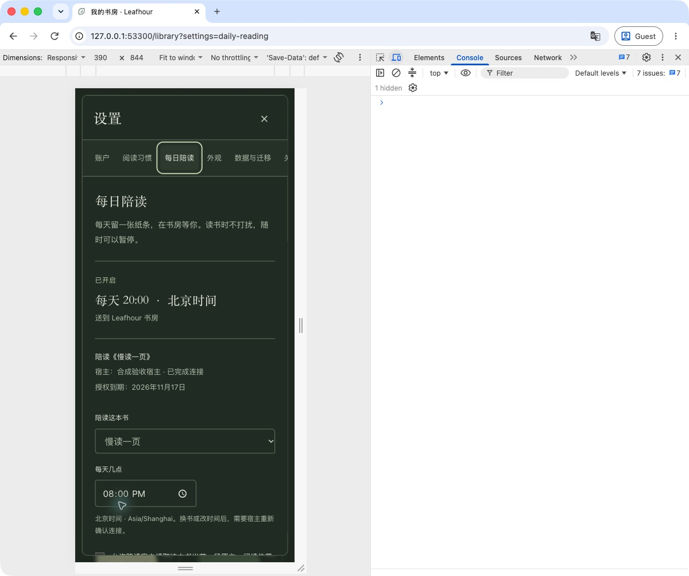
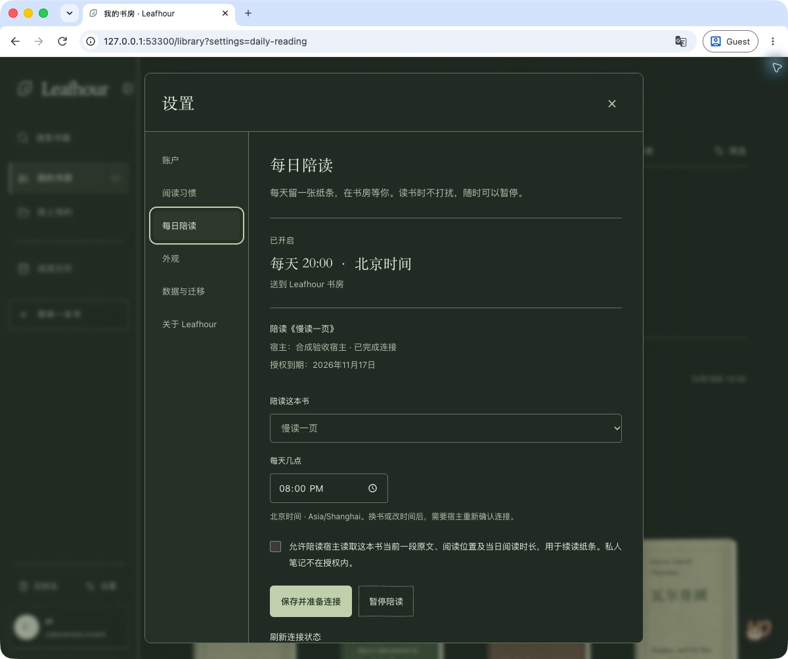
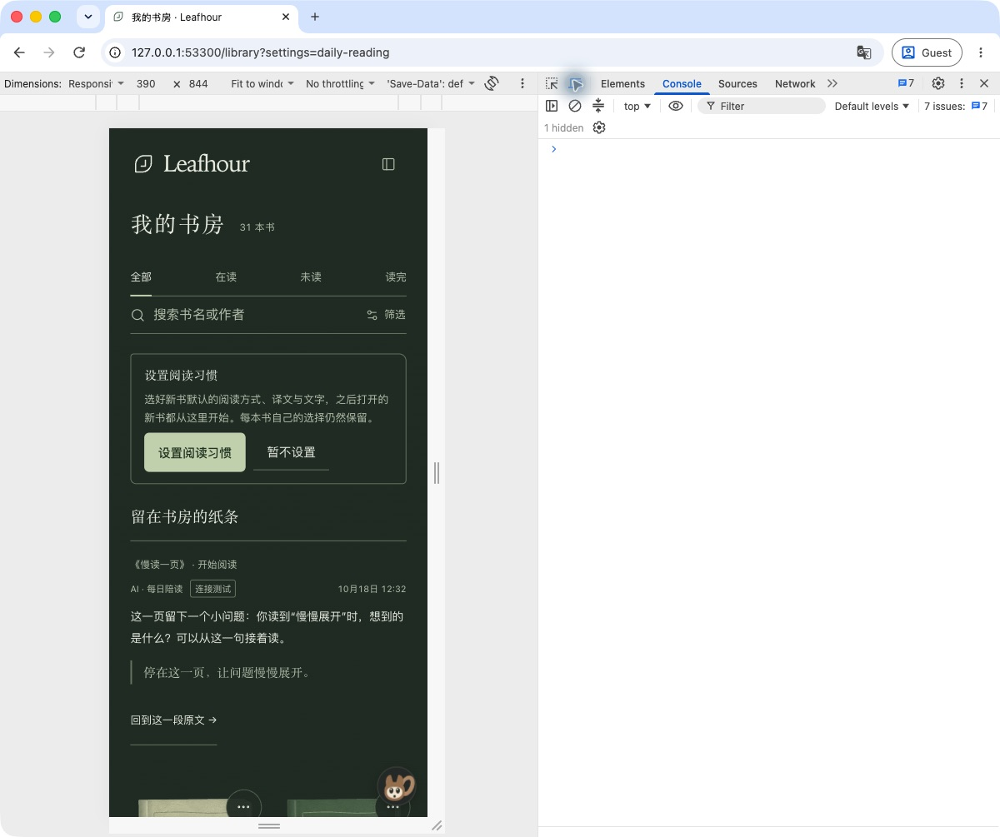

# GET-155 每日陪读验证

基线：公开仓库 `getyak/leafhour` 的 `921c77fbb5421f15c3fc9a92c0b2d21cf0a45dcf`。本次用户明确指定：每天 **20:00 Asia/Shanghai**，送达 **Leafhour 站内书房**。设计与验收约定见 [设计](../superpowers/specs/2026-10-18-get-155-daily-reading.md)，宿主接入见 [使用文档](../daily-reading.md)。

## 实现与审阅

- 本机 Pi + MiMo Pro 完成后端与 HTTP/MCP 第一轮实现；父任务完成界面、独立阅读在场模块、官方 SDK 宿主桥及集成，并独立修复后端竞争问题。Pi 交付不作为最终通过依据。
- 每账号固定一本书、当地时间、站内渠道与明确授权。保存只产生“待连接”；宿主实际连接并读取受限来源后才能“已开启”。30 天专用授权只允许 `daily:deliver`，普通七天授权与通用读写工具保持隔离。
- 每日事件由计划 ID 与当地日期派生；领取有随机 `claimNonce`、10 分钟短租约、三次尝试和 30 分钟窗口。旧领取不能提交或释放新租约。完成响应丢失后，仅接受同一已完成 nonce 与相同内容摘要的重试。
- 卡片与送达账本在同一 CAS 保存。阅读在场、计划和账本共用账号 CAS，避免在场更新与发送并发时遗漏安静门。书籍来源和阅读记录是独立文档，在异步活动读取结束后再探测一次；这是末尾重读保护，不声称跨文档事务。
- 原文只返回当前授权片段；消息限 600 个 Unicode 码点，必需的精确引用限 240 个码点。服务端确定引用范围、段落、版本和原文链接。私人笔记、译文、历史对话均不提供给每日宿主；不写阅读进度或用户评论。
- 设置和纸条沿用纸张/苔绿及夜间主题。卡片显示实际送达时间、书名、章节与 AI 归属。已移出书架的固定书籍仍明确显示绑定，不能静默换书。保存、暂停和晚到请求均有账号及版本栅栏。

独立 native reviewer 分工复核后端及 HTTP/MCP/CLI/UI。已确认的问题包括换书授权竞争、过期领取、提交幂等、引用缺失、异步来源/活动变化、私有文件路径、子进程退出、UI 草稿/焦点与归档书绑定；逐项补回归后复核关闭。最终受审文件与测试证据存于任务私有验收目录，未包含真实令牌或上传书籍。

## 自动验证

- 后端原有 26 项，加 22 项竞争/异步状态/Unicode/时区/请求乱序回归：**48/48 通过**。新增竞争回归最初 13 项均失败，修复后通过；异步来源/读完/目标及 DST 补充场景先失败后通过。
- 独立 reviewer 使用真实 HostedStore + 合成 REST/CAS，核对在场提交冲突重试、来源变化、真实五分钟阅读目标、读完、首次并发领取、提交前/后 503、终态换书范围等场景。只使用合成身份与资料。
- HTTP/MCP：**9/9 通过**，包含实际私有配置 CLI → 官方 SDK stdio 子进程 → HTTP → 单张站内卡、Unicode 引用位置、相同完成请求重试及阅读记录不变。
- 界面/宿主/在场定向验证由独立 reviewer 执行 **37/37**；归档书修复与四语首页标签增量验证 **17/17**。这些集合有重叠，不相加冒充不同测试总数。
- 第一轮完整 `verify:deploy`：1450 通过、1 失败、1 平台跳过。失败是新增静态 aria-label 未进入英文首页本地化映射；修复后定向验证通过。修复后第二轮完整 `npm run verify:deploy`：**1452 通过、0 失败、1 平台跳过**；隔离阅读运行时初始化（928 文件、9.0 MB）、托管构建、215 文件公开内容检查、566 软件文件发布白名单及发布来源验证均通过。跳过是本机 macOS 不能执行的 Linux x64 license 篡改测试，未计为通过。

- 当前 PR 首个 head CI 已通过，但合并前新增网络超时复核发现一个 P1：旧 inactive handler 可删除新的 active 状态，旧 active 也可在隐藏后复活。该提交没有合并。修复加入递增序号、同 CAS 水位、inactive 保留期，以及在 HTTP 入口捕获、每次 CAS 重试检查的固定接受期限；延迟处理不延长 TTL。新增回归先失败后通过，后端/HTTP/MCP/客户端在场组合 **64/64**。修复后第三轮完整 `npm run verify:deploy` 为 **1458 通过、0 失败、1 平台跳过**，隔离运行时、托管构建、公开内容/566 文件发布清单及来源验证再次通过；独立 reviewer 使用实际 controller 与锁文件 store，复现正反乱序并验证不再覆盖新状态；跨 90 秒水位清理后的 CAS 重试返回 408，接收后 90 秒到期，组合 64/64 独立通过，P1 复核关闭。新 head 还需全套 CI，不能沿用旧 head 绿灯。

## 实际渲染验收

浏览器在本机隔离合成书房使用最终应用、真实服务与官方 SDK 路径完成一张“连接测试”纸条；没有模型调用或真实日程。实际点击纸条回到对应原文，观察正文正确呈现；暂停返回“已暂停”，恢复返回“已开启”，焦点回到可见刷新控制。390 × 844 和 1200 像素桌面宽度均核对排版与操作区域。

## 生产验收边界

合成结果不能代替真实账号连接或每日 20:00 送达。生产验收必须核对当前提交的 Production、实际宿主日程及 ID、真实 MCP 连接状态和用户授权的站内连接测试；本次结果见下一节。首个正式 20:00 回执与连接测试分开记录。授权到期、暂停、在场及目标完成时安静是正常结果，不伪造纸条来证明调度。

## 真实接入验收 · 2026-10-18

[PR #120](https://github.com/getyak/leafhour/pull/120) 已正常合并，代码来源 `c1f13f6bd053e2971cf76b79e04019765444b0f1`。最新 PR head 的 [CI](https://github.com/getyak/leafhour/actions/runs/39098301403)、合并后 [main CI](https://github.com/getyak/leafhour/actions/runs/39098420146) 与 [Production](https://github.com/getyak/leafhour/actions/runs/39098560653) 均成功；正式域名 `release.json` 和 Vercel 提交状态读回一致。Vercel MCP 对该团队返回403、本机没有对应CLI，未声称读取到部署日志；实际来源验证依靠上述门禁和域名读回。

指定账号的真实当前书已在配置时重新解析并固定，用户原文、书名、密钥与个人记录未进入本仓库。实际 Codex heartbeat 为 ACTIVE，名义日程是每天 **20:00 Asia/Shanghai**；私有配置保存真实 scheduler ID，官方 SDK MCP 子进程完成实际连接和来源读取，站内设置读回“已开启”。授权到期为2026-11-17，未设置静默续期。

宿主可能提前几十秒唤醒；已核对实际调度水位，并在宿主指令中加入每段不超过60秒的有界等待，到名义20:00之后才领取，避免把提前唤醒的 `not-due` 当作当天结束。宿主需在窗口内可运行；离线或超过20:30不补发积压。

房主明确创建单独的当天“连接测试”；真实 MCP `claim` 返回 nonce 和有界当前原文，本次 Codex 会话据此形成一张续读问题，`finish` 返回 delivered。房主读回只有一张匹配测试卡、事件送达、AI 归属、Unicode 精确引用和同版本/段落原文链接，未向站外收件人发送内容，也未请求产品后台付费生成服务。宿主送达前后个人 records SHA-256 完全一致。

在本任务隔离的 Chrome Guest 中，实际纸条及其“连接测试”标签可见，点击原文链接后呈现对应章节与领取原句，再经地址栏回书房。未开始计时、未滚动或操作正文；点击验收后再次从 owner 接口核对 records，哈希仍与测试前一致。这是该次受控路径的观察，不代表 `/read` 存在通用只读模式。正式设置再次读回20:00、北京时间、宿主已连接和实际到期日期。

**首个正式20:00定时回执尚未发生。** 连接测试证明实际接入和站内送达，不冒充正式日程已执行；宿主后续单独保存定时回执。凭据、完整私密上下文、真实截图与失败尝试均保存在受限本机证据中，公开记录仅保留上述结果。
