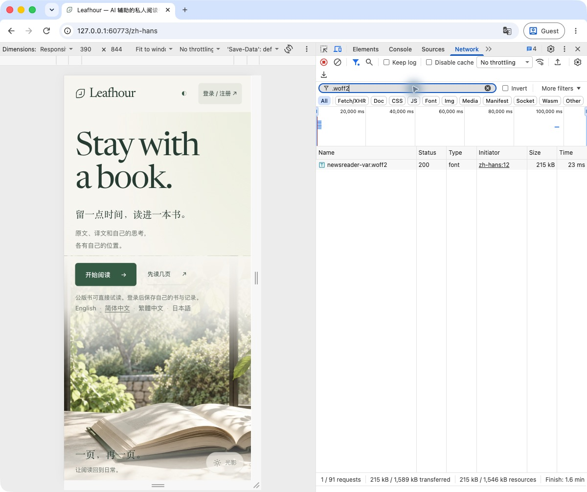
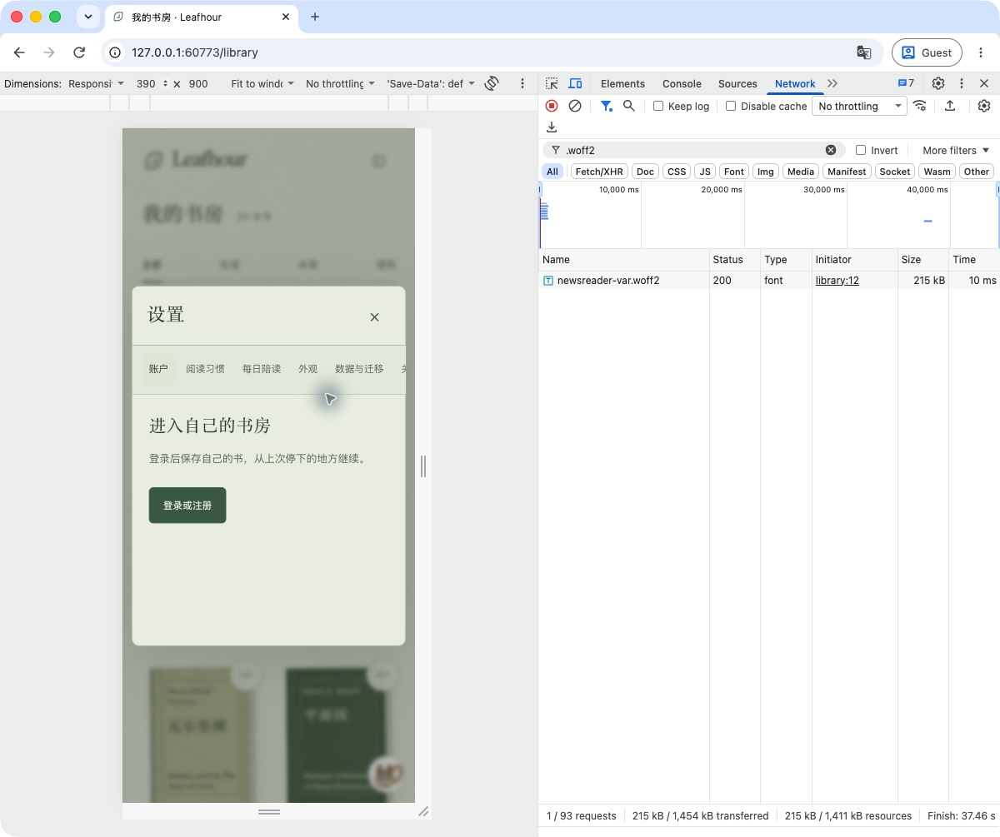
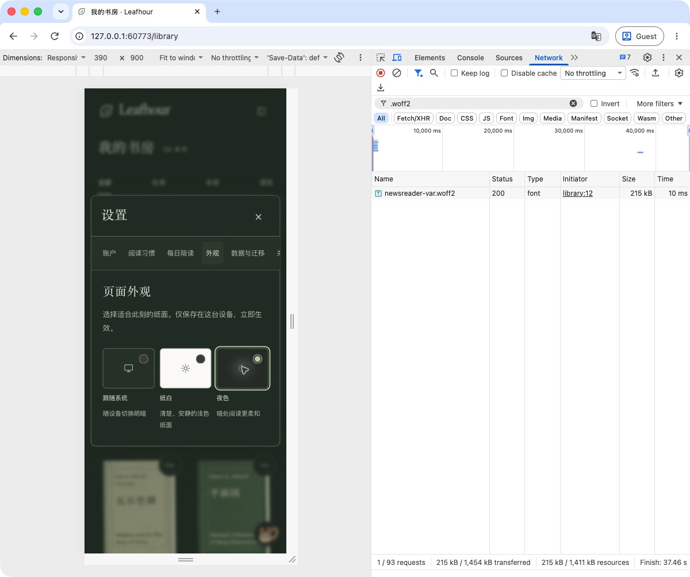
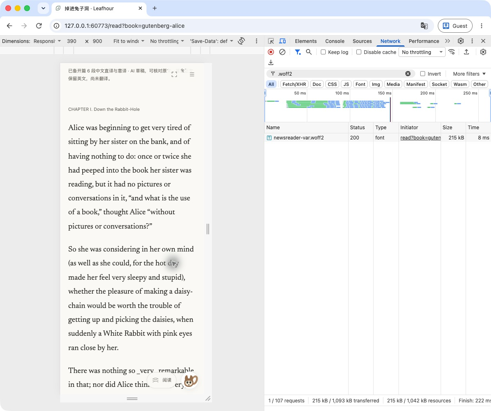
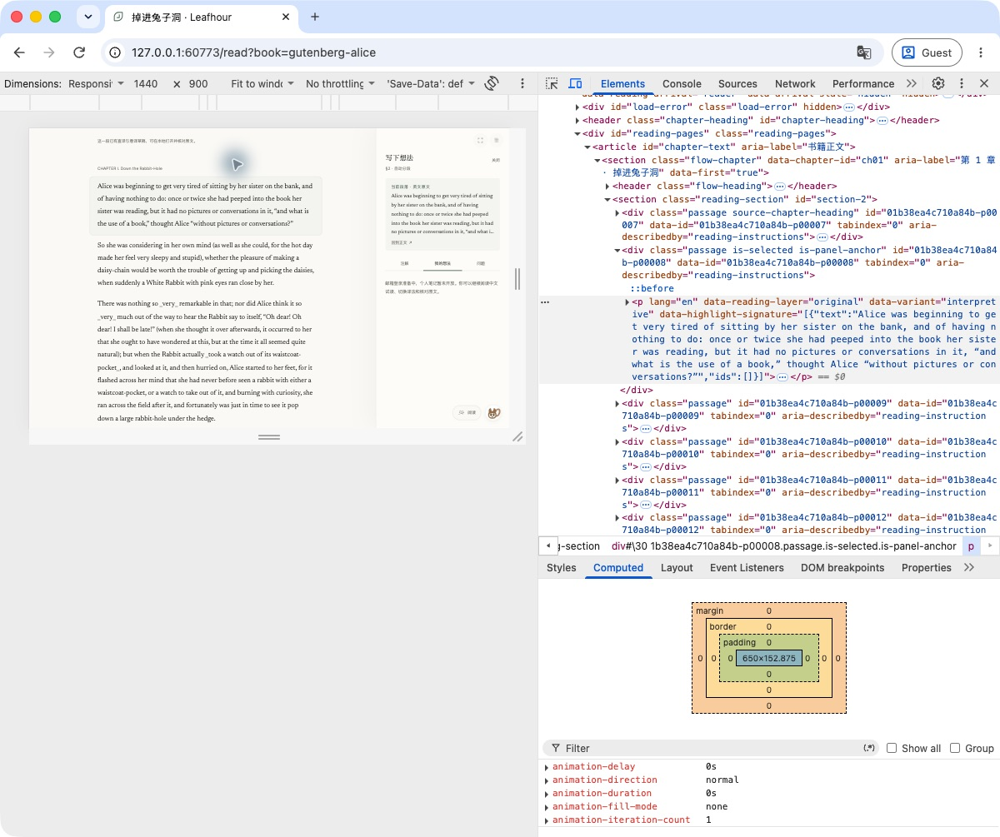
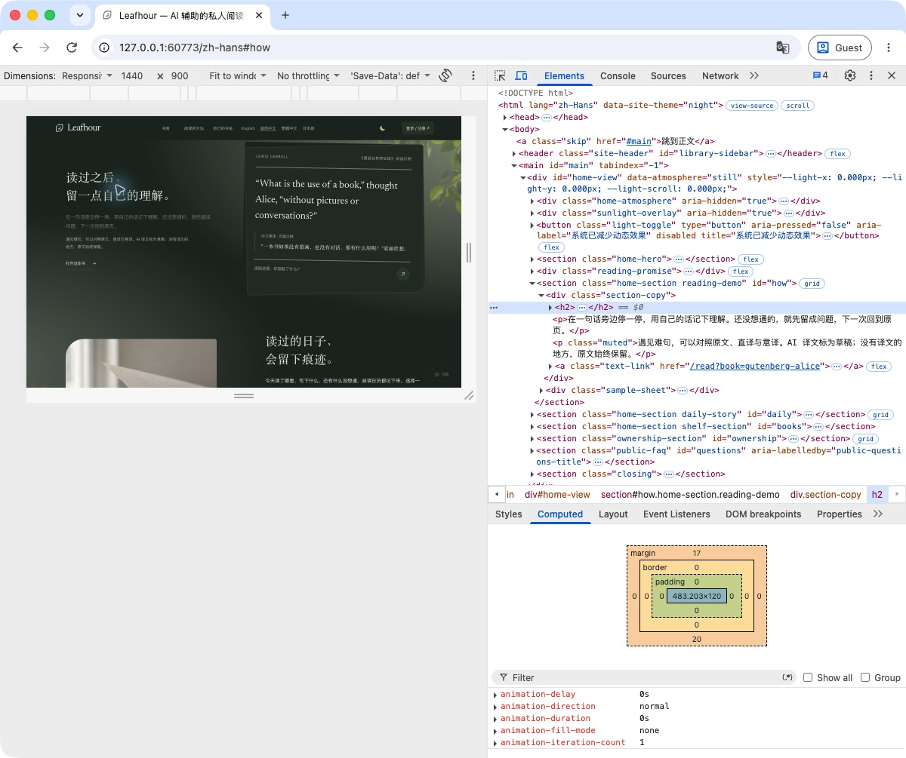
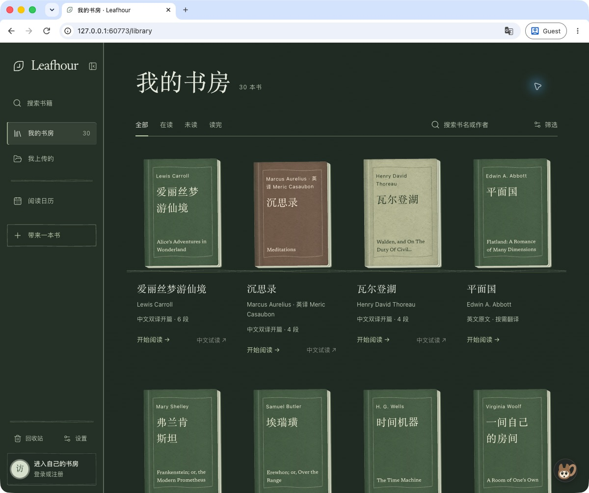

# GET-167 typography foundation — verification (2026-10-18)

Integration baseline: public main `4939cb21c12169d5b1c4340c5b4cc3bc60872c27`.
Implemented locally on top of this baseline; merge is recorded separately.
This record separates verified engineering and macOS Chrome observations from
remaining cross-platform and benchmark acceptance.

## Implementation

- Self-hosted Newsreader upright/italic variable faces, OFL-1.1 attribution and
  source commit `8b0a1d0f5983c89bc2b93f1b5fb55f9e252744b5`. Latin-first stacks
  retain local Songti/Noto Serif CJK for Chinese. The reader preserves explicit
  sans/Kai preferences, including body-mounted side notes.
- Shared type and tracking tokens on 11 product pages. Homepage section H2s use
  one responsive token (40px at 1440px). Functional text has a 12px floor;
  decorative book-cover/scene marks are documented exceptions. Internal eval
  and source-review tooling retain their existing styling.
- New reading preferences default to 0em tracking; stored book/account choices
  retain priority. Authored originals, paths and apostrophe characters remain
  unchanged. Three invalid gift-caption shorthands are corrected.
- First-screen home/reader preload only the upright face; italic remains lazy.
  Static routes serve exact bytes with WOFF2 MIME, HEAD, existing CSP/nosniff.
  The large-file exemption pins reviewed bytes and SHA independently of the
  distribution manifest, with distinct filename and absolute-path registries.

## Actual verification

1. Parent focused typography + HTTP + reading-preferences: **17/17 passed**.
   Meaningful RED/GREEN regressions cover preserving explicit preferences,
   jointly substituting fonts and their manifest, and duplicating the upright
   entry while removing italic. Both font-policy counterexamples were accepted
   before the fix and rejected afterward.
2. Parent `npm run verify:deploy`: **1471 tests, 1470 passed, 0 failed,
   1 existing platform-gated skip**. Reader runtime built/initialized (928
   files, 9.0 MB; no model requests); hosted build checked 221 files and 11
   registered media assets. Release allowlist checked 572 software files;
   source provenance verification passed. `git diff --check` passed.
3. Independent native reviews: typography/reader delta **17/17 passed**;
   font/static/public-build **19/19 passed**. All confirmed findings closed;
   **0 unresolved P0/P1/P2** in their reviewed scope. Frozen 54-code-file
   list digest: `c7446fde7b90a1aa48e452495f14655a868f072a6ce19a56657e613dc921f6a1`.
4. Independent FontTools decoding compared both converted faces to their
   provided source TTFs: all 658 glyph outlines per face, cmap, hmtx and 17
   common non-container tables match. DSIG is removed during WOFF2 format
   conversion; source bytes are not claimed identical. U+2019 advances are
   455/2000 upright and 458/2000 italic; zero CJK ideographs in these faces.
5. Actual macOS Chrome Guest UI, isolated loopback server with public Alice,
   no model providers or real accounts: home/library/settings/reader observed
   at 390px and desktop widths; 1440px body-mounted side note opened. Network
   served the upright face as 200, 214960 resource bytes. Reader Computed panel
   reports **Newsreader 16pt, network resource, 21px, normal letter-spacing**;
   body-mounted original side note reports Newsreader and `lang=en`. Chinese
   homepage H2 reports **Songti SC local, 40px, weight 400, 0.4px tracking**
   (the shared 0.01em token). Night home/settings and actual 1200px library also observed; the cover’s
   Alice’s apostrophe is tight and card metadata is readable. Current home
   console at All levels has one browser password-form accessibility advisory
   and no JavaScript error; this is not an all-page console claim.

Screenshots contain public demo content only. The emulated 1440px viewport is
scaled to fit the physical desktop; this is not a device or alternate-OS test.

## Acceptance still open

- Windows, Android and Linux rendered acceptance has not been executed here.
  Self-hosted font delivery and decoded metrics do not establish those visual
  results. GET-173 retains this explicit acceptance gap.
- The supplied A–H rubric starts at 11/16. No >=14/16 or original reviewer's
  re-evaluation is claimed. A precise Ambi reference URL has not been supplied;
  no side-by-side benchmark is claimed for GET-174 or the epic.
- The pre-existing clipped first-entry chapter heading was reproduced and is
  tracked by GET-186. Literal underscore emphasis remains GET-190 work.
- This document does not assert PR merge or production publication; those
  must be verified from GitHub and the deployed revision after landing.

No paid model calls, real-account changes, book-data edits or preview deploys
were part of this typography acceptance.
