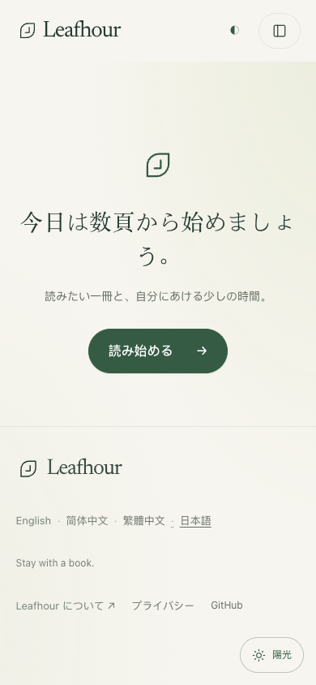
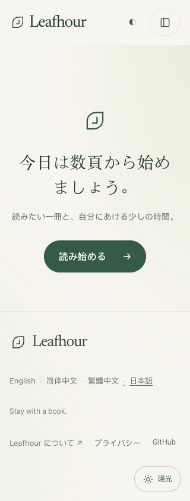

# GET-189 mobile footer clearance

The final Production design review of `cae3f61f37570000bdedfcaf43eb5d2e2dc034f1` found the fixed Sunlight control visually intersecting the end of the Japanese GitHub link. The mobile footer now leaves 76px plus the bottom safe area below its final row. The existing 44px controls, fonts, themes and desktop layout remain governed by their existing rules.

Pre-merge source verification: 30 relevant Node tests passed; independent review found no P0/P1, with 7 additional checks passing and CSS parsing without warnings. This change only adds one CSS declaration and a comment under the existing max-width:760px rule.

Actual local Chromium mobile-touch verification passed eight cases: home EN/Hans/Hant/JA at390px; JA home at320px and760px; JA MCP/privacy at390px. All63 footer links are at least44×44px, all315 center/edge-midpoint hit tests reach their own links, no link intersects the visible Sunlight control, and there is no horizontal overflow. Locale state, fonts and finite animations were awaited. The screenshots show the actual source, with no layout injection.

The first probe incorrectly required rounded MCP language pills to respond at rectangular bounding-box corners. That diagnostic is not a product regression or a passing result; the final probe tests each center and four edge midpoints, which are inside the pill. No production model was invoked and no private account was used.

These are local pre-merge observations. Exact-head CI, merge, Production and final online acceptance must be recorded separately after this PR lands.
