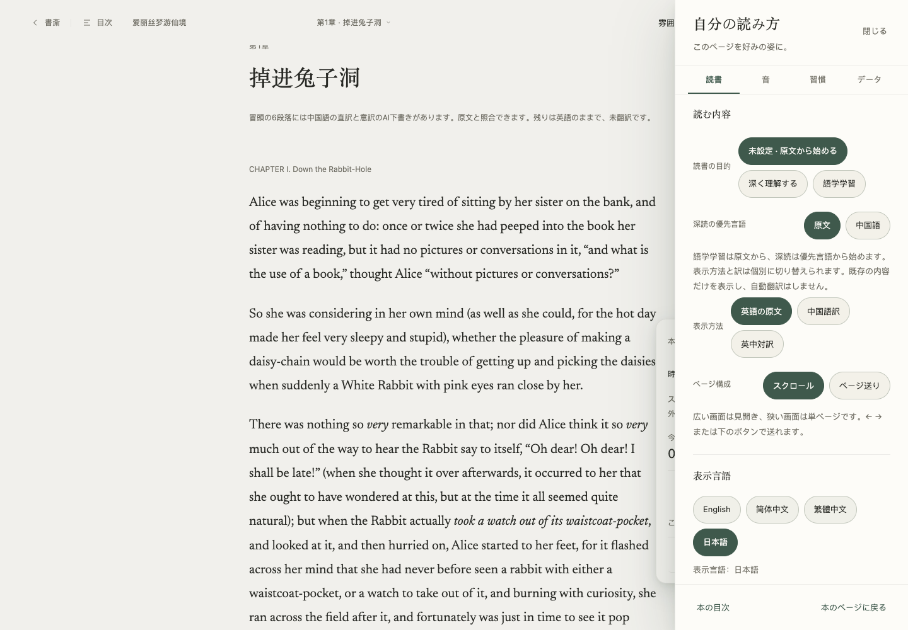
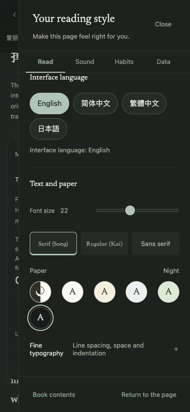

# GET-192 — consistent interface language

This pre-merge report records implementation and browser verification. The linked PR and Linear issue hold the later exact-head CI, merge and Production receipts. No Preview deployment is required.

## Result

English home entry remains English through the library, reader and settings. English, Simplified Chinese, Traditional Chinese and Japanese share one physical locale runtime and 1,956 immutable message entries per language. Existing original text, translations, real titles, notes, AI prose, filenames and stored domain values remain literal. Source language and interface language remain separate choices.

Owned labels and retained notices update their existing nodes. Auth returns, home CTA/body links, citation/recommendation links and support navigation carry the effective UI language. Authored home/privacy/MCP prose and SEO follow their authored path; dictionary failure honestly exposes English interactive fallback with an explicit bounded Retry.

Library settings Close preserves the successfully selected language, while a genuine browser Back restores the destination language without changing device preference. A synchronous `onBeforeUiPopstate` owner hook normalizes only the exact consumed modal predecessor before the runtime reads its route. Exact entry, owner epoch, generation, disposal and newer-choice guards remain; no fake pop event or Window listener-order assumption is used.

## Verification

- Final frozen macOS run: **2,294 PASS, 0 FAIL, 1 Linux-only skip**; reader-runtime packaging, Vercel build, public-build check, release policy and release verification all exit 0. Both the tested source and parent source stayed unchanged during that run. Linux and AWS execution remain current-head CI gates.
- Independent whole-branch review and corrective re-review: **Spec PASS / Quality PASS**, no remaining confirmed P0/P1/P2. The final independent corrective run passed **109/109**. Earlier review and native failures were fixed and retained as evidence, not replaced by old green results.
- Actual Chromium: four authored home CTA → library → reader → Aa journeys, same 31 original nodes and SHA-256 `c318ada55121504ab95e5829cc77f80f76f5dc6325f337bc439e4826593b0e36`; logged-in synthetic library label/hint/ARIA parity; brand/account/privacy links; storage-denied ja-JP browser with English entry; native Close/Back/Forward; retained draft, noncollapsed textarea range, focused language choice and IME Enter without submission.
- Support failure: exact Japanese base catalogue HTTP503 → native Retry → exact `?retry=1` HTTP200. Effective owned hrefs change EN → JA while authored Japanese text, node identity and SEO stay unchanged. The fault deliberately persists on each new document; that new document correctly shows an English fallback notice rather than pretending Japanese loaded.
- Optional audio: no controller load before intent, real saved voice summary, one native Start session, same audio node/blob/voice/rate across all four locale commits, and an already advancing media clock. Synthetic WAV/provider only. Earlier native file/import and pending-guide/idempotency evidence is supplementary; the corresponding source files are byte-for-byte unchanged, as listed in the receipt.

The receipt and selected unedited screenshots are in [the evidence directory](2026-10-20-get-192-final/evidence.json). They contain synthetic/public-domain content only. The final documentation and screenshots are added after the frozen run; product sources remain unchanged, and CI must validate the final implementation commit.

## Design and delivery cost

The existing paper, ink, serif reading typography and shared focus/choice primitives remain. The Ambi reference informed the quiet hierarchy and restrained spacing; the reader retains its own identity. Native 390×844 wheel navigation exposes all four 44px language choices with the header and Close visible, no horizontal overflow and no DOM scroll reset. Night selected/unselected label contrast measures **9.51:1 / 11.40:1**. Earlier programmatic scrollIntoView clipping is not treated as a user-input pass; the final screenshots use real pointer-wheel navigation.

| Build boundary | Uncompressed bytes | Existing cap |
| --- | ---: | ---: |
| Reader JS entry | 311260 | 327680 |
| Reader CSS | 170243 | 204800 |
| Initial English static module closure | 492065 | measured aggregate, not the entry cap |
| Additional optional audio closure | 61029 | measured after audio intent/restore |

The integrated pre-boundary reader exceeded the unchanged JS cap (338400 bytes). Only the independently reviewed audio-intent boundary was added. API/session ownership stays eager and singular; preferences alone do not load audio; existing authorized task markers may restore their task; no autoplay is introduced. Resume GETs may continue an already authorized generation and are not guaranteed provider-free. Catalogues contain data only, and exact runtime/catalogue/audio import and release fences remain enforced.

## Limits

This is Chromium viewport/keyboard/IME-protocol evidence, not physical mobile, assistive-technology or physical macOS IME certification. A native source drag Range was cleared by opening a modal before any locale change; the verified textarea range and unchanged original-node hash are separate claims. Native empty file-picker cancellation was not proved by the CLI; cancellation and stale-owner cases have unit evidence. No real account, private book, paid model, human comprehension or willingness-to-pay outcome is claimed. Production acceptance must use the actual merged source commit.
