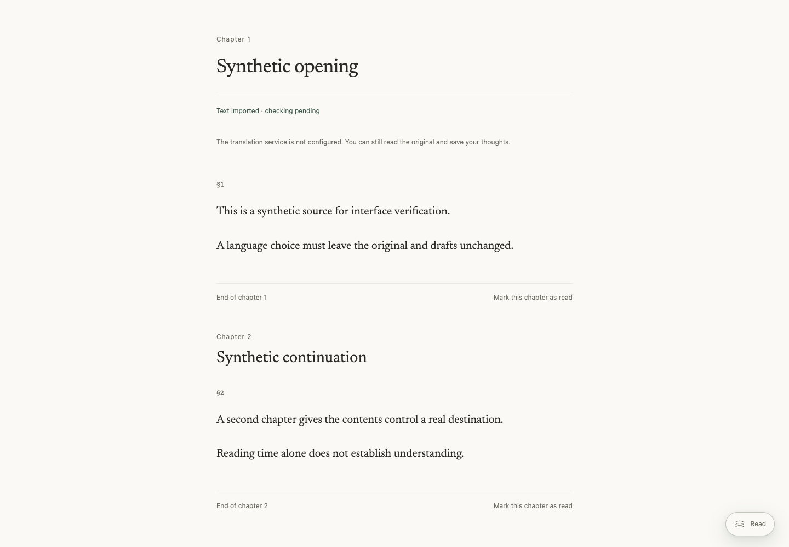
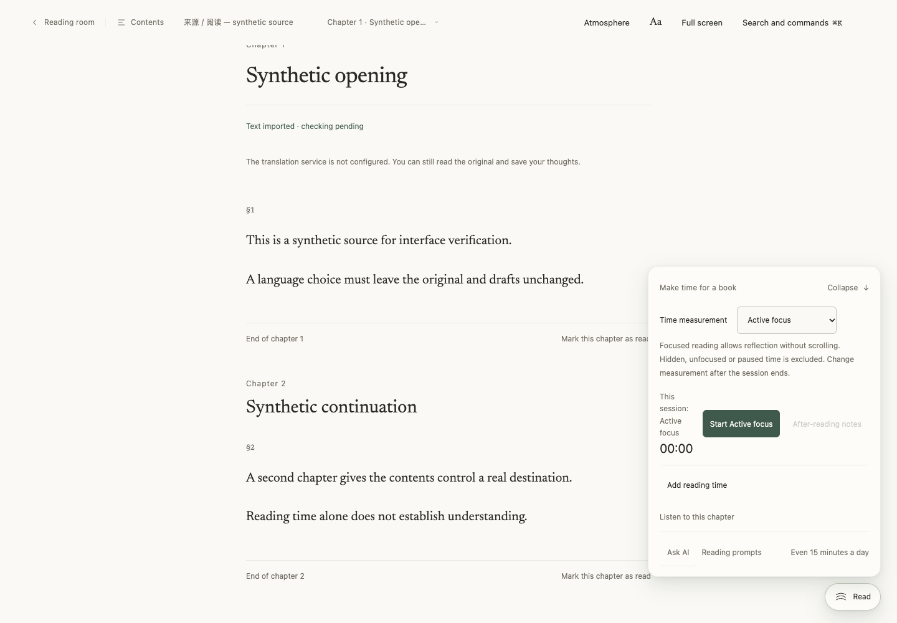
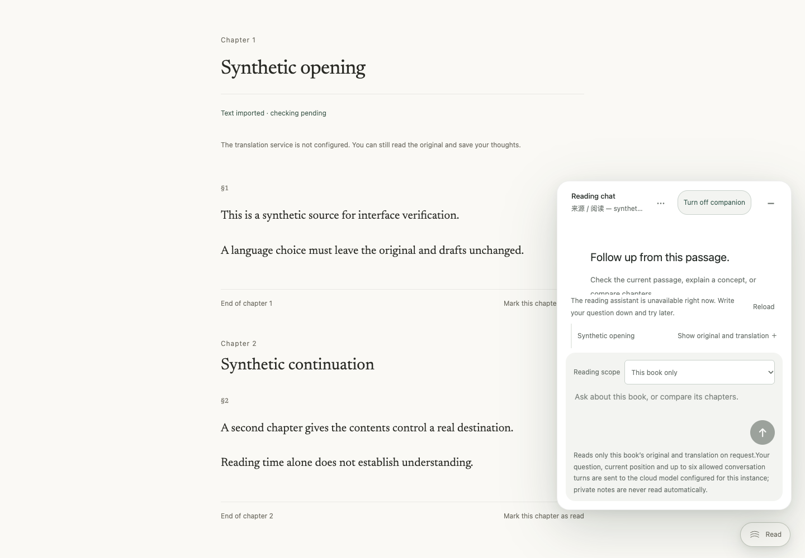
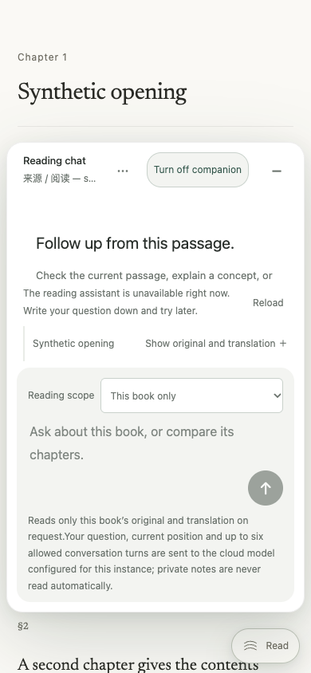

# GET-194 baseline audit

Captured 2026-10-20 Asia/Shanghai from the actual compiled UI at source `3882bfad7584bbfd3385f0a520595309da2efc9f`. This is the **before** state, not a design mockup or acceptance of a change. Chrome 155, isolated local synthetic account and four synthetic paragraphs; no real books, questions submitted, paid model calls, reading timer or completed-reading claims.

Build `build-1792445551401-cd936830-763d-4a4a-8983-8103087cdea3`; source digest `a58621ec180f62bed594238d5e02912b582067a4898a597d627f84e95a49ba26`; compiled digest `8273e2a020ceabc1bb174c667ae830a4db77a33357278e631beb3f270059e063`. Private build/run receipts retain the exact file manifest. The owned server and browser were closed after capture; shutdown verifies unchanged snapshot/source/compiled bytes and closed port.

1. Reading begins with a quiet page but only a Read entry. 
2. One click reveals timing controls and explanations; Ask AI is inside that drawer, requiring a second click. 
3. Desktop chat overlays the book as a 420 × 590px floating panel. Its messages receive 133px height while the composer receives 266px. A 44px permission row and 82px explanatory hint dominate the input area. 
4. At 390 × 844px, the panel is 374 × 590px; messages receive 114px and the composer 294px. The footer explanation has 233 characters. This is an actionable space/hierarchy problem, not a judgment about a reader's understanding. 
5. At 390 × 400px the compact frame scrolls and the composer initially lies below the visible messages. This simulates a short viewport, **not** a physical on-screen keyboard test; it does not establish that scrolling/focus cannot reach the input. 

The deterministic fixture intentionally has no model generator, so the UI truthfully displays unavailable status and disables Send. The textarea itself is enabled. A scope sentence in the raw capture script incorrectly described the input as disabled; a subsequent independent measurement recorded `inputEnabled=true`, `sendDisabled=true`. The original raw log is retained with this erratum rather than rewritten. No DOM/style/history edits were used to stage these screenshots.

The browser recorded two failed fixture requests: original-resource info returned 409, and audio preferences returned 503. This audit does not claim an error-free console or validate those unavailable integrations; they must not be silently described as healthy production services.

The audit supports reducing steps, reserving book space and reclaiming message space. It does not prove a comparative preference score against ChatGPT, Claude or Manus, physical keyboard behavior, screen-reader behavior, real-account authentication or model output quality. The [implementation plan](../../plans/2026-10-20-get-194-reading-workspace.md) states the resulting design and delivery gates.
