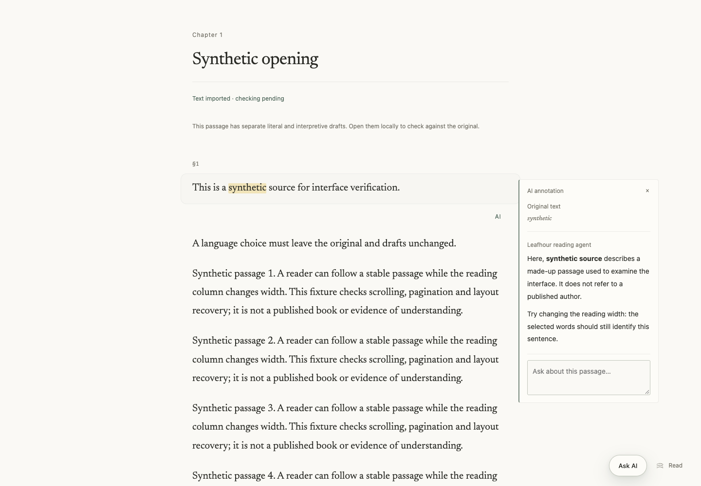
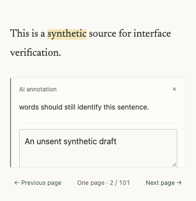
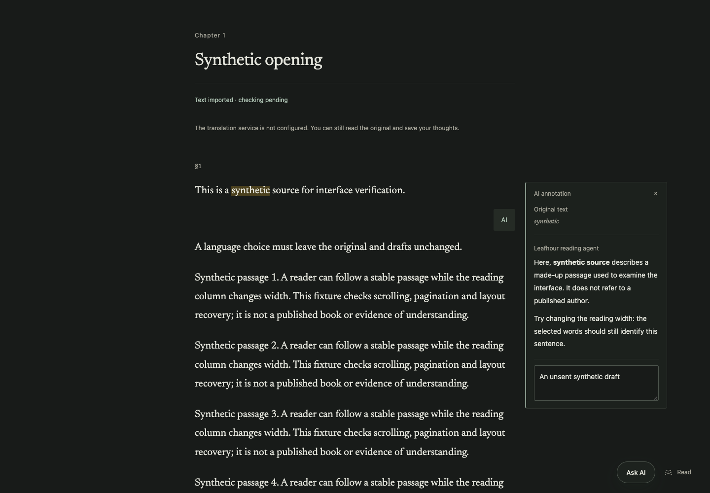
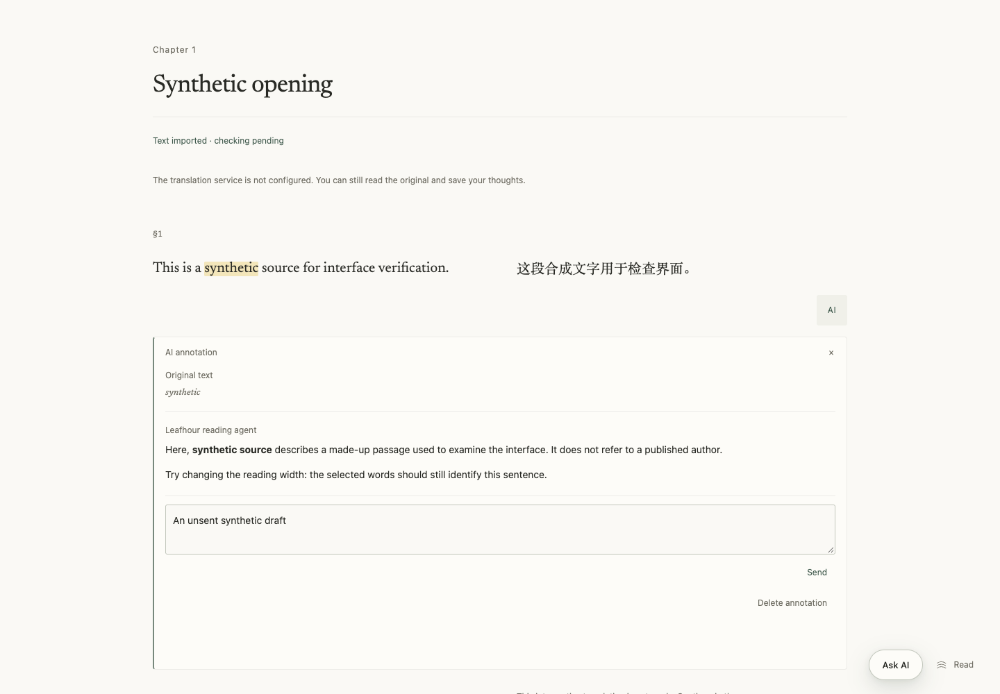

# GET-195 — 阅读边缘批注界面（实现阶段验收）

本记录只覆盖当前工作分支的界面阶段；不是合并、Production 或真人理解验收。

## 交互与视觉

- 显式“AI 批注”先保存选文高亮，再使用固定请求 ID 生成自由文字解释。首次解释没有虚构用户提问；用户追问保留原话。
- 宽屏在原文右侧有足够空间时使用纸张质感边缘卡片；并排阅读和窄屏置于段落之后；分页置于列容器之外的底部区域。原文仍可选择和复制，批注文字不进入原文偏移计算。
- 短屏分页保留原文、关闭和翻页。打开批注时收起原选文工具栏；低可视高度时暂时让出底部浮动工具的位置，关闭批注后恢复。
- 四语只更新自有界面标签，不替换输入框、草稿、选区或 AI 文字；外部 Agent、站内 AI 与用户文字分别标识。Markdown 使用既有安全 DOM 渲染器。
- 未确认结果只允许重试保存的同一请求；来源变化不隐藏此核对入口。浏览器无法可靠保存请求时不发起生成；不可读的旧缓存保留。取消需要服务端已确认的 running 请求；关闭卡片不等于取消。

## 独立审查与确定性验证

独立 reviewer 发现的来源变化后无法重试问题已由原反例重现，再以同 ID 重试回归与独立反例复核关闭。存储失败的生成风险也已修复并独立复核；没有以 memory-only 状态冒充跨刷新可靠恢复。

当前界面、pending、分页、高亮、精确延迟边界、待同步备份、原阅读器 owner/locale 及阅读对话邻居测试 **69/69 通过，0 failed/cancelled/skipped**。合成 DOM 只验证状态与身份，不证明真实几何或系统输入法行为。

待同步备份保留原离线原始数据恢复行为，新增 owner/book/version/epoch await 后核对。延迟模块加载失败不会被误报成成功导出；账号 ABA、来源补全期间换书都不下载旧账号缓存。

## 原生 Chromium

2026-10-20T07:18:06.442Z，实际编译入口、真实 annotation HTTP/领域服务，隔离合成账号、合成原文与确定性生成器。仅一次解释调用，未调用真实模型或其他账号。源码前后哈希一致，浏览器与服务已关闭，无 pageerror。

- 原生选词 → 高亮 → AI 解释；首次无用户消息。
- 四语切换保留同一个物理 textarea、焦点、文字选区与未发送草稿。composition 事件检查为程序事件，不是真实系统 IME 验收。
- 连续阅读 390×844、390×400、320×640；分页桌面、390×844、390×400。短屏 input 可视行至少 44px，close/send/delete 中心命中；打开批注后立即翻页没有被旧 resize 回调拉回。
- 纸张、夜间、并排阅读截图复核。窗口尺寸是 Chromium viewport，未声称物理手机或 VoiceOver 验收。

初始 JS **327517 B / 327680 B**，CSS **183431 B / 204800 B**；未提高预算。annotation controller/pending 为闭合的公开延迟模块图；原待同步备份模块改为仅显式导出手势导入，原因是原加入 UI 后初始 JS 327912 B 超预算。签入后还会为发现预生成批注加载 23589 B 的 controller、4738 B 的 pending store 及其纯依赖；320 KiB 是编译入口预算，不是首屏总下载体积。两条新边界均拒绝别名、query、错误 owner 和非公开依赖；保留原六条语言目录边界。不是零成本或性能 SLO 结论。

冷加载反例额外验收（2026-10-20T06:54:11Z）：实际暂停 `/reader-annotations.mjs` 的首次浏览器响应，在 p1 点击后改选 p2，再放行模块，没有错发请求；之后显式点击 p2 仅生成一次且引用 p2。同类 bootstrap+controller 回归同时覆盖账号 ABA、dispose 和未改选的正向路径。模块加载失败提供明确整页重载按钮，不尝试新 query/alias。

独立审查确认备份静态依赖的四个缺失路由后已精确补齐。实际两个请求处理器的 27×2 文件全部 200、正确 MIME、逐字节一致；另以 Chromium 执行真实待同步备份手势，合成同步失败后正常下载完整 `marginalia-library`，全部新请求的原始模块均 200，0 模型调用。此补充没有把模块加载失败当成原始数据恢复成功。

## 可复核图

图片均为合成资料，不含真实书房运行数据。最终无遮挡截图来自 2026-10-20T07:18:06.442Z；本轮同时核对共享焦点 token（2px solid）与功能文字至少 12px；冷导入 guard 另有独立原生检查与确定性回归。SHA-256：

- desktop-paper.png `796b52a195871a0e8cb023985659ea54ccea4877482701f514f79e05539693c5`
- paged-400.png `bc9240a34012dc20049e4721e988266adf0a8881ad506279cfb03654f35991b8`
- desktop-night.png `0de9d9ca9ef9437af8371b19088a646fa0b4415ce5624a49a85b2b77973c5c4e`
- desktop-parallel.png `e5709fbdd5c27c786e6021a996b21ad1491f4584445b1e50d287fb925df6a08b`
