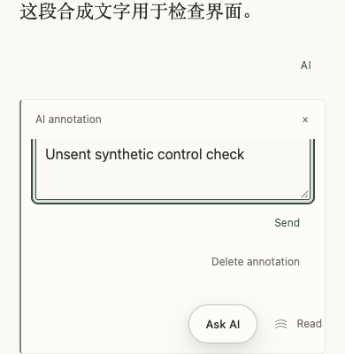

# GET-195 — 窄屏批注操作的滚动安全距离

基线 `233770f7fe84cb4546da75b0df1763e2f30f1edc` 的真实 Production 验收中，390×400 连续阅读的删除按钮在滚入视图后，中心仍被底部浮动入口覆盖。隔离合成资料复现时，发送按钮中心也命中了阅读工具入口。没有点击实际删除或发送虚构用户文字。

修复只在既有 mobile / non-pane 批注滚动区增加 `scroll-padding-bottom`，与原先 80px + safe-area 的底部 padding 保持一致。浏览器将操作滚入视图时，会为浮动入口保留这段安全距离。浮动入口继续显示，未改输入框、原文、模型请求、断点或分页布局。

40/40 定向门禁、hosted/public/release 构建通过。实际编译 reader + 合成 Auth/HTTP/领域服务 + 确定性生成器：修复前原生中心命中失败；修复后 close/send/delete 的目标均至少 44×44 CSS px，中心命中正确。测试前后源码 SHA 不变，0 pageerror，浏览器与服务关闭，未调用真实模型。

初始 JS 327517 B 不变；CSS 183494 B，仍低于 204800 B。原控制器和私有数据契约不变。独立 reviewer 在同页覆盖为 0 复现遮挡，再移除覆盖验证三项中心命中；390 非分页为 80px、768 非分页和 390 分页均为 auto。物理输入框、草稿与原文不变，无 P0/P1。当前 head CI 和同提交 Production / 实际站点复验仍是交付门禁。

本修复不声称解决站内真实模型生成失败。原 PR #139 的代码和外部 SDK 已上线验证；站内生成曾返回 failed，Vercel 运行日志权限与线上 provider 状态仍需核实，GET-195 保持进行中。
