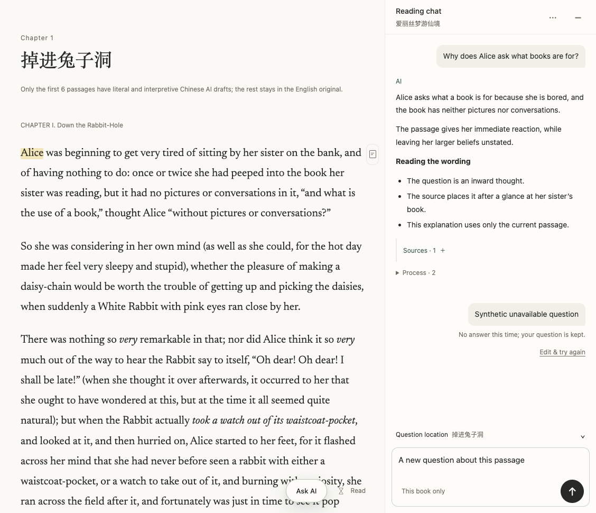
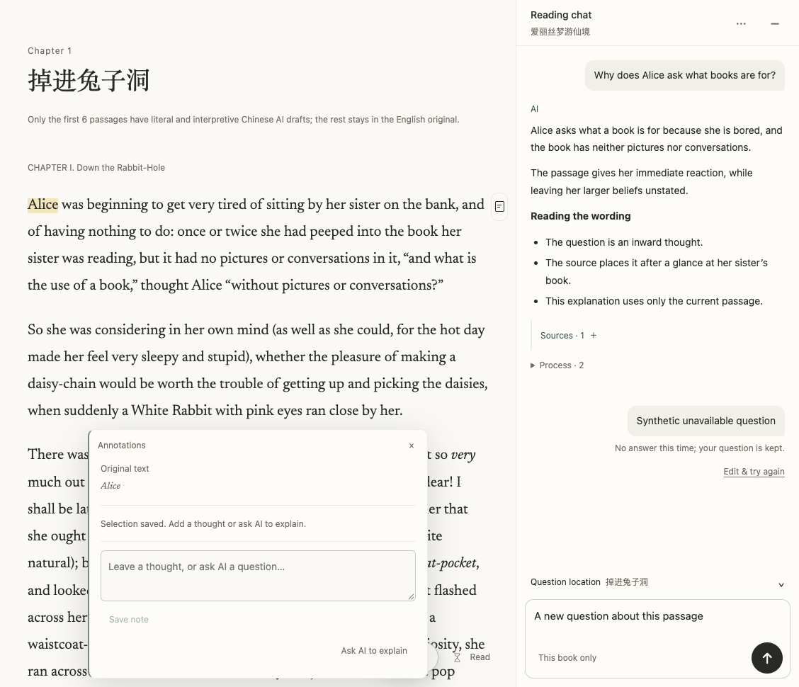
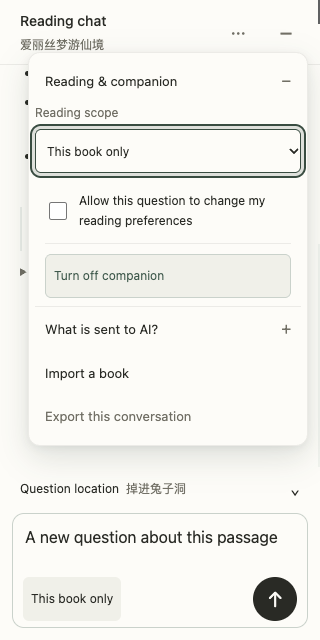

# 阅读侧栏细节与渐进展示

任务开始于 2026-10-24；本机实现与验收跨至 2026-10-25（Asia/Shanghai）。

## 最终行为

右侧保留对话与输入，提问位置、来源、过程和相关书目按需展开。阅读范围保持可见，导入改为具名菜单操作，阅读/陪读/数据说明分组呈现。原文、直译、意译分别查看，缺译和草稿状态仍明确。失败提示保留在对应问题旁；新草稿与原请求恢复的按钮语义分开。

注解sheet按正文可用区域居中，避免被聊天栏覆盖。已有宽度、书籍锚点、草稿、编辑器、用户记录和请求身份继续保留。复制次级操作支持hover与键盘聚焦显现；核心操作常驻。长回答可手动收起，旧消息节点与展开状态在新请求期间保持。

展示来源、工具、上下文和推荐的代码随原有Markdown模块在打开对话时加载，固定320 KiB阅读器启动JS门禁不变。

## 本地证据

- 14个定向与边界测试文件：最终组合 **238/238 通过**（包含新增长回答、Esc、inert、草稿、账号、HTTP与体积门禁）。
- 8个账号、HTTP、上传与上下文边界测试文件单独 **91/91 通过**，已包含在最终组合中。首次发现启动包超限后修复；最终启动JS为 **327262 bytes**，小于固定 **327680 bytes** 上限。
- 独立review发现并修复4个P2：不可见disclosure吞Esc、inert注解抢Esc、工具状态跨语言回退、旧失败消息被新问题重建。每项补充行为回归；最终独立review确认未解决 **P0=0、P1=0、P2=0**，copy三输出重算全部MATCH，`git diff --check`通过。
- 浏览器使用隔离合成账号与公版《爱丽丝》；没有访问生产私有数据或调用真实供应商。桌面1128×970、侧栏400px时，注解卡x124–604，聊天从x728开始，关闭/保存/解释操作均在可用区域内。
- 浏览器验证原生文本版本选择、缺译提示、范围入口定位、Esc逐层关闭、桌面来源跳转不关闭聊天、未发送草稿保持完整。390×844窄屏已验证核心输入与发送可见、跨断点后Esc关闭顶层聊天且保留底层注解。390×420压缩视口发送按钮底边401px且触屏Copy可见；320×640菜单由越界修复为x28–308。注解卡由固定540px改为随内容收紧，当前合成案例约352px高。
- 截图仅包含合成对话及公版原文，不包含真实用户对话。生产验收与CI证据在合并后记录，不能据本节声称已上线。

## 50项审查对应

“沿用”表示保留已有行为并核对相关边界；“未验收”保留真实覆盖限制，不当成缺陷已修复。

| # | 审查项 | 实现或验收说明 |
|---|---|---|
| 01 | 注解卡右侧约 115px 被对话栏盖住，操作不可完整看到。 | 已实现可用区域定位，桌面实测卡片与操作均不跨入聊天区域。 |
| 02 | 对话输入框和注解输入框同时出现，两个任务争夺注意力。 | 保留两个独立任务与编辑器；修复共存遮挡，未合并或迁移记录。 |
| 03 | 正文当前可见开篇，侧栏“current passage”指向之前的第六段；界面没说这是保留的提问位置。 | 明确为提问位置，不再称作实时当前位置。 |
| 04 | 上下文收起后仍是章节名＋一整句展开说明，且与页内标题重复。 | 默认折叠的短提问位置行。 |
| 05 | 选文摘要与整段上下文是两套组件，容易同时占空间。 | 有精确选文时优先显示选文卡，隐藏重复的整段上下文。 |
| 06 | 原文、直译、意译纵向全部铺开。 | 原文、直译、意译用原生选择器逐一查看。 |
| 07 | 对话滚动、上下文滚动、引文滚动和注解滚动可能同时出现。 | 默认不展开正文；展开只保留一处有界文本滚动。 |
| 08 | 收起侧栏会改变正文宽度，原文锚点与草稿恢复很关键。 | 保留原有草稿、锚点与账号隔离行为，回归测试覆盖。 |
| 09 | 点击来源当前会关闭对话，打断并排核对。 | 桌面原文跳转保留聊天及草稿，窄屏返回正文。 |
| 10 | 当前宽度占约 39%，正文和旁注可用空间紧张。 | 首次宽度由440px降为400px，已有用户宽度继续保留。 |
| 11 | 每轮失败显示同一句话，底部又重复一次。 | 末轮失败已显示时不重复绘制全局失败条。 |
| 12 | 失败状态和对应问题距离大，显得像一条空 AI 回答。 | 失败状态与编辑恢复动作紧随原问题。 |
| 13 | 输入框有可编辑草稿，但按钮只因存在 retry 就显示重试图标。 | 标签比较问题、引用、位置、版本与范围；改变草稿显示发送。 |
| 14 | 相同失败问题反复出现，用户难辨是重试记录还是新问题。 | 保留未知结果的原请求恢复与既有幂等；不按文本合并历史。 |
| 15 | “No answer this time”没告诉用户现在能做什么。 | 保留错误与恢复状态；不猜测供应商、额度或网络原因。 |
| 16 | 生成中的状态可能分散在消息区和全局提示中。 | 保留单一实时状态、停止与运行态轮询。 |
| 17 | 展开的明细重复“正在查找书目 · Completed”，时态矛盾，重复多行。 | 工具活动按类型和状态汇总，失败数量在摘要明示。 |
| 18 | 当前实现已有接近底部才跟随的保护，但上翻后没有清楚的新消息返回入口。 | 按滚动位置提供回到最新入口，保留接近底部才跟随的保护。 |
| 19 | 展开来源、切换任务后需要回到同一条历史消息。 | 历史消息复用原DOM；待定状态和恢复按钮原位更新。 |
| 20 | 历史长回答占很多屏，但不能擅自把最新答案藏起来。 | 长回答允许手动收起；默认仍完整展示。 |
| 21 | “Reading chat”、书名、页内章节名和上下文章名反复出现。 | 缩减顶部和重复说明的间距，保留书名。 |
| 22 | 顶部“−”像最小化窗口，和内容折叠的“−”没有层级差别。 | 保留既有明确可访问名称与44px收起入口；图标仍沿用产品现有符号。 |
| 23 | 每条回答都常驻一整行 AI＋Copy，增加空白和工具感。 | 复制操作移除独立工具行，桌面hover/focus显现，触屏常显。 |
| 24 | 问题、AI 标记、答案、来源和下一轮之间的空白层层累积。 | 统一轮次内和轮次间间距。 |
| 25 | 提问与回答的字号、行高及段间距缺少统一节奏。 | 提问与回答采用14px/1.75基础消息节奏，正文书籍排版不变。 |
| 26 | 灰色状态、链接和边界很淡。 | 沿用项目语义颜色；未声明完整WCAG或全主题对比度认证。 |
| 27 | “···”“↻”“＋”含义依赖猜测。 | 具名导入与阅读范围，核心按钮保留可访问名称。 |
| 28 | 英文长书名、链接、中文与代码混排容易使窄栏断行失衡。 | 沿用长词换行、Markdown代码/表格容器；窄屏浏览器已检查。 |
| 29 | 侧栏自己的颜色变量与阅读主题变量叠加，容易在夜间、泛黄主题中不一致。 | 使用现有语义token；完整夜间/泛黄对比度矩阵仍需独立实测。 |
| 30 | 调宽分隔条默认几乎不可见，已有键盘调节能力值得保留。 | 保留hover/focus分隔线、键盘宽度调节与持久化。 |
| 31 | 当前阅读范围藏在更多菜单里，输入区只笼统说“这本书”。 | 输入框附近常驻已确认的阅读范围；点击定位实际范围设置。 |
| 32 | 复选框、范围选择、说明、导出、陪读混在一个大浮层。 | 更多菜单分组，设置默认折叠。 |
| 33 | 菜单里两段长说明让一个操作菜单变成文档。 | 发送内容与历史范围说明收进明确的说明disclosure。 |
| 34 | “Allow this question to change my reading preferences”隐藏在全局菜单，难看出只影响本轮。 | 保留按轮次的偏好写入复选框与提交语义，不扩权。 |
| 35 | 陪读是一个很大的“Turn off companion”按钮，看不出它是状态开关。 | 陪读移入设置组；保留真实aria-pressed状态及取消/恢复服务。 |
| 36 | 导出是低频功能，但夹在授权说明中间。 | 导出保留在菜单，能力与开放格式不变。 |
| 37 | 输入框右下“＋”实际是带入新书，容易被理解为添加引用或附件。 | 书籍导入移至菜单具名入口，保留原上传控制器及拖放。 |
| 38 | 空状态提示容易变成功能展板。 | 沿用只有空历史才显示建议的条件。 |
| 39 | 来源、工具活动与相关书是三种不同信息，但都用类似列表占空间。 | 来源与过程按需展开，相关书目也改为折叠组。 |
| 40 | 英文 UI 出现“Read 1 chapters / 1 places”，工具标签又保留中文进行态。 | 四种UI语言统一工具类型/状态，来源计数使用无单复数歧义格式。 |
| 41 | 全常驻会乱，全部隐藏又难找。 | 只有复制等次级操作渐显；发送、停止、关闭及范围常驻。 |
| 42 | 仅设 opacity:0 会出现看不见却可点击或可 Tab 到的控件。 | 渐显操作获得焦点时显现；真正收起用原生details/hidden语义。 |
| 43 | 所有展开都滑动、呼吸或弹跳会干扰阅读。 | 复制渐显140ms；reduced-motion取消过渡。 |
| 44 | 浮层当前只知道整窗，未充分处理并排侧栏的占用。 | 注解按实际可用横向区域定位，并考虑可视视口高度与安全区。 |
| 45 | 对话有自己的 Escape 处理，多浮层并存时需要确定关闭顺序。 | Esc先关闭当前可见的最内层disclosure；inert注解不能抢占。 |
| 46 | 渐显、切任务与折叠后，键盘焦点容易丢失。 | 保留焦点恢复及编辑器身份，补充Esc和语言切换回归。 |
| 47 | 当前小于 1100px 就变成全宽对话，跨断点可能突变。 | 保留1100px断点，桌面/窄屏跨断点已浏览器验收。 |
| 48 | 移动软键盘会显著压缩消息区域。 | 保留visualViewport处理并检查紧凑视口；真实iOS/Android软键盘未验收。 |
| 49 | 小屏、200% 缩放和长书名未覆盖。 | 浏览器视口矩阵与缩放单独记录；不冒充实体设备验收。 |
| 50 | 视觉修改涉及多种请求与存储状态，不能只看静态截图。 | 定向状态/账号/请求边界测试通过；没有调用真实供应商生成。 |

## 合成界面证据

以下均为隔离合成验收，不是生产用户对话。

## 合并与生产

交付 PR：[#177](https://github.com/getyak/leafhour/pull/177)。本文保存合并前的本地及隔离合成验收；当前提交 CI 与合并记录以该 PR 的 GitHub 检查为准，Production 部署及同提交线上验收证据在该 PR 的合并后评论中读回记录。CI、合并、发布和线上验收是不同状态。
