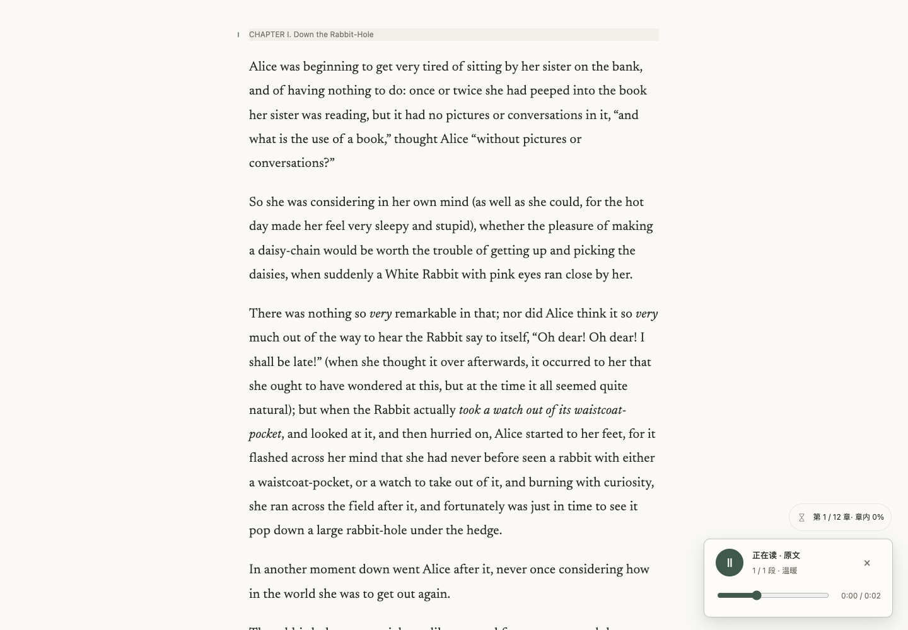
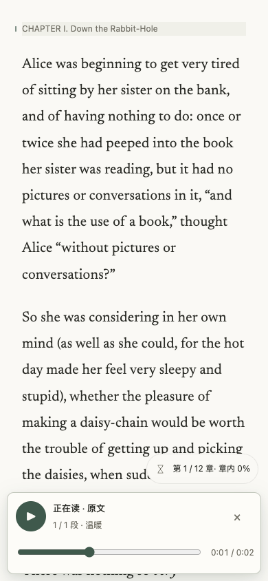
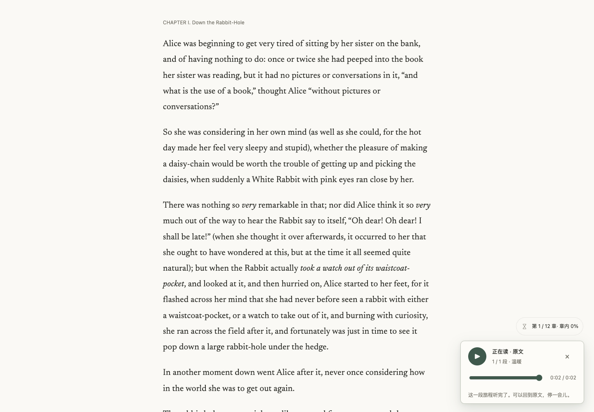

# GET-193：原文连续听读实现与验收记录

2026-10-27（Asia/Shanghai）。**代码候选已完成；完整工单验收仍未完成。** 本记录不把单段缓存或合成状态测试当成真实多段听读通过。

## 原候选与当前基线

沿用唯一工作区 `/Users/cubxxw/ops/symphony/runtime/workspaces/GET-193` 和分支 `codex/get-193-e2e`。原未提交内容共 20 个文件已逐字节复制并记录 SHA-256，原差异和所有历史截图未覆盖；本轮只接续仍未被主干覆盖的音频补丁。原候选的恢复 stash 为 `2279e7d35fcd262b117a518400adfd56af785ef3`（基线 d0ecf84），同步前第二次保存为 `4ca90fac04d0cd3c9ee159417dd05318f3e83a23`（基线 dca8eab）。原字节和恢复说明留在 ignored `.symphony/resume-20261027-original/`。

最终基于公开 `origin/main` 的 `bbe817db861a064a7e74cdef27b80285577be746` 快进同步，保留较新的导航、浮层协调、界面词条和样式令牌。上游原文听读底座尚无直接播放及自动续批，因此这些是独有补丁；没有复制其他工单的未审代码，也没有修改原项目目录。

## 用户可见行为

- 选择文字后点击朗读即开始；侧边阅读工具的正文入口从捕获的当前位置直接朗读。“更多听读方式”单独保留导读、讲解和历史记录入口，有四种界面语言的可访问名称。
- 原文按稳定段落 ID 和精确 source offsets 顺序播放。当前章节以每批最多十个音频片段准备，在播放走到批尾后才提交下一批，支持长段落内部续接；不越过章节末尾，也不静默跳过缺失译文。
- 当前段落同时显示底色、边标和 `aria-current`；异步导航返回后重新校验归属再标记。暂停、手动退出跟随和切换起点不会被迟到结果覆盖。
- 宽屏播放器固定在右侧；中等及手机屏使用底部布局。移动时间标签保持一行，主按钮 44×44px。
- 创建响应丢失也能按原请求标识取消。取消绑定原 owner/book，服务端持久化取消记录同时封住先取消后创建及准备期间取消的竞态。记录容量满时对未知新请求拒绝创建，避免取消保护失效后仍计费。已提交给供应商的单次请求仍可能收费。
- 失败创建只在用户明确重试时复用同一 idempotency key；BFCache 返回不自动生成。只有精确的 `409/missing_translation` 才提供显式“改听原文”，点击前不合成。

## 真实浏览器观察

环境是本机 Google Chrome 156.0.8078.48，通过已有 Playwright 驱动；不是物理 Safari 或人工语义听辨。Browser plugin 未提供，采用已安装的浏览器和工具，没有安装第二套浏览器。分支构建 HTML/CSS/JS 在浏览器中替换，认证、书籍与音频仍走已有 Production 服务。因此这是分支页面验收，不是合并后正式站验收。

先通过项目指定 macOS 钥匙串登录默认测试账号，再读回账号和 owner 匹配。没有写入密码、Cookie、令牌或真实书房导出到本记录。保持书籍、译文、偏好、私人笔记和划线；沿现有用户界面读取公版 Alice 的已保存听读会话，播放位置作为这次验收操作更新。未查询其他真实账号。

本轮仅复用已有 2.96 秒 Gemini WAV；没有新增合成请求。原生 `playing/timeupdate` 事件和 currentTime 前进已记录，播放段落与 `aria-current` 匹配。键盘空格暂停后两次采样位置均为 0.469096 秒，再次空格后继续前进。结束时原生 `ended` 为 trusted，currentTime=duration=2.96，按钮变为“重新播放”，原文标记清除。

故障注入将第一次 clip GET 明确返回 503；播放器显示听读失败，用户再点击播放后第二次 GET 取得未改动的真实缓存 WAV 并完整播放至结束。该 503 是注入的传输故障，不是对正式站可用性的断言，也没有用 mock 音频替代播放。

布局读回：1440px 下播放器 x=1116、宽 300px；1024px 下居中宽 720px，未出现横向溢出；390px 下控制区在视口内，主按钮 44×44px，时钟高度 15px、nowrap，无横向溢出。没有捕获到 pageerror。

证据：[原生媒体/暂停及移动状态](2026-10-27-get-193/cached-playback.json)、[最终布局与播放事件](2026-10-27-get-193/final-browser.json)、[真实缓存恢复及播放结束](2026-10-27-get-193/real-error-end.json)。

## 自动验证与独立审查

| 检查 | 实际结果 |
| --- | --- |
| 音频最终相关测试 | [241 passed / 0 failed](2026-10-27-get-193/audio-final.log)，含实际 HTTP 身份边界、真实 hosted-store CAS、跨进程取消、顺序/offset/章节边界与前端生命周期；媒体 fixture 只证明状态契约 |
| 类型化缺译文回退 | [99 passed / 0 failed](2026-10-27-get-193/fallback-green-fixed.log)，新增场景先 RED 后通过；保留已有 transport 测试 |
| 中间全量本机测试 | [3578 tests：3574 passed / 1 failed / 3 skipped](2026-10-27-get-193/full-tests.log)。唯一失败是本机未安装原生 PostgreSQL 的年度计费 SQL 断言；未设 hosted 标志跳过、未改测试掩盖。该轮早于最后的缺译文回退窄修复 |
| 完整构建及发布包 | [runtime/web/public-build/release-policy/verify-release 全部 exit 0](2026-10-27-get-193/build-validation.json)，隔离运行时实际初始化 928 文件、9.0 MB，0 模型请求 |
| 初始阅读资源预算 | JS 327480 / 327680 字节；CSS 204771 / 204800 字节。只去除音频样式中的覆盖重复和简化新增布局，未放宽预算或外部化规则 |
| 文案 | 固定缓存 Vale 3.24.0 + 锁定 textlint CLI，[lint 通过](2026-10-27-get-193/copy-lint-accepted.log)，[真实违规探针通过](2026-10-27-get-193/copy-canaries.log)；历史 debt 仍可见，未新增豁免 |
| 独立原生 sub-agent review | 已关闭确认的 P1/P2：未知创建取消、准备失败恢复、续批期间退出跟随、异步定位后暂停、BFCache 成败恢复、取消容量边界及显式原文回退。最终复审未发现未解决 P0/P1/P2 |

构建和本机测试不替代当前 PR head 的 GitHub CI。SQL、打包和仓库保护门禁必须在实际当前提交上通过后才能合并；原生 PostgreSQL 缺口不写成本机通过。

## 仍缺的真实验收

当前默认账号只找到 Alice 单段真实朗读缓存。多段原文的真实自动衔接、跨十 clip 批次及章节末尾的完整音频观察，仍缺可复用的多段真实音频；本轮禁止新增费用，因此没有生成新声音补齐。合成服务/状态/HTTP 测试证明控制逻辑，不证明本人已听到每段与原文完全一致。物理 Safari 和语义音质也未验证。

合并及 Production 状态必须后续按实际回执记录。仅当前 main 的 Vercel 正向成功状态曾只读核对；共享发布 hold 未修改，没有手动部署、预览部署、重试发布或切换供应商。Linear 原生插件返回工具不可用后，已通过备用网页核对 GetYak、GET team 及本单 In Progress；只在本单回链和记录进度，不关闭未完成的验收。

## 截图

桌面真实缓存播放：

手机暂停状态：

真实缓存完整播放结束：

提交的日志只移除行尾空白；原始输出保留于本任务的忽略恢复目录与登记测试产物。
