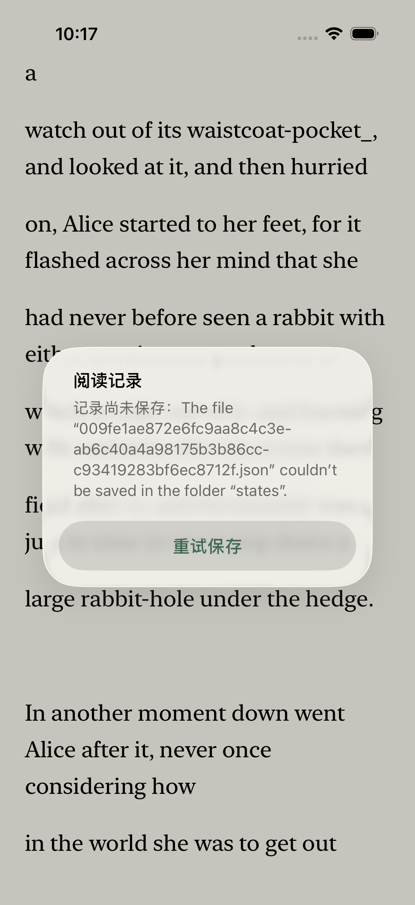
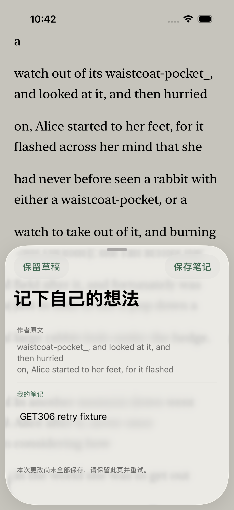
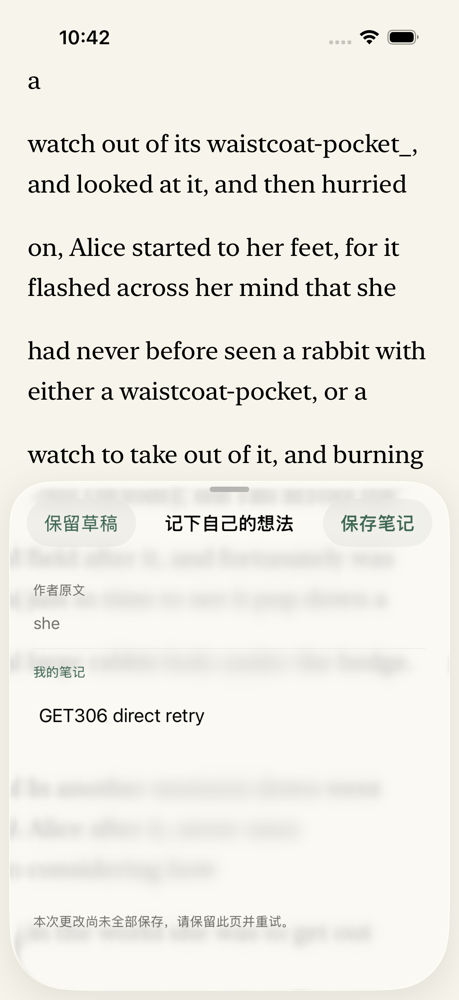

# GET-306 · Keep iOS note saves safe to retry

实现和本地验收完成；当前提交 CI、合并、main CI 与 Production 的状态另行跟踪。本记录不代表 TestFlight 已更新。

## 发现与处理

在 iOS 26.5 Primary iPhone、任务应用和隔离公版 Alice 数据中，从“我的记录”打开草稿，阻断该书状态文件的写入后保存。原生失败用例实际执行一次：根错误弹窗出现在正文上，嵌套编辑页不再可见。恢复后根重试只保存一条，冷启动也保留一条；没有观察到重复记录或数据丢失。

ReaderSession 的宿主失败用例另外确认了未落盘笔记／草稿的状态问题，以及旧 `flush()` 未等后续排队编辑就返回。它们不证明原生界面已复现提前关闭。

[保存方案](../../design/2026-10-29-ios-craft/note-save-retries.md)围绕同一编辑的 UUID、逐次成功回执、未确认提交的局部恢复和当前版本复核。编辑页内处理保存错误，提交期间锁住重复动作，直接编辑页去掉额外“继续读”入口，恢复清楚的导航层级。原文、笔记、草稿、锚点和存储格式保持各自职责。

## 真实验证

| 检查 | 结果与限制 |
| --- | --- |
| 宿主 RED | 原行为的 2 项测试、3 个断言失败；审阅补充的关闭草稿用例先执行 1 项、1 次失败，再修复 |
| 最终宿主 | `host-final-reviewed.log`：41 项 XCTest、0 失败，含 8 项实际 ReaderSession 回归，无编译警告。另一个 Swift Testing 的 0-test footer 不计作成功测试 |
| 最终原生 | `native-final.xcresult`：1 个组合测试实际执行 56.940 秒，0 失败；不是两次独立测试或全量 UI 套件 |
| 嵌套编辑 | 写入失败后编辑页仍在；恢复写入后同页重试、冷启动，只有一条笔记，原始引用仍为 `text/text-2/scalar370` |
| 直接编辑 | 真实长按选文、输入笔记、写入失败，编辑页保留且无根保存弹窗；保留草稿、冷启动、从记录恢复再提交，最终两条不同 ID 的笔记，引用与提交前真实草稿一致；再次冷启动仍为两条 |
| 审阅 | 独立审阅无遗留确认问题；补齐外层关闭回执检查，以及已确认笔记改回原正文后关闭时的同 ID 草稿清理。不同正文、新编辑 ID 的同内容草稿均保留 |
| 资源 | 全部原生运行经 dev-ios-session，复用既有 Primary／构建缓存，实际 xcodebuild 日志为 `-jobs 2`，本任务无并行重活；借用设备保留 Booted |
| 收尾 | 临时 UI 探针字节还原；当前任务的 2 条合成笔记已存证，应用终止后状态恢复为本轮前的原始字节，原有书籍未改 |

精确源码、截图、探针、归档哈希和笔记锚点见 [evidence.json](evidence.json)。原始 xcresult、日志、各版探针与恢复脚本保存在 `native-note-save-evidence.tar.gz`，全部 4315 个文件逐项校验，恢复成员前缀为 `runtime/`。第一轮旧容器路径错误、第二轮 footer 预期不符，以及审阅前通过的 `native-green` 均不替代最终验收。

XCTest 的停止失败行为会跳过 Swift defer；实际恢复由 host driver 的退出清理保障。故障只替换当前任务的隔离状态文件端点，不填满磁盘，不损坏真实书籍，不涉及云账号或模型调用。

## 原始原生截图

失败前的行为：根弹窗取代编辑上下文。

当前嵌套编辑页保持正文和错误反馈。

当前直接编辑页使用自己的保存／草稿入口，标题完整。

截图是原始导出像素，没有修改或补画。真机、TestFlight、VoiceOver、硬件键盘、小屏与 iPad，以及真实存储故障的长期表现仍未验收。
