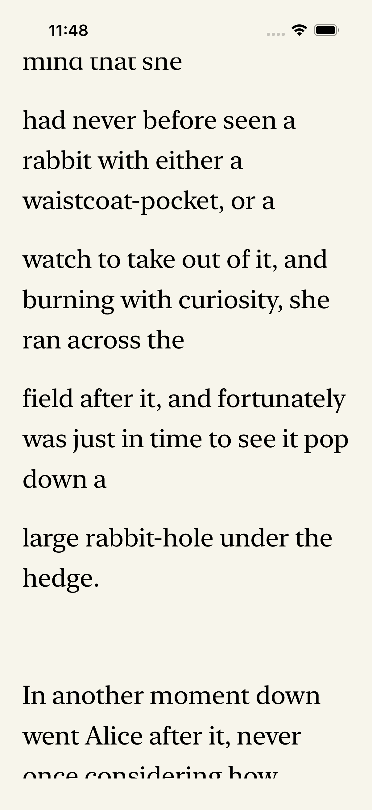
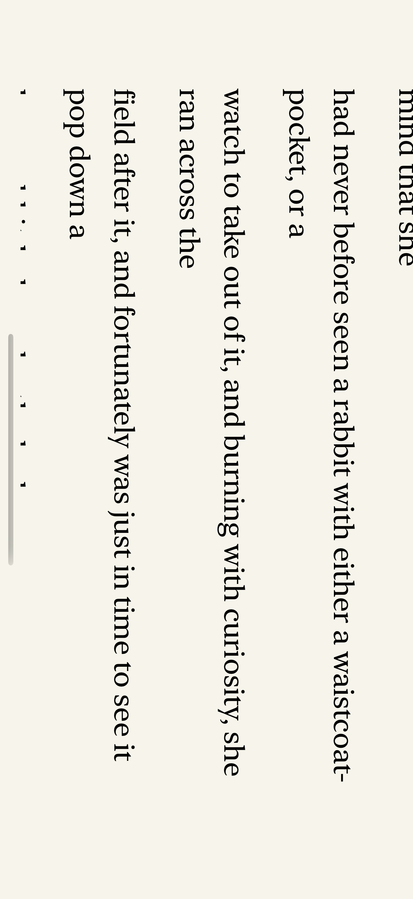

# GET-308 native reflow verification

Issue: [Keep iOS reading position stable during reflow](https://linear.app/getyak/issue/GET-308). Base: public main `e1cd406` (the separate native release-automation change is included, not reimplemented here). This is source/simulator evidence, not native distribution or physical-device acceptance.

## Executed evidence

- **Before:** `native-baseline-final`, one executed XCTest with one expected anchor-retention failure. A same-frame +600pt scroll and font22→26 changed the visible source to text-3/scalar28 before reflow, then returned to text-2/scalar353. Further reflow cleared the actual `waistcoat-` selection. A legal explicit scalar500 target in a739-scalar passage remained visible at481.
- **Host RED:** one executed existing-session regression failed because typography changed the explicit navigation identity.
- **Final host:** `host-final.log`, **47 XCTest / zero failures**, including six new session regressions. They exercise immediate ignored checkpoints without observed publication, immediate flush, later checkpoints during a suspended write, stale navigation/chapter rejection, receipt freshness/preferences, and confirmed note/source-anchor invariance. Writes use the actual OfflineLibrary with controlled scheduling. The separate Swift Testing zero-test footer is not acceptance.
- **Final native:** `native-final`, **one executed combined XCTest /9.849s/zero failures**. Same-paragraph reflow, retained single-range selection, explicit navigation/selection clearing and actual `XCUIDevice.landscapeLeft` rotation passed. Immediate checkpoint text-3/scalar28; after reflow visible text-3/scalar0 and session/checkpoint28. Selected UTF-16 range[965,10] still contains `waistcoat-`. Explicit scalar500 session target remains500, visible481; landscape750×382 remains visible481/checkpoint500. These line-head differences are retained in evidence, not called exact pixel/scalar preservation. Native disk/cold readback of these new positions was not performed; actual storage propagation is covered by the host tests.
- Independent code review found no P0/P1. One substantive P2 about saveNote checking only revision after awaiting flush was fixed and reviewed: ignored checkpoint changes also invalidate that handoff. The added gated note test covers latest-position confirmation, not deterministic reproduction of the exact await-return race.

The controlled native probe temporarily invokes actual coordinator/session APIs on the UI actor. It is not a finger-gesture latency/frequency benchmark. Public assertions and raw reports are in [evidence.json](evidence.json). Screenshots below show the end of the navigation/rotation flow, not an invented visual before/after of the immediate reflow stage.

## Provenance and restoration

All native commands used `dev-ios-session`, the borrowed Primary iPhone17Pro/iOS26.5, effective `IOS_XCODE_JOBS=2` confirmed in logs, and the existing DerivedData. Heavy work was serial. The driver queried the current post-install task container, copied its report, terminated only `org.leafhour.craft297`, restored the exact original state SHA256 `f0df05c436c404e0a9a7a81e85c03b701ad763adc4f800078f4735ea2fcf0e57`, and checked it. XCTest returned the borrowed device to portrait and left it Booted. Temporary app diagnostics and the replacement UI test were removed before commit; production/source fingerprints and the exact temporary probe are retained in the local evidence archive.

The first native build failed because a local diagnostic function lacked MainActor isolation; no test ran. The next baseline used an invalid1200-scalar navigation target and is superseded for navigation acceptance. `native-green`/46 host tests preceded the final reviewed fixes and are superseded. None are counted as the final current-source pass.

No source book, private account data, credentials or generated translation is published. The isolated public-domain fixture identity is `sha256-009fe1ae872e6fc9aa8c4c3eab6c40a4a98175b3b86ccc93419283bf6ec8712f`. No schema, network, model, signing, upload or tester change.

## Remaining acceptance

The guards have session-level stale-navigation/chapter tests; real cross-chapter UI interruption was not executed. No image/cache, very-long-paragraph CPU, frame-rate, memory, iPad/split-view, PDF theme, maximum type, mixed RTL/LTR multi-range, VoiceOver, physical keyboard, real-device or TestFlight acceptance. Current-head CI, merge, main CI and same-source website publication are tracked separately in Linear and the operational ledger; a native test is not proof of those later gates.
