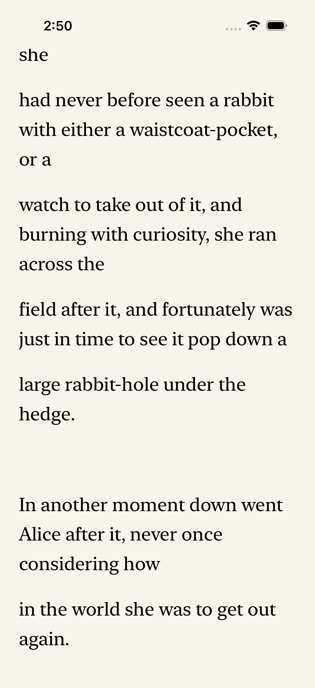
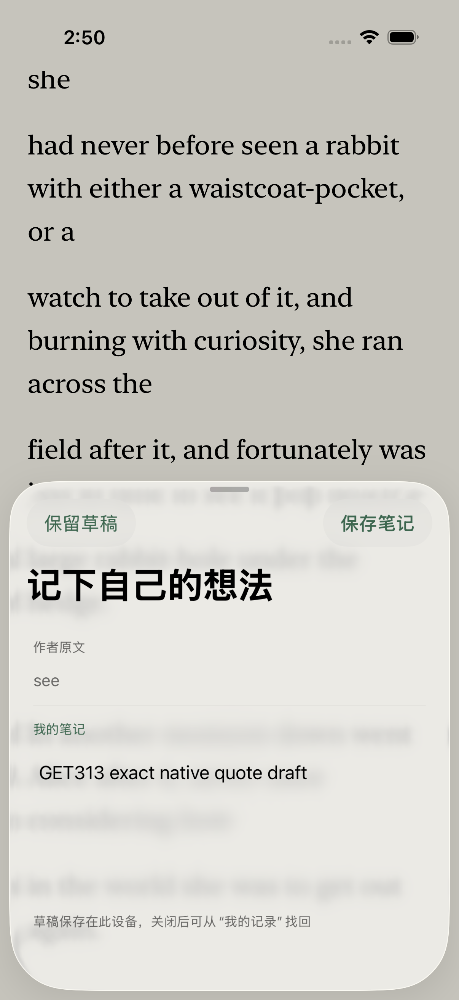

# GET-313: fast source offsets in long native paragraphs

Base: `9ed97de798f08818f2c12c4eed2f1804fe867ebb`. Issue: [GET-313](https://linear.app/getyak/issue/GET-313). This record covers source, host tests and one actual native Simulator test. PR/current-head CI, merge, main CI, production website and TestFlight are separate delivery stages.

## Reader benefit and implementation

Each scroll checkpoint previously bridged a passage to NSString, copied its UTF-16 prefix and counted Unicode scalars. TXT/Markdown imports retain entire paragraphs, so a long paragraph can make this repeated work significant. The change indexes the unchanged source once and reuses it while reflowing the same session/chapter. It does not split or truncate the paragraph.

`SourceTextOffsets` caches counts, uses identity conversion for BMP scalars, and stores one internal String.Index/UTF-16/scalar checkpoint every 1024 scalars for longer supplementary text. Lookup binary-searches the checkpoints and scans at most 1024 scalars. Capture, restore and selected-quote anchors use the same conversion. Indices belong to the struct's immutable String. Reuse checks session object identity, chapter index, passage ID and exact UTF-8; a new source or dismantle releases the old spans. Array-position matching avoids a passage-by-passage quadratic search.

Swift canonical string equality can treat composed and decomposed spelling as equal despite different raw scalar offsets. Exact UTF-8 comparison avoids reusing the wrong index. See the official [Swift string guide](https://docs.swift.org/latest/documentation/the-swift-programming-language/stringsandcharacters/), [UTF-16 view](https://developer.apple.com/documentation/swift/string/utf16view) and [scalar view](https://developer.apple.com/documentation/swift/string/unicodescalarview). The seven new host tests exercise both representations, combinations, emoji/ZWJ/flags/skin tones, CJK, RTL scalars, NUL, negative/oversized values, long checkpoint boundaries and bridged/immutable storage. Invalid positions halfway through a surrogate pair floor to that scalar's beginning; legal scalar offsets inside a grapheme cluster stay distinct.

No source text, stable IDs, saved scalar schema, notes/exports, font/network dependency or TextKit engine is changed. Latest GET-274 companion callbacks, menu order and selection dismissal remain intact. This does not certify its separate end-to-end flow.

## Component measurements

The paired experiment uses ASCII `reader `, BMP `字é ` and mixed `a字😀é ` repeated 8, 32000 or 128000 times on the host. Native uses 8/128000. Each pair uses the same valid source boundary with alternating old/new order and asserts equal answers. Two warmups are discarded. Old lookup includes an autorelease pool; new lookup uses the prebuilt index. Timed construction uses distinct equal-length inputs prepared outside its timer. Checksums keep answers live. Median uses sorted[count/2]; percentile labels use sorted[floor((n-1)*0.95)]; these are small descriptive samples, especially four native construction samples, not a statistically established production percentile.

| Scope / mixed UTF-16 units | Old lookup p95 | New lookup p95 | Construction (host p95; native median / max) | Samples lookup / construction |
| --- | ---: | ---: | ---: | ---: |
| Host -O / 56 | 0.000584ms | 0.000167ms | 0.000334ms | 48 / 10 |
| Host -O / 224000 | 2.701375ms | 0.008625ms | 1.883166ms | 48 / 10 |
| Host -O / 896000 | 6.979416ms | 0.006125ms | 15.812208ms | 48 / 10 |
| Native Debug / 56 | 0.017833ms | 0.005083ms | 0.004833 / 0.005084ms | 24 / 4 |
| Native Debug / 896000 | 4.210500ms | 0.015083ms | 13.285792 / 13.373167ms | 24 / 4 |

Full raw distributions for all nine host/six native cases: [host](host-comparison.json), [native](native-final-report.json). Short cases show no observed lookup increase in these runs; sub-microsecond host values approach timer/compiler resolution. Different runs varied with shared CPU/swap pressure; earlier baseline and preliminary runs remain in the formal archive. The table uses the final paired runs, not the best number from each run. Host -O and native -Onone are not directly comparable.

For 896000 mixed UTF-16 units the host index contains 749 checkpoint elements, 17976 bytes of element fields (`count * MemoryLayout.stride`), excluding array capacity/allocator overhead, String/object storage and temporary allocations. ASCII/BMP have zero checkpoint elements. This is not RSS or total allocation measurement. First construction remains linear and on the render path; reusing an unchanged source avoids rebuilding the index, but exact UTF-8 validation still scans on reflow. This change removes repeated prefix scanning from checkpoint lookup; it does not prove first-layout, whole-frame, FPS, real-finger or physical-device performance. A chapter with many huge paragraphs can still have expensive initial layout.

## Actual native regression

One executed XCTest, **36.985s / zero failures**, on the existing task-owned iPhone 17 Pro/iOS 26.5 Simulator, Debug, actual xcodebuild `-jobs 2`, serial testing. It runs the component comparison on the main actor with sleeps outside timing samples, then checks:

1. Programmatic selection `waistcoat-` remains through a real session font change and attributed-text rebuild.
2. Explicit scalar500 navigation remains current and clears selection.
3. A controlled in-memory session with identical chapter/passage IDs but changed mixed source forces replacement: 3000 scalars/3500 UTF-16 units, followed by restoration of the original source. This is a component source-owner check, not a real library/source migration or cross-chapter UI test.
4. A real long-press system menu → 记笔记 → type → 保留草稿 → terminate/relaunch → 我的记录 → reopen restores the exact draft body. Final on-disk quote is `see`, text/text-2 scalar687, checked against the unchanged public source. This proves this quote's cold draft persistence, not every language's natural selection or exact cold reading pixel position.

The temporary [native probe](probe.swift) and [XCTest](ReadingUITests.probe.swift) are archived here as evidence; they are absent from app/test targets after the run. The host driver restored the original task state byte-for-byte, SHA `f0df05c436c404e0a9a7a81e85c03b701ad763adc4f800078f4735ea2fcf0e57`, even on failure; [readback](restoration.json). No private/cloud/model data was used. The borrowed Primary remains booted. [Actual counts and source hashes](verification.json).

## Reproduction and limits

Run the Core suite with `swift test --package-path apps/ios/LeafhourCore --jobs 2` through the host's `dev-ios-session` and resource audit. To reproduce the host benchmark, concatenate the checked-in SourceTextOffsets.swift with [benchmark-body.swift](benchmark-body.swift), compile with `swiftc -O -num-threads 2`, and execute on a quiet comparable host. This intentionally uses the exact implementation in one module; actual app Debug integration was checked separately. Record source hashes and configuration, rather than comparing absolute numbers across machines.

Formal archive `native-fast-anchors-evidence.tar.gz` and `fast-anchors-preservation.json` live with the overnight control artifacts, with runtime/ restore scope and full file hashes. Raw old/new sources, host logs, native xcresult, snapshots and drivers are preserved. Initial semantic RED (6 tests/one expected failure) and six-case preliminary benchmark are retained as excluded/superseded. The final Core suite executed **54 XCTest / zero failures**; the separate Swift Testing zero-test footer is not acceptance.

Independent code/evidence review is required before landing. The explicit-go assertion concerns session scalar500 and selection clearing; no visible-line scalar was sampled in this batch. No actual allocation trace, full scrolling trace, Release iOS benchmark, iPad/split view, VoiceOver, mixed-direction natural multi-range UI selection, physical device or TestFlight acceptance is claimed. Existing GET-276 distribution work remains separate.
