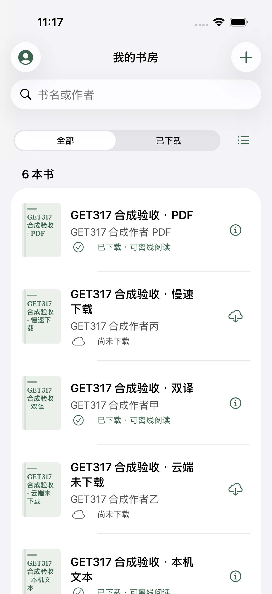
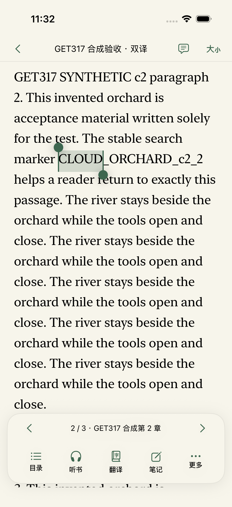
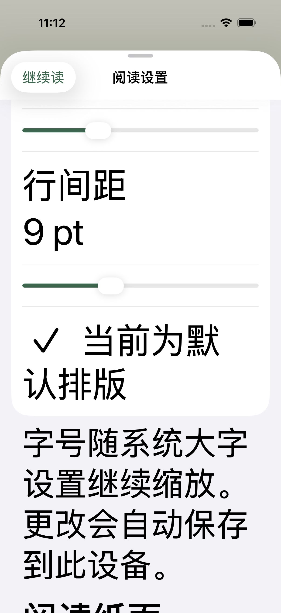
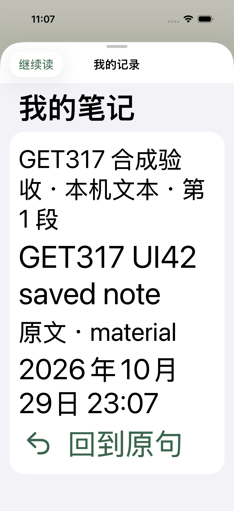
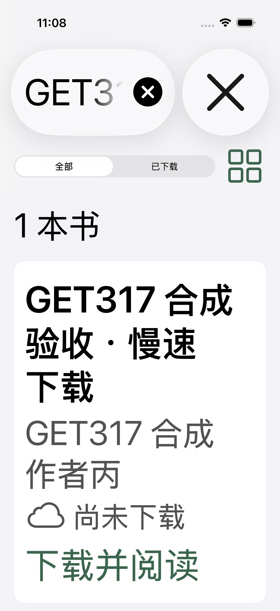

# GET-317 native iOS experience verification

Status: regression runs completed; partial acceptance only. Prepared for draft PR review. GET-317 remains In Progress.

## Scope and provenance

[GET-317](https://linear.app/getyak/issue/GET-317) tracks the [50-item design ledger](../../superpowers/specs/2026-10-29-get-317-ios-video-experience-design.md) and 45 executable native UI cases. The completed, runtime-source-bound `NativeFullFinal21` run passed **43/45 UI cases (95.56%)**, with only the unfiltered UI32 and UI38 accessibility audits failing. No case was skipped or removed from the denominator. The [structured results](results.json) keep each validation layer separate.

The supplied recording is silent. Its private books, notes, recording and extracted frames are excluded from this public repository. All public fixtures and screenshots are synthetic; the other reader shown in the recording is comparison material.

The implementation retains SwiftUI navigation, UIKit text selection, PDFKit, stable source anchors and the existing account/domain services. No real account, paid model, subscription, cloud write, private note, full-book generation or deployment configuration was used by the automated native checks. The dedicated DEBUG fixture requires the exact `org.leafhour.get317.testing` app identifier and either an explicit acceptance flag or a hosted unit-test context; the production app cannot opt into it. Unexpected requests in that session fail closed.

## Source and environments

- Xcode 26.6 (17F113), iOS Simulator 26.5. The final normal-size run requested the real OS large text category and dark appearance, then restored the previous large/light settings.
- Primary: existing iPhone 17 Pro, serial native jobs through `dev-ios-session`; left running because another session had already booted it.
- The selected AX5 group completed **7/7**. Compact/iPad acceptance remains **unavailable**: `Compact21` ended at the shared-session gate with exit 2, before native execution, because borrowed Primary remained Booted and a second simulator was refused. iPad was not started under the same gate. Neither the borrowed device nor the guard was changed.
- No physical iPhone is attached. Simulator, real services, TestFlight installation and production remain separate evidence states.
- Immutable per-run source hashes, result bundles, screenshots and logs are stored in the task-owned private artifact. Runtime markers identify the executed test source and installed test bundle; later runs use an isolated runner identity. A rebuilt or installed binary alone is not proof of the loaded test image. The source copy cannot change while its native job runs.

## Completed executable evidence

| Layer | Actual result | Boundary |
| --- | --- | --- |
| LeafhourCore | 95 passed | Previously completed domain tests; relevant Core bytes remain unchanged in source22. |
| Native app unit tests | 73 passed | Passed in full source21 and again in `NativeBuildCompatibility22` with current Xcode 26. This is not an Xcode 16 build result. |
| Host iOS contracts | 90 passed | `ios-host-contracts-21.log`; package, signing and release contracts, without an Apple upload. |
| Local CI contracts | 8 passed | `ci-contracts-22-complete.log`: 4 impact-planner + 4 production-status contracts, separate from hosted PR checks. |
| iOS Python contracts | 9 passed | `ios-python-21.log`; local signing/package/image fixtures. |
| Vendor integrity / bash syntax | Passed | Local dependency integrity and shell syntax checks. |
| Full normal native UI | **43/45 passed; 2 failed; 0 skipped** | `NativeFullFinal21`, source21, runtime binding verified. Only raw UI32/UI38 failed; the xcodebuild run therefore failed overall. |

Counts from different layers and repeated runs are not added into a combined testing total. Hosted CI state must be read from the live PR checks; this document does not freeze a provider status.

### Source-bound native runs

| Artifact | Result | Scope |
| --- | --- | --- |
| `NativeFullFinal21` | App73 passed; UI43/45 passed | Includes real native Copy/Paste, Files import/export, saved-note return, 44-point cancellation, bounded long titles and real portrait/landscape rotation. UI32/UI38 remain failed without audit filtering or test skips. |
| `NativeAX5Current20` | **7/7 passed:** UI20, UI39–44 | Real maximum OS text size, including saved-note return/Continue, typography/reset, grid actions and complete copyable long-title information. Source20 result; it does not include the later ordinary-size Cancel repair or prove compact/iPad behavior. |
| `NativeNormalRepair21` | **3/3 passed:** UI25, UI42, UI43 | Source21 supplies the real Cancel label's minimum 44-point width/height and preserves actual task cancellation. UI42 uses the center of the real wake region. All three also passed in the full source21 run. |
| `NativeBuildCompatibility22` | **73/73 hosted app tests passed; build succeeded** | Source22 differs from21 only by the two compiler-guard lines described below. The current Xcode 26 runtime branch is unchanged. No UI suite or Xcode 16 compiler execution is claimed for this build-only run. |

Immutable inputs, runtime markers, result bundles and original failures remain in the task-owned private artifact. Source22's compile-only change does not turn the two source21 raw audit failures into passes. Local regression execution is complete; accessibility acceptance and the unavailable platform profiles remain incomplete.

### Export and historical repairs

`NativeFiles12` passed UI24/UI35, and its corrected receipt is `verified: true`: the actual saved JSON matches that run's unique note sentinel, current fixture book ID/source version and stored note body, quote and anchor. Installation changed the app data container; verification refreshed its location before reading and retained the earlier failed receipt. `NativeFiles20` independently repeated the exact-sentinel export check (583 bytes, SHA-256 `855058a9c21f3e828e4a070532b7e59931eb426760c11532c2c1a62027b6d032`). There is no JSON restore interface, so these results prove export only.

Keep `NativeFullNormal19` as the historical **39/44** result, with UI30, UI32, UI38, UI42 and UI43 failing. UI43 measured the normal-size Cancel button at **34 points wide**, despite an outer 44-point frame; its height assertion was not reached. The production repair moved minimum size and hit shape into the actual label. Remembered Files navigation and wake-region locators were also repaired and verified in later source-bound runs. Those later passes do not rewrite source19's failures.

## Representative issue-to-commit trace

Each link is a source change, not a claim of deployment or physical-device acceptance. The design ledger preserves the individual observations; follow-up fixes retain their own commits.

| Problem area | Commits |
| --- | --- |
| Truthful download activity, cancellation and publication | `3818f13`, `3da7a2b`, `979c9b6`, `df36808` |
| Search, filters, sorting, layout and recognizable book fallbacks | `67eb257`, `a67f043`, `3d71ad1`, `6a39fed` |
| Readable chrome, stable source position, PDF page seams and iPad measure | `f3499b4`, `a9de241`, `e91188b`, `5a2815a`, `6615c15` |
| Useful contents, durable note writing and independent return action | `f075a5a`, `596af3e`, `8fd3830`, `a4c8bd0`, `aa1a8cf` |
| Selection context, native Copy and direct translation dismissal | `9652879`, `9c7ea30`, `5cf8ad8`, `8fd0617`, `cf5f2ff` |
| Speech pause intent and independent transport controls | `9a53a60`, `c41d724`, `9b3551d` |
| Companion input, keyboard visibility and reduced motion | `c7ab8f5`, `494498f`, `a6ed871` |
| Honest record states, account ownership, activity and account linking | `07b8c39`, `5b43b83`, `3d52c20`, `a0318d1` |
| Keep the chosen reader and older local versions | `7ffdadc`, `d8d693d` |
| Illustration alternative descriptions | `b01f558` |
| Clearer tool captions, complete large-type shelf information and bounded long titles | `585ce86`, `dce28ab`, `27e7eba` |
| Source-bound independent UI test runner identity | `2869220` |
| Actual download cancellation tap target | `50f1669` |
| Actual native Files, editing, accessibility and rotation acceptance | `a12a12e` |
| Older-compiler preview font guard | `d9714ea` |
| System type preview, actual hit regions, enlarged tools and panel opacity | `afc4406`, `b2d3990`, `bf6ce3b`, `6daceac`, `34e195f` |

Independent code review of the final production changes found no new confirmed P0/P1/P2. That is static evidence. It does not convert incomplete native UI or failed heuristic audits into passes.

## Full system accessibility audit

The unfiltered `.all` audits in UI32 and UI38 failed in `NativeAuditBaseline13` and remain failed in the completed `NativeFullFinal21` run. Their handler returns `false`, and the raw issues and screenshots are retained. Earlier audits found real defects, including a 21 × 14 point library menu, reader actions exposing only icon/text bounds, weak metadata contrast and a clipped search prompt. Those findings led to implementation fixes and repeat tests. The remaining issues are assessed individually:

| Raw issue | Evidence and interpretation | Boundary |
| --- | --- | --- |
| UI32: potentially inaccessible text, with no matching AX element | `NativeCoverProbe16` used the same test source and a source-bound unique runner. Its only visual change was hiding the fallback cover's internal duplicate title/author while preserving layout; the original unfiltered UI32 passed in 22.641 seconds. This isolates the warning to the repeated cover text. | The probe is diagnostic only. Production covers retain their text. The actual reading action already exposes the complete title and author; adding another readable cover title could duplicate announcements. This does not authorize ignoring other inaccessible-text findings. |
| UI38: saved-note header contrast | The baseline13 element screenshot contains black text on `#F2F2F7`, measured at approximately **18.82:1**. This specific failure conflicts with the rendered pixels. | It says nothing about other colors, themes or elements. |
| UI38: six settings nodes reported as partially unsupported for Dynamic Type | The same immutable source13 was measured in normal and AX5 runs: labels and values grow as shown below. The preview uses semantic `.body.scaled(by:)` on iOS 26, with a scaled-metric fallback on earlier systems. | Actual scaling disproves the claim that these nodes cannot change size. It does not alone prove every line is unclipped or reachable. Later UI41 provides separate interaction evidence. |
| UI38: native Continue toolbar and Return Label warnings | The separate stock SwiftUI probe reproduces partial Dynamic Type and text-clipping warnings for native toolbar/Label controls. The normal Return screenshot is complete. AX5 UI42 later exercised the actual saved-note return and native Continue actions. | The stock control cannot establish that every Leafhour warning is false, and these interaction passes do not turn the raw audit green. |
| UI38: typography preview contrast | The flagged frame was partly outside the viewport and overlapped the navigation bar. The source uses primary text on the chosen reading paper. | A partly obscured screenshot cannot establish the contrast of the fully visible preview. Retain the raw finding; do not shrink or remove preview text to silence it. |

Source13 normal → AX5 element heights, in points:

| Settings text | Normal | AX5 |
| --- | ---: | ---: |
| Font-size label and value; line-spacing label and value (four nodes) | 20.3 each | 63.3 each |
| Default typography state | 52.3 | 155.3 |
| System-size explanatory text | 52.0 | 246.7 |

The stock probe has no service, account, keychain or network adapter. Its handler records all flags as discovery observations; handled warnings do not count as product acceptance. Its ordinary semantic body grows from 72.3 to 403.3 points at AX5, while a native toolbar warning remains. This supports a limited SDK-measurement hypothesis, not a blanket conclusion about settings text, contrast or clipping. The original audit failures remain visible; no audit category or nil-element class is globally allowlisted or skipped.

## Limits to retain at delivery

A numeric design target does not establish a measured score. Neither the requested 95/100 design target nor the 98% executable-case target has been demonstrated. The observed normal UI rate is 95.56%, below 98%. Unrun, skipped, failed or unavailable cases cannot count as passes; source21 UI evidence and source22 build evidence retain their separate scopes. Keep raw audit failures visible even when a separate control points to an SDK limitation. Native JSON export has no corresponding restore interface, so saving valid JSON cannot prove cross-instance restoration. Physical-device VoiceOver, hardware keyboard, real cloud/account/model round trips, TestFlight installation and production release remain unproved by these fixture tests.

## Synthetic screenshots

| Ordinary shelf | Native selection and reading controls |
| --- | --- |
|  |  |

### Maximum system type

These are unedited screenshots from the historical source-bound runs named in their provenance, not mockups, real-account material or a claim that every image comes from final source21. The [provenance file](../../../apps/ios/Documentation/verification/2026-10-29-get-317-ios-video-experience/screenshots/provenance.json) records the screenshot and UI source hashes.

| Long-title reader | Typography settings |
| --- | --- |
|  |  |

| Saved note and explicit return | Actual grid download action |
| --- | --- |
|  |  |

## Reproduction

The native UI cases require the isolated DEBUG app identifier; running them against the normal application identifier cannot activate the fixture. Choose an existing simulator through the shared device-session tool before testing. Set `GET317_ARTIFACT` to a new task-owned output directory outside the checkout. The shared session injects `IOS_SIMULATOR_ID` into its child command.

```sh
export GET317_ARTIFACT=/absolute/path/to/task-artifact
dev-ios-session run -- bash -c '
  xcodebuild -project apps/ios/Leafhour.xcodeproj -scheme Leafhour \
    -configuration Debug -sdk iphonesimulator \
    -destination "platform=iOS Simulator,id=$IOS_SIMULATOR_ID" \
    -derivedDataPath "$GET317_ARTIFACT/DerivedData" \
    -resultBundlePath "$GET317_ARTIFACT/acceptance.xcresult" \
    LEAFHOUR_BUNDLE_ID=org.leafhour.get317.testing \
    LEAFHOUR_UI_TEST_BUNDLE_ID=org.leafhour.get317.testing.uitests.acceptance$(date -u +%Y%m%d%H%M%S) \
    CODE_SIGNING_ALLOWED=NO -parallel-testing-enabled NO -jobs 2 \
    -only-testing:LeafhourAppTests \
    -only-testing:LeafhourUITests/VideoExperienceUITests test
'
```

For size/theme profiles, read and save the simulator's current `simctl ui` preferences, set the requested real OS size/appearance inside the same guarded session, and restore the saved values in a `finally`/trap even after failure. Never infer a profile from an environment variable alone. Preserve the `GET317 native runner input` trace and compare its canonical source path with the immutable source used by that build. The known unfiltered audit failures remain failures in this command.

## Build compatibility follow-up

The README supports Xcode 16+, but a runtime `#available(iOS 26.0, *)` check alone cannot hide a new SDK member from an older compiler. The preview now also guards `Font.scaled(by:)` with `#if compiler(>=6.2)`, retaining its existing `@ScaledMetric` fallback. Independent static review checked the local SDK declaration and compiler/language-version distinction. Current Xcode 26 behavior takes the same tested branch; an actual Xcode 16 build remains unverified. `NativeBuildCompatibility22` completed successfully with 73 hosted app tests on the current SDK. This checks the guarded source with Xcode 26; it does not establish actual Xcode 16 compilation.
