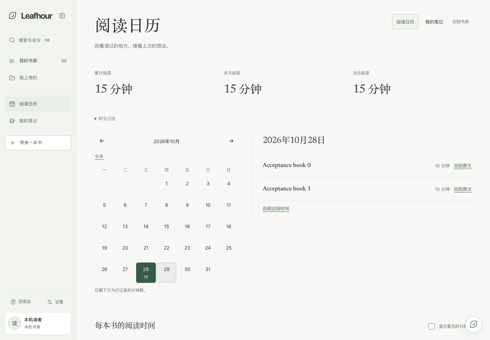
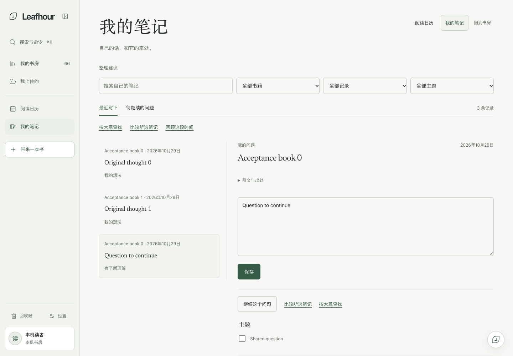
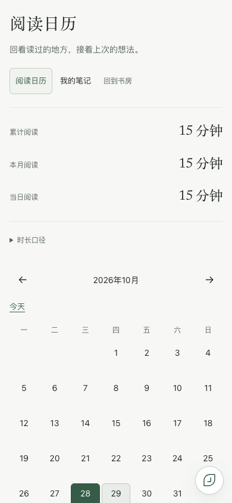
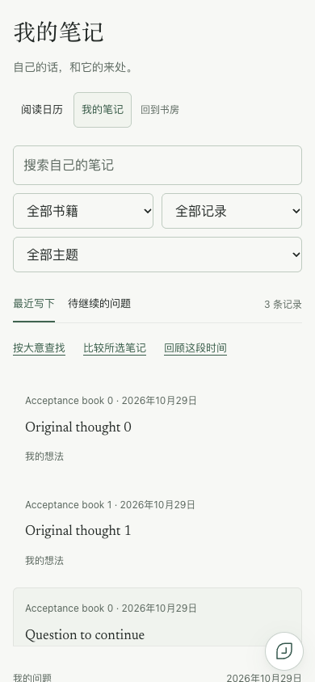
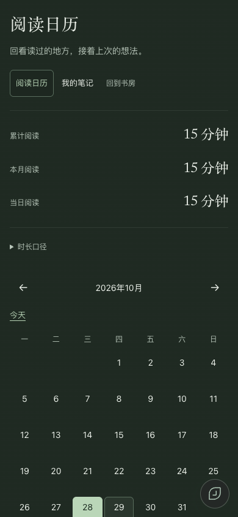
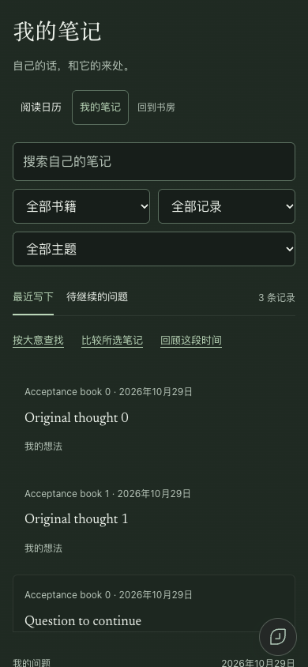

# Reading workspace acceptance

Scope: the eight approved Reading Calendar / My Notes goals, plus recorded daily, monthly, per-book and all-time reading duration. Design contract and implementation plan are in `docs/superpowers/`.

All screenshots and model input in this directory use isolated synthetic books and notes. No account credentials, uploaded user books or private note bodies are included.

## Behavior and boundaries

- Independent calendar and notebook URLs, native sidebar destinations, locale-aware first paint and history. Workspace code and styles load on demand; delayed styles retain the loading shell, and a failed style load offers an explicit retry.
- Calendar lists source-linked day records and later understandings on their actual dates. Archived books are included. Per-book time unions that book's valid recorded intervals; the global total unions across books and sources. The acceptance fixture has two 600-second book sessions overlapping by 300 seconds: each book shows 600 seconds and the total shows 900 seconds. These are recorded activity durations, never comprehension scores.
- Original user comments/questions remain editable with revision checks, exact retry identity, recovery and undo. Later understandings and manually assigned topics remain separate from the original words. Question status is manual and reversible.
- Semantic search, comparison and week/month review require a visible saved-note selection and fresh consent. Changing material or calendar range invalidates consent. Generated items cite authorized selected snapshots and remain attributed candidates until adopted. Existing reader chat, companion and external MCP permissions are unchanged.
- Structured workspace export/import preserves topics, question status, dated understandings, candidates, adopted relations and historical evidence. The base books/notes must first be restored with the existing library backup. Unit fixtures cover restoration into another temporary instance.

## Evidence

`browser-results.json` records the complete temporary-app flow: edit/undo, draft refresh, topics, followups, question status, explicit search/compare/review, adopt/dismiss, downloaded backup/import, locale retention, stylesheet failure/retry and 32 route/locale/width combinations. Viewports: 320, 390, 768 and 1440. Locales: English, Simplified Chinese, Traditional Chinese and Japanese. No page errors or automatic analysis requests were observed.

`runtime-results.json` records one bounded official DSH request using two synthetic notes, with no real private user notes. Model-facing N1/N2 references are mapped strictly back to selected canonical record keys. The reported successful request used 621 input and 70 output tokens (136 micro-USD). An earlier adapter trial completed at the provider but failed citation validation; it was repaired rather than replaced by fabricated local results.

Independent frontend and backend review covered owner transitions, draft acknowledgement races, stale revisions, quota failures, interrupted writes, concurrent imports, canonical snapshot hashing, citation validation, cancellation, sponsored limits and bounded restore capacity. The whole-branch adversarial review found additional storage-failure draft loss, unnecessary empty-account chapter hydration and missing paged edit-acknowledgement metadata; regression fixes are verified before delivery.

## Verification status

Final local `npm run verify:deploy`: 4,253 passed, zero failed, one platform-conditional Node-license fixture skipped. The isolated runtime initialized without model requests; hosted build, public-file inspection and release allowlist checks passed. Real pinned Vale/textlint lint and planted-violation canaries passed, with no new exemptions. Independent scoped re-review closed all three whole-branch findings after their regression fixes.

Production acceptance is separate from local synthetic acceptance. The pull request verification section records CI, merge, deployed source and read-only default-account UI receipts; a merged PR alone does not establish deployment or actual-account behavior.

## Visual evidence

