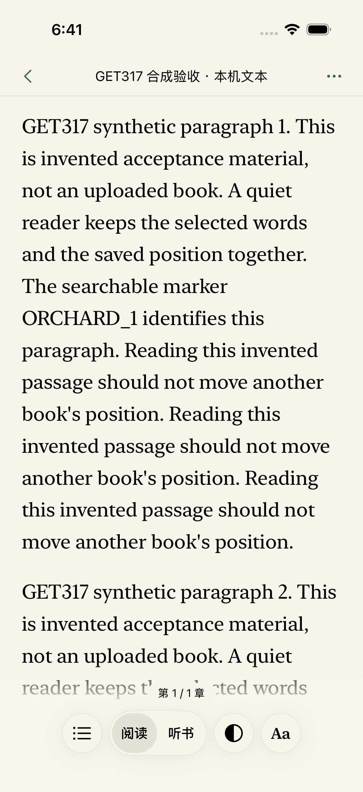
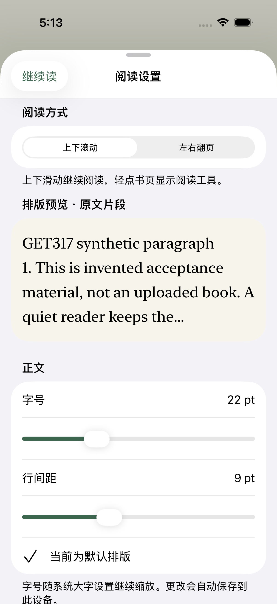

# GET-328 pre-PR evidence checkpoint — 2026-10-30

At native source `f7c5785`, the latest complete feature run, `UIFinalPostRestart56`, finished **55/56 passed**: UI38 is the only failed case, retaining **19 raw accessibility-audit assertions**. The whole run remains **exit65**, 2057.454 s, with a minimum 33.150 GiB free; complete source/path-file readback and independent review match all 73 live observations. Current App tests remain **116/116**. Final legacy V5 executed all six cases: five passed and PDF Files/import failed. The actual-OS maximum-type phase executed all ten cases: eight passed and UI41/54 failed; system large/light restoration was read back successfully. All planned native runs have executed, while acceptance remains incomplete and PR/CI/merge/TestFlight outcomes were not yet recorded at this pre-PR checkpoint. Earlier failed and rejected runs are preserved separately. A case pass rate is not an experience score, and neither AA nor a 95/98 score, physical-device acceptance or a new TestFlight release is claimed.

Scope: [design](../../superpowers/specs/2026-10-30-get-328-reader-controls-design.md), [implementation plan](../../superpowers/plans/2026-10-30-get-328-reader-controls.md) and [GET-317 video verification](../2026-10-29-get-317-ios-video-experience/README.md). Evidence keys below identify retained logs, result bundles and source manifests. The private recording, personal-library data, credentials and private screenshots are outside this repository. Native acceptance uses isolated synthetic accounts and separately verified public-domain EPUB/PDF inputs.

## Problems and changes

| Problem | Change | Verification boundary |
| --- | --- | --- |
| Sparse reading controls | Page taps disclose contents/progress, Read/Listen, appearance and typography. More retains secondary tools. Explicit grip reveal is idempotent. Hidden chrome preserves layout and regains its native/AX lifecycle when shown. | Repair `1e1bcba` passes real header hit-point plus foreground-Tools diagnostics and original UI15/16/44. The latest complete feature run passes its control paths; its separate UI38 audit failure and historical Full55 failures remain. |
| Scroll-only reading | Persisted scroll/paged preference; TextKit line/glyph/attachment layout determines actual screen boundaries. PDF retains PDFKit pages. | Whole-line, final-screen allowance, source-anchor and PDF geometry tests pass. |
| PDF mode changes stall the reader | Defer PDFKit hierarchy changes beyond SwiftUI updates; coalesce current requests, suppress old native notifications and preserve newer selections. | Deferred update `8245141` removes the observed responder-graph stall. After the separate position repair, fresh original UI53 passes in 52.644 s with strict source binding. Original UI53 also passes in the latest complete feature run; UI38 remains the whole-run failure. |
| Adjacent-page text leaks into paper margins | Clip glyph/background ink to the readable paper region; reject new hidden-text selection without clipping native selection handles. | Pixel, selection-handle, link exclusion and margin/pan App tests pass; actual UI57 also passes in 53.522 s in the latest complete feature run. Physical-device gestures remain separate. |
| New books open on marked covers | Trusted EPUB body metadata and same-owner/book/version cloud hints resolve to real source passages. Saved positions take precedence. Mixed first chapters with fragment-only covers remain intact. | Core 147/147 and current App 116/116 pass. In the completed `UIFinalCurrent56`, UI55 passes in 52.625 s: actual hinted c2/p4 opening, user-selected c1, cold saved-c1 restoration and continued draft source are retained as attachments. The earlier Full55 readiness failure remains. This is synthetic cloud-copy acceptance, not real-account continuity. |
| Copy followed by a swipe hangs the reader | Defer native selection dismissal beyond SwiftUI updates; reject stale view/session/navigation/range work. | Focused original UI50 now passes in 115.839 s. New UI58 also completes three actual PDF Copy → foreground selected quote → Note/Paste rounds in 134.885 s. The historical Full55 failure is retained. |
| Reading position changes with type, width or mode | Restore canonical source anchors, guard intermediate UIKit clamps and use the view's actual content-size traits. Initialize the default font before complete attributed-text assignment. | Exact text/reflow tests pass. A strict PDF RED showed source Y≈400 becoming page top 595 through physical restore, disk and cold reopen. Removing only passive layout capture preserves that point; all 116 App cases pass. Heading/caption/link attributes remain independent. |
| Tall pictures reopen at their top | Optional local image-relative coordinate; preserve PDF absolute Y, scalar text offsets, existing note keys and legacy nil decoding. Caption checkpoints retain the image endpoint. | Real imported EPUB, source-color pixels, successful flush/readback, fresh windows, width/mode, invalid data and caption endpoint tests pass. This does not claim server sync of image coordinates or exact caption-character positioning. |
| Large controls consume short viewports | Measure actual controls in a width/height/type/book context; retain margins only within that context. Compact-height header and fitted dock keep a readable body. | Real hosting/trait tests include 36 pt base font, 18 pt line spacing and AX5 traits. These are not actual compact/iPad/device acceptance. |
| Crowded labels and interrupted tool return | Truthful short progress, readable Return text, direct Continue with the existing save receipt, complete book information and cloud-update reading labels. | Full55 UI56 passes its cloud-update action chain. Focused original UI13/15/16/44/50 pass after repair; two actual OS maximum-type diagnostic cases pass. The latest complete feature run covers these paths; UI38, legacy PDF import and two actual-OS-type cases remain unpassed. |
| Typography preview ends midway through a word | Commit `f7c5785` keeps a bounded source excerpt, uses a word boundary where appropriate and adds an ellipsis only when shortened. | Current App116 and original UI41 pass. The synthetic screenshot below shows complete words plus an ellipsis. This does not resolve or waive UI38. |
| Native-menu existence wait scans later items after a visible action is already confirmed | Test-only commit `03b96d8` short-circuits the same MenuItem role/label/frame predicate; original action checks, native Button-group fallback and timeouts remain. | Source-verified original UI33 passes in 35.710 s after the owned runner reset. This is a test-query correction, not a product menu change; the earlier failed run is retained. |

## Most recent source-bound checks

| Evidence key | Actual result | Scope |
| --- | --- | --- |
| `CoreResourcePositionGreen` | **147/147 passed** | Current Core image-coordinate schema/validation plus EPUB, Markdown, cloud-start and ownership checks. Core production source has not changed since this run. |
| `AppIntegrated111Fresh` | **111/111 passed** | All then-current App cases, including image interiors and real short-height/AX5 hosting. Actual loaded paths/hashes independently matched the frozen build. |
| `AppCaptionEndpointObservedRed` | **1 case failed, 5 assertions** | A real visible caption saved nil image Y and reopened at the image top. Loaded test path and live-PID path/hash evidence matched the build; the strict RED is retained. |
| `AppIntegrated112` | **112/112 passed** | Complete App suite after the caption fix. `caption-green-source.json` binds inputs; `app112-loaded-authority.json` verifies the actual loaded unit/app paths and matching main/debug/unit hashes. |
| `AppHeaderHidden112` | **112/112 passed**, 8.545 s | Header repair `1e1bcba`; source-before/after equal and loaded main/debug/unit hashes match. `header-app112-reused-build-proof.json` confirms exact production/App inputs and binaries; only the unused temporary UI-test source differs after restoring the original 55 methods. This run predates the PDF change. |
| `UIKitOrientationAfterRestart` | **1/1 passed** | The original frozen independent UIKit control completed actual landscape and portrait return after the user-authorized device restart. Reader UI54 subsequently passed its own full chain in focused and Full55 runs. |
| `HostIOSContracts` | **90/90 passed** | Native/release contract checks, with test concurrency 2. |
| `HostIOSPythonContracts` | **9/9 passed** | Python iOS release-contract checks. |
| `HostIOSFinal100` | **100/100 passed**, zero failed/skipped, 728.162625 ms | Current Node host checks. The earlier 90-case result stays historical and is not substituted for this run. |
| `HostIOSFinalPython` | **9/9 passed**, 0.300 s | Current Python host checks; recorded separately from the earlier nine-case run. |
| `UIChromeAndRotation` | **2/2 passed**, 296.654 s | Original UI54 passed in 147.622 s; UI57 passed in 149.031 s. These focused passes do not replace the full suite. |
| `UIFinalVideo55` | **39/55 passed; 16 failed; 18 assertions**, 2227.601 s | Frozen production/test source at `51e9670`; controller65, minimum 40.0707 GiB, no resource or selection-graph cancellation. UI54/57 also pass here in 118.793/69.734 s; UI56 passes in 89.709 s. |
| `UIFinalVideo55-complete-stream-readback` | **Complete source/path-file match; original run remains failed** | Complete 117,534,633-byte decoded console, 192 MiB bound, one runner plus 66 target live-process receipts, no provenance failures. |
| `BuildHeaderHitDiagnostics` | **Build failed; no diagnostic tests ran** | Temporary UI58/59 used Swift-unavailable `NSStringFromCGRect`. The trap restored the original 55-method test source. This is a diagnostic build failure, not a native outcome. |
| `UIHeaderHitDiagnosticsV2` | **2/2 physical-route diagnostics passed**, 52.123 s | UI58/59 open the correct foreground Tools sheet despite enabled header controls reporting isHittable=false. This does not pass the original AX readiness assertions. |
| `UIHeaderZIndexAB` | **2/2 physical-route diagnostics passed**, 48.355 s; **AX unchanged** | Explicit root chrome zIndex leaves Back/title/More enabled but nonhittable. The candidate was exactly reverted; it is not an AX fix. |
| `UIHeaderHiddenLifecycle` | **2/2 diagnostics passed**, 268.379 s | Header Back/title/More and Contents report enabled/hittable; real More taps open the foreground Tools sheet. Strict runner/live-process path-file authority passes. Temporary diagnostic methods were then removed. |
| `UIHeaderOriginal3Reuse` | **3/3 passed**, 110.348 s | Original UI15/16/44 pass in 21.996/19.955/68.398 s with unchanged assertions/timeouts and strict authority. The identical temporary diagnostic block was reapplied solely to match the frozen compiled source, then removed again. |
| `UIPDFDeferredV2` | **Original UI53 passed**, 66.528 s | `BuildPDFDeferredV2` succeeded with at least 41.042 GiB free. Strict UI authority passes; `pdf-deferred-v2-source.json` equals the post-run manifest. No event-loop-idle marker; minimum 39.889 GiB free. This focused pass does not replace full UI or App regression. |
| `AppPDFPositionGreen116` | **116/116 passed**, 9.151 s | Final PDF position repair plus scheduled-update/native-selection guards, image/caption positions and existing App cases; actual loaded paths/hashes match. |
| `UIPDFCopy58` | **1/1 passed**, 134.885 s | New formal case uses actual PDF word AX frames and physical long presses. Fresh scroll/paged/scroll rounds Copy and Paste exact `PDF`/`SYNTHETIC`/`PDF`, each with a matching foreground Note quote and empty editor. No clipboard injection; strict source binding passes. |
| `UIPDFPositionPages53Fresh` | **Original UI53 passed**, 52.644 s | Both task target and runner freshly installed; strict authority passes and post-run source equals the frozen manifest. The rejected preceding run is retained below. |
| `UICompactCoverAudit32` | **1/1 passed**, 22.746 s | Original UI32 unfiltered `.all` audit passes after replacing only unreadable duplicate 10 pt compact fallback-cover text with a decorative graphic. Full metadata and grid covers remain. |
| `UIChromeGhostAudit39` | **1/1 passed**, 43.878 s | Original UI39 unfiltered `.all` audit passes after removing the bottom chrome's outer `.accessibilityHidden` modifier; the real controls retain their visibility handling. |
| `UIRealOSAX5Diagnostic2PositionGreenFresh` | **2/2 diagnostic case gates passed** | Original UI40/42 run in new processes at actual `UICTContentSizeCategoryAccessibilityXXXL`, with true accessibility-category attachments and matching source/path receipts. Finally restores original `large`/`light`; readback true, errors empty. These historical diagnostics are separate from the completed ten-case phase below. |
| `UIFinalCurrent56` | **52/56 passed; four failed; 22 assertions**, 2560.101 s | Failed UI33/34/38/44, controller65, minimum 36.119 GiB. The native source-before/after maps match. Its complete-stream source readback below accepts provenance only; the run remains failed. |
| `UIFinalCurrent56-complete-stream-readback` | **Complete source/path-file match; original run remains failed** | Canonical console decoded to EOF: 152,127,607 bytes, 1,317,701 lines, fixed 192 MiB bound. Same-PID Loading/configuration and all 71 target PIDs plus one runner match all 72 live observations. The 71 native source entries and actual runtime/DD binary hashes matched at that readback; independent review passes. Original generic scan-bounds rejection is retained. |
| `UIFinalCurrent56-ui35-export-readback` | **Actual exported JSON and original source verified** | UI35 passed in 54.815 s; separate postflight checks the actual exported note body, quote, anchor, source version and original synthetic-source bytes. Whole-run controller65 is preserved. This is export evidence, not restore or cloud acceptance. |
| `AppMenuPreview116` | **116/116 passed**, 9.098 s | Current preview/menu-query source; actual loaded App/unit paths and hashes match. `menu-preview-current-accepted-source.json` records the accepted current-source scope. |
| `UIMenuPreviewFocused4` | **Behavior 4/4; source acceptance rejected** | Actual raw Loading URL names a Dead-cache runner. Its on-disk UI plugin matches old Full56 (`ea1eb306…`), not the current frozen plugin (`35dc8026…`). The original authority report and false pipeline result remain unchanged. |
| `UIMenuPreviewFocused4Uncached` | **4/4 passed**, strict source/path-file readback | Original UI33/34/41/44 pass in 35.710/24.711/32.427/63.928 s. Actual normal Loading URL, current UI plugin and all authority checks match the frozen build after resetting only the owned testing runner. This focused run does not replace full56. |
| `UIFinalMenuPreview56` | **53/56 passed; three failed; 21 assertions**, 1928.332 s | UI38 retains 19 raw audit assertions; UI45/54 fail rotation. Controller65, minimum 35.1687 GiB; no failure is erased by the later restart recovery. |
| `UIFinalMenuPreview56-complete-stream-readback` | **Complete source/path-file match; original run remains failed** | Complete EOF: 142,341,388 decoded bytes / 1,235,011 lines under 192 MiB. All 71 target PIDs plus one runner match 72 live observations; native maps and actual/DD hashes match at capture. Independent review passes; original generic rejection remains. |
| `UIKitOrientationAfterMenuPreview56` → `UIKitOrientationAfterMenuPreview56Restart` | **Original frozen UIKit control failed, then 1/1 passed in 9.878 s** | Before restart, the independent control also fails (controller65). Only the existing authorized Primary is restarted; the unchanged frozen control then passes (controller0). This is environment-recovery evidence, not a product-code fix. |
| `UIRotationPostRestart3` | **Original UI45/54/57 passed 3/3**, 231.746 s | Times 72.129/110.367/49.250 s, controller0, minimum 34.4494 GiB. Complete 22,691,418-byte EOF readback binds four targets plus one runner to five observations and the same native source; independent review passes. This focused run alone does not complete full56. |
| `UIFinalPostRestart56` | **55/56 passed; UI38 failed; 19 assertions**, 2057.454 s | Controller65, minimum 33.150 GiB, no disk/graph cancellation. All 71 native source entries remain unchanged. Original UI45/54/57 pass in 68.883/109.114/53.522 s; UI38 remains unfiltered and failed. |
| `UIFinalPostRestart56-complete-stream-readback` | **Complete source/path-file match; audit failure remains** | Canonical console reaches EOF: 150,559,270 bytes / 1,305,756 lines under 192 MiB. All 72 target PIDs plus one runner match 73 live observations; normal actual Loading, current UI plugin, clocks, files and native source maps match at capture. Independent review passes; generic scan-bounds rejection is preserved. |
| `UIFinalPostRestart56-ui35-export-readback` | **Actual exported JSON and original source verified** | The separate postflight checks the actual synthetic export body, quote, anchor and source identity/bytes. Its whole-run controller65 remains. This does not prove restore or real-account/cloud continuity. |
| `UIFinalPostRestart56` / UI58 | **Actual PDF Copy → Note/Paste passed**, 160.342 s | All three physical source-word rounds complete in the latest full wave, whose source readback is recorded above. The earlier focused 134.885 s pass is a separate historical run. |
| `UIFinalLegacy6PostRestartV4` | **Six preparation exits 133; zero native cases executed** | The original preparation failures remain. A minimal off-tree receipt-parent canonicalization repair was independently reviewed; no product source changed. |
| `UIFinalLegacy6PostRestartV5` | **All six executed: five passed, one failed** | Cases 1/2/3/4/6 pass in 37.508/17.822/34.468/31.658/42.461 s; PDF case 5 fails in 18.683 s. All six authority exits are 0 and before/after native sources match; minimum 35.55999 GiB. The failed case retains its native 65 and PDF verification exit −5. |
| `UIRealOSAX5PostRestartV4` | **All ten executed: eight passed, UI41/54 failed** | All ten authority exits are 0 and before/after sources match; UI40/44 target attachments confirm actual `UICTContentSizeCategoryAccessibilityXXXL`. Minimum 34.223564 GiB. Finally restores `large`/`light`, readback true/errors[]. Failed UI41 and UI54 boundaries are below; source acceptance does not turn them green. |

The earlier focused PDF Copy receipt (`pdf-copy58-attachments/5926797D-4DC2-4AFC-9DD7-04C22211288C.txt`) records all three actual word frames, foreground quote frames and raw pasted words. It used the actual-word path, not the fallback line projection. All original 55 feature methods remain; committed formal UI58 makes the current denominator **56**. Temporary diagnostic methods numbered 58/59 from earlier experiments are not part of that historical 55-case count.

The default-font correction uses the original exact height/anchor/ink oracle. A draw-only baseline change failed and was discarded; diagnostic property reads had affected lazy layout. The production default font is set before the complete attributed-text assignment, preserving the original attributes of every run.

## Current feature checkpoint and screenshots

The current feature run is complete: 55 cases pass, while UI38 retains 19 raw audit assertions and keeps controller65. Its complete EOF/source report and independent review establish the executed source, not AA acceptance. The actual UI35 export has its own successful JSON/source postflight. Final legacy V5 executed all six cases with five passes and one failure. The actual-OS ten-case phase also completed: eight pass, UI41/54 fail, and finally restores large/light with verified readback. The planned regression executions are complete; their failed acceptance gates remain.

Earlier outcomes remain: Full55 39/55, FullCurrent56 52/56 and FullMenuPreview56 53/56. The latter's rotation failures also reproduced in the independent frozen UIKit control. After the authorized restart of only the borrowed Primary, that same control passed in 9.878 s, then the unchanged reader's focused rotation/margin cases and latest whole-run UI45/54/57 passed. No product code, device erase or shared-cache cleanup was needed for this recovery.

Legacy V4's six preparation failures did not execute native tests. After the reviewed, off-tree receipt canonical-parent correction, V5 runs the same product source and all six native cases. The PDF case stops after six bounded Files routes: no PDF import or manifest is established, and the postflight returns −5. This supplies no PDF-renderer/last-page acceptance and does not rule out renderer defects. The other five cases pass their individual gates; all six have accepted source readback. These results are not combined with the 56-case pass rate.

Actual OS AX5 UI41 fails in 77.577 s. Its real slider, preview and reset actions execute, but the final `showFullText` search never finds the earlier `字号` row and keeps swiping in one direction to the Form bottom. The saved screenshot agrees with that bottom position. The remaining exact label/font/full-visibility checks are not completed; this is no proof of oversized or clipped production text. The independent review confirms the one-way test-navigation blind spot, without a confirmed product P0/P1.

Actual OS AX5 UI54 fails in 42.658 s. The first real Copy action is clicked, but Paste has not run, so copied bytes are unverified. After the second long press, the actual screenshot shows `This` selected with two handles and no native menu. The required native-menu reopening chain **did not pass under actual AX5**. Note/Paste, later reflow, rotation and cold-resume steps are not reached. The independent review and screenshot establish this observed failure, without establishing a production cause or a confirmed P0/P1. Both failed cases remain failed; their source checks and the eight other passes do not waive them.

The earlier focused4 behavioral pass is still rejected: its raw Dead-path UI plugin was old. Only the separate owned-runner reset and normal-path current-source run were accepted. The reading target and books were retained. These distinct recoveries do not rewrite their original failed or rejected evidence.

The two unedited screenshots below contain only invented acceptance material. They do not include the private recording, private reference image or personal books, and do not establish maximum-system-type or VoiceOver acceptance.

| Current reader dock, latest UI46 | Typography preview, accepted UI41 |
| --- | --- |
|  |  |

- Dock attachment `3CEABEDA-DAC1-42DE-BF6F-D3F3F2A72A22.png`, copied-byte SHA256 `f164bd0226a1e76ccc312568b5e25b985eb89321c9d5849efc92ff2d6c8622ac`.
- Preview attachment `5F261C2C-077A-405C-9DD0-2B3360AFB752.png`, copied-byte SHA256 `c116d29aa6a3660163bb8bf530604874fddb8fe60d024da7c5e88781a172be57`.

## Complete Full55 result and source readback

In that frozen Full55 run, the failed methods were **13, 15, 16, 32, 33, 38, 39, 40, 42, 44, 45, 46, 49, 50, 53 and 55**. The 18 assertions are not 18 failed cases: UI38 records two raw audit failures and then a Back-readiness failure. Awake header/control readiness, the persistent native Copy-menu check, missing expected panels and the PDF query timeout are separate recorded failure categories; later focused repair results are listed above. Passing UI54/57 does not waive the other failures.

The original generic UI authority report remains `rejected-or-incomplete`; it was not rewritten. A separate complete-stream readback consumed the actual original Full55 console object to EOF under an explicit 192 MiB bound. Its status is `complete-specific-console-and-67-live-process-file-receipts-match-original-frozen-build`, with an empty failures list. It matches the actual loaded runner/configuration, all 66 observed foreground target PIDs and 67 live path/file-hash receipts to the original pre-run build. This establishes source/path-file binding for the **failed** run, not dyld mapped-memory attestation, continuous integrity, successful tests or release acceptance.

In that failure, UI44's plain title remained enabled but nonhittable for about 10.5 seconds after disclosure, ruling out an explanation limited to More styling or six-second expiry. The separate UI58/59 baseline and zIndex A/B both demonstrate that a timely real More-center tap can open the correct sheet despite a negative AX hit point. Physical routing worked in those observations while the original readiness assertions failed. No readiness assertion was replaced with a coordinate tap. The zIndex experiment did not resolve AX and was reverted. The subsequent visibility-lifecycle repair, committed as `1e1bcba`, preserves hidden layout and restores the visible branch. Its actual header AX hit points and physical Tools route passed, followed by the unchanged original UI15/16/44 and complete 112-case App suite. Physical VoiceOver focus remains a separate gate.

The failed first diagnostic build, subsequent successful diagnostic runs and negative zIndex result are all retained. Temporary UI58/59 are excluded from the original 55-method denominator, and their trap restores test-source SHA `35c632694a93d7188d759a0e62ad3bee238df4123826519c625c8fff0fe7de25` before formal regression work.

## Historical failures and recovery evidence

Counts from separate frozen waves are never added together into a pass-rate denominator. A run named Green can contain failures.

| Evidence key | Recorded result / reason retained |
| --- | --- |
| `UIFinal` | Original complete feature baseline: **52 cases, 43 passed, 9 failed; 11 assertions**. Cases 31, 32, 38, 39, 40, 42, 44, 50 and 54 failed. This predates later repairs. |
| `UISelectionAndShelfRed` | Four cases: UI50 and UI55 passed; UI54 failed actual rotation; UI56 exposed missing spoken cloud-update status. |
| `UIShelfGreen` | UI56 passed after the label repair; this does not waive the separate shelf audit issue. |
| `UIAXShelfGreen` | Two cases failed, **20 audit assertions**; all raw issues remain below. |
| `AppFinalLineRed` | Two cases failed, three assertions: partial ordinary lines, end allowance and source retention. Later exact tests pass. |
| `AppResourcePositionRedValid` | **111 cases: 107 passed, four new resource cases failed; 16 assertions**. Different image interiors collapsed to the same durable anchor and cold-opened at the image top. |
| `AppResourcePositionGreen` | 110/111 passed; one case failed three pixel assertions. Whole-window dimming affected the white background as well as the source image. |
| `AppResourceWindowGreen` | One of four cases passed; three failed fixture presentation setup, six XCTest failure records. Unbound windows had nil scenes/presentation layers. |
| `AppResourceWindowGreen2` | Focused four-case run passed after binding the fixture to a real foreground UIWindowScene. This alone did not prove the full suite. |
| `AppIntegrated111` | The following full run loaded its unit bundle from a containermanagerd Dead-cache path, inconsistent with the current built test source. It is rejected for final-source acceptance; its removed historical binary hash is not invented. |
| `AppCaptionEndpointRed` | The first caption RED had a normal loaded URL but insufficient same-PID foreground evidence for the strict authority helper. It remains incomplete; the separate ObservedRed supplied the missing live-process proof. |
| `UIChromeAccessibilityGreen` | Failed its initial hide precondition. The helper mistook hierarchy membership for visible chrome; this is not proof that VoiceOver could focus hidden controls. |
| `UIRootPDF53Idle` | Original UI53 failed in 298.158 s. Live target samples show synchronous PDF page-controller replacement reentering SwiftUI responder/AttributeGraph work; the owned xcodebuild sample shows console processing. After the case failed, only that owned xcodebuild was stopped during oversized finalization. Its incomplete xcresult lacks Info and is not complete source-authority acceptance. The failed log, both successful samples and unchanged source manifests remain retained. |
| `UIReaderAfterFixes3` | Original UI13 and UI50 passed in 43.068/115.839 s; UI39 failed its raw ghost audit. The later isolated UI39 repair/pass does not rewrite this wave. |
| `AppPDFPositionObserved` | **One case failed six assertions**: source Y≈400 was replaced with 595, then persisted and cold-reopened at page top. Actual loaded App/test paths and hashes match. The strict nonzero-point oracle was preserved for the fix. |
| `UIPDFPositionPages53` | Behavior passed in 51.816 s, but strict source authority rejected a Dead-cache runner URL. Local commits were created before that final readback; `position-pipeline-acceptance-boundary.json` records the mistake. No PR/release followed. Source-after was captured after rejection, explicitly not backdated. A separate fresh-both run above supplied accepted evidence. |

The controlled native sequence terminates only exact task processes and explicitly installs the frozen target and UI runner before every UI invocation; App runs install their exact task app. The reviewed uncached wrapper may uninstall only the fixed testing UI runner after guard/device/manifest/installed-identity checks; the reading target and its data are retained. A failed container lookup is not treated as absence without a successful fixed-key inventory check. Actual loaded paths/PIDs and matching binary hashes are checked before another installation. Live process-path observations may supplement missing foreground-log evidence; conflicting foreground evidence, Dead paths, missing files or unequal hashes remain rejections. This is path/file binding, not a claim of dyld memory attestation. Global caches were not deleted.

The package-resolution-only attempt `BuildResourcePositionRed` did not run tests. Canonical project.yml now links ZIPFoundation through the already resolved LeafhourCore dependency. Vendor files and upstream integrity metadata remain unchanged.

## Accessibility: UI38 raw 19 remain open

The subsequent `UIRemainingAudits2` run reached all audits: UI32 failed one inaccessible-text assertion and UI38 failed **19 audit assertions**, without filtering. The isolated compact-cover repair then passed original UI32. UI38's nineteen issues remain: three contrast, fourteen partially unsupported Dynamic Type, one unsupported type and one clipped-text assertion. Passing original UI39 after the decorative-background repair is separate from these settings/records issues.

Actual section-header screenshot pixels show 18.819:1 black-on-background contrast; that measurement does not overturn the system audit or justify arbitrary color changes. The actual-OS AX5 diagnostic passes for UI40/42 establish their specific behavior/category; they do not waive UI38 or complete the planned ten-case phase.

The frozen Full55 `.all` audit records three audit assertions: UI32 reports potentially inaccessible shelf text with no matching element; UI38 reports records-header contrast (`我的笔记`) and partially unsupported Dynamic Type on `reader-tool-continue`. UI38 then fails Back readiness before reaching its settings audits. Its settings coverage therefore did not execute in this run, and its third failure is not an accessibility-audit finding.

The following table is the **earlier `UIAXShelfGreen` two-case raw 20 wave**, not a count for the latest Full55 run. It used `.all` without category filtering or ignored nil issues:

| Foreground state | Failed assertions | Detail |
| --- | ---: | --- |
| UI32 shelf | 1 | Potentially inaccessible text, no matching element/frame. |
| UI32 quiet reader | 0 additional | The second audit executed; the case still failed its shelf assertion. |
| UI38 records | 2 | Notes-header contrast and Continue partially unsupported Dynamic Type. |
| UI38 settings top | 7 | Unlocated contrast; six partially unsupported Dynamic Type issues. |
| UI38 settings bottom | 10 | Preview contrast; seven partially unsupported-type issues; unlocated unsupported type and clipping. |

That historical wave totals three contrast, fourteen partially unsupported Dynamic Type, one unsupported type, one clipped-text and one inaccessible-text issue. Four have no matching element. These are twenty assertions across two cases, not twenty distinct controls. The specific new navigation-mode footer warning disappeared after its repair; remaining nil findings are not assigned to it without evidence.

The bottom preview audit crop also includes obscuring navigation/status content. Screenshot measurements alone do not resolve the raw audit. Remaining maximum-OS-type coverage, final unfiltered audits and physical VoiceOver focus remain accountable.

The corrected chrome helpers use an actionable real grip plus disabled/nonhittable retained controls for the asleep state, and unique enabled/hittable actions for the awake state. Apple distinguishes [hierarchy existence](https://developer.apple.com/documentation/xcuiautomation/xcuielement/exists), [onscreen hit points](https://developer.apple.com/documentation/xcuiautomation/xcuielement/ishittable) and [system accessibility hiding](https://developer.apple.com/documentation/swiftui/view/accessibilityhidden(_:)). Test selectors, original idle/gesture timings, native menu/Copy/pan/return assertions, non-chrome dismissal checks and raw audits remain. This correction does not establish physical VoiceOver acceptance.

## Remaining acceptance and delivery

- The formal **56 VideoExperience methods (original 01–50 and 53–57, plus PDF Copy/Paste 58)** have completed at the delivered native source: 55 pass, UI38 fails with 19 raw assertions. Preserve controller65 and the audit boundary. A 55/56 case rate is not an experience score or AA completion.
- The actual OS maximum-type phase is complete at 8/10, with UI41 typography-row verification and UI54 native-menu reopening unpassed. UI40/44 actual-category attachments are verified; all ten sources match. Finally restores large/light with readback true and no errors. UI38's nineteen raw audit issues remain unresolved.
- Final legacy `UIFinalLegacy6PostRestartV5` is 5/6 after all six actual native executions; source checks pass for every case. PDF Files/import case 5 remains failed with no imported manifest and verification exit −5, so PDF renderer/last-page acceptance is unproved. Original V4 six preparation 133/zero-native evidence remains. The ten-case `UIRealOSAX5PostRestartV4` phase has completed separately at 8/10 with verified source/category evidence and final settings restoration. The two earlier diagnostic passes are not substituted for its two failures.
- After the independently observed UIKit environment recovery, original reader UI45/54/57 pass in focused and latest complete-feature runs. Compact iPhone/iPad and physical-device gestures, VoiceOver, keyboard and audible output remain separate from those simulator/hosting results.
- Real-account consent/cloud continuity, provider-backed generation and network-failure recovery are not established by synthetic HTTP fixtures or local state tests. The read-only real-account probe built successfully, but one external 150 s execution timeout left an empty receipt and log. `RealAccountRead-external-timeout.json` records phase and authentication-attempt completion as unknown, with no acceptance. It proves neither failed authentication nor absence of an attempt, and provides no cleanup, account, body-opening or continuity evidence; do not automatically retry it.
- Code review and the planned native executions are complete at this checkpoint; runtime acceptance is not fully passed. PR creation, applicable current CI, normal merge, release archive/upload, Apple processing and existing tester-group availability still need their own delivery evidence. They had not been recorded at this pre-PR snapshot. Commit `92ac6e2` adds optional exact build-ID/version/build-number GET readback; raw beta states, VALID status and reported group relationships are metadata, not proof that a particular tester can install. No live new-build readback has been claimed.

The user authorized a temporary resource exception: one native session, jobs 2, at least 30 GiB free and the existing Primary device. The global pause marker remains. A subsequent explicit authorization permitted restarting only that existing device without erasing/rebuilding it; the other two device states and pre-existing Simulator process were preserved. `final-native-cleanup.json` records completed termination checks for only owned task processes and successful uninstall of the synthetic UIKit control app and runner. The GET317 testing app and its data were retained. Primary remains Booted; Compact/iPad remain Shutdown, and large/light settings were read back. Formal evidence artifacts and DerivedData are still retained at this checkpoint; complete resource reclamation is not claimed.

This is a fixed pre-PR evidence checkpoint at native source `f7c5785`, not a live release-status page. Subsequent PR, CI, merge and TestFlight outcomes are tracked in the GET-328 PR and [Linear issue](https://linear.app/getyak/issue/GET-328/refine-the-ios-reader-controls-page-turning-and-book-opening); the failed and accepted native evidence above remains intact.
