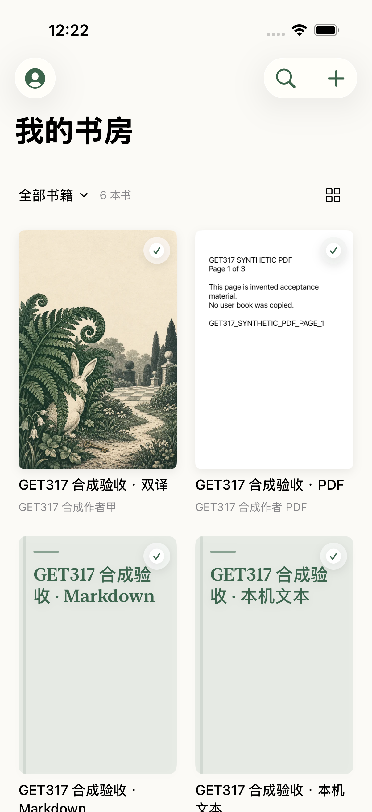
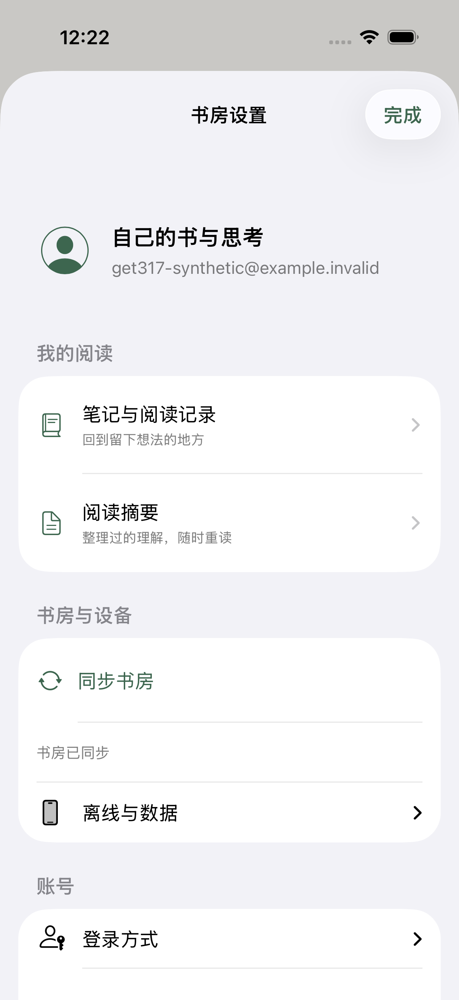
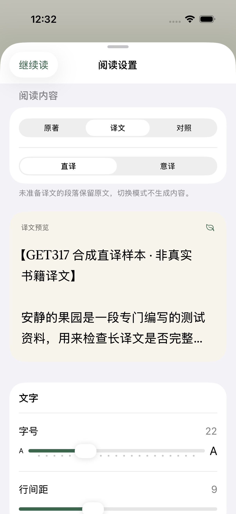
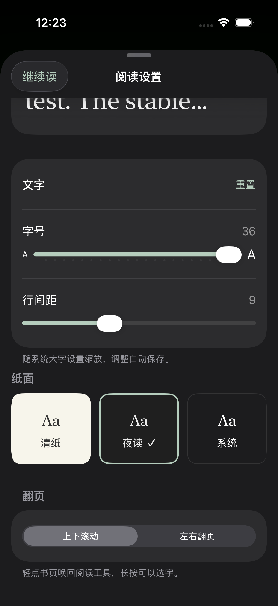
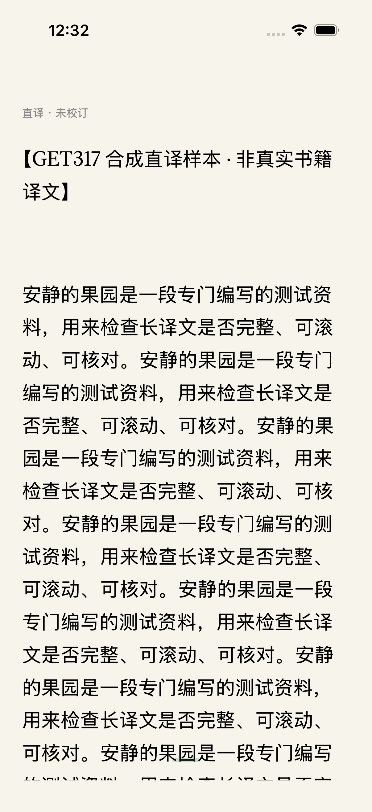
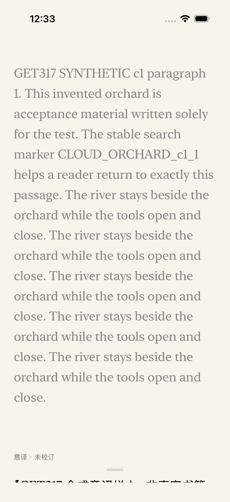
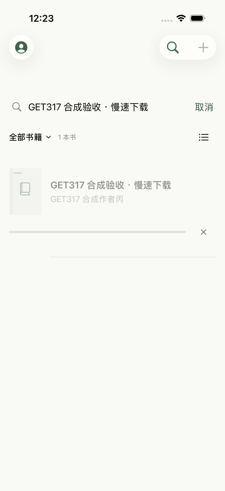

# GET-344: quieter iOS library and bilingual reading

The six requested changes are implemented in one branch and one Linear issue: [GET-344](https://linear.app/getyak/issue/GET-344/refine-the-ios-library-settings-and-bilingual-reading). The source base is `430cf68`; independent application-code review is confirmed through `fdff1de`.

## Visible behavior

1. The shelf loads the Web public-edition artwork and authenticated original-file covers remotely. Images remain available from an owner/version-specific cache after synchronization and reload. Existing local EPUBs resolve declared artwork from their OPF without rewriting their index; PDF uses its actual first page. A missing image preserves a readable typographic fallback.
2. Tapping any book opens or downloads it. Resting cards have no “not downloaded”, download or read buttons. Offline availability is a small corner mark, with full status retained for VoiceOver. Details live in the native context menu.
3. Account settings prioritize personal records and summaries; provider management is disclosed on demand. Reading settings preview the selected layer and use paper choices, concise typography controls and a compact non-ASCII excerpt.
4. Range, count and presentation share one shelf heading. Search opens on demand and has a 44-point clear/cancel target. The list alternative remains available, including full-width large-text rows.
5. A download shows one progress indicator and cancellation beside its book. The global activity surface is reserved for imports without a corresponding shelf item. Reading another downloaded book remains possible while a download finishes.
6. Original, translation and stacked parallel reading are independently persisted, with literal and interpretive variants. Missing translation retains original text. Current/next chapter reads refresh saved translations. An explicit, priced confirmation starts at most 100 missing passages from a frozen two-chapter scope. Backgrounding, returning to original mode, leaving that scope or stopping prevents later submissions. An already submitted passage may complete and consume its quoted point.

A durable request retains its exact id, quote and idempotency key across uncertain responses and a new login. Only a trusted terminal billing receipt retires an unresolved request. Completed results are checkpointed before batched offline-cache publication. Translation selections retain their layer/variant and distinct draft identity; display offsets never masquerade as original-language offsets.

## Design evidence

Direction A makes cover art the primary shelf content. Direction B is the denser editorial list and remains the alternative layout. Their comparison is a mockup, not native acceptance. The initial state was audited from source; no unrelated simulator foreground screenshot is presented as a baseline.

The following screenshots are from the real native app on the existing Primary iPhone simulator, using explicit synthetic fixture books and the checked-in public artwork. They contain no uploaded user books or real account records.

| Shelf | Account settings |
| --- | --- |
|  |  |

| Reading settings | Night settings, 36-point base type |
| --- | --- |
|  |  |

| Translation only | Parallel reading | Single download indicator |
| --- | --- | --- |
|  |  |  |

## Verification

- Core: **160 passed**, including old EPUB metadata, source/translation modes, missing/stale translation, draft persistence, reviewed-translation preservation and same-anchor preference synchronization.
- Native application units: **132 passed**, including source selection, pagination, Unicode, typography/AX5 layouts, real WebP transport/decoding, fixed-scope generation, stop/background, uncertain-request recovery and trusted rejection receipts.
- Primary native UI: **4 passed** for quiet shelf with actual-artwork pixel evidence, mode/variant switching and cold restart, item-only download/cancel, and night reading at 36-point base type.
- Follow-up checks: typography **2 passed**, reading-mode UI **1 passed** after compacting the preview, new-login recovery **1 passed**, downloaded-range UI **1 passed**, and background-download/local-reading UI **1 passed** using the real search-clear action.
- Affected host/server/release contracts: **217 passed**; hosted Web build passed.
- Authenticated readback used the Keychain-provided default account and checked the actual authenticated UID and shelf owner. Its own original-file cover returned **200 image/webp**; public artwork returned **200 image/webp without a session**. No book was uploaded and no paid generation was performed for this check.
- Independent static review found the initial draft identity, uncertain-recovery and legacy-cover gaps. All confirmed findings were fixed; the final application diff has no remaining P0/P1 or material P2 in that review.

[Machine-readable results](results.json) separate these checks. The native runs reused one registered artifact/build directory and the existing device pool through `dev-ios-session`; no other project's process, simulator or data was removed.

Two regressions were observed before repair: a long translated paragraph jumped to its start during a saved-translation update, and synchronization dropped the remote cover URL from the shelf cache. The current tests reproduce each user-visible effect and pass after the fixes. Native selection now delays content replacement until selection ends.

## Delivery boundary

This committed evidence records local implementation and acceptance. Exact-head remote CI, normal merge, Production source/cover-metadata readback, and the automatic TestFlight receipt are subsequent gates recorded on the linked issue and PR. No preview deployment is requested. Physical-device behavior and real paid-model generation are not inferred from simulator or HTTP checks.

The PR's CI repair is recorded separately in the [release-pricing guard note](../../superpowers/plans/2026-10-31-get-344-release-pricing.md). It includes dependency-free contract routing, generated-copy synchronization and the explicitly verified tool-fee reservation required to cross the existing promotion boundary. The focused 68-check follow-up uses no real paid model calls and changes no customer reading-point price.
