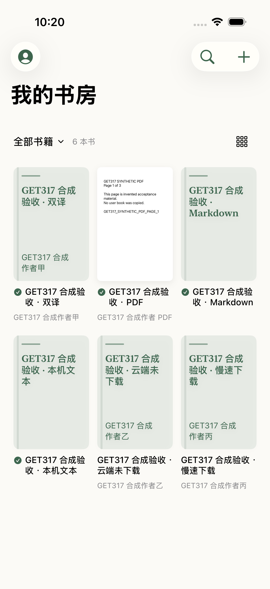
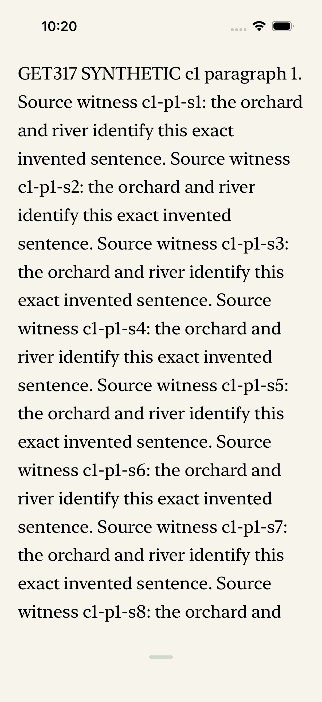
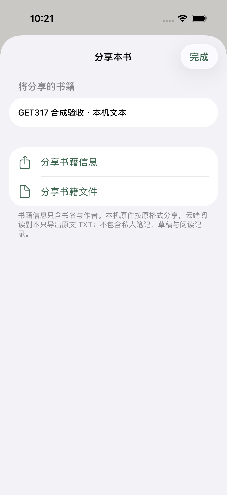
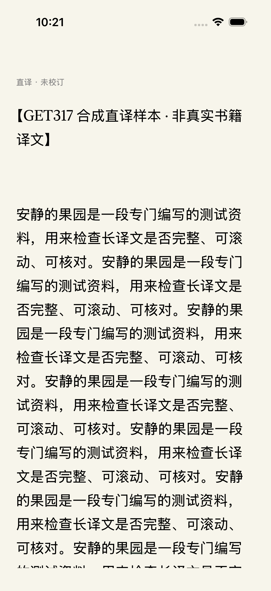

# GET-346: compact reading and library actions

Five requested improvements are implemented on the public `27fe290` base in [GET-346](https://linear.app/getyak/issue/GET-346/improve-ios-reading-space-on-demand-translation-and-library-actions). Each optimization has its own commit; all changes belong to one PR.

## Behavior

1. Horizontal text reading uses 16/44-point top/bottom margins inside the system safe area, replacing the permanent measured toolbar budget (previously about 52/94 points). The 44-point footer contains the quiet handle and the playing/paused listening control. Waking tools does not repaginate or change source anchors. Continuous reading retains its measured end margins; PDF retains its original page contents.
2. The translation controls sit immediately after the original/translation/parallel picker. Explicitly choosing a translated view first refreshes saved results, then offers a single source paragraph. The reader can instead request the current chapter, current passage first, capped at 100 missing paragraphs. Each completed paragraph is durably saved before appearing. Progress, pause and recovery remain in reading settings and reading tools. Backgrounding, stopping or returning to original prevents later submissions. Existing two-chapter envelopes retain their previously confirmed scope; an unresolved request keeps its exact original key and explicitly displays its actual source paragraph. Navigation and restart do not automatically generate or offer more work.
3. A small downloaded checkmark precedes each book title. Selection uses a separate large cover circle; detailed download/update/version status remains available to VoiceOver.
4. Long press offers select multiple, pin/unpin, share and details. Pins persist per account/device, while selection resets across account changes and filtering. Share previews offer book information or files: local originals retain their format, and cloud reading copies become source-only TXT. Generated shares exclude personal notes, drafts, reading history and internal ownership metadata.
5. The standard shelf uses three equal columns and 12-point gaps, scalable 13-point titles and 11-point author text. Accessibility text sizes retain full-width rows.

## Actual native screenshots

These are screenshots of the native app on the existing Primary iPhone, using explicitly synthetic books. They contain no uploaded user books or private records. Native artifacts live beside the native project, outside the application source/bundle inputs.

| Three-column library | Compact horizontal page |
| --- | --- |
|  |  |

| Share preview | First translated paragraph |
| --- | --- |
|  |  |

## Verification

- Core: **161 passed**. Single-paragraph scope, current-first chapter scope, independent translations and source identity are covered.
- Final native application tests: **137 passed, 0 skipped**. Includes real public WebP cover decoding/rendering, actual TextKit pagination, selection, source anchors, AX5 and short landscape layouts, owner-scoped pins, share metadata, cancellation and uncertain-request recovery. Scope-label tampering is rejected before submission.
- Native UI: **3 passed** for actual left/right source round trips; three-column geometry, long press, multi-selection, persistent pin and share preview; and selecting translation, confirming one paragraph, viewing its result and retaining it after restart.
- Host checks: **100 Node tests and 9 Python tests passed**; pinned native vendor checks passed.
- Configured online service: authenticated with the Keychain-provided default test account, checked its actual session and shelf UID, submitted **one** untranslated public-domain source paragraph, obtained independent AI draft translations (**135/141 characters**), and re-read both saved results. Billing was disabled; no reading-point purchase or real payment occurred. No full-book request, upload, account migration or private-note access was performed. This is separate from the synthetic native UI transport.
- Independent review: the permanent translation capsule and misleading old-request recovery description were fixed. The final follow-up found no remaining P0/P1/P2.

The initial unit assertion incorrectly treated a source-only cache entry as a translation; it now checks the actual translation fields. The first UI attempt used the ordinary debug bundle and did not enter the synthetic factory; its screenshots were excluded from formal acceptance, and existing application data was retained. Isolated acceptance uses the explicitly allowlisted `org.leafhour.shelf-refinement` bundle. A legacy navigation test also scrolled toward the top even though the picker had moved below typography; its traversal now follows the actual lower content. All declared final checks passed after these corrections.

The user explicitly allowed serial native validation while the host pause marker remained intact. All runs reused the existing Primary iPhone and registered build caches through `dev-ios-session`; no other project, simulator, worktree or data was removed.

[Machine-readable results](../../apps/ios/verification/2026-10-31-get-346/results.json) record each gate. Exact-head remote CI, normal merge and automatic TestFlight processing follow source delivery. Physical-device installation/acceptance remains separate; source, simulator and online generation checks do not establish that a tester has installed the update.
