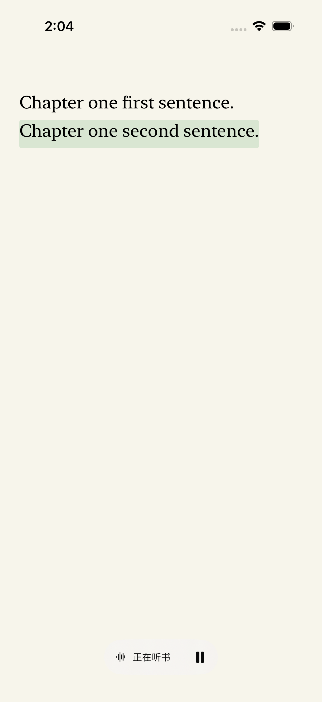
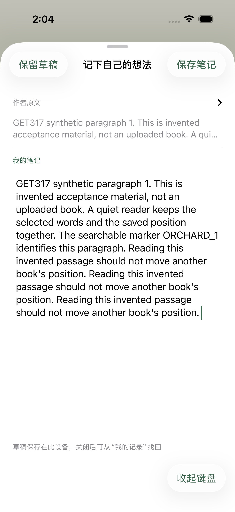

# GET-347: listening follows the sentence, first selection uses the paragraph

[GET-347](https://linear.app/getyak/issue/GET-347/follow-the-current-sentence-while-listening-and-improve-paragraph) builds on public source `24381ff`. It uses this device's system voices, with no model, cloud speech, payment or reading-point request.

## Delivered behavior

Listening starts at the currently visible sentence, including its actual selected translation layer. An independently verified local cursor resumes a prior session without confusing translation UTF-16 offsets with original scalar anchors. Real `willSpeakRangeOfSpeechString` callbacks identify the current word and sentence. The current sentence is drawn behind the existing TextKit text; the word drives following when a sentence is taller than a page. PDFKit paints separate highlighted selections on its original pages. Source attributes, links and the native selected range are preserved.

One passage is queued at a time and playback continues through the book. Pause, interruption and backgrounding do not autoplay. Voice or speed changes restart only the current sentence. Manual browsing/selection suspends following; the quiet footer offers return, pause/resume and settings. Saved resume state is source-version/layer/fingerprint scoped and invalidated when it cannot be verified. Current-view restart is explicit. Empty image-only tails do not wrap back to earlier text.

For Text, the first long press on an unselected passage glyph selects that stable paragraph/layer. Existing selections, handles, double taps, links and VoiceOver retain native behavior. A bounded initial-selection recognizer avoids UIKit's cached word-selection state and presents a native `UIEditMenuInteraction`, preserving the responder chain's suggested editing actions. Copy and anchored note/AI actions use the live range. Viewport and canonical source anchors stay stable. PDF uses its independent native observation path and extracted paragraph boundaries; no OCR or source-page rewriting is introduced.

## Actual evidence

All screenshots use isolated synthetic books on the existing Primary iPhone. No uploaded user books, real notes or account credentials appear.

| Actual system sentence callback | Next chapter, paused |
| --- | --- |
|  |  |

- **162 Core tests passed.** Includes backward-compatible listening state and separate original/translation offsets.
- **152 native application tests passed, no skips.** Covers middle-sentence starts, callback prefix/source mapping, stale utterances, accepted/rejected pauses, sentence-scoped voice changes, independent translation cursors, full-chapter Markdown reference rendering, display-text changes, forward-only image handling, scoped restart, actual TextKit geometry and source preservation. PDFKit fixtures verify visible right-column position, separate speech paint and extracted paragraph boundaries.
- **5 actual native UI journeys passed.** Real system speech advanced to the second sentence and brought the next chapter onto the screen; opening listening did not autoplay; read/pause and speed changes preserved explicit pause; long press and native Copy/Paste retained the full paragraph and note quote; selection dismissal did not turn a page.
- **100 host Node and 9 Python checks passed.** Native vendor integrity remained unchanged.
- **Independent review completed.** Confirmed image-tail wraparound, heading-layer mismatch, touch/follow protection, Markdown display invalidation and PDF horizontal-viewport issues were repaired. The final review found no remaining P0/P1/P2.

The original middle-paragraph regression failed before the speech change. Actual touch testing also caught UIKit overwriting an observed paragraph range on lift and dismissing its menu after another range rewrite; the final Text path selects once through the bounded first-selection gesture. Tests separately account for existing selections and clear outside the selected paragraph before checking a fresh selection. PDF fixture assertions use actual character geometry rather than assume a particular extraction spelling.

Native runs reused the Primary iPhone and registered caches through the shared iOS session. Other-project builds were allowed to finish naturally; none was terminated. The global pause marker remained intact. Temporary diagnostic logging was removed before the final native run.

[Machine-readable results](../../apps/ios/verification/2026-10-31-get-347/results.json) separate the gates. This record proves Text's native long-press menu path; PDF's original-page geometry/paint/boundary tests do not certify its physical/native-menu flow. Actual callback/Simulator evidence does not establish physical-device listening quality, full VoiceOver behavior, tester installation or retained-data upgrade acceptance. Exact-head CI, normal merge, Production and TestFlight are recorded subsequently on the linked PR/issue.
