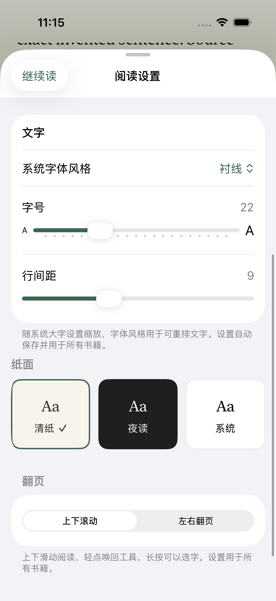
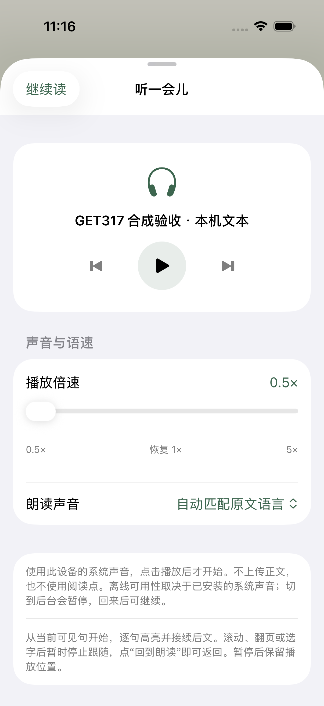
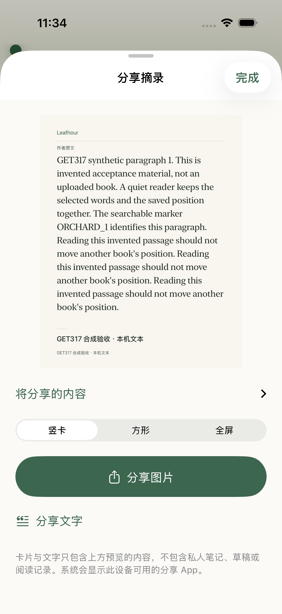
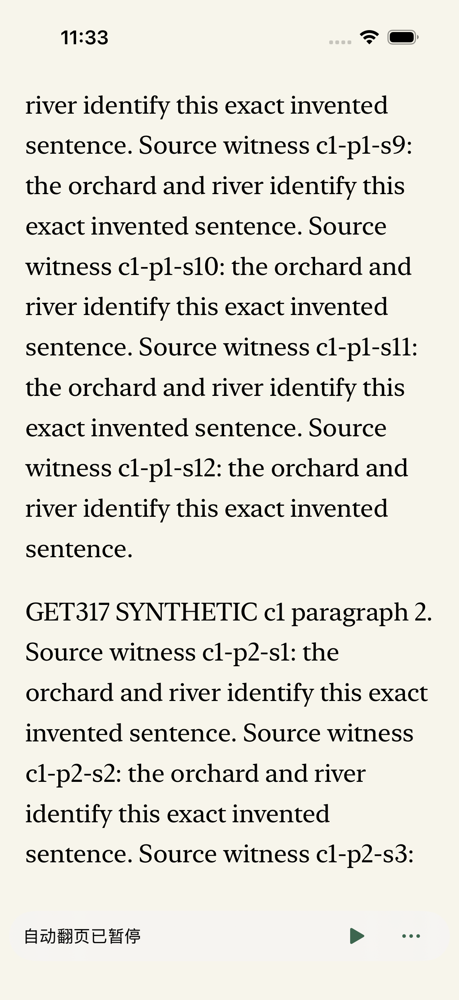
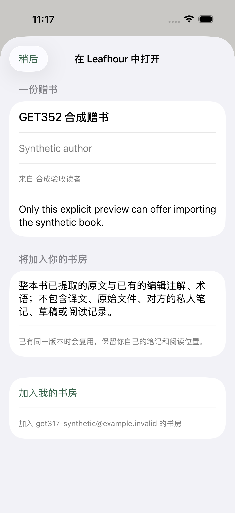

# GET-352 · iOS reading and sharing verification

Date: 2026-11-01. [Linear GET-352](https://linear.app/getyak/issue/GET-352). Base source `85bf3a3`, isolated branch `codex/get-352-natural-ios-reading`.

## Scope and design evaluation

| Reader need | Design delivered | Evaluation criterion |
| --- | --- | --- |
| Open a book and turn naturally | New readers default to horizontal pages; public UIKit native page curl over temporary snapshots | Actual source page and anchor move, native text selection remains, cancelled turns cannot overwrite a later jump |
| Keep settings from book A in book B | Library-scoped preferences, local system font styles and validated migration | Typography, paper, mode, layer and speed survive A→B→restart; records and account scopes stay independent |
| Contents without competing controls | Real-order list, current location, local title/page search | No drag-to-jump chapter slider or duplicated previous/next actions; locate does not navigate |
| Draggable 0.5×–5× listening | Generous native slider and local PCM playback with AVAudioUnitTimePitch | High rates produce distinct output durations; paused audio and source highlighting remain stable |
| Automatic page turning | Foreground-only acknowledged page commands, interval and quiet pause control | Real viewport pages advance once; interaction, tools, selection, assistive reading and background pause explicitly |
| Share books and selected passages | Complete readable cards, separate image/text/link representations and explicit gift import | No hidden private records, fake public links, silent text truncation or automatic publication/acceptance |

The design uses the existing reading surface and system share destinations. Card ratios are 4:5, 1:1 and 9:16; long quotes paginate without shrinking the body text. Existing authorized public/gift links receive a sharp native QR code so an image forwarded through another application can still open the Web import route. No-link private cards receive no invented code. The system decides which installed social applications are available. This record does not claim superiority over another reader from visual preference alone.

Native curl starts after a recognized swipe/tap; it does not track the finger continuously. Legacy records encoded default scroll and an explicit scroll identically, so existing valid scroll choices are preserved. Missing/new navigation fields default to paged. Public PDF pages retain their original typography.

## Review and refinement

Separate subagents implemented paging/preferences, contents/automatic turns and sharing/import. Root implemented audio speed and coordinated integration/testing. A separate whole-branch reviewer examined the integrated source; a second cross-domain review covered sharing.

Confirmed findings fixed during this round include:

1. A previous cross-chapter turn could leak into a later explicit jump and overwrite its anchor. Transition identity now includes its expected owner/navigation/chapter/layout and is cleared on cancellation.
2. Cloud synchronization could be scheduled before a newly shared preference was durable. Shared preferences now save before the state write that schedules sync; a failed shared write retains retry state.
3. A delayed public-link lookup could replace a newly created gift URL. A completed gift remains authoritative.
4. File-share preparation failures lacked an explanation or retry. Preparation retains successful work and offers an explicit retry.
5. A frozen old translation selection could inherit a newer translation's reviewed label. Provenance now requires an exact source/variant/offset/text match.
6. Audio EOF, pause completion and provider callbacks needed explicit ordering. Synthesis writes PCM and EOF synchronously through a locked capture, while playback consumes word markers and owns completion.
7. Real hosting teardown crashed because native touch cleanup wrote SwiftUI state while its graph was being destroyed. Text/PDF coordinators now enter a terminal state and cut host callbacks before invalidating observers; queued old receipts cannot revive the view.
8. The real PDFKit pager probe reported a horizontal `scroll` transition on iOS 26.5. Fitted paged PDFs now use the same committed curl entry as text, with native zoom/pan retained and an explicit public accessibility-scroll bridge.
9. Tingting's marker ranges include spoken SSML expansion for emoji. Timestamped markers now pair with legacy delegate ranges, which address the original utterance's UTF-16 text. Internal words inside an emoji's description never become invented author-text anchors.
10. The real automatic-turn UI stalled inside `updateUIView`: a synchronous after-screen-update snapshot waited on the rendering transaction it was blocking. Native command execution now defers one main-queue turn and revalidates request, view, owner, navigation, restoration generation, layout, selection and touch. The actual page, pause/resume and background path passed after temporary tracing was removed.

See [independent source review](2026-11-01-get-352-independent-review.md), [sharing task review](2026-11-01-get-352-sharing-task-review.md) and [contents/automatic turn report](2026-11-01-get-352-contents-autopage.md). Source review and runtime acceptance are separate states.

## Local evidence

Task artifacts: `/private/tmp/ai-test-GET-352.IYg8DY`. All native execution uses the shared Primary iPhone through `dev-ios-session`, with two build jobs and serial simulator use. Test bundle `org.leafhour.get352.testing` has a separate synthetic fixture library; no real account was used for local acceptance.

| Check | Current recorded result |
| --- | --- |
| Unchanged Core baseline | 207 tests passed |
| New listening-rate validation regression before implementation | Expected red: NaN/infinity/out-of-range values failed 4 assertions |
| First complete Core run | 226 tests; one sync fixture failed 2 assertions because it wrote per-book preferences after a profile became authoritative |
| Core after fixture API update | 226 tests passed |
| Core after preference-save ordering regression | 227 tests passed |
| Latest complete Core, including public gift transport and archived-book authorization | 231 tests passed |
| Affected Web/host contracts | 191 passed, 0 failed, 0 skipped |
| Native release contracts / Python checks | 106 / 9 passed in separate batches; batches can overlap the affected-host set |
| First full application run | 184 passed, 12 failed, 1 skipped; crashes and failed assertions retained in `app-pass6.xcresult` |
| Focused paging/lifecycle fixes | 57 tests passed in `paging-fixed2.xcresult` |
| Complete application run before final automatic-turn fix | 213 passed, 0 failed, 0 skipped in `app-pass7.xcresult` |
| Final trace-free application run | 216 passed, 0 failed, 0 skipped in `native-final.xcresult` |
| Native UI first pass | 8/10 passed; automatic-turn rendering stall and covered-navigation counting were retained as failures |
| Final UI coverage | All 10 named flows have passing recorded runs; the two corrected cases passed again on the final trace-free source |
| CI / PR / merge | Delivery readback belongs to the linked GET-352 issue and PR timeline; this report certifies local evidence |
| Production / Apple processing | Separate exact-source receipts in the GET-352 delivery timeline; never inferred from local tests |

Earlier integration compilation failures are retained in task logs: an outer PDF observer called a private nested method; incoming-link handling synchronously read an actor-isolated cross-module immutable URL. Compilation failures did not execute the requested runtime tests.

Other integration diagnostics were corrected before the passing application run: a shadowed error property, a SwiftUI async expression that needed a separate function, a test still removing the retired layer animation, and test visibility at a coordinator event boundary. The original cover-art skip was resolved by preparing the declared public `alice-640.webp` fixture in this task's isolated test app; the final suite did not skip it.

The final result bundle reports **218/218 passed**: 216 application tests and the two final UI corrections. Earlier UI runs additionally passed default paging/shared settings/cold restart (100), slider endpoints/persistence (103), gift preview/explicit import/download/cold restart (104), opening a reading link while another book was open (105), PDF last-page/cold restoration (23), horizontal source-ink movement (47), complete native Copy/Note/Paste (96) and actual speech/chapter following (97). UI101 additionally checks the real source page advances, not only a running status. UI102 counts visible navigation and opens the actual native image-share destinations without sending anything to another application.

Only the task's synthetic app and test runner were uninstalled after evidence export. The borrowed Primary iPhone remained booted, its original `large` content-size setting was restored, and the shared native session was released.

## Synthetic screenshots

All screenshots below use isolated, explicitly invented acceptance material. The QR example encodes a synthetic test URL and is not a published personal book. No real user's reading data or installed-application list is included.

| Reading settings | Contents | Listening |
| --- | --- | --- |
|  |  |  |

| Selected-text preview | Actual automatic page after pause | Gift import preview |
| --- | --- | --- |
|  |  |  |

## Real local audio and source coordinates

The initial real write probe observed Samantha sending 14 timestamped word markers to its delegate and zero to the marker closure. A second probe showed Tingting expanding the emoji into internal speech words: a raw SSML range `{33, 1}` corresponds to the original UTF-16 range `{4, 1}`. Both raw traces remain in task artifacts. The production collector preserves the real audio byte offset and takes the author-text range from the paired legacy callback; synthesis completion never advances the visible reading position.

The final application run measured output from the first audible marker to completion:

| Voice / requested multiplier | Measured output duration | Source evidence |
| --- | --- | --- |
| Samantha 2.5× | 2.878 seconds | 21 real word markers |
| Samantha 5× | 1.496 seconds | Same 21 source ranges |
| Tingting 0.5× | 8.827 seconds | Original UTF-16 ranges include the complete emoji and following sentence |
| Tingting 5× | 0.928 seconds | Exactly the same 11 source units as at 0.5× |

These are local Simulator sample/output callbacks, including audio processing and device-output latency through `dataPlayedBack`. They establish distinct high-rate playback, bounded pause/resume and source mapping for the tested installed voices. They do not establish physical-device sound quality. Metadata arriving after preparation is isolated and deduplicated, but may wait until the next already scheduled output boundary; no precise timing guarantee is made for every third-party voice/provider.

## Acceptance boundaries

Do not equate source review, Core/application/UI tests, CI, merge, website publication, Apple processing, TestFlight installation or physical-device acceptance. This round uses local system speech only. Real-device audible quality at extreme rates, physical VoiceOver, tester installation and retained-data update acceptance require their own evidence. A custom `leafhour://` import route and the Web's explicit open-App button are separate from Universal Links, which require associated-domain signing/AASA and Apple CDN/device verification.

## Primary design and API sources

- [Apple: UIPageViewController.pageCurl](https://developer.apple.com/documentation/uikit/uipageviewcontroller/transitionstyle-swift.enum/pagecurl)
- [Apple: AVSpeechUtterance.rate](https://developer.apple.com/documentation/avfaudio/avspeechutterance/rate)
- [Apple: synthesis buffers and markers](https://developer.apple.com/documentation/avfaudio/avspeechsynthesizer/write(_:tobuffercallback:tomarkercallback:))
- [Apple: AVAudioUnitTimePitch.rate](https://developer.apple.com/documentation/avfaudio/avaudiounittimepitch/rate)
- [Apple: dataPlayedBack completion](https://developer.apple.com/documentation/avfaudio/avaudioplayernodecompletioncallbacktype/dataplayedback)
- [Apple: original speech-string ranges](https://developer.apple.com/documentation/avfaudio/avspeechsynthesizerdelegate/speechsynthesizer(_:willspeakrangeofspeechstring:utterance:))
- [Apple: UIActivityViewController](https://developer.apple.com/documentation/uikit/uiactivityviewcontroller)
- [Apple: QR code generator](https://developer.apple.com/documentation/coreimage/cifilter-swift.class/qrcodegenerator())
- [Apple: onOpenURL](https://developer.apple.com/documentation/swiftui/view/onopenurl(perform:))
- [Readwise: sharing](https://docs.readwise.io/reader/docs/faqs/sharing)
