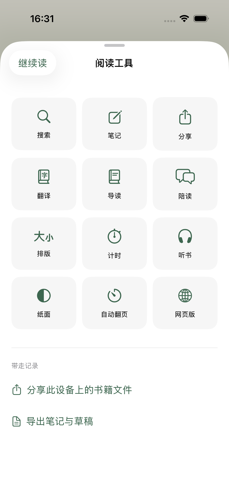
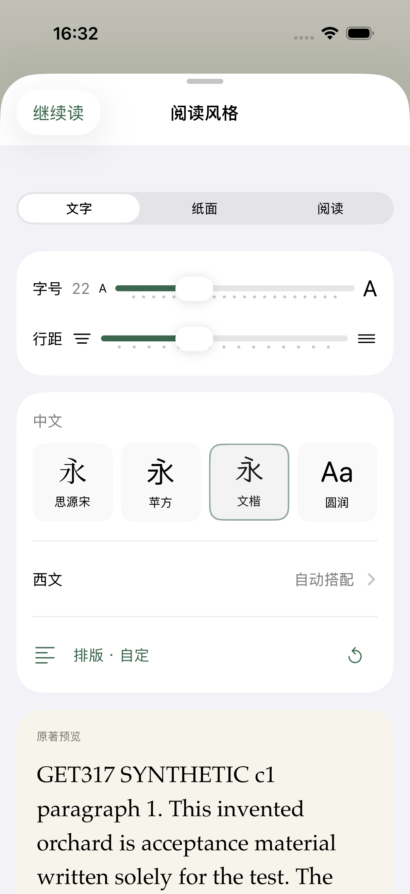
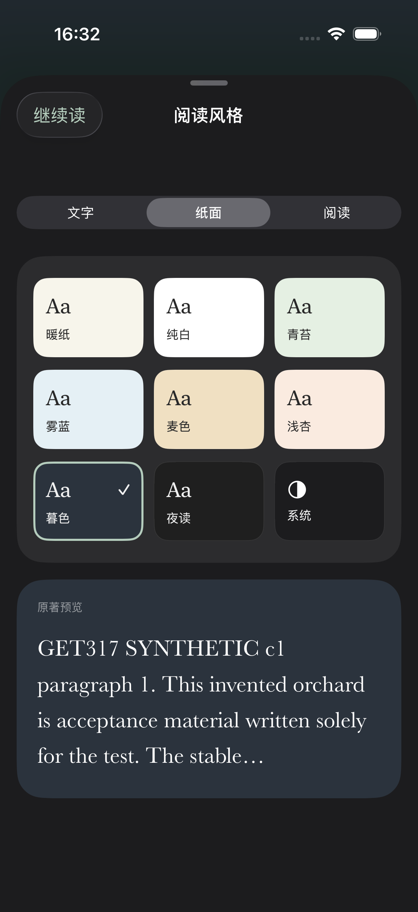
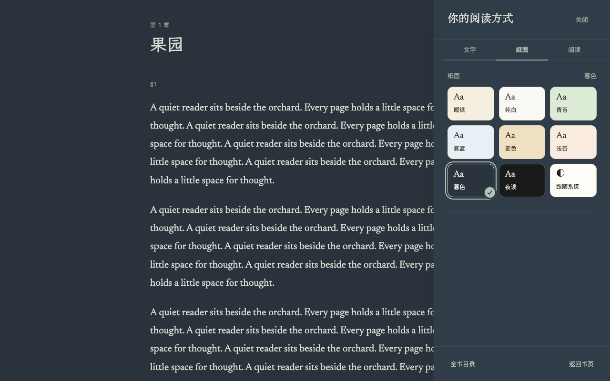
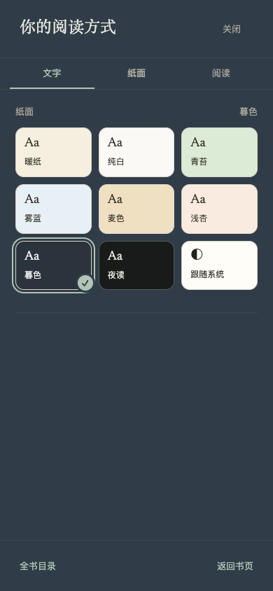

# Quiet reading controls — 2026-11-02

Implemented for native iPhone first, with matching web category/label/paper principles. This record separates local validation from CI, production and native distribution.

## Result

Native tools use a three-column labeled grid, two columns at accessibility sizes. Typography exposes direct size/spacing, four Chinese/paired styles, seven Latin options including automatic, and nine papers including system. Controls precede the actual-book preview. Global and reader settings share the same components and scoped preferences. The bottom controls share one quiet surface. Listening started from the tools grid returns directly to the book. Original PDF typography remains unchanged.

Noto Serif SC and WenKai Lite are bundled under their original OFL terms, with pinned upstream bytes. The app adds 25,575,272 font bytes before store compression. Local CJK cascade and Latin glyphs were verified through actual Core Text runs. Chinese Markdown bold/italic retain visible synthetic emphasis because the bundled CJK faces contain regular weight only. Fonts, sizes and layers participate in pagination invalidation; notes and anchors remain independent.

Web keeps existing preference fields and IDs, adds sand/apricot/dusk, and presents named font/paper samples. Dusk reuses the existing night foreground/translation palette. WenKai is served locally in seven Unicode WOFF2 parts; their union retains all 25,694 original codepoints and advance/sidebearing metrics. No public asset limit was increased. After font loading, pagination refreshes; the captured anchor is restored only if no newer user interaction or navigation superseded it. Native Latin family selection is not a new web preference.

## Local evidence

- Core: 268 tests, 1 existing skip, zero failures.
- Native app: 255 tests, 2 existing skips, zero failures. Includes actual mixed-script glyphs, Dynamic Type, Chinese Markdown rendering, paper appearance and font-triggered pagination rebuild without moving the anchor.
- Simulator: 3 UI tests passed — font/paper selection across cold restart; tools search/timing and return; accessibility paper choices and return. Isolated `org.leafhour.quiet.testing` synthetic library, no real account or user books.
- Web full suite: 4,529 tests, 4,515 passed, 14 existing skips, zero failures before the final resource packaging refinements. After the final resource packaging and CSS refinement, 56 affected build/settings/font HTTP, preference-history and touch checks passed.
- Production build, public-source allowlist, asset hash/size/license validation and native vendor checks passed. Reader CSS and JS retain the existing 200/320 KiB limits.
- Browser: synthetic local reader at 390×844 and 1280×800, keyboard-accessible settings, named paper tiles and dusk state. Screenshots below are application output, not mockups. No paid model calls.
- Independent review identified and closed CJK emphasis, nested listening return, preference-memory compatibility, dark translation colors and asynchronous font layout issues.

Artifacts: `/private/tmp/leafhour-quiet-reading`; native result `Test-Leafhour-2026.11.02_16-29-50-+0800.xcresult` inside its DerivedData logs. Temporary artifacts are local only.

## Delivery limits

CI/merge/production status is tracked in the PR. Local acceptance does not establish physical iPhone VoiceOver, audible playback quality, signed builds, TestFlight or App Store distribution. Native distribution requires the existing release channel; no manual upload was initiated here. Web font cold-cache behavior on a physical mobile network remains distinct from local browser checks.
