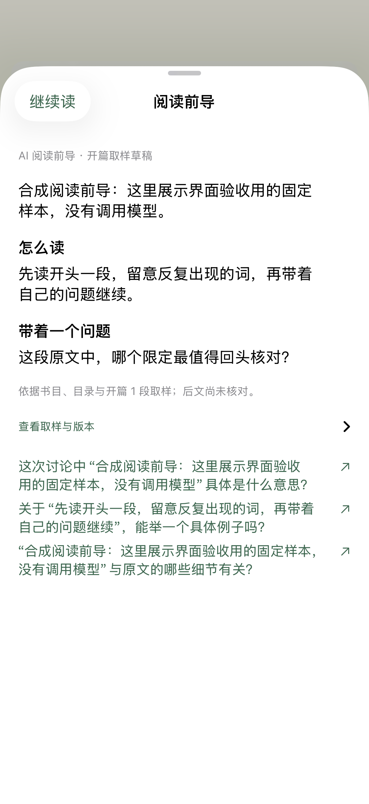
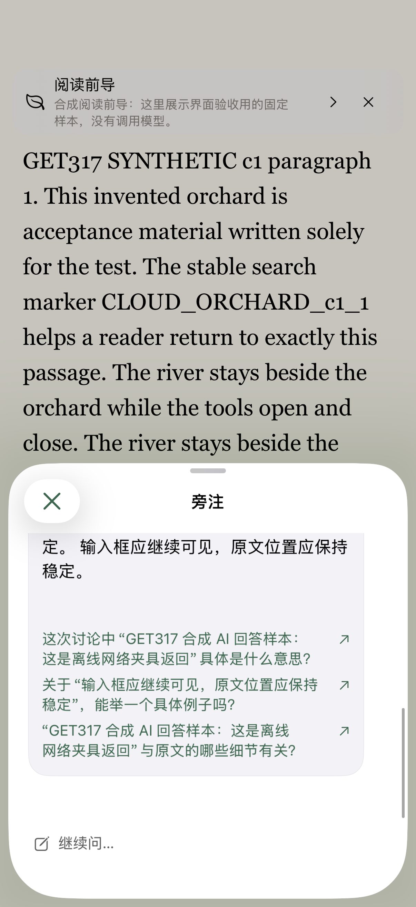
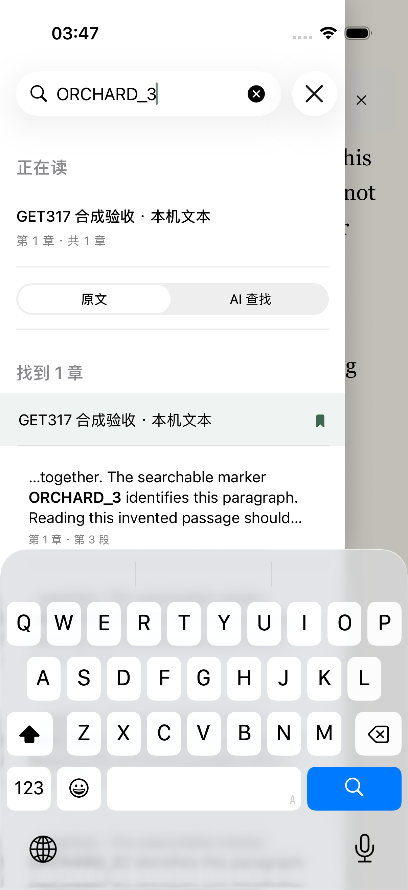
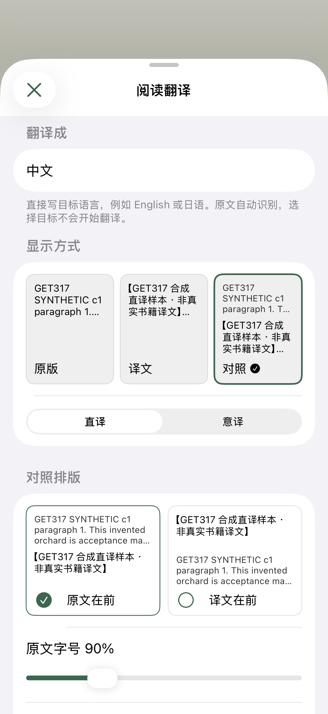
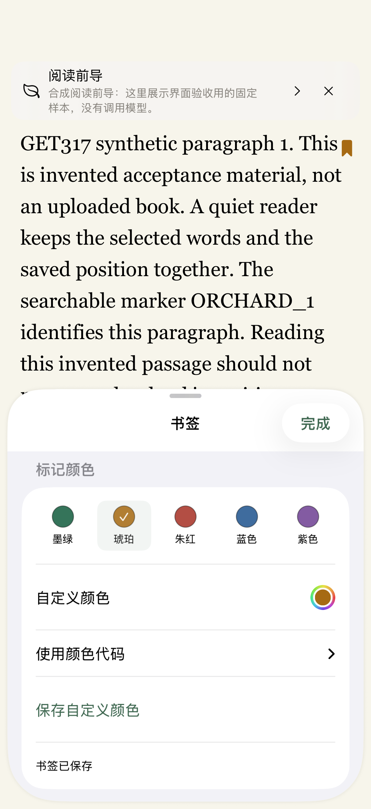
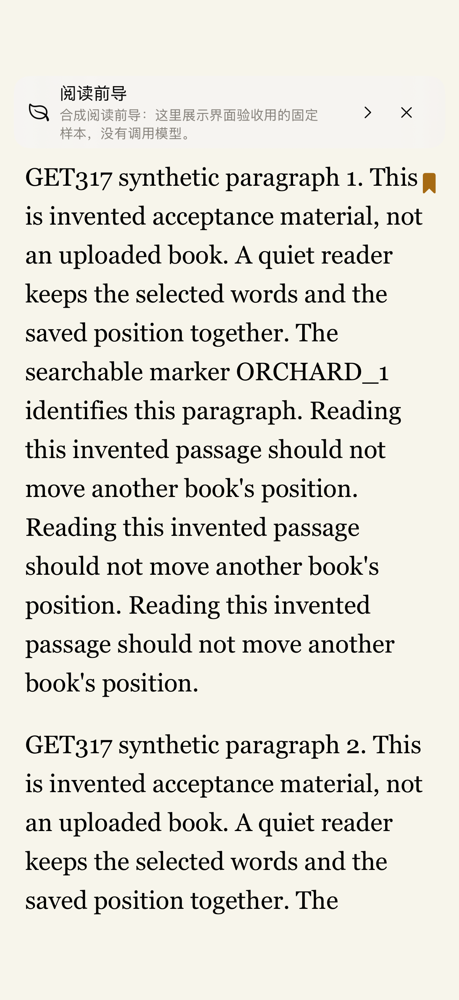

# iPhone 阅读体验：实现与验证

日期：2026-11-05。主要平台由用户确认为 iPhone App。本轮基于公开主线 `11a89b3b`，在独立工作区实现。原工作区其他任务未改动。需求、设计、实现、测试、发布和真机验收分别记录。

书架现在按实际阅读或加入时间显示最近活动，新书默认靠前。已有书不会在刷新时被清空。设备上的书先打开，上传和记录同步继续在后台进行。正文沿用有界窗口，并复用长段落的位置计算。AI 阅读前导与逐回复的三个追问已接入原生阅读入口。目录可查原文，也可用 AI 查找。设备书签和须显式开启的随读翻译在同一阅读器中操作。

[完整需求](../../superpowers/specs/2026-11-05-reading-experience-design.md)列出 R1–R16。[使用与数据范围](../../ios-reading-experience.md)说明操作、默认行为与恢复方式。下面按实际证据记录，不把自动化通过率换算为体验分数。

## 实现与证据

| 需求 | 实际行为 | 验证与审阅 |
| --- | --- | --- |
| R1 书架刷新 | 同账号元数据更新保留书房；相同快照不重复发布；并发强制刷新等待共享任务及一次复查 | LibraryActivity、LibraryPresentation；[独立审阅](shelf-review.md) |
| R2 新书排序 | 默认比较真实加入与阅读活动时间；置顶优先，显式排序保留；下载日期不冒充加入日期 | 排序回归先红后绿；[实现记录](shelf-implementation.md) |
| R3 本地先读 | 下载副本保存后先打开，再同步记录；上传中可读原件；活跃源书或目标书延后迁移 | 挂起网络与新增记录回归；[打开实现](opening-implementation.md) |
| R4 分段呈现 | 24K 正文窗口；首窗复用准备结果，邻窗复用已核验偏移；保留原件及索引校验 | Core 长 Unicode 样本和原生分页/选文回归；下表为阶段测量 |
| R5 AI 前导 | 登录后默认异步、有界开篇取样；按账号/书/版本缓存；独立赞助容量；不阻塞正文 | ReadingGuide、HTTP 与赞助额度测试；模拟器导览流程 |
| R6 三个追问 | 导览及每个完成回复给三个可点即发的问题；保留文字、录音与引用草稿；异常短语兜底 | 数学符号/URL/代码等回归；实际导览发送与可点击追问流程 |
| R7 目录原文搜索 | 标题与正文匹配按真实章节归组；强调命中词，显示真实段序；精确返回原文 | ContentsSource、ContentsSearchApp；模拟器搜索与跳转 |
| R8 目录 AI 搜索 | 显式发起，只读当前设备快照；独立草稿；来源逐项核验；恢复结果标明原问题 | 原请求/计费身份保留、取消确认、Q1/Q2 归属回归；[复审](ai-contents-review.md) |
| R9 下拉书签 | 方向/阈值门禁；滚动模式仅真实顶端越界触发；提供按钮和辅助功能入口 | 状态机、真实原生手势与可见范围测试；模拟器下拉保存 |
| R10 书签配置 | 预设与自定义颜色、可选名称、移除与列表；设备持久化；译文另存真实展示偏移与指纹 | 冷存储/隔离恢复、长译文跨页与变化拒跳；模拟器改色 |
| R11 随读翻译 | 仅显式开启；当前页加后续最多两段，每窗最多十二段；真实导航开始中断旧窗口；连续请求受平台容量约束 | 新标记/有效页/跨章/等待授权/后台守卫及免费路径上下文边界回归 |
| R12 真正取消 | URLSession 取消传到服务及供应商请求；提交前禁止迟到保存；提交后按原回执核对 | HTTP 断开、供应商取消、保存/计费竞态；[独立审阅](translation-cancellation-review.md) |
| R13 一行语言目标 | 新书默认 English；旧书、旧 JSON 和缺失 state 文件保留旧默认；显式设置优先 | 版本标记、缓存重写、修复与语言意图回归 |
| R14 三种模板 | 原版、译文、对照小样；切换不启动生成；缺译明确保留原文 | 真正渲染/选择/锚点回归；模拟器三模板操作 |
| R15 实时对照 | 原文/译文顺序、原文字号/深浅/段距作用于实际正文；Markdown 映射保留 | 真实 TextKit、长译文位置、Markdown 状态与映射测试 |
| R16 独立测评 | 六个领域分别设计，另有独立功能审阅及限定复审；问题先修再测 | 原审阅快照、修复提交和当前证据均保留；未验证项不补为 95 分 |

## 当前检查

- Core：400 项，2 项原有样本条件跳过，0 失败。日志 `core-review-fixed.log`。
- App：411 项，2 项原有样本条件跳过，0 失败。日志 `features-native-v4.log`。
- 后续受影响原生复测：12 项 App、1 项翻译模板 UI 通过。日志 `experience-ui-fixed.log`。
- 最终界面流程：8 项通过，包含目录搜索、导览追问、下拉书签改色、翻译模板，以及同一构建的安静阅读、章节/翻译入口、大字和横屏。日志 `experience-final-ui.log`、`quiet-controller-current.log`、`accessible-current.log`。
- 全局追问路由修复后：51 项 App 测试通过。日志 `followup-routing.log`。
- 翻译容量、免费路径上下文边界及保存/取消/计费回归：80 项通过。日志 `translation-capacity-bounds-fixed.log`。
- 最终 Node 22 全量检查：4666 项，4665 通过，1 项原有条件跳过，0 失败。运行时、公开发布包和来源检查通过。日志 `verify-deploy-node22-final.log`。
- 同运行环境的章节存储与真实隔离 PostgreSQL 检查：32 项通过。日志 `pinned-runtime-recheck.log`。
- 文案导出、固定版本 Vale/textlint 及文案校验用例通过；保留原有警告和未审文案，不批量重置审阅状态。
- PR、远程检查、Production 和 TestFlight：本地检查结束后跟踪同一提交，结果另记。

测试产物保存在任务目录 `/tmp/leafhour-reading-experience-20261105/`。界面使用明确标注的合成书和网络替身，没有真实书籍、模型回答、凭据或其他用户数据进入源码。模拟器应用标识为 `org.leafhour.readingtest20261105`，未覆盖或清空用户的正式应用。

## 性能测量范围

同一 Mac、Debug、合成样本。以下数值是具体阶段的耗时，不等于物理 iPhone 的完整可读首帧或帧率。

| 样本与阶段 | 改前/原路径 | 本轮结果 |
| --- | --- | --- |
| 3,000,000-byte Unicode 超长段，四个邻窗准备 | 39.7–40.7 ms/窗 | 0.05–0.08 ms/窗；未重建完整段偏移 |
| 同样本首窗 | 45.3 ms | 36.5 ms；之后复用 |
| 9,236,888-byte、32,000 段，本地 critical pass | 完整 book 路径约 101.8 ms，重复原件核验约 103.8 ms | 冷 12.9 ms，热 0.5 ms |
| 新下载副本、云记录请求挂起 | 观察窗内未发布 reader | 约 12.7 ms 发布 reader；不当作可读首帧 |

首次只在云端的书仍需取得完整、核验过的离线副本。本轮没有把整本网络下载改成逐段云端流式首开。已在设备上的书不等待这条链路。

个人旧有的每小时 10 段、每天 50 段频次限制会阻断连续随读，本轮实现移除了这两条限制。平台仍限制每小时 100 次、每天 500 次和同时 2 次生成。同账号同书禁止并发保存。单账号可以使用这份共享容量。免费与计费路径均在生成前检查目标段不超过 4000 Unicode 标量、当前及邻段合计不超过 24 KiB。未开启计费不豁免这条边界。没有开启计费，也没有改写已有有效译文。

## 实际画面

以下是当前原生代码在 iOS 26.4 模拟器中的合成验收画面，截图里的固定文案不代表真实模型质量。

| 阅读前导 | 每次回复的三个追问 |
| --- | --- |
|  |  |

| 目录正文命中 | 三种翻译模板与对照配置 |
| --- | --- |
|  |  |

| 书签改色 | 当前页书签 |
| --- | --- |
|  |  |

## 95 分目标与交付边界

95 分是用户提出的最终体验目标。自动化用例按通过/失败记录，不能据通过率宣布体验达到 95。独立审阅报告中较早的“已验证小计”是当时的证据快照。后续缺陷修复以复审节和真实日志为准，未测项目不会补分。

物理 iPhone 还要验收实际触感和连续使用。本机暂未检测到 USB iPhone，未进行安装、签名或手机操作。VoiceOver 朗读与大字/横屏完整矩阵尚待核对。已通过的大字和横屏用例只覆盖上述具体流程。真实网络与模型的目录语义质量也未验收。书签没有声明云端同步。正式发布、TestFlight 和安装升级状态以本轮 PR、同提交工作流及 Apple 回执为准。本页不把编译或模拟器通过写成已发布或真机通过。
