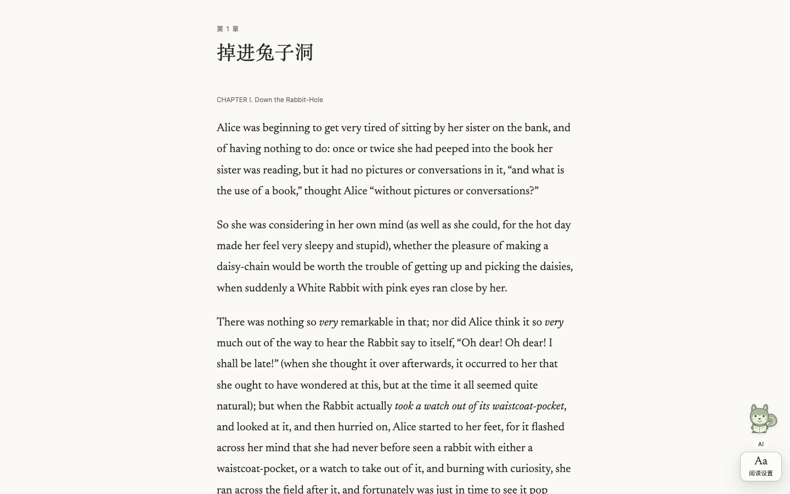
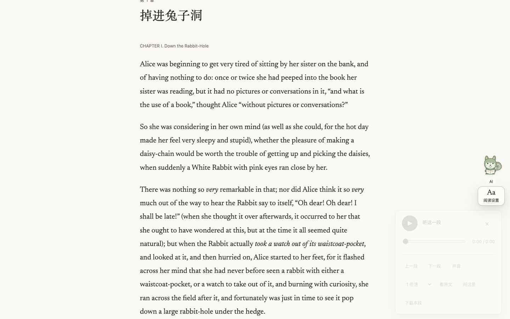
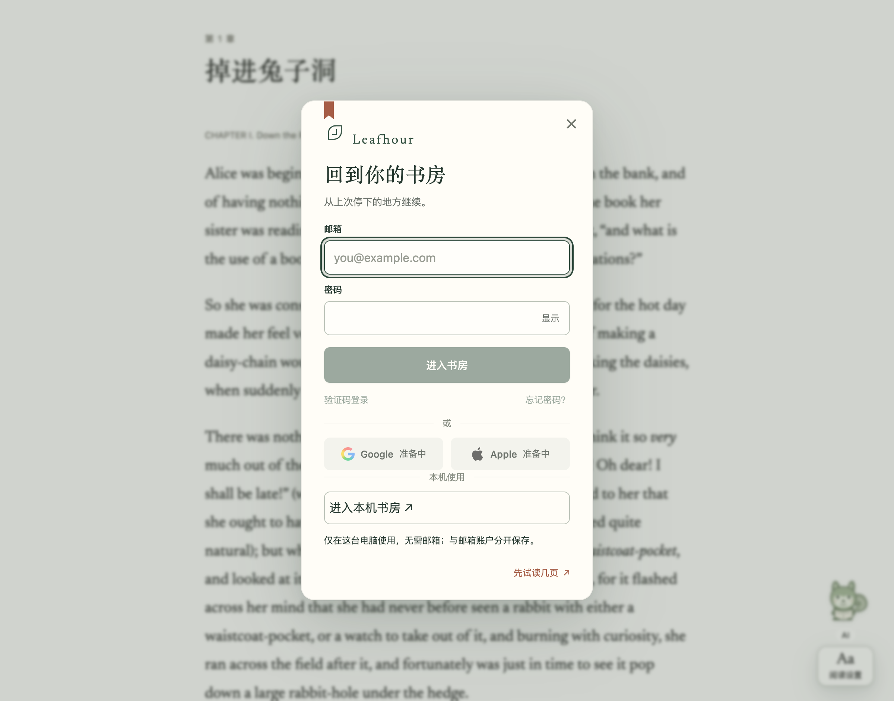

# Web reader controls — local source verification

Date: 2026-11-05. Scope: the real Leafhour source application, not the earlier standalone mockup. The user requested source changes and local review. No remote publication was performed.

## Result

The quiet reader retains a draggable AI character and a direct settings entry. They use the existing conversation and settings controllers. The dock has its own device-local position key; the library launcher's existing position is unchanged. Text gets a narrow gutter when needed, and placement rechecks actual text, notes, tools and listening-player rectangles.

305 affected tests passed, with zero failures. `npm run build:vercel` passed with the existing JavaScript, full-style and critical-style budgets unchanged. The release allowlist check passed. The independent review's moving-note-panel finding was reproduced by a failing test, fixed, and checked over 25 browser animation frames with zero text overlap.

## Real browser checks

- Opened `/read?book=gutenberg-alice&ui=zh-Hans` from the compiled current source.
- The permanent settings entry opened the original drawer, changed the real reader font and returned focus to the visible entry on close.
- The AI entry opened the original conversation, retained the selected paragraph, and returned focus to the visible AI button. No model reply was requested.
- Pointer dragging did not open chat or cover text. Position survived a reload.
- At 390 × 844, the dock stayed outside text without horizontal overflow.
- Revealing the actual listening controller's player DOM in a controlled visibility fixture moved the dock above it: dock bottom 582px, player top 594px. This checks layout only; it does not certify speech generation, audio playback or continuous listening.
- The successful browser scenario recorded no JavaScript exceptions. A guest/unavailable-records note-panel crash and the local chat upload module's missing static route were also fixed with regression checks.

## Local service and boundaries

The application is left running at `http://127.0.0.1:8330` through the project's `npm start` entry. Review data uses `/tmp/leafhour-local-01a1aada`, with the public-domain Alice sample selected explicitly. Existing personal library directories were not read, migrated or overwritten. The project configuration is loaded by its normal startup entry; credentials are not included in this record.

Implementation, the tests above, and local browser checks are complete. Merge, production publication, real AI generation, actual listening playback and physical-device acceptance are not claimed.

## Follow-up: direct login and conversation popup

The user requested that AI open as a popup and that guests see login immediately. Desktop conversation now uses the existing chat as a nonmodal popup; narrow windows retain the contained full-screen layout. A guest's AI action directly opens the original shared login form/controller over the current reader, without the former login-to-start interstitial. Authentication resumes through a validated current-book/paragraph `action=chat` URL and a fresh account-scoped document.

224 affected auth, return, reader, UI and build checks passed with zero failures. The full application build passed without increasing asset budgets. The shared workspace is retained at one public module URL for its actual reader and library callers. Independent review found two P2s: stale phone-to-desktop return anchors and provisional login being interrupted by focus identity checks. Both received failing regression cases, fixes and passing verification.

In the actual local source application, clicking AI opened exactly one login dialog with email focus; the conversation interstitial stayed closed. Cancelling kept the Alice book and returned focus to the visible AI entry. Reopening worked. The native dialog was visually inspected at 392 × 672 CSS pixels and left open in a visible local browser. No credentials were entered or submitted, no actual authentication or password setup was performed, and no model reply was requested. Post-auth return and provisional identity handling have unit/controller coverage, not real password/OTP acceptance.

## Delivery verification after main sync

The delivery pass fast-forwarded the branch to public `origin/main` at `48146961` without conflicts. The earlier browser checks above are retained as local implementation evidence; this pass reviewed their public Alice screenshots and reran the affected automated checks.

- 244 tests passed across dock, login, API identity, chat workspace/conversation, tools, positioning, reader UI, return links, shared auth, settings, build and release suites. No failures or skips.
- 46 additional tests passed across reader entry, localized auth return/transport, password flow, auth cookie races/activity, book transfer, focus return, offline boundaries and the public module graph. No failures or skips.
- `npm run build:vercel` passed. Reader asset budgets stayed enforced by the build; the library entry bundled 51 modules (346,472 bytes), with shared and lazy modules retaining public URLs.
- `node tools/release-policy.mjs` passed for 1,533 allowlisted software files, and `node tools/verify-release.mjs` passed against the resulting public build. `git diff --check` passed.

The code review checked captured account ownership, guest login handoff and fallback, disposal during asynchronous loading, desktop/narrow-window transitions, drag click suppression, focus return and public static dependencies. No additional blocking findings remained. Unrelated local browser artifacts and `output/` files are excluded from the commit.

The delivery branch is ready for PR review. This record does not certify a merge, production publication, real password/OTP login, model generation, actual listening playback or physical-device acceptance.

## CI copy-inventory correction

The first PR run (`42036892891`) failed in the copy-export consistency check: the new `reader.dock.settings` catalogue key and changed source locations were missing from the three tracked generated inventories. The failing command was `git diff --exit-code -- docs/copy`, before copy lint or the main application-test stage. The native iOS job passed in that run. The local delivery checks above had omitted this export-consistency gate.

Regenerated `copy-inventory.json`, `copy-inventory.csv` and `copy-candidates.csv` using the maintained exporter. The catalogue comparison found exactly the one added key, no changed or removed existing values; source hash/location changes correspond to this PR's files. A second export was byte-identical across all three artifacts.

With the real pinned Vale 3.24.0 and textlint 15.8.0, copy lint passed: zero new T1 errors, 371 documented debt alerts, 2,275 retained warnings, zero exceptions and zero stale bindings. Copy canaries passed. All 61 inventory, ledger and lint regression tests passed with no failures or skips. No CI contracts, wording-debt baseline or allowances were changed.

The broader local test run reproduced two shared-style checks failing: the login button's fixed 8px radius and the dock's 11px functional labels. Primary and outlined login actions now use the existing `--action-radius` token, and both labels use the 12px minimum. All 34 typography, component-foundation, dock, login and reader-build tests passed after these corrections under Node 22.23.4, matching CI's Node major version. A fresh `npm run build:vercel` and `node tools/verify-release.mjs` also passed.

The supplementary full run used the machine's default Node 26.10.0: 4,709 tests, 4,700 passed, eight failed and one Linux-only test skipped. Two failures were the style regressions corrected above. The remaining six were the unchanged yearly-test assertion expecting TAP skip formatting and five instance tests whose child permission flags lack Node 26's required `--allow-net`. Yearly PostgreSQL and all five local-instance tests passed when rerun under Node 22; no billing or instance code/tests were changed. The complete Node 26 run is not reported as a passing suite.
