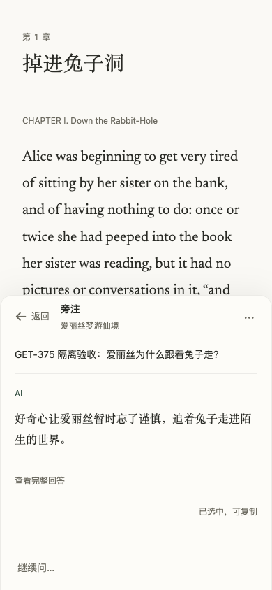
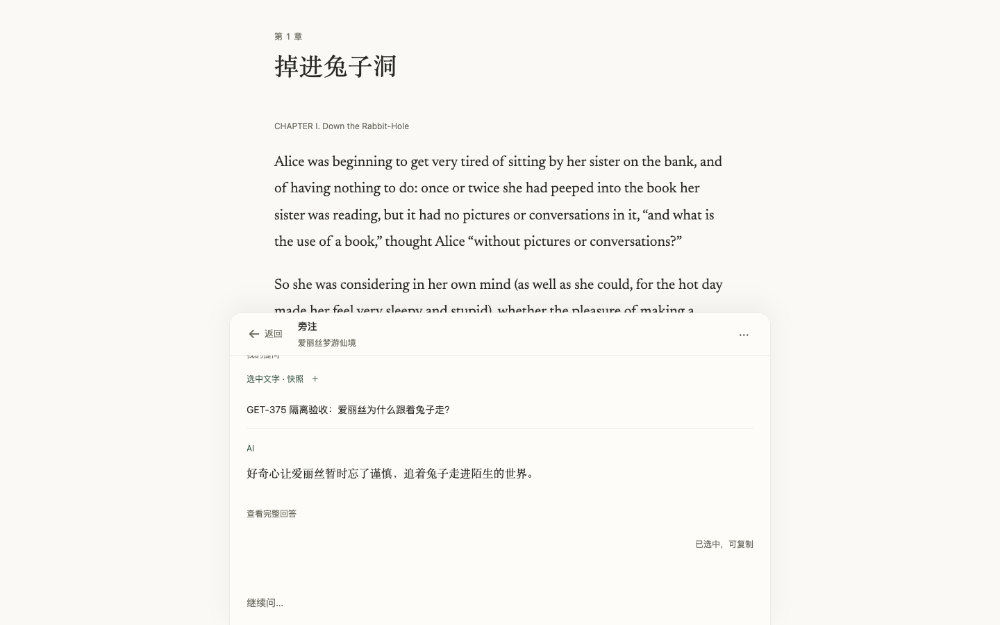

# GET-375：书页旁注的 Web 缺口验收

[Linear](https://linear.app/getyak/issue/GET-375) · 2026-11-06 · 起点 `cde3a7ae1164b716fd503d09c7eccdda01eccc8c`。

核对主线后，保留已有半屏旁注、首句直接回答及自然段的生成提示、iOS 输入退隐、阅读前导和自动封面。本单只补 Web 仍缺失的交互；没有重新实现原生阅读页，也没有修改 provider、计费或数据归属。

## 已确认的缺口与改动

390×844 Chromium 中，原输入区在读回复时仍占 117px。现在已有回复且没有草稿、未发送引用、输入法组合或需要处理的错误时，输入区退为 48px 的“继续问…”入口；点击或键盘激活后恢复同一个输入节点。生成中的停止操作始终可达，取消后保留问题并恢复焦点。书房全局对话沿用原交互。

历史选文默认收起，展开后仍保留原文、来源层与返回锚点。已有长回复在实际首段之后按需展开补充内容，既不改写储存的 Markdown，也不删掉内容。正常复制保留完整原始 Markdown；剪贴板拒绝时先展开完整正文，再提供完整的浏览器选区回退。交互按钮、链接和展开摘要不触发阅读退隐，避免 pointerdown 改变布局后错过 click。

新增视图逻辑放在已有延迟加载模块。实际 Web 构建成功：阅读 JavaScript 327,418 bytes、CSS 204,627 bytes，仍受原有 320 KiB / 200 KiB 门禁约束，没有提高预算。

## 实际验证

隔离本地服务使用当前构建产物、独立夹具身份、公版《爱丽丝梦游仙境》和明确标注的模拟回复。没有读写生产书房、私人笔记或真实账号记录，没有付费模型调用。Browser 插件未提供，使用现有 Playwright 与 Chrome 156.0.8078.80。

16 项真实浏览器检查通过：空态；选文随问题发送及历史折叠；回复展开收起；完整 Markdown 复制及权限拒绝回退；320 / 390 / 768 / 1440 宽度的半屏几何与无横向溢出；390×420 键盘等效视口；日文/中文切换保留草稿和选区；Back 返回同一原文锚点；重开与刷新恢复草稿/已存回复；账号切换隔离与切回恢复；离线加载错误；流式生成停止后的焦点与问题恢复；失败回复的编辑/重试入口。单次完整矩阵仅有三个本地生成夹具调用（成功、等待取消、失败）。

页面没有 JavaScript 运行异常或框架错误浮层。控制台五项 HTTP 503 均有归因：四项是隔离服务未提供听读服务的 `/audio/preferences`，一项是有意注入的对话离线响应；没有把它们写成无错误的生产服务验证。

最终受影响的 UI、阅读对话与工作区回归：120 项通过，零失败。固定 Vale 3.24.0 与 textlint 文案检查通过，无新增 T1、无陈旧绑定；历史警告和既有文案债保留。

本机全量运行实际为 4,759 项：4,751 通过、3 跳过、5 失败。缺少本机原生 PostgreSQL 导致其中一项失败；另外四项源于初次复用依赖目录的软链接无法满足隔离打包路径。换成本单 APFS 文件副本后，仅复测相关 PDF / runtime 文件：10 通过、1 平台跳过、零失败，四项打包失败已解决。没有把初次全量运行改记为通过；原生数据库检查由当前提交的 GitHub CI 执行。

独立 agent review 关闭了停止焦点、折叠内容复制回退、异步错误可见性、全局输入焦点及错误后滚动退隐五项 P2；最终源码复核没有新的确定 P0/P1/P2。浏览器随后发现并验证了按钮 pointerdown 的布局边界。早期构建门禁失败、自动化等待时机失败和中间状态保存在本单证据中，没有计入通过结果。

## 阅读意图对照

[Apple Books 笔记](https://support.apple.com/en-ae/guide/iphone/iph17bf340c1/ios)作为原文锚点与按需查看的参考；[Notion AI 内嵌](https://www.notion.com/help/notion-ai-faqs)作为留在当前内容里提问的参考。Leafhour 保留书页、独立署名的 AI 回复和可返回的原文位置。Ambi 沿用工单给定的“安静旁注”意图；本轮未拿到可核实的 Ambi 阅读旁注一手界面，不声称复刻其布局。

## 证据与边界

下图来自本次隔离浏览器验收，展示收起补充后的首段与阅读主体；复制按钮处于已验证的剪贴板拒绝选区回退状态。图片不是生产模型结果。

本轮没有原生源码改动或新的 iOS 构建。既有 iOS 旁注行为的源码核对不等于当前真机、VoiceOver、系统手势或 TestFlight 验收。生产发布来源、当前提交 CI 与上线后核对另按 PR 的实时交付记录；本地界面通过不代替这些门禁。
