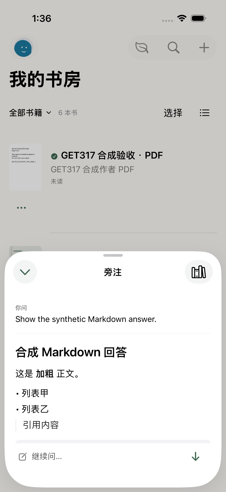
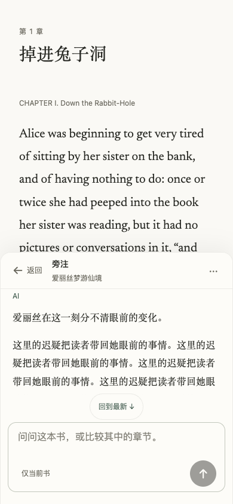
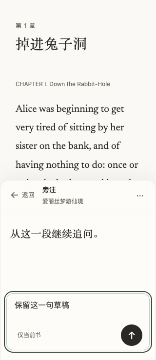
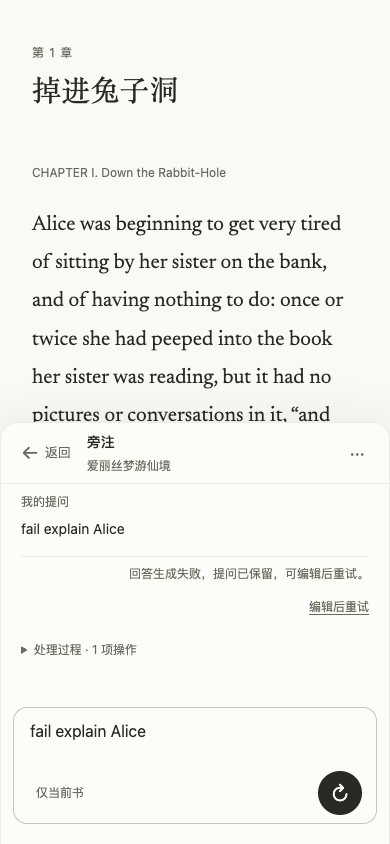

# GET-385 · 陪读留在页边

任务：[陪读回复观感：松鼠空、豆包满，都不是页边批注](https://linear.app/getyak/issue/GET-385)。本次只处理这张工单；设置由另一会话处理。

## 实现

Web 的阅读和书房入口使用半屏纸面旁注。正文保持挂载与原有布局；收起、浏览器返回、引文跳转与输入草稿沿用同一会话。小键盘可视区保留上方书页；选文和多行草稿超出半屏时，可滚动整张旁注找到输入与返回操作。打开旁注暂停阅读计时和连续阅读，收起再恢复。

iOS 沿用既有原生半屏、键盘几何和书内引用入口，去掉双边消息气泡。书房的叶子按钮召唤旁注；底栏只保留书房和我的阅读。账号会话、选书、消息选择/复制/分享、原文来源和草稿仍沿用原来的归属。读一条较长回复时从开头开始，并可显式回到最新。

回复提示要求先答问题，默认自然段，不套编号、加粗答题纸或 emoji tip。资料缺口只说明问题中的未知，不展开工具清单、权限或绑定状态。用户明确要求步骤、比较或询问能力时仍如实回答；不删改原文、历史或必要限定。

## 实际验证与限制

| 范围 | 证据 |
| --- | --- |
| 完整可移植宿主测试 | 4693 通过，0 失败，4 跳过。三项 PostgreSQL 集成因本机缺少原生引擎跳过；一项为平台限定的 Node 许可探针。数据库集成仍由 GitHub Linux CI 执行，未计为本机通过。 |
| 最后一次受影响宿主检查 | 162 通过，0 失败：对话 UI/适配器、旁注返回、提示配置与阅读时钟。 |
| 原生入口与键盘 | Primary iPhone 模拟器：书房召唤半屏、输入在键盘上方、收起/再开保留草稿、直接发送并渲染 Markdown。最新构建对应的两项入口 UI 用例通过。 |
| 原生大字/暗色与阅读返回 | 最新构建的两项 UI 用例通过：历史浏览、回到最新、草稿与等待中的回复；书内半屏返回同一原文位置。另有四项半屏几何及根导航用例的较早通过记录。 |
| 扩大原生探针 | AppTests 共 413 项，2 跳过，1 失败。`ReaderLayoutTests.testRealReaderBudgetUpdatesAcrossResizeAndOSTypeButChromeWakeKeepsItsSource` 在 874×340、普通系统字号的像素探针失败；将未改动的 `4814696` 单独归档构建后，同一探针同处失败。两份失败保留，未宣称原生全量通过。 |
| 原生更小设备 | Compact iPhone 会话被设备守卫拒绝，因为借用的 Primary iPhone 仍由共享会话使用。没有关闭或重建他人设备。实体 iPhone、完整 VoiceOver 朗读与硬件触感未验收。 |
| 回复真实模型 | 使用现有官方 DeepSeek 配置和公版 Alice 的实际领域读取/逐字引用，以及没有当前书的随手提问；无云端写入、私人笔记或其他账号数据。首次样本复现能力自述后收紧提示；最后时长样本为「本月的阅读时长还没有可核对的记录。」书内样本为自然段并带真实原文引用。少量样本不代表所有模型回复均能保证相同质量。 |
| 前端构建 | 阅读器与书房构建通过，保留原有资源体积门禁；公共产物检查通过。阅读运行时构建并实际初始化 SDK、profile、插件与原生绑定，通过，无模型请求。 |
| 文案 | 固定 Vale 3.24.0 与 textlint 检查通过，新增 T1 错误 0；原有债务与警告保留。 |

浏览器采用已有 Playwright/Chromium；本会话没有 Browser 插件。验收使用临时合成账号与公版正文，通过真实 HTTP/领域服务运行，固定生成器只用于可重复的加载/失败和布局检查，不能当作线上 provider 通过。桌面 1440×900、手机 390×844、320×740、390×420 均验证草稿、焦点、阅读锚点与浏览器 Back。保持 layout 844px、独立设置 visualViewport 600/501/400/300/250px，覆盖真实选文、八行草稿及 More 内展开原文，发送操作可达；加载/失败状态与书房手机半屏也通过。最终浏览器报告 `passed=true`、页面异常 0。物理软键盘与系统读屏另列。

原始日志、xcresult、浏览器报告和真实模型结果保存在本机注册目录 `/private/tmp/ai-test-GET-385.UNXa5U`。截图为本轮本地应用，不能代替生产、TestFlight 或实体设备验收。

本地书房验收还发现：既有自托管服务遗漏了 `import-limits.mjs` 的公共静态资源注册，上传模块图因此挂起，旁注入口无法完成启动。补充这一条固定资源映射后，真实书房入口及菜单边界验证通过；没有开放任意文件访问。

独立审查已完成，最终未发现阻断性 P0/P1/P2。

## 发布门禁的必要修复

核查过程中，既有价格参照剩余不足发布门禁要求的 24 小时。重新读取[官方人民币价格](https://api-docs.deepseek.com/zh-cn/quick_start/pricing/)与[官方美元价格](https://api-docs.deepseek.com/quick_start/pricing/)，模型及全部费率一致；只刷新核查日期、七日有效期、版本与原始页面 SHA256/字节数。预算、实际费用数值、工具计费边界和免费截止未改变。`check-pricing --sources` 对新回执逐字节匹配通过。

## 参考与画面

松鼠截图的问题是去掉气泡后仍在讲系统能力；豆包截图的问题是大气泡、编号答题纸与 emoji 小提示。本次以可返回书页的半屏纸面和直接回答替换这些表现，保留完整内容与来源。Markdown 测试截图故意包含列表、引用和代码，证明用户要求的结构仍能如实呈现。

