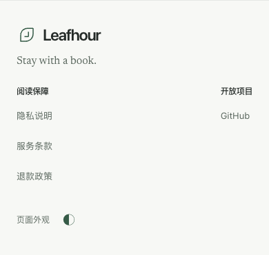

# GET-416 官网页脚

任务：[GET-416](https://linear.app/getyak/issue/GET-416)。开发基线为公开仓库 `getyak/leafhour` 的 `cf218fc`。

## 设计与实现

采用紧凑的分类页脚：左侧 Leafhour 与原有品牌短句，右侧分成「阅读保障」「开放项目」，并给外观按钮加上可见用途文字。参考 [cubxxw.com](https://cubxxw.com/) 的品牌与分组层级；只保留本任务要求的四个必要链接，不展开完整站点地图。单行混排无法清楚分类，多列站点地图会增加无关入口，因此采用两个小组。

复用现有字体与配色：正文纸面 `#F7F8F5`、墨色 `#242A27`、次要文字 `#59665D`、强调色 `#365B47`，夜间继续用现有主题变量。品牌短句用既有衬线字体，导航用既有无衬线字体。桌面页脚约 139px 高；小屏让品牌独占一行，政策链接纵向排列，所有交互目标至少 44px 高。

页脚只保留 Privacy、Terms、Refunds、GitHub，以及品牌返回首页。Pricing 与 Agent access 留在顶栏；页脚没有 MCP 文案。四种语言首屏均生成本语言的政策链接；共享导航的英文 Agent access 改为 `/en/mcp`。保留既有外观控制器与存储键，不修改账号、书籍或阅读记录。

## 本地验证

| 检查 | 实际结果 |
| --- | --- |
| 宿主测试 | 146/146 通过：home-locale、home-navigation、support-navigation、billing-ui、site-appearance、home-scroll-story、home-auto-route、home-auto-entry |
| 网页构建 | `npm run build:vercel` 通过 |
| 文案 | 重新导出清单，使用固定 Vale 与 textlint 执行 `copy-lint` 通过；既有警告和文案债务保留 |
| 8 组 Chromium 场景 | 1440/en、1024/en、768/繁中、390/简中、320/日文、390/英文深色，以及 1440/英文和 390/日文禁用 JS，均通过 |
| 页面与布局 | 标题/路径正确、正文可见、无框架错误覆盖层、无横向溢出、链接/按钮至少 44px 高、各场景无控制台错误 |
| 真实交互 | 点击英文 Privacy 到 `/en/privacy`；键盘打开外观菜单、选择夜间、Escape 关闭并返回按钮，刷新保留；Agent access 到 `/en/mcp` |
| 路由与隔离 | 各语言 privacy/terms/refunds 返回 200 及正确语言；匿名 `/library` 不显示官网页脚 |
| 独立审阅 | 只读审阅未发现需修复的 P0/P1/P2；`git diff --check` 通过 |

浏览器插件未提供，复用已安装的 Playwright 与 Chrome 156。浏览器访问构建后的真实本地服务，使用隔离数据目录，无登录、真实书房写入或模型调用。最初源码模式未提供离线 worker，产生 503；改用 `compiledWeb: true` 的正式构建服务后，完整重跑的 8 组均无该错误。

完整本地日志与报告位于登记产物 `/private/tmp/ai-test-GET-416.PZsC8t`。生成的文案清单包含源文件哈希与行号，因此除新增文案外存在行号更新。以下截图为本地实际应用，不代表线上或实体设备验收；PR、同提交 CI、合并及正式发布状态以远程结果为准。

