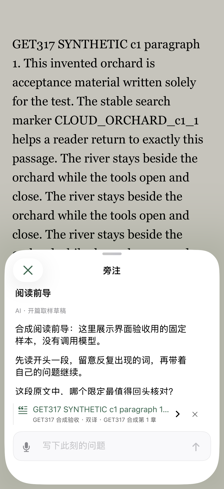
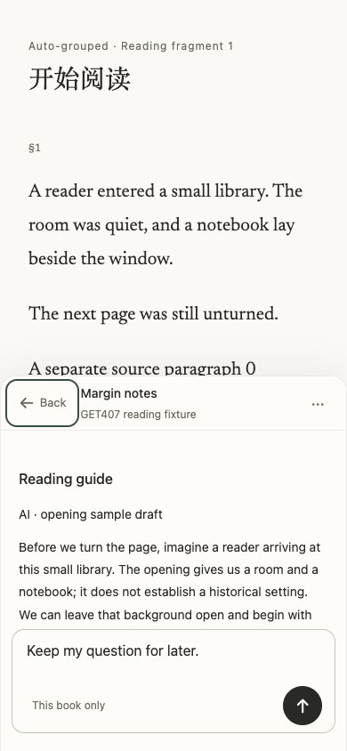
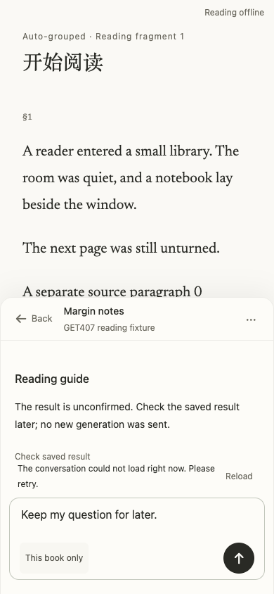
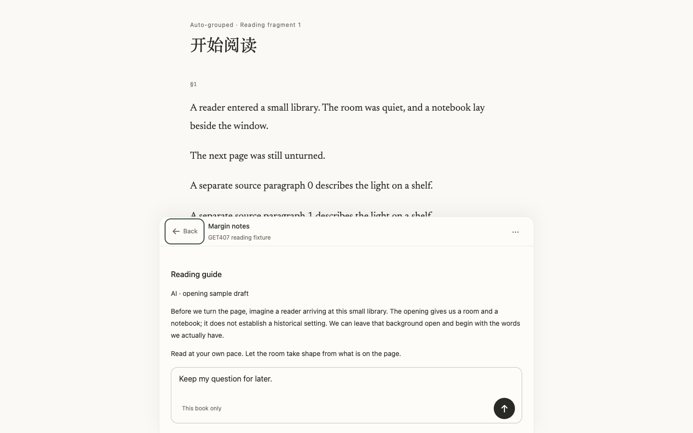

# GET-407 reading guide verification

The reader no longer shows a guide banner. The existing companion contains the guide, AI attribution, opening-sample boundary and the existing conversation. iOS keeps its marginal-note half sheet; Web keeps its mounted reader, composer and anchor.

## Local evidence

- Portable host suite: 4,742 tests, 4,738 passed, zero failed, four database/platform skips. Local native PostgreSQL is absent; the mandatory CI database checks remain separate.
- Final affected host suite: 63/63 passed, including real service/HTTP/controller integration, concurrent and cold opens, account/book/version isolation, expired/unknown attempts, explicit safe retry, source bounds and fixed startup budgets.
- Native test build succeeded. Nine affected app unit tests and the companion entry UI regression passed (10 total), covering owner cache isolation, cold/offline cache reuse, unknown-state read-only recovery, draft/voice preservation and existing half-sheet geometry.
- Native UI automation uses the dedicated DEBUG bundle `org.leafhour.get407.testing`, with synthetic books and fixed model responses. The normal local bundle does not opt into the synthetic fixture. The UI regression confirmed no top banner, the guide visible inside the existing companion, a real click on a fully visible guide question, the fixed fixture answer and retained follow-ups. UI run outcomes and release evidence are recorded on the canonical PR; a build or synthetic response does not certify a physical device or live provider.
- After synchronizing main’s TXT-cover update, the combined affected host suite passed 100/100 and the rebuilt native suite passed 11/11 (nine unit tests plus companion-entry and accessibility-size UI tests). The latter used the existing Primary iPhone at 402pt width with Accessibility XXXL text. The separate Compact profile was not started because the shared-session guard protected the already active Primary device.
- Real pinned Vale/textlint: zero new T1 errors; existing debt and warnings remain reported. Runtime tracing, hosted build, public assets, software release allowlist and source provenance checks passed.
- Independent agent review found no remaining P0/P1. It prompted fixes for first-open positioning, preserving user scrolling, current-account cache verification and safe failure classification.

Web rendering was checked with Playwright because the Browser plugin was unavailable. The compiled local application used an isolated temporary library and a fixed synthetic generator. The 390×844 and 1440×900 views showed the guide inside the existing companion without horizontal overflow or JavaScript page errors. Closing/reopening and refreshing preserved the composer draft. Offline reading remained visible; Web guide text was hidden when the current cookie account could not be confirmed, with a read-only “Check saved result” action. This is intentionally distinct from native account-scoped offline guide caching.

## Content and billing boundary

New output asks for a friendly, source-grounded story useful before reading, with no plot, ending, identity secret or key turn. Background not established by the supplied bibliographic information/opening remains unknown. The source-selection renderer remains a compatibility utility; completed cached guides are retained rather than regenerated.

The current official provider factory and sponsored funding path are unchanged: one model request, no tools, 1,000 output tokens, 60-second model timeout and CNY 0.1 generation budget. Domain quota still applies. The durable attempt is claimed before dispatch. Expiry/transport uncertainty never reclaims that claim automatically; known preflight or completed-format failure requires explicit retry. Read-only status and cache access do not start a model.

Live generation quality, exact-head CI, production deployment, Apple processing and hardware acceptance must be assessed from their own evidence. The canonical PR and Linear issue contain subsequent delivery results; these local checks do not imply those later gates passed.

Refs https://linear.app/getyak/issue/GET-407/阅读前导逻辑优化
