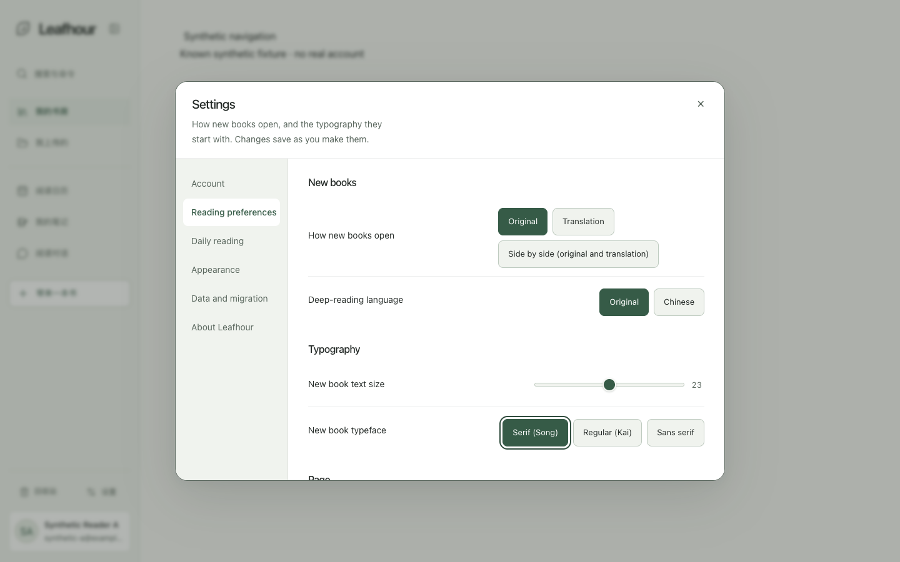
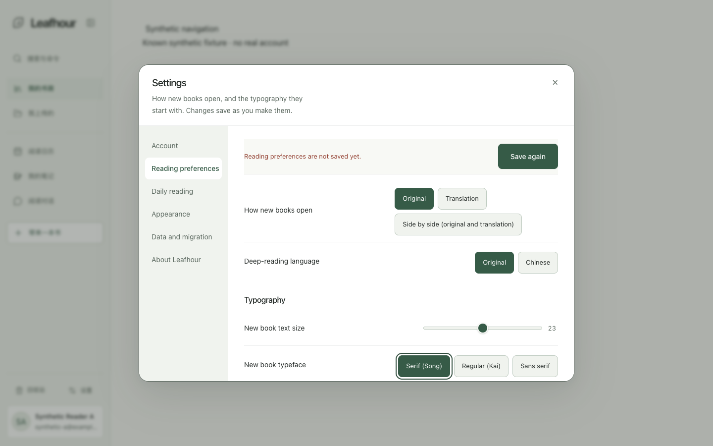
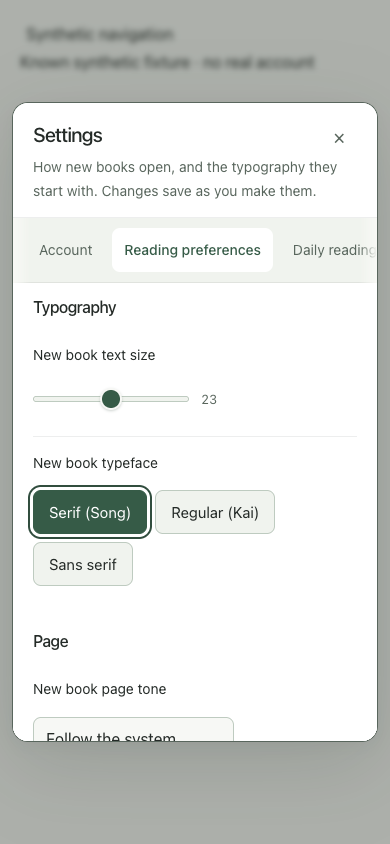
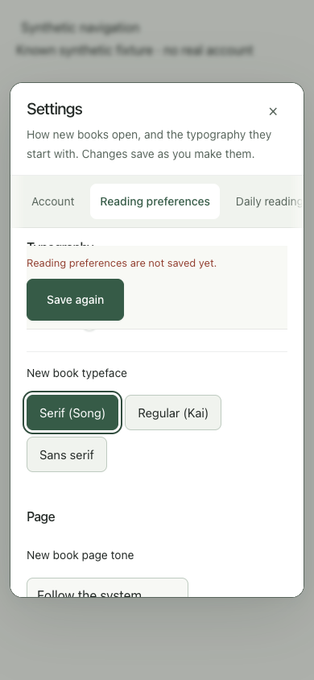

# GET-201：就地自动保存反馈验证

关联 GET-201；本批基于 PR335 的合并提交 `4cfdd7fc355eae5c73a5f0d654b0c2da89203892`，不向已合并 PR335 追加。原自动保存已经实现，常态 Save 隐藏，失败才显式重试。本批仅改呈现、反馈关联和受保护的成功淡出。

原自然路径（真实 Tab 到字号、方向键修改、Tab 离开）在1440/390 ×503/409四组中均无法在当前视口看到错误；继续 Tab 可恢复且草稿保留。原失败证据保留，手动滚动后的可见截图不算默认反馈通过。

## 当前源码检查

反馈模块复用原 status/retry/recover 节点，成功1500ms后开始160ms淡出，错误持续。owner、消息ticket、dispose防止旧回调清除新消息；locale只重译。保存中显示真实 saving，只读恢复显示单独的 reloading；原请求载荷、CAS、dirty draft、owner fence、防抖和串行队列不变。字段在choice增强前关联同一个状态节点。

已有测试把 `status.parentElement` 当form；加反馈容器后此假设失效。测试现沿父链定位真实form，保留原提交/恢复/owner/请求数和分组断言。迟到owner测试从旧空状态预期改为确认B的Saving消息不能被A迟到结果清除，并非删除保护。只读恢复时的禁用重试不再被标成正在保存；该行为回归先失败。

初始 reading suite 在复用安装中因缺少锁定的 commonmark0.31.2导入失败，保留该记录。后续在注册产物中复制真实源码，按未修改lock用正常npm ci准备隔离依赖，优先离线缓存、禁用生命周期脚本并过滤凭据环境，不使用loader、不改import或共享node_modules。普通Node解析下，完整reading suite与相关呈现/choice/settings/shell/fixture合计106项通过，0失败、0跳过。最初正常运行的旧预期失败与修复后结果分别保留。源文件和隔离副本SHA核对一致。

源码第一轮独审发现并确认了旧测试form定位P2，已修复且复审关闭；其余源码未发现新增P0/P1。最终冻结源码 `af7e0983e88f7eeb7ef1e65ffd67fe76fbaf6bf8` 的真实Chrome定点验收如下。

新增的唯一文案key是四语言 `prefs.reloading`，用于只读GET，不把读取称为保存；原catalogue值保持。复制清单通过正常导出更新，不改lint规则、欠债或豁免。新runtime helper进入公开软件allowlist。

## 实际 Chrome 定点结果

已安装 Google Chrome156.0.8078.80，headless、单页、独立临时profile，静态loopback白名单与内存API。冻结来源197个Git输入摘要全部匹配、162个输出；没有修改CSS、动画时间或release marker来通过截图。以下是10个场景，不是整单完整矩阵。

| 范围 | 实际结果 |
| --- | --- |
| 自然字号编辑→503/409 ×1440/390 | 4/4通过。Tab到字号、方向键修改、立即Tab离开，之后才等待原400ms自动保存；无需额外滚动就能看到错误与retry/recover，字号草稿23保留，409先只读GET再显式重试 |
| busy→saved→淡出 ×1440/390 | 2/2通过。普通Save始终隐藏；实际busy与saved可见，完整5px焦点环在内容区内且不被sticky遮挡；观察到success约1499/1495ms后开始淡出，再约162/163ms隐藏 |
| 新错误跨旧成功timer、关闭重开 | 1/1通过。超过旧timer后错误仍在，重开不产生额外POST、保留草稿 |
| owner切换后的新错误跨旧owner timer | 1/1通过。旧owner回调不清除新owner错误 |
| 503错误中切换中文→日文→英文 ×paper/night | 2/2通过。文案实际重译、错误和retry持续、草稿保留、无额外reading POST |

两批都为零页面错误、站外请求、HTTP失败及下载。标题/关闭仍在视口，外层dialog scrollTop为0；对应Chrome/profile/HTTP已关闭，原端口无listener。最低采样空闲约12.98GiB，未触发10.5GiB本单取消线。

这是修后结果，不是首次全绿。第一轮 `481e68a` 的1440/503路径实际焦点按钮底部超出内容区约0.1875px，加上5px outline被裁；保留原失败。仅增加8px scroll-margin-block后，以完全相同的立即Tab时序复验4/4通过。原自然四RED、缺依赖、旧测试预期失败与只读恢复标签RED均单独保留。

原始两份ledger里 `productFix` 遗留了之前PR335的提交，不能用该字段归属本批。有效来源是其 `source`、冻结provenance和逐输入SHA，即上述af7提交；私有元数据纠正sidecar保留原文件SHA，不覆盖原件。文档与合成证据收尾提交与af7的所有197个组件输入、测试及依赖锁字节已读回相等，浏览器证据仍明确绑定af7，不能冒称在新提交重新运行。

## 公开的合成前后对照

两宽均为真实Tab路径、相同503状态、无额外滚动；before为PR335源码0a7，after为本批af7，具体来源与原图SHA见[provenance](assets/get-201-feedback/provenance.json)。所有内容是隔离fixture的合成样本，不是真实账号数据。

| 宽度 | 修前：错误在屏外 | 修后：错误和恢复在视口 |
| --- | --- | --- |
| 1440 |  |  |
| 390 |  |  |

最终独立review未发现P0/P1或新增实质P2；已核197输入、162输出和27张修后截图SHA，确认原始Tab时序和错误恢复断言。前述测试定位和焦点环裁切P2关闭。浏览器owner项只证明旧成功timer，不冒称在途POST跨owner；该迟到请求保护仍由host测试覆盖。

## 交付与未验范围

独审完成；集中push关联GET-201的新PR，跟进当前head适用CI并交由统筹正常合并。父issue仍In Progress/need human；其它控件完整状态、完整144张矩阵、pixel diff、token/CJK原量表、参考并排、Safari/Firefox、VoiceOver、两位真人测试及真实业务/线上验收均未由这10项补齐。原要求逐项ledger继续保留，不缩成“仅缺真人”。

不新增真实账号、模型调用、原始书籍、完整导出恢复、授权或生产操作。PR335合并后的主线CI通过不等于上线：其Production来源核对失败、Vercel为Account is blocked；iOS流程Apple/Archive两job实际跳过，无新IPA。不能用本批结果补齐Safari/Firefox、真人与原GET-201全部验收。

## 第一轮当前head CI及文案修复

PR337的328f653 / CI42315496442在真实copy-lint失败：新提示中简/繁体“版本”各触发一项DevSpeak T1。其余当时未完成/跳过的步骤不算通过。保留原日志，不重复运行失败提交。将新提示改为“正在读取最新设置…”/“正在讀取最新設定…”，英文相应为“Loading the latest settings…”，日文原本已是設定，未改。正常exporter再生成清单；lint规则、欠债和allowances未变。新head需独立CI和受影响浏览器复验；af7证据仍只归属af7，不能因产品逻辑相同而声称全部组件输入仍相等。
