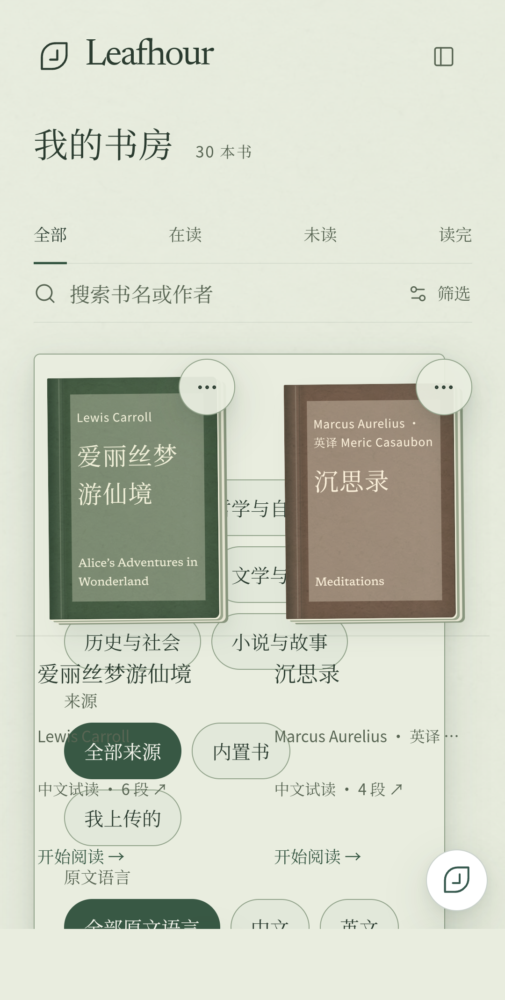
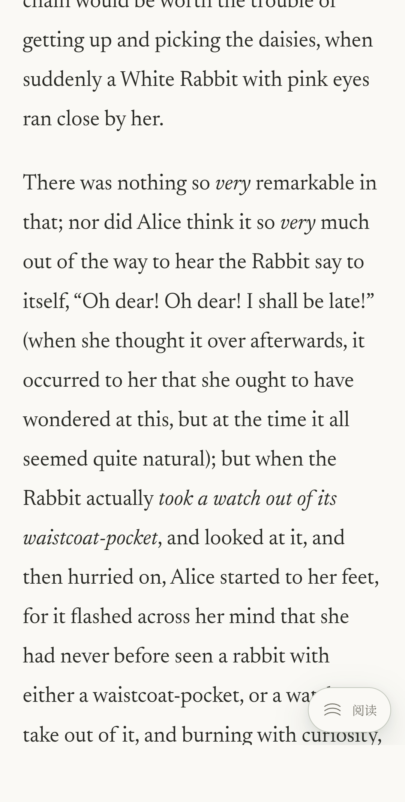

# GET-173 actual platform review

This evidence binds [PR128](https://github.com/getyak/leafhour/pull/128) head `8912b1f18f80f8f565b433a48cf20084f6a23467` and [actual run39162519203](https://github.com/getyak/leafhour/actions/runs/39162519203). It is a **rejected pre-merge checkpoint**, not final acceptance: three OS machine checks passed, but independent Android visual review found P1.

The [receipt](8912b1f-receipt.json) lists exact hashes for all23 original PNGs. Linux and Windows each had21 font checks and7 reviewed images with no confirmed visual P0/P1/P2. Android had21 font checks and9 reviewed images. All raw evidence is permanently retained by the task; the remote CI upload has3-day retention and is not the only copy.

## Android default filter defect (P1)

On the actual API34/x86_64 AVD, stock Chrome113 is393 CSS px wide. The supposedly closed filter layer visibly overlaps book cards. Product code depended on native `popover` hiding and unsafe `:popover-open` JS selectors; [native support starts at Chromium114](https://developer.chrome.com/blog/introducing-popover-api). The repair must provide a real usable capability fallback, preserve focus, owner and URL behavior, then pass fresh current-head CI and independent actual screenshot review. Changing the tested browser or hiding the feature cannot resolve this acceptance failure.

## Actual source italic

The two visible `very` spans have clear italic contours distinct from surrounding upright text. Chrome113 lacks per-node PostScript identity, so the receipt retains `css-matching-and-visual` with same-document declared/loaded italic face, verified source hash and actual custom Newsreader glyphs. Visual review does not upgrade that to PostScript identity. Modern desktop protocol identity remains strict. CJK/title/apostrophe glyphs showed no visible missing boxes; the native notification rationale was actually declined and cleared.

Fixed ambient/reading pills overlap a Japanese hero line and one reader bottom line at this width (P2); GET-189 tracks the mobile finish. These artifacts are not physical ARM/OEM phone, touch or assistive-technology evidence.
